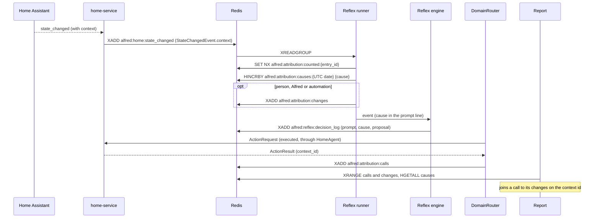

# Attribution — who did it

Every change in the house says who caused it: a person, Alfred, an automation, or something
outside Alfred's view. The cause is read from the `context` Home Assistant attaches to each
state change, counted by day, and kept with the calls Alfred made, so a private report can
answer "what did Alfred change, and why?".

Design: `docs/superpowers/specs/2026-10-24-reflex-anticipation-design.md` (slice 1, "who did
it") · The first slice of the Reflex anticipation work, which replaces
[#286](https://github.com/anirudhlath/alfred/issues/286) and
[#287](https://github.com/anirudhlath/alfred/issues/287); its slice 2 is PR 8 of
[#317](https://github.com/anirudhlath/alfred/issues/317).

## Why

Reflex decides what to do about each change in the house. Without a cause it cannot tell the
owner turning a lamp off from Alfred having just turned it off, so it proposes to undo what
Alfred did a minute ago. The shadow log of
[#285](https://github.com/anirudhlath/alfred/issues/285) shows that: close to half its
proposals would reverse the change that had just happened.

Slice 1 only records the cause and shows it. Nothing it reads changes what Reflex proposes;
shadow mode stays, and nothing Reflex proposes executes. Two things build on it:

- **Oversight.** The owner can see what Alfred changed in a window, which part of Alfred asked
  for it (Reflex, System 2, a trigger or the admin API) and the reason it gave.
- **Learning.** From slice 3 on, habit detection counts only `person` changes, so Alfred never
  learns its own actions as the owner's habits. The Librarian reads no state changes today, so
  that rule has no code to live in yet.

## Data flow



## The four causes

`core/attribution/cause.py` reads a `ChangeContext` and returns one cause. The checks run in
order and the first match wins.

| Order | Test on the context | Cause | Means |
|---|---|---|---|
| 1 | no context at all | none (`None`) | An older home-service, or a replayed old entry: nothing is known. The counter field is `unknown`. |
| 2 | `by_service` is set | `alfred` | home-service's own call, made on Alfred's request. Wins over any user or parent id on the same context. |
| 3 | `user_id` is set | `person` | Someone used an app or a dashboard. |
| 4 | `parent_id` is set | `automation` | A script or an automation ran the call. |
| 5 | otherwise | `outside` | A wall switch, a device's own app or schedule, a voice assistant, or Home Assistant itself. |

`ChangeContext` is the event's `context` field: `id`, `user_id`, `parent_id`, `person` (the
person entity of that user, when home-service could map it) and `by_service`. Its fields are in
[event-bus.md](event-bus.md#statechangedevent) and the publisher's side in
[sdk.md](sdk.md#saying-who-caused-a-state-change).

### The copy

The cause is phrased the same way in Reflex's prompt, in episodic memory and in the reports:

| Cause | Words |
|---|---|
| `person`, named | `by Alex` |
| `person`, not named | `by a person` |
| `alfred` | `by Alfred` |
| `automation` | `by an automation` |
| `outside` | `by a switch, app or device` |
| none | nothing: the line reads exactly as it did before attribution |

`cause_words(context, name=None)` builds it. A caller that can resolve a display name passes it;
otherwise a person is named by the context's person entity, and without one, "a person".

### Where the cause appears

| Place | Shows | Person named by |
|---|---|---|
| Reflex's `## What changed` line | `Bedroom Lamp: on → off · by Alex` | the person's friendly name in live state |
| Episodic memory's summary of the observation | `…, by Alfred` at the end | the person entity id |
| The shadow report | the same line as the prompt, `· by person.alex` | the person entity id |
| The decision log | `cause` on each record, and the event with its whole context | not named: the cause, and the context's person entity |

The shadow report and memory have no live state to look a friendly name up in, so they name a
person by entity id (`by person.alex`) where Reflex's prompt uses the friendly name. Neither
changes the cause.

## What is kept

All of it is private bookkeeping, in Redis, and every write is best-effort: a refused write
(Redis at its memory limit, say) logs one warning and never raises into routing or Reflex, never
changes a decision and never blocks an ACK.

| Key | Type | Holds | Retention |
|---|---|---|---|
| `alfred:attribution:calls` | Stream | One `AlfredCall` per successful call Alfred made: time, `source` (the part of Alfred that asked), request id, target service, tool, parameters, reason, and the `context_id` the service reported | 30 days; capped at 20,000 entries |
| `alfred:attribution:changes` | Stream | One `AttributedChange` per state change whose cause is `person`, `alfred` or `automation`, with its whole context | 30 days; capped at 50,000 entries |
| `alfred:attribution:causes:<UTC date>` | Hash | One counter per cause (`person`, `alfred`, `automation`, `outside`) plus `unknown`, for every state change that day | 30 days (TTL) |
| `alfred:attribution:counted:{entry_id}` | String | A marker that a `alfred:home:state_changed` entry has been counted | twice the replay window (`REPLAY_MARKER_TTL_SECONDS`, 10 minutes) |
| `alfred:reflex:decision_log` | Stream | One `DecisionRecord` per decision that reached the model: the event, its cause, the exact prompt and the proposal | 30 days; capped at 10,000 entries |

- A change from a switch, an app or a device (`outside`) is counted but not kept in the changes
  stream: there is nobody to attribute it to.
- The `counted:` marker is why a redelivered entry is counted once. Reflex's loop reclaims an
  entry whose inference failed (a model outage is exactly when that happens) and processes it
  again; the first delivery's marker, set with `SET NX`, tells the second to write nothing. Its
  TTL is the same one the availability bridge keeps its decisions for. `record_change` called
  with no entry id (a test, a one-off) counts every time.
- Age is enforced with `XTRIM MINID` on each append (`shared/redis_streams.append_capped`), in
  the same pipeline as the `XADD`, because approximate `MAXLEN` trimming never ages out a small
  stream.
- The decision log is what slice 2's replay set and model comparison are built from. A
  redelivered state change can be inferred again and recorded twice, so slice 2 dedupes on the
  event's `event_id`.

### Joining a call to its changes

A call is logged when `DomainRouter.route` has executed it, with the `context_id` home-service
returned in its result. A change belongs to a call when its `context.id` equals the call's
`context_id` (the call's own effect, or a script it ran) or its `context.parent_id` does (an
automation the call set off). The state change can reach Alfred before the call's result does;
nothing depends on the order, because the report joins them afterwards.

## The report

```bash
docker exec alfred python -m core.attribution.report --days 7
```

`core/attribution/report.py` prints Markdown in the user's timezone, oldest first. It names people
and devices, so it is read privately and never posted to a public thread.

1. **Changes by cause.** One row per UTC day in the window, with the five counter fields.
2. **What Alfred changed.** One bullet per call: time, the part of Alfred (`Reflex`, `System 2`,
   `a trigger`, `the admin API`; an unknown source is shown as it is), the tool and its
   parameters, and the reason in quotes when it gave one. Under it, each change that belongs to
   it as `entity: old → new · by whom`. A call with no `context_id` says `no context id (older
   home-service)`; one whose id matches nothing says `no change seen`.
3. **Changes by people and automations.** Every `person` or `automation` change that belongs to
   no call in the window, with its cause.

When a change carrying a call's own context id has a cause other than `alfred`, the report opens
with one line before its heading, for example:

> 1 changes matched Alfred's calls but were not attributed to Alfred: home-service is not
> connected to Home Assistant as a user of its own.

That line is the operator step below, not yet taken. A script's or an automation's children
(matched on `parent_id`) are rightly an automation's work and do not raise it.

## Operator requirement

Home Assistant records the user who made each call. home-service must connect to Home Assistant
as **a user of its own**, not as the owner: it asks Home Assistant which user its token belongs
to, and marks `by_service` on every change that user caused. If it uses the owner's token, every
change Alfred makes carries the owner's user id, nothing is ever marked as Alfred's, and Alfred's
changes read as a person's until the token is replaced. The report flags exactly this. Creating
that user is a Home Assistant admin step.

## An older home-service

Alfred core ships before home-service sends a context. Until then, and for any entry replayed
from before, an event has no `context`: it parses and flows everywhere as it always did, the
cause is `None`, the prompt line, the memory summary and the shadow log read as they did, and the
day's counter says `unknown`. A call whose result carries no `context_id` is logged all the same,
and the report says `no context id (older home-service)` for it.

## Files

| File | Role |
|---|---|
| `bus/schemas/events.py`, `sdk/alfred_sdk/events.py` | `ChangeContext` and `StateChangedEvent.context` |
| `core/attribution/cause.py` | `cause_of()`, `cause_words()`, `ATTRIBUTED` |
| `core/attribution/log.py` | `AlfredCall`, `AttributedChange`, `record_call()`, `record_change()`, `causes_key()` |
| `core/attribution/report.py` | The report: `build_report()`, `PARTS` |
| `core/reflex/decision_log.py` | `DecisionLog` |
| `core/routing/domain_router.py` | calls `record_call()` after an executed action |
| `core/reflex/runner.py` | calls `record_change()` after the availability bridge, before the attention gate |
| `shared/streams.py` | the stream and key names, caps and `ATTRIBUTION_MAX_AGE` |
