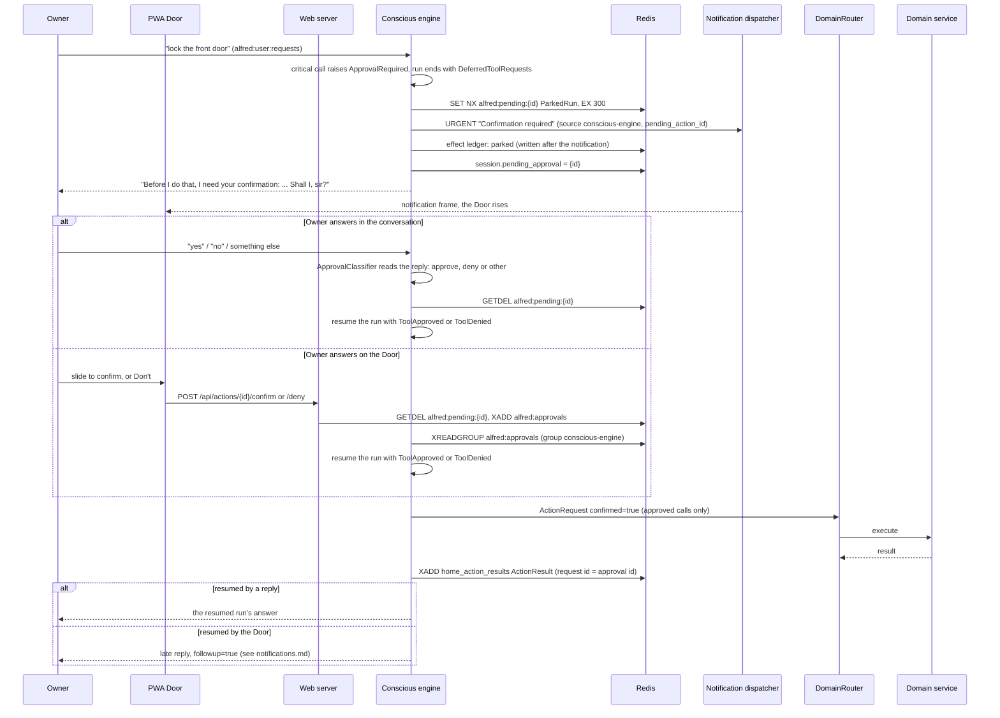

# Tiered Autonomy — Attention Set, Risk Enforcement, Confirmation Flow

Alfred observes everything but reacts selectively, and its two engines have
different action rights. Spec: `docs/superpowers/specs/2026-07-15-real-home-ha-integration-design.md` (Section 3).

## Attention Set (Reflex SLM gating)

Tier 1: every `state_changed` event reaches triggers and context (full
visibility). Tier 2: only attention-set members fire the Reflex SLM.

- Membership: Redis SET `alfred:attention:{domain}` (`ATTENTION_PREFIX`).
- Lazy seeding: on first sight of an entity, YAML rules
  (`core/reflex/attention_seed.yaml`: domains + device classes) decide
  membership; the result is persisted via SADD. A companion
  `alfred:attention:{domain}:seen` SET makes runtime removals sticky.
- Runtime primitives (Conscious internal tools, sir-only):
  `attention_add(domain, entity_id)`, `attention_remove(domain, entity_id)`,
  `attention_list(domain)`. The Librarian may promote/demote entities during
  consolidation using the same helpers (`core/reflex/attention.py`).
- HTTP surface: `GET /api/admin/attention` lists every domain with its members
  and its sticky `seen` companion; `PUT /api/admin/attention/{domain}` runs the
  same two primitives from a request body (`allow` → `attention_add`, `ask` →
  `attention_remove`, `ask` applied second). Session-gated like the rest of the
  admin API; see [`admin-api.md` → Attention](admin-api.md#attention).
- Firing rules: real transitions only (`new_state != old_state` — attribute-only
  updates are forwarded with equal states and gated here) + per-entity 5s
  in-process cooldown.
- Gate location: `core/reflex/runner.py` `process_stream_entry()` — gated
  events are still XACKed.

## Tiered autonomy — enforced twice

1. **Prompt layer:** `ReflexEngine._get_tools_and_prompt()` builds the SLM
   prompt only from registry tools tagged `audience: "reflex"` (untagged
   tools default to `"conscious"`).
2. **Dispatch layer:** `DomainRouter.route()` looks up the tool's risk
   (`core/routing/risk.py: tool_risk()`). An ActionRequest whose `source`
   starts with `"reflex"` targeting anything other than `"benign"` is
   rejected (`autonomy_violation:`), logged, and recorded as a
   `ReflexObservation`.

### The dispatch layer fails closed

`tool_risk()` returns three kinds of answer:

| Registry state | Risk | Reflex may execute |
|---|---|---|
| Tool declared with a `risk` field | that value | only if `benign` |
| Tool declared, no `risk` field | `benign` | yes (legacy manifests predate risk tagging) |
| Tool **not** declared, service absent, or manifest unparseable | `unknown` | no |

The last row is the important one. The registry is the only evidence a tool
exists at all, so a name it has never heard of gets no autonomy. This is not
hypothetical: the Reflex SLM emitted `home.light_turn_on` — absent from
`home-service`'s generated manifest — and while unknown risk read as
`"benign"` the gate passed it straight through to a real house, unconfirmed,
for weeks. Prompt-layer filtering (rule 1) cannot prevent this on its own,
because a model is free to emit a tool name that was never in its prompt.

Note the asymmetry: `"unknown"` blocks *reflex* only. System 2 keeps full
action rights over undeclared tools, since an incomplete manifest must not
stop the user from asking Alfred for something directly.

## Confirmation flow for critical actions

A critical action never runs on the model's say-so, and never on the strength of a
confirmation the model supplied itself. There are two doors into the same store, and
one record shape per door (`core/routing/pending.py`, `bus/schemas/events.py`):

| Record | Written by | Holds | Resolved by |
|---|---|---|---|
| `ParkedRun` (`kind="parked_run"`) | the conscious engine, when a System 2 run defers its critical calls | the run's message history, every deferred call (tool, service, parameters, reason), the identity it ran as, the request that started it | a reply in the conversation, or the Door; the **run resumes** |
| `ParkedAction` (`kind="action"`) | `DomainRouter._intercept_critical`, for a critical `ActionRequest` that reaches the router unconfirmed (a trigger, or any caller that is not a parked run) | the `ActionRequest` itself | the Door only; the **action is republished** with `confirmed=True` |

Both live at `alfred:pending:{id}` with a 300 s TTL (`PENDING_TTL_SECONDS`) and are
read back through one discriminated union, `PENDING_RECORD`. Every path that answers one
claims it with an atomic `GETDEL`, so two answers to the same approval can never both
act: the second finds nothing. This is what keeps a door lock from running twice.

### A System 2 run that wants a critical action



1. **Park.** `RegistryToolset` (`core/conscious/tools/registry.py`) checks each critical
   call in its args validator and raises Pydantic AI's `ApprovalRequired` unless
   `ctx.tool_call_approved` is set, after argument validation. The agent's output type is
   `[str, DeferredToolRequests]`, so the run ends with the deferred calls instead of an
   answer. `core/conscious/approvals.py` turns them into **one** `ParkedRun` for the whole
   run — one approval covers every call it deferred — keyed by a `uuid5` of the request's
   key, so a redelivered turn finds the same approval and its `SET NX` loses to the first
   write.
2. **Notify.** An `URGENT` notification, title `Confirmation required`, source
   `"conscious-engine"`, goes out through the dispatcher before the ledger is touched.
   It carries `pending_action_id`, `tool_name`, `parameters` and `reason`. `reason` is the
   actor's one-sentence justification, offered as an extra argument on critical tools and
   moved off `parameters` by `RegistryToolset` so the domain service never sees it — unless
   the tool declares `reason` as its own parameter, in which case it belongs to the service
   and stays out of the metadata. It is **null for every non-conscious source**
   (trigger-fired actions, `core/triggers/engine.py`, and any caller that omits it), so
   clients render the prompt without a reason rather than assuming one. For a parked run
   the `reason` is the run's summary, which names every deferred call (see "The owner
   approves what will run" below), not the model's own reason. The router's own
   confirmation notification, for an action it intercepted, has source `"domain-router"`.
3. **Remember.** `park()` writes each parked call to the request's effect ledger with status
   `parked`, after the record and the notification; then the engine stores
   `pending_approval = {id}` in the session (only `store_run` sets or clears it,
   `append_text_turn` leaves it alone). A crash before the ledger is written repeats the
   notification on redelivery, with the same id: at-least-once, never lost. A redelivery
   that finds a `parked` ledger entry answers from it and does not run the turn again.
4. **Answer in the conversation.** While a session has a `pending_approval`, the next
   message from **sir** is read by the `ApprovalClassifier`
   (`core/conscious/approval_classifier.py`, role `approval`, prompt `approval-classifier`):
   `approve`, `deny` or `other`. Its instructions are static; the pending calls and the
   reply are passed as data in the user message. A classification that never validates (after one retry),
   a missing model, and an exhausted daily budget read as `other`. A provider or transport
   error is not a verdict: it fails the delivery, which is retried up to `MAX_DELIVERIES` and
   then dead-lettered (the `APPROVAL_MODEL` note in [`llm.md`](llm.md#approvals)). The reply
   is *also* the resumed run's user prompt, so the model sees
   what was said. A guest turn never reaches the classifier — a guest cannot approve
   anything. `approve` resumes with `ToolApproved()`; `deny` with
   `ToolDenied("The user declined.")`; `other` with
   `ToolDenied("Not confirmed; the user moved on.")`, and the run carries on with the new
   message as an ordinary turn.
5. **Answer on the Door.** `POST /api/actions/{id}/confirm` and `/deny` call `decide()`
   (`core/routing/pending.py`), which claims the record and, for a parked run, adds an
   `ApprovalDecision` to `alfred:approvals`. The conscious loop reads that stream and
   `alfred:user:requests` through one consumer group (`conscious-engine`), so a decision
   gets the same reclaim, retry and dead-letter policy as a turn. The resumed run's request
   id is the approval id; its `received_ms` is the stream entry's time, so the replay guard
   measures from the decision, not from the original message. Its reply is an
   `AlfredResponse` with `followup=True` and `in_reply_to` the original request, which
   reaches the owner through the late-answer path in
   [`notifications.md`](notifications.md#follow-ups-late-answers-and-door-resumes).
6. **Execute.** An approved call runs with `confirmed=True` (`ctx.tool_call_approved`) and
   the registry publishes its `ActionResult` to `home_action_results` (the telemetry name of
   `alfred:home:action_results`, see [`event-bus.md`](event-bus.md#topic-and-stream-naming-convention)) under the approval id
   — that is what flips the Door's row from `queued` to `applied` or `failed`. A failed
   action reaches the model as a failed tool result, so the reply says it failed
   ([#306](https://github.com/anirudhlath/alfred/issues/306)). A denied call returns the
   verdict text to the model as the tool's result.
7. **Resume store.** The resumed messages go back into the session only if the session's
   `pending_approval` still equals that approval id. Otherwise a turn has come in since (it
   closed the open call and cleared the approval, or parked a newer one): the engine appends
   a marker turn (`APPROVED_MARKER` / `DECLINED_MARKER`) and nothing else changes, so a
   newer approval, if there is one, stays pending. A resumed run can itself park again.
8. **Expire.** Silent (Redis TTL). Nothing is notified. The session still names the
   approval; the next turn finds no record, the open call is closed by `repair_messages`,
   and the conversation goes on. A reply to an expired approval is a normal turn.

Failure handling on the Door's side of the stream:

- A decision whose stored run no longer reads (its history or identity does not validate any
  more) cannot be resumed, and a retry never could: it is answered once with a follow-up
  failure reply and dead-lettered with reason `permanent`.
- A pending record that cannot be read (malformed JSON, a format that no longer validates)
  **never blocks the conversation**: the turn proceeds as a normal turn and the record
  expires on its own.
- A decision is keyed on its approval id, so the resumed run's effect ledger and answered
  marker are its own: a redelivery answers once and cannot act twice. An entry that cannot be
  parsed at all is ACKed and dropped, as everywhere else.

### An action the router intercepts

`DomainRouter.route()` still guards the dispatch layer for everything that is not a parked
run. A critical `ActionRequest` with `confirmed=false` is parked as a `ParkedAction`
(notification source `"domain-router"`, the same `Confirmation required` title and
metadata) and the caller gets an `ActionResult` error `confirmation_required:{id}`. Only
the Door can answer it: `decide()` republishes the action to `alfred:actions` with
`confirmed=True` on approve and drops it on deny. The conscious process's
`_consume_internal_actions` consumer (group `conscious-engine` on `alfred:actions`) runs
`confirmed=True` domain actions through the DomainRouter, and reports the outcome:
an `ActionResult` on `home_action_results` and a `Done` / `That didn't work`
notification (source `conscious-engine`, `IMPORTANT`); a failure is also logged at
WARNING. That notification is how the owner learns the outcome of an action nobody was
waiting on ([#306](https://github.com/anirudhlath/alfred/issues/306)).

### The Door

The PWA raises both record kinds as the Door (`web/src/door/DoorProvider.tsx` +
`web/src/lib/actions.ts`), tracked from three independent feeds — the
`/api/actions/pending` read, a `/ws` notification frame carrying
`metadata.pending_action_id`, and the `home_action_results` telemetry stream. Confirming
is a slide, never a tap; declining is a separate **Don't** button. Phases: `pending`,
`queued` (a 200 from confirm), `applied` and `failed` (only from `home_action_results`),
`declined`, `expired`, `answered` (a 404: someone or something else answered first).
Full behaviour in [`web-frontend.md`](web-frontend.md#the-door).

- A confirm or deny that fails with anything other than 404 (a 503, no network) leaves the
  item pending so the owner can retry while the fuse runs; the failure is logged to the
  console.
- A late `failed` result after a decline shows what the lock did, rather than hiding it.
- Notifications that carry no `pending_action_id` are not confirmable and render as act
  rows in the Room's timeline instead (`web/src/room/rows/ActRow.tsx`).

### HTTP surface

- `POST /api/actions/{request_id}/confirm` and `/deny` — auth cookie required; 404 when
  the approval is gone. A `request_id` outside `[A-Za-z0-9_-]{1,128}` is **400**
  `Invalid request id` before Redis is touched.
- `GET /api/actions/pending` → `{"actions": [...]}`, oldest request first, and
  `GET /api/actions/{request_id}` → one action (404 `Pending action not found or expired`
  when it is missing, the TTL has run out, or the stored value no longer parses — the list
  skips exactly that entry, so the two reads agree). A store failure on either read is
  **503** `Action store unavailable`. Both are session-gated by the same auth cookie and
  **non-consuming** — a plain `GET`, never the `GETDEL` the answers use — so a client may
  poll or re-open a push-tap deep link without spending the approval. Each entry carries
  `request_id`, `tool_name`, `target_service`, `parameters`, `reason`, `source`,
  `timestamp`, `ttl_seconds` and `expires_at`; a parked run lists its first deferred call.
  `ttl_seconds` is clamped at 0 (Redis reports -2 for a key that vanished between the read
  and the TTL, -1 for one with no expiry), so clients can render the remaining fuse
  directly.

### Rules that hold on every path

- **The owner approves what will run, not what the model says.** The confirmation text, the
  Door's reason line and the classifier's input all describe each deferred call from facts
  the code owns: `describe_call` (`core/conscious/approvals.py`) writes the humanised tool
  name and **every** parameter the call will run with, as `key=value` pairs in the
  parameters' own order (the real tools take a `target`, or a `domain`, `service` and
  `entity_id`; none is singled out). The model's `reason` is appended only as a quoted
  clause:

  ```
  call service (domain="lock", service="unlock", entity_id="lock.front_door") ("lock the door")
  ```

  Every parameter shown is one the tool declares: the registry toolset closes a critical
  tool's schema (`additionalProperties: false`, unless the schema sets it itself), so a call
  carrying a stray parameter is retried with the validation error naming it, never parked.
  Past eight parameters the rest are counted (`+2 more`), not shown.

  Each name, value and reason is shown as one plain line:

  - **Names** that are plain printable ASCII are shown as they are, cut with "…" at 40
    characters. Any other name (a zero-width or Cyrillic look-alike, a bidi control, a quote
    mark) is shown JSON-escaped (`tar\u200bget`) instead of cleaned, so a decoy never reads
    like the real name beside it.
  - **Values**: a string has whitespace runs collapsed and quote marks and Unicode format
    characters (bidi controls, zero-width) removed, is cut at 60 characters and is shown in
    double quotes, so a `)` or a `, key=` inside it stays visibly inside the value. A dict or
    list is shown whole as compact ASCII JSON, its own quotes and escapes kept, because what a
    call acts on (`call_service`'s `data` carries an `entity_id`) can sit anywhere in it, and
    a nested string can then no more pass for a nested name than a top-level one can.
  - **The reason** gets the value cleaning and loses more, since it sits in quotes after
    the parameters: parentheses and the common quotation marks (Unicode categories Pi and
    Pf, and the look-alikes `″` `＂` `״` `ˮ`), cut at 120 characters. A rarer quote glyph
    can still fake the end of the reason's own quotes, but not a parameter group.
  - The classifier's copy of a line also drops angle brackets, full-width and small-form
    ones included (`docs/llm.md`).

  So a reason cannot make an unlock read as a light, close its own quotes or open a parameter
  group of its own, or carry text aimed at the classifier. The Door keeps showing a parked
  run's first call (tool and parameters); its reason line is the summary of every call.
- **Critical actions require confirmation even when the owner asked directly.** The model
  never self-certifies: there is no tool that confirms an action, the model never sees an
  approval id, and `confirmed` on a registry call is set from the approval the harness
  holds (`ctx.tool_call_approved`), never from the model's arguments.
- **Only sir answers.** The classifier and the confirm routes are owner-only; the
  `attention_*` tools (`core/conscious/tools/attention.py`) form a sir-only toolset, never
  offered on a guest turn and refused at call time if a guest turn names one anyway.
- **One answer wins.** `GETDEL` is the arbiter on every path; the loser gets 404 on the
  Door and nothing on the stream.
- **Eval coverage.** The `critical_actions` suite drives the server half of this flow
  (reply, Door and refusal paths); see [`evals.md`](evals.md). The PWA half is a manual
  checklist: [`qa-backlog/critical-action-confirmation-flow.md`](qa-backlog/critical-action-confirmation-flow.md).

## Resilience

- `bus/bridge.py` caps MQTT→Redis forwards with `maxlen=10000,
  approximate=True` so a chatty apartment cannot grow
  `alfred:home:state_changed` unboundedly.
