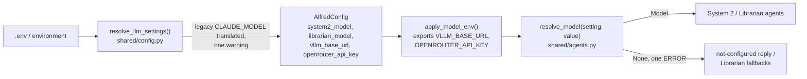

# The LLM layer

Alfred calls a language model in three roles. Two of them, System 2 and the Librarian, run
as [Pydantic AI](https://ai.pydantic.dev) agents; System 1 (Reflex) still posts raw
OpenAI-compatible requests until PR 8 of the adoption
([#317](https://github.com/anirudhlath/alfred/issues/317)). This page covers how a role finds
its model, how System 2 offers and runs tools, what the Librarian asks for, how spend and
traces are recorded, and how the eval harness tells the roles apart.

## Roles

| Role | Code | Model setting | Agent name(s) | `X-Alfred-Role` |
|---|---|---|---|---|
| System 1 (Reflex) | `core/reflex/openai_client.py` | `OPENAI_COMPAT_HOST` + `OPENAI_COMPAT_MODEL` | none (raw HTTP) | `system1` |
| System 2 (Conscious) | `core/conscious/agent.py`, `engine.py` | `SYSTEM2_MODEL` | `system2` | `system2` |
| Librarian | `core/librarian/agents.py` | `LIBRARIAN_MODEL` | `librarian-analyse`, `librarian-extract`, `librarian-resolve`, `librarian-compress`, `librarian-patterns` | `librarian` |

The header name and values live in `shared/llm_roles.py`, which has no dependencies so the
Reflex process can import it without loading Pydantic AI. Every request Alfred sends to an
OpenAI-compatible server carries the header; the Ollama Reflex backend sends none.

## Settings and model resolution



A model is a Pydantic AI model string; there is no model factory.

| Setting | Default | Meaning |
|---|---|---|
| `SYSTEM2_MODEL` | the translated `CLAUDE_MODEL`, else `openrouter:anthropic/claude-sonnet-4` | `openrouter:<vendor>/<model>` or `vllm:<served-name>` |
| `LIBRARIAN_MODEL` | `SYSTEM2_MODEL` | the same forms |
| `VLLM_BASE_URL` | `OPENAI_COMPAT_HOST` + `/v1` | where `vllm:` models are served |
| `OPENROUTER_API_KEY` | `CLAUDE_API_KEY` | the key `openrouter:` models use |
| `SYSTEM2_MAX_TOKENS` | `CLAUDE_MAX_TOKENS`, else 2048 | System 2's per-request output cap |
| `SYSTEM2_TIMEOUT_S` | 60 | System 2's per-request model timeout |

A blank value means the default. The legacy `CLAUDE_MODEL` is translated in one place:
`openrouter/<vendor>/<model>` becomes `openrouter:<vendor>/<model>`, and `openai/<model>`
becomes `vllm:<model>` when `OPENAI_BASE_URL` is set. A direct `claude-*` string is not
translated: no Anthropic provider ships, so `alfredctl doctor` fails it and
`resolve_model` returns `None`.

Each service resolves its models once, at startup. `apply_model_env(config)` must run first:
Pydantic AI's providers read `VLLM_BASE_URL` and `OPENROUTER_API_KEY` from the environment
when a string is resolved, and the resolved values include fallbacks the providers know
nothing of. A missing setting or key is one ERROR line at startup naming the variable, and
the role runs without a model:

- System 2 answers *"I'm afraid my connection to the thinking engine is not configured,
  sir."*
- The Librarian keeps its deterministic fallbacks: no analysis, concatenated compression
  summaries, no pattern detection.

The production System 2 model is set in the deploy `.env` only; the repo never names it.
`VLLM_BASE_URL` and `LANGFUSE_HOST` are in `GATEWAY_REWRITE_KEYS`, so a `localhost` value
is rewritten to the container gateway like the other host-pointing variables.

## System 2

```mermaid
sequenceDiagram
    participant E as ConsciousEngine
    participant A as Agent "system2"
    participant M as Model
    participant C as CatalogToolset
    participant T as Toolset (registry, triggers, memory, ...)
    E->>E: budget check, identity, session, involuntary recall
    E->>E: TurnDeps (registry + integration tools read once)
    E->>A: run(content, deps, history, model, UsageLimits(request_limit=10))
    A->>C: get_tools(ctx)
    C->>T: get_tools per toolset, in priority order
    T-->>C: tools by wire name, scoped by identity
    A->>M: instructions + history + tools
    M-->>A: tool call(s)
    A->>C: call_tool(wire name, validated args)
    C->>T: dispatch; record actions_taken
    T-->>A: result, or ModelRetry with the reason
    A->>M: tool results
    M-->>A: final text
    A-->>E: output (str) + usage
    E->>E: record spend, store session text, scratchpad note
```

**The agent** is built once per process by `build_system2_agent()`
(`core/conscious/agent.py`): output type `str`, two output retries, model settings
`max_tokens`, `timeout` and the role header, and the instructions assembled per turn by
`ContextAssembler` from `TurnDeps`. Its capabilities are instrumentation and
`RepairToolArguments`, which repairs malformed JSON in a call's arguments before they are
validated. The engine passes the model on each run, so tests run the same agent against a
`FunctionModel`.

**Turn dependencies** (`core/conscious/deps.py`): `TurnServices` holds the process's handles
(Redis, the domain router, the context reader, the context index); `TurnDeps` holds one
turn's identity, session, channel, clock and recall, plus the registry and integration
tools read once before the run, so listing tools on each model request costs no I/O.

**Ending a turn.** The model has ten requests a turn. Using them all, or running out of
retries, ends the turn with
*"I apologize, sir — I've been deliberating too long. Let me try a more direct approach."*
A provider or transport failure raises instead, so the request stays pending and is retried.
Over the daily budget, the turn never starts and the reply is the budget message (mood
`concerned`). Spend is recorded in `finally`, so a failed run is still paid for.

**Sessions** stay text-only in this PR: the stored user and assistant text becomes the
run's message history, and only text is stored back. Tool calls and results within a
session are not kept (PR 4).

### Tool names

One mapping names every tool: `wire_name()` (`core/conscious/tools/names.py`). It maps each
character outside `[A-Za-z0-9_-]` to `_` (`home.light_turn_on` → `home_light_turn_on`) and
refuses a result over 64 characters. The model is offered the wire name, calls it, and the
call is dispatched by it. There is no dotted-name fallback: a call to `home.light_turn_on`
is answered with a retry prompt listing the wire names, and nothing is dispatched
([#299](https://github.com/anirudhlath/alfred/issues/299)).

### The catalog and its toolsets

`CatalogToolset` (`core/conscious/tools/catalog.py`) combines the toolsets in priority
order. The first to offer a wire name owns it; a later one is dropped with one ERROR per
process, so a service can never register over an internal tool.

| Order | Toolset | File | Offered to |
|---|---|---|---|
| 1 | `TriggerToolset` (over `TriggerFeature`'s metas) | `tools/triggers.py` | sir: all; guest: `benign` risk only (the trigger tools are benign) |
| 2 | memory (`memory_recall_memories`, `memory_get_live_state`) | `tools/memory.py` | sir, when the turn has a context index |
| 3 | attention + `confirm_pending_action` | `tools/attention.py` | sir |
| 4 | integrations | `tools/integrations.py` | sir |
| 5 | `RegistryToolset` (every SDK-registered tool) | `tools/registry.py` | sir: all; guest: `benign` risk only |

Each toolset retries a failed call twice (`TOOL_RETRIES = 2`).

**Identity scope** (`core/conscious/tools/scope.py`). A guest is offered only `benign`
registry tools; elevated and critical ones are never listed. Sir-only toolsets
(`SirOnlyToolset`) also refuse at call time, in case a name reaches them anyway, with one
neutral sentence: *"`{name}` is only available to the verified user"*. A refused call is
never routed.

**Arguments** are validated before dispatch against the tool's own JSON Schema
(`core/conscious/tools/validation.py`, Draft 2020-12, one schema per tool from the SDK's
`input_schema`). An invalid call is sent back to the model as a retry with the validation
errors; it is never dispatched as `{}`
([#302](https://github.com/anirudhlath/alfred/issues/302)). A schema that does not compile
drops only that tool, with one ERROR across requests.

**Results.** A domain result reaches the model as JSON, not a Python `repr`
([#303](https://github.com/anirudhlath/alfred/issues/303)). A domain error reaches it as a
failed tool result with the service's exact text and does not spend a retry. Critical tools
take an optional `reason` argument, which `RegistryToolset` moves onto
`ActionRequest.reason` so the service never sees it. Confirmations still go through the
router's critical intercept and `confirm_pending_action` until PR 5.

`actions_taken` records every call the catalog dispatches, failed ones included, under the
tool's registry name (or its wire name, for in-process tools). Calls refused before dispatch
are not recorded.

## The Librarian

`build_librarian_agents(model)` (`core/librarian/agents.py`) builds five agents, one per
question the Librarian asks. Each takes its instructions from a `LibrarianTask` dependency
and returns a typed output:

| Agent | Output | Used for |
|---|---|---|
| `librarian-analyse` | `list[ObservationAnalysis]` (entities, `Significance`, semantic key) | scoring a batch of observations |
| `librarian-extract` | `list[PreferenceUpdate]` | preference candidates |
| `librarian-resolve` | `list[ConflictItem]` | resolving preference conflicts |
| `librarian-compress` | `CompressionSummary` | summarising a group at cold migration |
| `librarian-patterns` | `list[RoutineCandidate]` | detecting routines |

The output mode follows the model's profile: JSON-schema output where the model supports it,
an output tool where it does not. Each agent retries its output once. The analysis agent also checks the count: a reply with
the wrong number of elements is retried with a prompt naming both numbers, and a second
miss leaves every observation unscored rather than misaligned. Without a model, or when a
call fails, each caller keeps its deterministic fallback.

## Spend

`CostTracker` (`core/conscious/cost.py`) prices tokens by `model_key(model)`,
`<provider>:<served name>`. Models under the `vllm` provider are free; unknown paid models
use a $3/$15 per-million default. System 2 records each turn's usage. The Librarian records
each call with `count_request=False`, so its calls count against the daily cap but not
toward the request count. A per-request ledger replaces this in PR 6.

## Tracing

Every agent carries `instrumentation()` (`shared/agents.py`): Pydantic AI's GenAI spans on
the tracer provider `init_tracing` installed, content included. The System 2 run and its
child spans also carry `langfuse.session.id`, `langfuse.user.id` (the identity) and
`langfuse.trace.tags` (the channel), set by `langfuse_attributes()` (`shared/otel.py`), so
the self-hosted Langfuse groups a conversation's turns.

## The eval proxy

The eval harness's recording proxy (`evals/harness/proxy.py`) attributes each request by its
`X-Alfred-Role` header (`ROLES_BY_HEADER`). A request without a recognised header is
`unknown`; the prompt's text plays no part, so a prompt edit cannot break attribution. The
check `tool_calls_offered` runs on every scenario with a System 2 tool call: each call must
name, exactly, a tool offered in that request. The other checks compare tool names through
`wire_name`, so a golden may name a tool by its registry identity. See
[docs/evals.md](evals.md).

## Testing

The root `conftest.py` sets `pydantic_ai.models.ALLOW_MODEL_REQUESTS = False`: no test can
reach a real model. Agent tests drive the model with `Script` (`tests/llm_fakes.py`), a
`FunctionModel` that answers from a list of replies and records each request, so a test can
assert the instructions, the tools offered, their schemas, the settings and the retries.
`tests/core/conscious/helpers.py` builds identities, services, turn dependencies and a
one-toolset agent.

## Later PRs

| PR | Changes here |
|---|---|
| 3 | prompts move to the self-hosted Langfuse, with repo defaults |
| 4 | full session history, tool calls and results included |
| 5 | deferred tool approvals replace the critical intercept; late replies become follow-ups |
| 6 | a per-request spend ledger replaces `CostTracker`'s daily counters |
| 7 | the judge uses Inspect's own OpenAI provider; `evals/harness/vllm_model.py` goes |
| 8 | Reflex becomes an agent; Ollama is dropped |

## Key files

| File | Contents |
|---|---|
| `shared/llm_roles.py` | `ROLE_HEADER`, the role values, `LLM_ROLES` |
| `shared/agents.py` | `resolve_model`, `model_key`, `role_headers`, `instrumentation` |
| `shared/config.py` | `resolve_llm_settings`, the LLM fields on `AlfredConfig`, `apply_model_env` |
| `shared/otel.py` | `langfuse_attributes`, `LangfuseBaggageProcessor` |
| `core/conscious/agent.py` | `build_system2_agent`, `system2_toolsets`, `REQUEST_LIMIT` |
| `core/conscious/engine.py` | `ConsciousEngine`: one turn around one agent run |
| `core/conscious/deps.py` | `TurnServices`, `TurnDeps` |
| `core/conscious/tools/` | `names`, `scope`, `catalog`, `sir_only`, `validation`, `registry`, `triggers`, `memory`, `attention`, `integrations` |
| `core/librarian/agents.py` | the five Librarian agents and their output models |
| `core/conscious/cost.py` | `CostTracker`, the price table |
| `alfredctl/doctor.py` | `_check_conscious`: the settings above, checked before boot |
| `tests/llm_fakes.py` | `Script`, `tool_call`, `tool_calls` |
