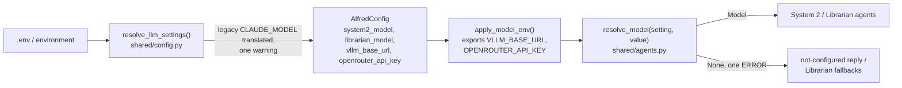

# The LLM layer

Alfred calls a language model in three roles. Two of them, System 2 and the Librarian, run
as [Pydantic AI](https://ai.pydantic.dev) agents; System 1 (Reflex) still posts raw
OpenAI-compatible requests until PR 8 of the adoption
([#317](https://github.com/anirudhlath/alfred/issues/317)). This page covers how a role finds
its model, how System 2 offers and runs tools, what the Librarian asks for, how spend and
traces are recorded, and how the eval harness tells the roles apart.

## Roles

| Role | Code | Model setting | Agent name(s) | `X-Alfred-Role` |
|---|---|---|---|---|
| System 1 (Reflex) | `core/reflex/openai_client.py` | `OPENAI_COMPAT_HOST` + `OPENAI_COMPAT_MODEL` | none (raw HTTP) | `system1` |
| System 2 (Conscious) | `core/conscious/agent.py`, `engine.py` | `SYSTEM2_MODEL` | `system2` | `system2` |
| Librarian | `core/librarian/agents.py` | `LIBRARIAN_MODEL` | `librarian-analyse`, `librarian-extract`, `librarian-resolve`, `librarian-compress`, `librarian-patterns` | `librarian` |

The header name and values live in `shared/llm_roles.py`, which has no dependencies so the
Reflex process can import it without loading Pydantic AI. Every chat request Alfred sends
to an OpenAI-compatible server carries the header; embedding requests and the Ollama Reflex
backend send none.

## Settings and model resolution



A model is a Pydantic AI model string; there is no model factory.

| Setting | Default | Meaning |
|---|---|---|
| `SYSTEM2_MODEL` | the translated `CLAUDE_MODEL`, else `openrouter:anthropic/claude-sonnet-4` | `openrouter:<vendor>/<model>` or `vllm:<served-name>` |
| `LIBRARIAN_MODEL` | `SYSTEM2_MODEL` | the same forms |
| `VLLM_BASE_URL` | the first set of `OPENAI_BASE_URL` (legacy only, see below), `OPENAI_COMPAT_HOST`, `LMSTUDIO_HOST`, else `http://localhost:1234`; `/v1` appended | where `vllm:` models are served |
| `OPENROUTER_API_KEY` | `CLAUDE_API_KEY` | the key `openrouter:` models use |
| `SYSTEM2_MAX_TOKENS` | `CLAUDE_MAX_TOKENS`, else 2048 | System 2's per-request output cap |
| `SYSTEM2_TIMEOUT_S` | 60 | the per-request model timeout, for System 2 and the Librarian |

A blank value means the default. The legacy `CLAUDE_MODEL` is translated in one place:
`openrouter/<vendor>/<model>` becomes `openrouter:<vendor>/<model>`, and `openai/<model>`
becomes `vllm:<model>` when `OPENAI_BASE_URL` is set. `OPENAI_BASE_URL` is read as the
`vllm:` server only in that case: when `SYSTEM2_MODEL` is blank and `CLAUDE_MODEL` is a
legacy `openai/` string. A direct `claude-*` string is not
translated: no Anthropic provider ships, so `alfredctl doctor` fails it and
`resolve_model` returns `None`.

Each service resolves its models once, at startup. `apply_model_env(config)` must run first:
Pydantic AI's providers read `VLLM_BASE_URL` and `OPENROUTER_API_KEY` from the environment
when a string is resolved, and the resolved values include fallbacks the providers know
nothing of. A missing setting or key is one ERROR line at startup naming the variable, and
the role runs without a model:

- System 2 answers *"I'm afraid my connection to the thinking engine is not configured,
  sir."*
- The Librarian keeps its deterministic fallbacks: no analysis, concatenated compression
  summaries, no pattern detection.

The production System 2 model is set in the deploy `.env` only; the repo never names it.
`VLLM_BASE_URL` and `LANGFUSE_HOST` are in `GATEWAY_REWRITE_KEYS`, so a `localhost` value
is rewritten to the container gateway like the other host-pointing variables.

## System 2

```mermaid
sequenceDiagram
    participant E as ConsciousEngine
    participant A as Agent "system2"
    participant M as Model
    participant C as CatalogToolset
    participant T as Toolset (registry, triggers, memory, ...)
    E->>E: budget check, identity, session, involuntary recall
    E->>E: TurnDeps (registry + integration tools read once)
    E->>A: run(content, deps, history, model, UsageLimits(request_limit=10))
    A->>C: get_tools(ctx)
    C->>T: get_tools per toolset, in priority order
    T-->>C: tools by wire name, scoped by identity
    A->>M: instructions + history + tools
    M-->>A: tool call(s)
    A->>C: call_tool(wire name, validated args)
    C->>T: dispatch; record actions_taken
    T-->>A: result, or ModelRetry with the reason
    A->>M: tool results
    M-->>A: final text
    A-->>E: output (str) + usage
    E->>E: store session text, scratchpad note
```

**The agent** is built once per process by `build_system2_agent()`
(`core/conscious/agent.py`): output type `str`, two output retries, model settings
`max_tokens`, `timeout` and the role header, and the instructions assembled per turn by
`ContextAssembler` from `TurnDeps`. Its capabilities are instrumentation and
`RepairToolArguments`, which repairs malformed JSON in a call's arguments before they are
validated. The engine passes the model on each run, so tests run the same agent against a
`FunctionModel`.

**Turn dependencies** (`core/conscious/deps.py`): `TurnServices` holds the process's handles
(Redis, the domain router, the context reader, the context index); `TurnDeps` holds one
turn's identity, session, channel, clock and recall, plus the registry and integration
tools read once before the run, so listing tools on each model request costs no I/O.

**Ending a turn.** The model has ten requests a turn. Using them all, or running out of
retries, ends the turn with
*"I apologize, sir — I've been deliberating too long. Let me try a more direct approach."*
A provider or transport failure raises instead, so the request stays pending and is
redelivered (see [Retries](#retries)). Over the daily budget, the turn never starts and the
reply is the budget message (mood `concerned`). The agent's `SpendLimits` counts each
response as it arrives, so a failed run is still paid for.

**Sessions** stay text-only in this PR: the stored user and assistant text becomes the
run's message history, and only text is stored back. Tool calls and results within a
session are not kept (PR 4).

### Tool names

One mapping names every tool: `wire_name()` (`core/conscious/tools/names.py`). It maps each
character outside `[A-Za-z0-9_-]` to `_` (`home.light_turn_on` → `home_light_turn_on`) and
refuses a result over 64 characters. The model is offered the wire name, calls it, and the
call is dispatched by it. There is no dotted-name fallback: a call to `home.light_turn_on`
is answered with a retry prompt listing the wire names, and nothing is dispatched
([#299](https://github.com/anirudhlath/alfred/issues/299)).

### The catalog and its toolsets

`CatalogToolset` (`core/conscious/tools/catalog.py`) combines the toolsets in priority
order. The first to offer a wire name owns it; a later one is dropped with one ERROR per
process, so a service can never register over an internal tool.

| Order | Toolset | File | Offered to |
|---|---|---|---|
| 1 | `TriggerToolset` (over `TriggerFeature`'s metas) | `tools/triggers.py` | sir: all; guest: `create_trigger` (benign actions only) |
| 2 | memory (`memory_recall_memories`, `memory_get_live_state`) | `tools/memory.py` | sir, when the turn has a context index |
| 3 | attention + `confirm_pending_action` | `tools/attention.py` | sir |
| 4 | integrations | `tools/integrations.py` | sir |
| 5 | `RegistryToolset` (every SDK-registered tool except the `trigger-engine` service's, which `TriggerToolset` serves) | `tools/registry.py` | sir: all; guest: `benign` risk only |

Each toolset retries a failed call twice (`TOOL_RETRIES = 2`).

**Identity scope** (`core/conscious/tools/scope.py`). A guest is offered only `benign`
registry tools; elevated and critical ones are never listed. Sir-only toolsets
(`SirOnlyToolset`) also refuse at call time, in case a name reaches them anyway, with one
neutral sentence: *"`{name}` is only available to the verified user"*. A refused call is
never routed.

The trigger tools need one more rule, because a trigger's action runs later as the trigger
engine, which the router does not scope by identity. `list_triggers`, `update_trigger`,
`delete_trigger` and `toggle_trigger` are `elevated`, so a guest can neither read nor touch
an existing trigger. A guest's
`create_trigger` is refused, with the same sentence, when its `action` names a tool whose
risk (`core/routing/risk.tool_risk`) is anything but `benign`, including a tool the
registry does not know. A trigger with no action, a plain reminder, is allowed.

**Arguments** are validated before dispatch against the tool's own JSON Schema
(`core/conscious/tools/validation.py`, Draft 2020-12, one schema per tool from the SDK's
`input_schema`). An invalid call is sent back to the model as a retry with the validation
errors; it is never dispatched as `{}`
([#302](https://github.com/anirudhlath/alfred/issues/302)). A schema that does not compile
drops only that tool, with one ERROR across requests.

**Results.** A domain result reaches the model as JSON, not a Python `repr`
([#303](https://github.com/anirudhlath/alfred/issues/303)). A domain error reaches it as a
failed tool result with the service's exact text and does not spend a retry. Critical tools
take an optional `reason` argument, which `RegistryToolset` moves onto
`ActionRequest.reason` so the service never sees it. Confirmations still go through the
router's critical intercept and `confirm_pending_action` until PR 5; the intercept's
`confirmation_required:<id>` text reaches the model as plain content, not as a failed call.
An unexpected exception in a toolset is logged with its traceback, and the model reads only
*"`{name}` failed"*: the exception's text can carry hosts or paths.

`actions_taken` records every call the catalog dispatches, failed ones included, under the
tool's registry name (or its wire name, for in-process tools). Calls whose arguments fail
validation are not recorded.

## The Librarian

`build_librarian_agents(model)` (`core/librarian/agents.py`) builds five agents, one per
question the Librarian asks. Each takes its instructions from a `LibrarianTask` dependency
and returns a typed output:

| Agent | Output | Used for |
|---|---|---|
| `librarian-analyse` | `list[ObservationAnalysis]` (entities, `Significance`, semantic key) | scoring a batch of observations |
| `librarian-extract` | `list[PreferenceUpdate]` | preference candidates |
| `librarian-resolve` | `list[ConflictItem]` | resolving preference conflicts |
| `librarian-compress` | `CompressionSummary` | summarising a group at cold migration |
| `librarian-patterns` | `list[RoutineCandidate]` | detecting routines |

The output mode follows the model's profile: JSON-schema output where the model supports it,
an output tool where it does not. Each request is bounded by `SYSTEM2_TIMEOUT_S`, so a hung
provider cannot stall a nightly step. Each agent retries its output once. The analysis agent
also checks the count: a reply with the wrong number of elements is retried with a prompt
naming both numbers, and a second miss leaves every observation unscored rather than
misaligned. Without a model, or when a
call fails, each caller keeps its deterministic fallback.

## Retries

A failed System 2 request is retried in three layers, each with one owner, and answered
exactly once.

**Model requests** (`shared/llm_http.py`). `resolve_model` builds the `vllm:`,
`openrouter:` and `openai:` providers on `retrying_http_client()` and turns the OpenAI
SDK's own retries off (`max_retries=0`), so only `RetryingTransport` retries. Any other
provider keeps its SDK's retries; resolving one logs a WARNING saying so.

- 3 attempts, all within a 30 s budget of the first. A retry waits a full-jitter
  `uniform(0, min(8 s, 0.5 s × 2^(attempt − 1)))`, or the server's `Retry-After`
  (`retry-after-ms`, seconds or an HTTP date) when it names one.
- Retried statuses: 408, 409, 429, 500, 502, 503, 504, 529. Retried transport errors:
  connect, read, write and pool timeouts, a remote protocol error, a read error.
- A wait that would pass the budget, a `Retry-After` included, ends the retrying at once, so
  the 429 surfaces as `ModelHTTPError(429)` rather than sleeping past the web channel's
  60 s wait. When attempts run out on a status, the last *response* is returned, so the
  caller sees the real status.
- Not retried: any other status (400, 401, 403, 404, 422...) and any other exception.
- Each retry logs a WARNING (role, attempt, reason, wait) and adds an `llm.retry` event to
  the current span.

**Turns** (`core/conscious/runner.py`, `failures.py`, `shared/redis_streams.reclaim_due`).
A turn that raises is left un-ACKed and the conscious loop redelivers it. `classify` sorts
the failure:

| Failure | Kind | Outcome |
|---|---|---|
| `SpendLimitExceeded`, `UserError`, a 4xx `ModelHTTPError` other than 408/409/429 | permanent | `FAILED_REPLY` at once, dead letter `permanent` |
| any other exception, 408/409/429, 5xx, a transport error | transient | redelivered |

- Redis counts each entry's deliveries. A pending entry is due once idle for
  `15 s × 2^(deliveries − 1)`: 15 s after the first, 30 s after the second. A failure
  restarts that idle clock, so a turn that ran 20 s is not due at once. `reclaim_due` runs on
  every pass of the loop, which reads with a 5 s block.
- `MAX_DELIVERIES = 3`. The third failure is answered with `FAILED_REPLY` and
  dead-lettered `exhausted`. A fourth delivery, which only happens when that answer never
  got out, is answered the same way without running the turn.
- Expiry. An entry older than the 300 s replay window is not run: it is answered with
  `FAILED_REPLY` and dead-lettered `expired`, because an unlock that arrives five minutes
  late is worse than none. The window is checked again when a side-effecting call is
  about to run, since a slow delivery that started in time can reach the call minutes
  later: `RecordEffects` refuses it (`TooLate`, a `ToolFailed`), so it never runs and the
  model is told why. Both checks measure the age from the request's stream entry id; the
  runner hands the engine its milliseconds (`received_ms`, kept in `TurnDeps`). An entry that already acted is answered from its ledger
  instead (`partial`). One older than the answered marker's 3600 s TTL is ACKed and
  dead-lettered `stale` without an answer; an hours-late reply is noise.
- An unparseable entry is ACKed and dropped, as everywhere else.

`FAILED_REPLY` is *"I'm afraid I couldn't finish that, sir — my reasoning service isn't
answering. Please try again in a moment."* A model that runs out of requests or output
retries is not a failure: it gets the deliberating reply and is ACKed.

**Home dispatch** (`domains/home/home_agent.py`). The `HomeAgent` retries a call to the
home service 3 times, waiting `wait_random_exponential(0.2 s base, 2 s cap)`, on connect
errors only (`ConnectError`, `ConnectTimeout`, `PoolTimeout`): a request that never left
cannot have acted. Connecting, or waiting for a pooled connection, times out after 5 s, so
a black-holed service costs under 20 s; reading the answer still has 30 s. A read timeout or a status error says nothing about whether it acted, so
it is never retried.

### Answered once

- **Answered marker.** The response `XADD` and `SET alfred:conscious:answered:{event_id}`
  (TTL 3600 s) are one transaction, then the entry is ACKed. A crash between publishing and
  ACKing leaves the marker, so the redelivery only ACKs and never answers twice.
- **Side-effect ledger** (`core/conscious/effects.py`). A toolset marks a side-effecting
  tool with `SIDE_EFFECT` in its `ToolDefinition` metadata: every registry tool, the trigger
  and attention mutations, `confirm_pending_action`, and every integration capability its
  adapter does not mark a read (`IntegrationCapability.side_effect`, default True, so an
  unmarked one counts as a write; the calendar's `create_event` and `delete_event` are
  writes, the `get_*` and `list_*` capabilities reads). `RecordEffects` writes each such
  call to the list `alfred:conscious:effects:{event_id}` (TTL 3600 s) before it runs and
  settles it after as `ok` or `failed`. A call held for the user's confirmation settles as
  `parked`: nothing happened yet. A call refused by identity scope never acted, so its entry
  is struck out. If the `started` write fails the call does not run. If settling fails the
  entry stays `started`, which reads as in doubt, never as not done.
- **Answering from the ledger.** A turn that fails after acting, or a delivery that finds a
  ledger a crashed one left, is not run again. `ledger_reply` answers from a fixed template,
  with no model call: what was done, what may or may not have gone through ("please check
  before asking again"), and what awaits confirmation. The entry is ACKed and dead-lettered
  `partial`, and the turn is stored in the session once the answer is published. A run
  the daily budget stops after it acted answers the same template plus one budget
  sentence, never the bare budget reply.
- **Each answer names its request.** Every `AlfredResponse` the engine publishes carries
  `in_reply_to`, the request's `event_id`. `publish_and_wait` (`core/channels/request_bus.py`)
  returns only the response to its own request, so a redelivered answer that lands after
  the web channel's 60 s wait is skipped rather than shown as the user's next message's
  answer. A response without `in_reply_to` is matched by session, as before.
- **After every answer** — a success, a give-up or a ledger answer — the runner runs its
  post-answer hook, the spend alert check; a hook failure is logged, never raised.

### Dead letters

Every turn Alfred gives up on is written to the stream `alfred:conscious:dead_letters`
(trimmed to about 1000 entries) and logged at ERROR. Fields: `entry_id`, `event` (the
request itself), `error_type`, `error`, `deliveries` and `reason`, one of `permanent`,
`exhausted`, `expired`, `stale`, `partial`.

```bash
redis-cli XRANGE alfred:conscious:dead_letters - +
```

## Spend

Every agent that calls a model — System 2 and the five Librarian agents — carries the
same `SpendLimits` capability from pydantic-ai-harness, built by `build_spend_limits`
(`shared/spend.py`): one `day` budget of `DAILY_COST_CAP_USD`, `warn_at` 0.8.
`DAILY_COST_CAP_USD` of 0 or less is the kill switch: every model request, a $0 vLLM one
included, and every System 2 turn is refused, and the Librarian skips its passes. NaN or infinity is a startup
error naming the variable (`shared.config.cost_cap_usd`).

- **Gate.** Before each model request it reads today's counter and raises
  `SpendLimitExceeded` once the cap is reached, for every model, local ones included. The
  engine also checks before a turn starts. Either way the user gets the budget reply with
  mood `concerned` (after what the turn already did, if it acted), and `classify`
  (`core/conscious/failures.py`) treats it as permanent. A Librarian pass skips the rest
  of its work when the budget runs out.
- **Counter.** Each billed response is added to a `RedisSpendStore` under
  `{alfred:spend}:*` in one Lua script, so the conscious and Librarian processes cannot lose
  each other's updates. The day rolls over at midnight in the user's timezone
  (`shared/usertime.last_user_timezone`).
- **Price.** `price` charges a response from the `vllm` provider $0, a model genai-prices
  knows its registry price, and any other model a $3/$15 per-million fallback with one
  WARNING per model, so an unpriced model never counts as free.
- **Failures.** A failed counter write logs a WARNING and leaves the response uncounted
  (`TolerantSpendStore`); the turn still answers. A failed read refuses the request.
- **Overshoot.** The check and the increment are separate round trips, so requests in
  flight at once can each pass the check: the cap can be exceeded by their own cost, one
  System 2 request plus up to `DECAY_MIGRATION_CONCURRENCY` (8) Librarian requests. Accepted.
- **Alert.** After each answered System 2 turn (a failed or ledger-answered one included)
  and each Librarian call, `alert_if_needed` sends the 80% notification (URGENT) if today's
  spend has reached it, claiming `alfred:spend:alert:{day}` with `SET NX` so exactly one
  process sends it.

## Tracing

Every agent carries `instrumentation()` (`shared/agents.py`): Pydantic AI's GenAI spans on
the tracer provider `init_tracing` installed, content included. The System 2 run and its
child spans also carry `langfuse.session.id`, `langfuse.user.id` (the identity) and
`langfuse.trace.tags` (the channel), set by `langfuse_attributes()` (`shared/otel.py`), so
the self-hosted Langfuse groups a conversation's turns.

## The eval proxy

The eval harness's recording proxy (`evals/harness/proxy.py`) attributes each request by its
`X-Alfred-Role` header (`ROLES_BY_HEADER`). A request without a recognised header is
`unknown`; the prompt's text plays no part, so a prompt edit cannot break attribution. The
check `tool_calls_offered` runs on every scenario with a System 2 tool call: each call must
name, exactly, a tool offered in that request. The other checks compare tool names through
`wire_name`, so a golden may name a tool by its registry identity. See
[docs/evals.md](evals.md).

## Testing

The root `conftest.py` sets `pydantic_ai.models.ALLOW_MODEL_REQUESTS = False`: no test can
reach a real model. Agent tests drive the model with `Script` (`tests/llm_fakes.py`), a
`FunctionModel` that answers from a list of replies and records each request, so a test can
assert the instructions, the tools offered, their schemas, the settings and the retries.
`tests/core/conscious/helpers.py` builds identities, services, turn dependencies and a
one-toolset agent.

## Later PRs

| PR | Changes here |
|---|---|
| 3 | prompts move to the self-hosted Langfuse, with repo defaults |
| 4 | full session history, tool calls and results included |
| 5 | deferred tool approvals replace the critical intercept; late replies become follow-ups |
| 6 | retries, the turn ledger and spend on the harness's `SpendLimits` (done, see [Retries](#retries) and [Spend](#spend)) |
| 7 | the judge uses Inspect's own OpenAI provider; `evals/harness/vllm_model.py` goes |
| 8 | Reflex becomes an agent; Ollama is dropped |

## Key files

| File | Contents |
|---|---|
| `shared/llm_roles.py` | `ROLE_HEADER`, the role values, `LLM_ROLES` |
| `shared/agents.py` | `resolve_model` (providers on the retrying client), `model_key`, `role_headers`, `instrumentation` |
| `shared/config.py` | `resolve_llm_settings`, the LLM fields on `AlfredConfig`, `apply_model_env` |
| `shared/otel.py` | `langfuse_attributes`, `LangfuseBaggageProcessor` |
| `core/conscious/agent.py` | `build_system2_agent`, `system2_toolsets`, `REQUEST_LIMIT` |
| `core/conscious/engine.py` | `ConsciousEngine`: one turn around one agent run |
| `core/conscious/deps.py` | `TurnServices`, `TurnDeps` |
| `core/conscious/tools/` | `names`, `scope`, `catalog`, `sir_only`, `validation`, `registry`, `triggers`, `memory`, `attention`, `integrations` |
| `core/librarian/agents.py` | the five Librarian agents and their output models |
| `shared/llm_http.py` | `RetryingTransport`, `RetryPolicy`, `retrying_http_client` |
| `core/conscious/runner.py` | `process_request_entry`: delivery, answered marker, ledger answers, dead letters |
| `core/conscious/failures.py` | `classify`, `dead_letter`, `FAILED_REPLY`, `MAX_DELIVERIES` |
| `core/conscious/effects.py` | `RecordEffects`, `EffectLedger`, `ledger_reply` |
| `shared/spend.py` | `build_spend_limits`, `price`, `alert_if_needed`, `spend_snapshot` |
| `alfredctl/doctor.py` | `_check_conscious`: the settings above, checked before boot |
| `tests/llm_fakes.py` | `Script`, `tool_call`, `tool_calls` |
