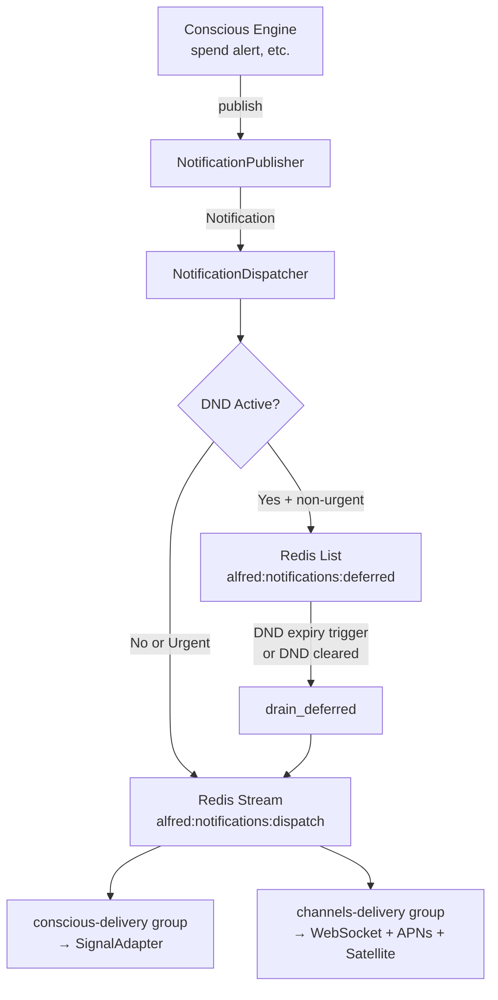

# Notification System

## Overview

The proactive notification system delivers alerts, updates, and information to the user through
multiple channels with DND awareness and priority routing. No LLM is involved in routing —
the dispatcher uses deterministic rules based on urgency and channel capabilities.

## Architecture

## Data Models

### Urgency (StrEnum)

| Level | Value | Channels |
|-------|-------|----------|
| INFORMATIONAL | `"informational"` | Signal + APNs |
| IMPORTANT | `"important"` | Signal + WebSocket + APNs |
| URGENT | `"urgent"` | Signal + WebSocket (with spoken audio) + APNs + Satellite (bypasses DND) |

APNs delivers only when its credentials are configured, and Satellite only when
`config/satellites.yaml` lists devices.

### Notification (Pydantic BaseModel)

| Field | Type | Default |
|-------|------|---------|
| notification_id | str | auto UUID |
| title | str | required |
| body | str | required |
| urgency | Urgency | required |
| source | str | required |
| timestamp | datetime | auto now(UTC) |

### DNDStatus (Pydantic BaseModel)

| Field | Type | Default |
|-------|------|---------|
| active | bool | required |
| reason | str \| None | None |
| source | str \| None | None ("manual" \| "calendar") |
| until | datetime \| None | None |

## Components

### NotificationPublisher

Public API for sending notifications. Creates `Notification` objects and routes through
the dispatcher. Used by the spend alert (through `urgent(source)`, a `send(title, body)`
at URGENT), the Conscious Engine, and any component that needs to notify the user.

### NotificationDispatcher

Core routing engine. Checks DND state, defers non-urgent notifications during DND,
and delivers to matching channel adapters in parallel via `asyncio.gather`.

### DNDChecker

Checks Do-Not-Disturb state from two sources (first match wins):
1. **Manual DND** — Redis key `alfred:memory:dnd` (JSON with active, until, reason, source)
2. **Calendar DND** — queries calendar integration for active meetings

Expired manual DND is auto-cleaned from Redis.

### ChannelRegistry

Auto-discovery registry using `@ChannelRegistry.register()` decorator. Adapters register
at import time and are initialized via `set_instance()` during startup.

## Channel Adapters

| Adapter | Urgencies | Delivery |
|---------|-----------|----------|
| SignalChannelAdapter | All | Formats `"Title: body"` → SignalBridge.send_notification() |
| WebSocketChannelAdapter | Important, Urgent | JSON `notification` frame to all connected WS sessions; an Urgent one also carries its TTS audio (base64 WAV in `audio`) |
| APNsChannelAdapter | All | HTTP/2 push to every registered iOS device token |
| SatelliteChannelAdapter | Urgent only | TTS audio played on every connected voice satellite ([voice-satellites.md](voice-satellites.md)) |

### Spoken audio

An URGENT notification is spoken once per surface. The WebSocket adapter synthesises
`"<title>: <body>"` and sends the audio inside the same `notification` frame as the text,
and the satellite adapter plays its own synthesis on the satellites. Both synthesise through
`synthesize_async` (`core/channels/voice_models.py`), in a worker thread, because synthesis
takes seconds and the channels event loop also serves every WebSocket and delivery.

There is no separate voice adapter. A second adapter pushing audio to the same WebSocket
sessions would speak every URGENT notification twice (the hazard
[#56](https://github.com/anirudhlath/alfred/issues/56) investigates).

### Device Registration (APNs)

Native clients register their APNs token with `POST /api/devices/register` (and `DELETE`
to unregister); tokens live in the `alfred:push:devices` Redis hash. Both routes are
double-gated — `require_trusted_network` **and** `require_authenticated` — so a client
must be on the LAN/tailnet *and* send a valid `alfred_auth` passkey session cookie. A
native client that presents only a device token gets 403 (untrusted network) or 401 (no
session), never a registration.

### Adding a New Channel Adapter

1. Create `core/notifications/adapters/myservice.py`
2. Subclass `ChannelAdapter`, set `name` and `supported_urgencies` ClassVars
3. Implement `async def deliver(self, notification: Notification) -> None`
4. Decorate with `@ChannelRegistry.register()`
5. Import the module in the appropriate entry point to trigger registration
6. Call `ChannelRegistry.set_instance("name", MyAdapter(...))` during startup

### Sources

`source` says who raised a notification. Clients should not branch on it, but it is what
the logs and the Room's act rows show. The approval and follow-up paths currently use
these, for example; other notifications can carry other sources:

| Source | Raised for |
|--------|------------|
| `conscious-engine` | the `Confirmation required` prompt of a System 2 run that parked its critical calls, and the `Done` / `That didn't work` outcome of an action the router held |
| `domain-router` | the `Confirmation required` prompt for an action `DomainRouter` intercepted, not a parked run ([`autonomy.md`](autonomy.md#an-action-the-router-intercepts)) |
| `channels` | a follow-up that found no socket to carry it (below) |

## Follow-ups: late answers and Door resumes

A reply can arrive after the channel that asked stopped waiting, or answer a request that
was answered long ago. Both reach the owner through `core/channels/followups.py`, which
reads every entry of `alfred:user:responses` once, in the consumer group
`channels-followups`, and hands the two kinds it owns to a channel-specific sink.
([#307](https://github.com/anirudhlath/alfred/issues/307))

- **A late answer.** `publish_and_wait` (`core/channels/request_bus.py`) registers the wait
  under `alfred:followup:{event_id}` as `waiting` (TTL 600 s) *before* the request goes out.
  On a timeout it flips the key to `late` and returns `LATE_REPLY` ("This is taking a
  little longer, sir..."). When the answer finally lands the worker claims it by winning the
  `DEL` of the key, which the waiter's last read races for, so it is shown exactly once. An
  answer a channel still waits for, or whose registration has expired (600 s), is skipped.
- **A Door resume.** The conscious engine answers a run the owner approved or declined from
  the Door with an `AlfredResponse` carrying `followup=True` and `in_reply_to` the original
  request ([`autonomy.md`](autonomy.md#a-system-2-run-that-wants-a-critical-action)). Nobody
  waits for it, and it needs no registration: the worker always delivers it.

The sink (`_followup_sink` in `core/channels/web_server.py`) delivers on the channel the
request came from:

| `channel` | Delivery |
|-----------|----------|
| `web_pwa`, `voice`, `ios` | A `response` frame to every socket joined to the session. With no socket that takes it, a notification instead: title `Alfred`, `IMPORTANT`, source `channels`. |
| `satellite` | The text is synthesised and spoken on the satellite the session names (`play_wav_to`). |
| `signal` | Nothing: the Signal bridge already sends every response. |

Every frame the worker sends to a socket carries `followup: true`, a late answer included.
The Room needs it: without it, the frame would be taken for the answer to the turn in
flight ([`web-frontend.md`](web-frontend.md#chat-ws)).

**Delivery is best effort, and the worker ACKs every entry** whether it delivered or not.
There is no PEL to reclaim — a deliberate exception to the reclaim rule in the root
`CLAUDE.md`'s Gotchas. The group is created at the stream's end, so its first start replays
none of the history; after that it resumes from its last read, so a follow-up that landed
while the process was down is delivered when it returns (a late answer only while its
registration lives).

**Known limitation: a reconnected PWA socket is not back on its session until it sends its
first message.** A new socket gets a fresh session id and adopts the client's previous one
only with its first message. A follow-up that arrives in that window finds no socket on the
session, so it goes through the dispatcher as a notification (above) rather than as a frame
in the Room.

## DND Behavior

- **Manual DND with expiry**: Notifications deferred to Redis list. One-shot time trigger
  created at expiry time to drain deferred notifications.
- **Manual DND without expiry**: Stays active until manually cleared, and nothing drains the
  queue while it is on (short of an explicit `POST /api/admin/notifications/drain`).
- **Clearing manual DND** (`POST /api/admin/dnd` with `active: false`, timed or not): drains
  the queue straight away — see [Drain on clear](#drain-on-clear).
- **Calendar DND**: Active during meetings. Drain trigger created at meeting end time.
- **URGENT notifications**: Always delivered immediately, regardless of DND.

## Redis Keys

| Key | Type | Purpose |
|-----|------|---------|
| `alfred:memory:dnd` | String (JSON) | Manual DND state |
| `alfred:notifications:deferred` | List | Deferred notification queue |
| `alfred:notifications:dispatch` | Stream | Cross-process notification delivery |
| `alfred:followup:{event_id}` | String (`waiting` \| `late`) | A channel's wait for a response, 600 s; `late` marks one that gave up and got `LATE_REPLY` |

## Drain Trigger

When DND defers a notification and knows when DND expires, the dispatcher creates
an idempotent one-shot `TimeTrigger` with ID `drain-deferred-{timestamp}`. When
the trigger fires, it posts an `ActionRequest(tool_name="drain_deferred_notifications",
target_service="conscious-engine")` to `ACTIONS_STREAM`. The conscious engine's
internal action consumer picks this up and calls `dispatcher.drain_deferred()`,
which publishes every queued notification to the dispatch stream. It does not re-check DND:
whatever asks for a drain is saying the queue is due.

## Drain on clear

Clearing manual DND from the web app (`POST /api/admin/dnd` with `active: false`) deletes
`alfred:memory:dnd` and, when that delete removed a live key, publishes the same
`drain_deferred_notifications` action to `ACTIONS_STREAM`. The drain therefore runs where it
always does — in the conscious process, through its internal action consumer — never in the
channels process that served the request. A clear that found no key (DND was already off)
requests no drain.

This is what makes an indefinite DND recoverable: before, deleting the key left the queue to
wait for some later expiry-based drain, which an indefinite DND never schedules. No Redis
keyspace notification is involved — the one code path that clears DND on request asks for
the drain itself. The lazy clean-up `DNDChecker` does when it finds an expired `until` does
not ask: an expiring DND is drained by the one-shot trigger above, at the moment it names. A
key deleted out of band (`redis-cli DEL`) bypasses this, so use the drain endpoint afterwards.
