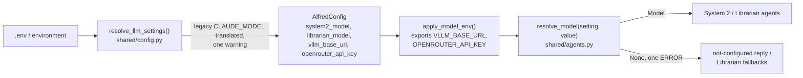

# Pydantic AI System 2 and Librarian (PR 2) Implementation Plan

> **For agentic workers:** REQUIRED SUB-SKILL: Use superpowers:subagent-driven-development (recommended) or superpowers:executing-plans to implement this plan task-by-task. Steps use checkbox (`- [ ]`) syntax for tracking.

**Goal:** Move System 2 and the Librarian off litellm onto Pydantic AI agents. System 2 gets one tool catalog with one name mapping, JSON Schema validation, typed in-process toolsets and identity-scoped tools. The Librarian gets structured outputs and records its spend. Both emit GenAI spans with Langfuse attributes, and the eval proxy attributes roles by header.

**Architecture:** Each process builds its agents once at startup from Pydantic AI model strings (`vllm:<served-name>`, `openrouter:<vendor>/<model>`) and runs them per request with typed dependencies.
- **System 2** is `Agent[TurnDeps, str]` named `system2`. Its single toolset is a `CatalogToolset`, which joins the trigger, memory, attention, integration and registry toolsets under the one name mapping, `wire_name`.
- **The Librarian's five LLM calls** become five small agents with Pydantic output types.
- **litellm leaves the environment** in the same PR, because it pins `openai<3` and Pydantic AI needs `openai>=3`.

**Tech Stack:** Python 3.13, `pydantic-ai-slim[openai,openrouter]==2.55.0`, `pydantic-ai-harness==0.55.0`, `jsonschema>=4.26` (Draft 2020-12), the OpenTelemetry SDK, pytest with `FunctionModel`.

**Spec:** `docs/superpowers/specs/2026-10-08-pydantic-ai-adoption-design.md`. This PR covers components 2, 3, 4, 10 and 11, and the PR 2 part of 13 (delivery row 2).

**Branch:** `feat/pydantic-ai-system2`, stacked on #359 in gh-stack #330. Worktree: `~/code/.worktrees/alfred/pydantic-ai-adoption`. Set `W=~/code/.worktrees/alfred/pydantic-ai-adoption` once and `cd "$W"`.

**Closes:** [#299](https://github.com/anirudhlath/alfred/issues/299), [#302](https://github.com/anirudhlath/alfred/issues/302), [#303](https://github.com/anirudhlath/alfred/issues/303), [#305](https://github.com/anirudhlath/alfred/issues/305), [#308](https://github.com/anirudhlath/alfred/issues/308), [#310](https://github.com/anirudhlath/alfred/issues/310).

## Global Constraints

**Toolchain and packages**
- Python 3.13, `mypy --strict` on `alfred_cli/ alfredctl/ bus/ core/ domains/ evals/ runner/ sdk/ shared/ telemetry/`, ruff line length 100. Tests are not mypy-checked.
- `pydantic-ai-slim==2.55.0` and `pydantic-ai-harness==0.55.0` are pinned exactly and move lock-step. The spec's floor is 2.54: 2.44 fixed OTel redaction and 2.53 a limiter deadlock.
- `jsonschema>=4.26` validates against Draft 2020-12.
- The Pydantic AI extras `[openai,openrouter]` are added only in Task 9, when litellm leaves. Until then the slim package has no extras, because `[openai]` forces litellm down to 1.83.0.

**Model settings**
- **Model strings:** `vllm:<served-name>` or `openrouter:<vendor>/<model>`. There is no model factory: Pydantic AI resolves the string itself, reading `VLLM_BASE_URL` and `OPENROUTER_API_KEY`.
- **Defaults:**
  - `SYSTEM2_MODEL`: the translated `CLAUDE_MODEL`, else `openrouter:anthropic/claude-sonnet-4`.
  - `LIBRARIAN_MODEL`: `SYSTEM2_MODEL`.
  - `VLLM_BASE_URL`: `OPENAI_COMPAT_HOST` + `/v1`.
  - `SYSTEM2_MAX_TOKENS`: `CLAUDE_MAX_TOKENS`, which defaults to 2048.
  - `SYSTEM2_TIMEOUT_S`: 60.
  - A blank value means the default, everywhere.
- **Legacy translation** lives in one function in `shared/config.py`:
  - `openrouter/<vendor>/<model>` becomes `openrouter:<vendor>/<model>`;
  - `openai/<model>` becomes `vllm:<model>` when `OPENAI_BASE_URL` is set.

  A translated value logs one warning per process.
- `VLLM_BASE_URL` and `LANGFUSE_HOST` join `GATEWAY_REWRITE_KEYS` (`shared/gateway.py`).
- **The production System 2 model never appears in the repo.** It is set in the deploy `.env` at deploy time. `.env.example` ships `SYSTEM2_MODEL=` blank.

**Role header**
- The header is `X-Alfred-Role`, with values `system1`, `system2` and `librarian`. Every LLM request Alfred makes carries it.

**System 2 agent**
- **Tool names:**
  - `wire_name` maps every character outside `[A-Za-z0-9_-]` to `_` and refuses a result over 64 characters.
  - When two identities map to one wire name, the second is dropped with one ERROR log per process.
  - There is no dotted-name fallback anywhere.
- **Retries:** 2 per toolset (`TOOL_RETRIES = 2`) and 2 for agent output (`retries=2`).
- **Limits and settings:**
  - `UsageLimits(request_limit=10)` replaces `MAX_ITERATIONS`.
  - Model settings are `max_tokens=SYSTEM2_MAX_TOKENS`, `timeout=SYSTEM2_TIMEOUT_S` and `extra_headers={"X-Alfred-Role": "system2"}`.
- **Agent names:** `system2`, and `librarian-analyse`, `librarian-resolve`, `librarian-extract`, `librarian-compress`, `librarian-patterns`.
- **Instrumentation** goes on every agent: `Instrumentation(settings=InstrumentationSettings(tracer_provider=trace.get_tracer_provider(), include_content=True))`.
- **Langfuse attributes** on the System 2 run and its child spans: `langfuse.session.id` (session), `langfuse.user.id` (identity) and `langfuse.trace.tags` (channel).

**Tests**
- The root `conftest.py` sets `pydantic_ai.models.ALLOW_MODEL_REQUESTS = False`.
- Agent tests drive the model with `tests/llm_fakes.py`'s `Script`, a `FunctionModel`.

**User-visible text, kept verbatim**
- Budget: `I'm afraid we've reached the daily budget, sir. I'm operating in reduced capacity — ambient actions continue, but I'll need to defer complex requests until tomorrow.` (mood `concerned`)
- Deliberating: `I apologize, sir — I've been deliberating too long. Let me try a more direct approach.`
- Not configured: `I'm afraid my connection to the thinking engine is not configured, sir.`

**Hygiene**
- Before every push, run the greps in `~/code/alfred-deploy/PWA-EXPOSURE-RUNBOOK.md` §Secret hygiene. They must show zero new matches against `origin/master`. Never quote them in a committed file.
- Commit messages are conventional commits and contain no model identifiers.

**Full gate** (run once per task, before its commit; during iteration run only the task's test files):
```bash
set -o pipefail; uv sync -q --all-extras && uv run --no-sync ruff check . && uv run --no-sync ruff format --check . && uv run --no-sync mypy --strict alfred_cli/ alfredctl/ bus/ core/ domains/ evals/ runner/ sdk/ shared/ telemetry/ && PYTHONDONTWRITEBYTECODE=1 uv run --no-sync pytest -q -p no:randomly
```

## Rulings: this PR's scope against the spec

The spec describes the end state of the whole stack. These rulings say what PR 2 does where a later PR owns the rest.

- **R1. Confirmations stay as they are until PR 5.**
  - `confirm_pending_action` survives as a sir-only in-process tool, and the router's critical intercept stays.
  - There is no `ApprovalRequired` gate, and `ActionRequest.confirmed` stays `False`.
  - Sixteen golden lines depend on today's flow. PR 5 (component 8) replaces it.
- **R2.** System 2's output type is `str`. `DeferredToolRequests` arrives with PR 5.
- **R3. Sessions stay text-only.** The stored `{"role", "content"}` history converts to `ModelRequest([UserPromptPart])` / `ModelResponse([TextPart])` for the run, and only the user and assistant text is stored back. Full history is PR 4.
- **R4. Spend still goes through `CostTracker`.** There is no ledger and no `SpendLimits`; those are PR 6.
- **R5. Prompts come from the repo** (`prompts/*.md` and module constants). There is no `PromptStore`; that is PR 3.
- **R6.** There is no `APPROVAL_MODEL` (PR 5) and no `REFLEX_MODEL` (PR 8). Reflex only gains the role header.
- **R7. The trigger toolset is a custom `AbstractToolset` over `TriggerFeature`'s metas,** not a `FunctionToolset`. This keeps:
  - the runtime-enriched `create_trigger` description;
  - `ToolMeta.validate_arguments` coercion, which turns "false" into `False` (an existing test pins this).
- **R8. Models resolve once at startup to `Model | None`.**
  - `None` gives the not-configured reply (System 2) or the degraded fallbacks (Librarian).
  - Tests pass a `Script(...).model`.
- **R9. Direct `claude-*` strings (no provider prefix) are not translated:** no anthropic extra ships. The doctor fails them, and `resolve_model` logs an ERROR and returns `None`.
- **R10.** `evals/harness/vllm_model.py` gets a docstring edit only. PR 7 deletes it.
- **R11.** The doctor rewrite is part of Task 2.
- **R12. The new always-on eval check is appended last, and only when the evidence holds a System 2 tool call.** Scenarios without one keep their check indices and verdicts.
- **R13.** `actions_taken` records every call the catalog dispatches, failed ones included, under the tool's registry name, or its wire name for in-process tools. Calls refused before dispatch are not recorded: an unknown name, or arguments that fail validation.
- **R14. The proxy reads the role header at the point where it classifies today,** after the body is read, so the in-flight bookkeeping is unchanged.
- **R15. Guest-facing refusals use one neutral sentence:** `"{name} is only available to the verified user"` (`core/conscious/tools/scope.refusal`).

## Review Focus

These five failure modes are the most likely to reach a person. Each is pinned by a test in the task named.

1. **Dotted or unknown tool name.** The model calls `home.light_turn_on` (a dotted name) or a tool that does not exist. It gets a retry prompt that lists the wire names, then succeeds; nothing is dispatched for the bad call (Task 6a, `test_dotted_name_is_retried_with_the_wire_names_and_never_dispatched`).
2. **A domain error.** It reaches the model as a failed tool result with the service's exact text and does not spend a retry (Task 4, `test_domain_error_reaches_the_model_without_spending_a_retry`).
3. **A guest calls a tool they may not use.**
   - An elevated or critical registry tool is never offered to a guest. If the guest names it anyway, the router is never awaited (Task 4, `test_guest_is_offered_only_benign_registry_tools` and `test_guest_naming_an_elevated_tool_is_never_routed`).
   - A sir-only tool is refused at call time even if it was somehow listed (Task 3, `test_sir_only_refuses_a_guest_at_call_time`).
4. **Missing model configuration or key.** The user gets the not-configured reply and the log gets one startup ERROR, not a crash (Task 1, `test_blank_setting_logs_and_yields_no_model`; Task 6b, `test_no_model_answers_not_configured`).
5. **An uncompilable registry schema.** Only that tool is dropped, with one ERROR across many requests; the other tools stay offered (Task 4, `test_uncompilable_schema_drops_only_that_tool_and_logs_once`).

## File Map

| File | Change | Responsibility |
|---|---|---|
| `shared/llm_roles.py` | create | role header name and role values (dependency-free) |
| `shared/agents.py` | create | `resolve_model`, `model_key`, `role_headers`, `instrumentation` |
| `shared/otel.py` | modify | `LangfuseBaggageProcessor`, `langfuse_attributes` |
| `shared/config.py` | modify | LLM settings, legacy translation, `apply_model_env` |
| `shared/gateway.py` | modify | two new rewrite keys |
| `alfredctl/doctor.py` | modify | `_check_conscious` on the new settings |
| `core/conscious/tools/__init__.py` | create | package docstring only (no imports) |
| `core/conscious/tools/names.py` | create | `wire_name`, `error_once`, `report_collision` |
| `core/conscious/tools/scope.py` | create | `allowed`, `refusal` |
| `core/conscious/deps.py` | create | `TurnServices`, `TurnDeps` |
| `core/conscious/tools/catalog.py` | create | `CatalogToolset` |
| `core/conscious/tools/sir_only.py` | create | `SirOnlyToolset` |
| `core/conscious/tools/validation.py` | create | `compile_schema`, `check_arguments`, `ANY_OBJECT` |
| `core/conscious/tools/registry.py` | create | `RegistryToolset` |
| `core/conscious/tools/triggers.py` | create | `TriggerToolset` |
| `core/conscious/tools/memory.py` | create | memory `FunctionToolset` |
| `core/conscious/tools/attention.py` | create | attention + confirm `FunctionToolset` |
| `core/conscious/tools/integrations.py` | create | `IntegrationTool`, `fetch_integration_tools`, `IntegrationToolset` |
| `core/conscious/memory_tools.py` | modify | public `recall_memories`, `get_live_state`; manifest + dispatcher deleted |
| `core/conscious/action_tools.py` | delete | moved to `tools/attention.py` |
| `core/conscious/agent.py` | create | `build_system2_agent` |
| `core/conscious/context_assembler.py` | modify | no tools section; `integrations_available`, `routine_hint` |
| `core/conscious/prompts/personality.md` | modify | tool-named bullets out |
| `core/triggers/feature.py` | modify | timing guidance into `create_trigger`'s description |
| `core/conscious/engine.py` | rewrite | runs the agent |
| `core/conscious/__main__.py`, `core/librarian/__main__.py` | modify | wiring |
| `core/conscious/cost.py` | modify | model keys, `vllm:` free, `count_request` |
| `core/librarian/agents.py` | create | the five Librarian agents and output models |
| `core/librarian/consolidator.py` | modify | calls the agents; `model`, `cost_tracker` |
| `core/reflex/openai_client.py` | modify | role header |
| `evals/harness/proxy.py`, `checks/*.py`, `driver.py`, `stack.py`, `tasks.py` | modify | header roles, `same_tool`, always-on check, env |
| `tests/llm_fakes.py` | create | `Script`, `tool_call`, `tool_calls` |
| `tests/core/conscious/helpers.py` | create | `identity`, `make_services`, `make_deps`, `tool_agent`, `run_context`, `call_direct` |
| `tests/core/librarian/test_agents.py` | create | the Librarian agents: names, header, output modes, retries, spend |
| `tests/core/librarian/` (existing modules) | modify | migrated from patched litellm to `Script` |
| `pyproject.toml`, `uv.lock` | modify | Pydantic AI in; litellm out (Task 9) |
| `runner/__main__.py` | modify | the dead `--debug` flag out |
| `docs/llm.md` | create | the LLM layer |
| `docs/architecture.md`, `docs/autonomy.md`, `docs/evals.md`, `docs/live-state.md`, `docs/PRD.md`, `README.md`, `CLAUDE.md`, `core/CLAUDE.md`, `docs/qa-backlog/*` | modify | the old loop's descriptions out; the guest-scoping PRD row in |

---

### Task 1: Foundation: dependencies, role header, model resolution, tracing attributes, test fakes

**Files:**
- Modify: `pyproject.toml` (dependencies, dev extras), `uv.lock`
- Modify: `conftest.py` (top of module)
- Create: `shared/llm_roles.py`, `shared/agents.py`, `tests/llm_fakes.py`
- Modify: `shared/otel.py`
- Test: `tests/shared/test_agents.py`, `tests/shared/test_otel.py`, `tests/test_llm_fakes.py`

**Interfaces:**
- Produces:
  - `shared.llm_roles`: `ROLE_HEADER = "X-Alfred-Role"`, `LlmRole = Literal["system1", "system2", "librarian"]`, `SYSTEM1`, `SYSTEM2`, `LIBRARIAN`, `LLM_ROLES: frozenset[str]`.
  - `shared.agents.resolve_model(setting: str, value: str) -> Model | None`.
  - `shared.agents.model_key(model: Model) -> str`, which returns `f"{model.system}:{model.model_name}"`.
  - `shared.agents.role_headers(role: LlmRole) -> dict[str, str]`.
  - `shared.agents.instrumentation() -> Instrumentation`.
  - `shared.otel.LangfuseBaggageProcessor`, `shared.otel.langfuse_attributes(*, session_id: str, user_id: str, tags: Sequence[str])` (a context manager), and the constants `LANGFUSE_SESSION_ID`, `LANGFUSE_USER_ID`, `LANGFUSE_TAGS`.
  - `tests.llm_fakes`: `Script(*replies, json_schema_output=True)`, which has:
    - `.model`, `.requests` and `.call_count`;
    - `.instructions(i)`, `.offered(i)`, `.schema(name, i=0)`, `.settings(i)`, `.returns(i)` and `.retries(i)`;
    - the module helpers `tool_call(name, args)`, `tool_calls(*pairs)` and `ScriptExhausted`.

- [x] **Step 1: Add the dependencies**

```bash
cd "$W"
uv add 'pydantic-ai-slim==2.55.0' 'pydantic-ai-harness==0.55.0' 'jsonschema>=4.26'
uv add --optional dev types-jsonschema
uv sync -q --all-extras
uv run --no-sync python -c "import litellm, pydantic_ai, pydantic_ai_harness, jsonschema; print(pydantic_ai.__version__)"
```
Expected: `2.55.0`, with litellm still importable. If `uv add` tries to move litellm below 1.88.6, stop: an extra slipped in.

- [x] **Step 2: Write the failing tests**

`tests/shared/test_agents.py`:
```python
"""What every agent shares: model resolution, the role header, instrumentation."""

from __future__ import annotations

import logging
from unittest.mock import patch

import pytest
from opentelemetry.sdk.trace import TracerProvider
from opentelemetry.sdk.trace.export import SimpleSpanProcessor
from opentelemetry.sdk.trace.export.in_memory_span_exporter import InMemorySpanExporter
from pydantic_ai import Agent

from shared.agents import instrumentation, model_key, resolve_model, role_headers
from shared.llm_roles import LIBRARIAN, LLM_ROLES, ROLE_HEADER, SYSTEM1, SYSTEM2
from tests.llm_fakes import Script


def test_conftest_blocks_real_model_requests() -> None:
    from pydantic_ai import models

    assert models.ALLOW_MODEL_REQUESTS is False


def test_roles_are_the_three_the_proxy_knows() -> None:
    assert ROLE_HEADER == "X-Alfred-Role"
    assert {SYSTEM1, SYSTEM2, LIBRARIAN} == LLM_ROLES == {"system1", "system2", "librarian"}
    assert role_headers(SYSTEM2) == {"X-Alfred-Role": "system2"}


def test_blank_setting_logs_and_yields_no_model(caplog: pytest.LogCaptureFixture) -> None:
    with caplog.at_level(logging.ERROR, logger="shared.agents"):
        assert resolve_model("SYSTEM2_MODEL", "  ") is None
    assert "SYSTEM2_MODEL is not set" in caplog.text


def test_unusable_model_string_logs_and_yields_no_model(
    caplog: pytest.LogCaptureFixture,
) -> None:
    with caplog.at_level(logging.ERROR, logger="shared.agents"):
        assert resolve_model("LIBRARIAN_MODEL", "nope:x") is None
    assert "LIBRARIAN_MODEL='nope:x' cannot be used" in caplog.text


def test_a_model_string_resolves_and_keys_by_provider_and_name() -> None:
    model = resolve_model("SYSTEM2_MODEL", " test ")
    assert model is not None
    assert model_key(model) == "test:test"


def test_instrumentation_records_the_agent_and_model_spans() -> None:
    exporter = InMemorySpanExporter()
    provider = TracerProvider()
    provider.add_span_processor(SimpleSpanProcessor(exporter))
    with patch("shared.agents.trace.get_tracer_provider", return_value=provider):
        capability = instrumentation()
    agent = Agent(Script("hello").model, name="probe", capabilities=[capability])

    agent.run_sync("hi")

    names = [span.name for span in exporter.get_finished_spans()]
    assert "invoke_agent probe" in names
    assert any(name.startswith("chat ") for name in names)
```

Append to `tests/shared/test_otel.py`. Merge these imports into the file's existing import block, and keep any it already has:
```python
from unittest.mock import patch

from opentelemetry.sdk.trace import TracerProvider
from opentelemetry.sdk.trace.export import SimpleSpanProcessor
from opentelemetry.sdk.trace.export.in_memory_span_exporter import InMemorySpanExporter

from shared.otel import (
    LANGFUSE_SESSION_ID,
    LANGFUSE_TAGS,
    LANGFUSE_USER_ID,
    LangfuseBaggageProcessor,
    init_tracing,
    langfuse_attributes,
)


def test_langfuse_attributes_land_on_every_span_started_inside() -> None:
    exporter = InMemorySpanExporter()
    provider = TracerProvider()
    provider.add_span_processor(LangfuseBaggageProcessor())
    provider.add_span_processor(SimpleSpanProcessor(exporter))
    tracer = provider.get_tracer("t")

    with langfuse_attributes(session_id="s-1", user_id="sir", tags=["web_pwa"]):
        with tracer.start_as_current_span("outer"), tracer.start_as_current_span("inner"):
            pass
    with tracer.start_as_current_span("after"):
        pass

    spans = {s.name: s for s in exporter.get_finished_spans()}
    for name in ("outer", "inner"):
        attrs = spans[name].attributes or {}
        assert attrs[LANGFUSE_SESSION_ID] == "s-1"
        assert attrs[LANGFUSE_USER_ID] == "sir"
        assert attrs[LANGFUSE_TAGS] == ("web_pwa",)
    assert LANGFUSE_SESSION_ID not in (spans["after"].attributes or {})


def test_init_tracing_copies_langfuse_baggage_onto_spans() -> None:
    with (
        patch("shared.otel.turn_off_env_exporters"),
        patch("shared.otel.trace.set_tracer_provider") as set_provider,
    ):
        init_tracing("svc", endpoint=None)
    provider = set_provider.call_args.args[0]

    with langfuse_attributes(session_id="s-2", user_id="guest", tags=["signal"]):
        span = provider.get_tracer("t").start_span("x")
    span.end()

    assert (span.attributes or {})[LANGFUSE_USER_ID] == "guest"
```

`tests/test_llm_fakes.py`:
```python
"""The scripted model every agent test drives."""

from __future__ import annotations

import pytest
from pydantic import BaseModel
from pydantic_ai import Agent, NativeOutput

from tests.llm_fakes import Script, ScriptExhausted, tool_call


class _Item(BaseModel):
    a: int


@pytest.mark.asyncio
async def test_script_answers_in_order_and_records_each_request() -> None:
    script = Script(tool_call("t", {"x": 1}), "done")
    agent = Agent(script.model, instructions="be brief")

    @agent.tool_plain
    def t(x: int) -> dict[str, int]:
        return {"ok": x}

    result = await agent.run("go")

    assert result.output == "done"
    assert script.call_count == 2
    assert script.offered(0) == ["t"]
    assert script.instructions(0) == "be brief"
    assert script.returns(1) == ['{"ok":1}']
    assert script.retries(1) == []


@pytest.mark.asyncio
async def test_running_out_of_replies_fails_the_test() -> None:
    with pytest.raises(ScriptExhausted):
        await Agent(Script().model).run("go")


@pytest.mark.asyncio
@pytest.mark.parametrize("native", [True, False])
async def test_structured_replies_follow_the_model_profile(native: bool) -> None:
    script = Script([{"a": 1}], json_schema_output=native)
    output_type = NativeOutput(list[_Item]) if native else list[_Item]

    result = await Agent(script.model, output_type=output_type).run("go")

    assert result.output == [_Item(a=1)]
```

- [x] **Step 3: Run the tests to verify they fail**

Run: `PYTHONDONTWRITEBYTECODE=1 uv run --no-sync pytest tests/shared/test_agents.py tests/shared/test_otel.py tests/test_llm_fakes.py -q -p no:randomly`
Expected: collection errors, because `shared.agents`, `shared.llm_roles`, `tests.llm_fakes` and the new `shared.otel` names do not exist.

- [x] **Step 4: Write the implementation**

`conftest.py`: add after the existing imports, before the first fixture:
```python
import pydantic_ai as _pydantic_ai
from pydantic_ai import models as _pydantic_ai_models

# No test reaches a real model. A test that forgets its FunctionModel fails loudly here
# instead of calling the network.
_pydantic_ai_models.ALLOW_MODEL_REQUESTS = False
# Pydantic AI prints a banner on its first agent run; test output stays clean.
_pydantic_ai.BANNER_ENABLED = False
```

`shared/llm_roles.py`:
```python
"""The LLM roles, and the header each request names its role in.

The eval proxy attributes a recorded call to a role by this header
(``evals/harness/proxy.py``), so a prompt edit can never break attribution.
Dependency-free on purpose: Reflex's raw HTTP client and the eval harness import it.
"""

from __future__ import annotations

from typing import Final, Literal

ROLE_HEADER: Final = "X-Alfred-Role"

LlmRole = Literal["system1", "system2", "librarian"]

SYSTEM1: Final[LlmRole] = "system1"
SYSTEM2: Final[LlmRole] = "system2"
LIBRARIAN: Final[LlmRole] = "librarian"

LLM_ROLES: Final[frozenset[str]] = frozenset({SYSTEM1, SYSTEM2, LIBRARIAN})
```

`shared/agents.py`:
```python
"""What every Pydantic AI agent in Alfred shares: model resolution, the role header and
instrumentation. Agents are built once per process and run per request."""

from __future__ import annotations

import logging

import pydantic_ai
from opentelemetry import trace
from pydantic_ai.capabilities.instrumentation import Instrumentation
from pydantic_ai.exceptions import UserError
from pydantic_ai.models import Model, infer_model
from pydantic_ai.models.instrumented import InstrumentationSettings

from shared.llm_roles import ROLE_HEADER, LlmRole

logger = logging.getLogger(__name__)

# Pydantic AI prints a banner on its first run; services log, they do not print.
pydantic_ai.BANNER_ENABLED = False


def resolve_model(setting: str, value: str) -> Model | None:
    """The model *value* names, or None, logged at ERROR, when it names none.

    *setting* is the variable the value came from, so the log line says what to fix.
    Called once at startup: a missing ``OPENROUTER_API_KEY`` or ``VLLM_BASE_URL`` fails
    here, when Pydantic AI builds the provider, rather than on the first request.
    """
    text = value.strip()
    if not text:
        logger.error("%s is not set — this role has no model", setting)
        return None
    try:
        return infer_model(text)
    except (UserError, ImportError, ValueError) as exc:
        logger.error("%s=%r cannot be used: %s", setting, text, exc)
        return None


def model_key(model: Model) -> str:
    """``<provider>:<served name>``, the key ``CostTracker`` prices a model by."""
    return f"{model.system}:{model.model_name}"


def role_headers(role: LlmRole) -> dict[str, str]:
    """The header the eval proxy attributes a request by."""
    return {ROLE_HEADER: role}


def instrumentation() -> Instrumentation:
    """GenAI spans, content included, on the tracer provider ``init_tracing`` installed."""
    return Instrumentation(
        settings=InstrumentationSettings(
            tracer_provider=trace.get_tracer_provider(), include_content=True
        )
    )
```

`shared/otel.py`:
- Add to the imports:
  ```python
  from contextlib import contextmanager
  from opentelemetry import baggage, context
  from opentelemetry.sdk.trace import Span, SpanProcessor
  ```
  and add `from collections.abc import Iterator, Sequence` under `TYPE_CHECKING`.
- Add after `turn_off_env_exporters`:
  ```python
  LANGFUSE_PREFIX: Final = "langfuse."
  LANGFUSE_SESSION_ID: Final = "langfuse.session.id"
  LANGFUSE_USER_ID: Final = "langfuse.user.id"
  LANGFUSE_TAGS: Final = "langfuse.trace.tags"


  class LangfuseBaggageProcessor(SpanProcessor):
      """Copies ``langfuse.*`` baggage onto each span as it starts.

      Langfuse reads a trace's session, user and tags from span attributes, and its OTel
      guide asks for them on child spans too. They ride baggage, set by
      ``langfuse_attributes``, so every span started inside carries them, including the
      ones Pydantic AI starts.
      """

      def on_start(self, span: Span, parent_context: context.Context | None = None) -> None:
          for key, value in baggage.get_all(parent_context).items():
              if not key.startswith(LANGFUSE_PREFIX) or not isinstance(value, str):
                  continue
              if key == LANGFUSE_TAGS:
                  span.set_attribute(key, tuple(tag for tag in value.split(",") if tag))
              else:
                  span.set_attribute(key, value)


  @contextmanager
  def langfuse_attributes(
      *, session_id: str, user_id: str, tags: Sequence[str]
  ) -> Iterator[None]:
      """Every span started inside carries Langfuse's session, user and tag attributes."""
      ctx = baggage.set_baggage(LANGFUSE_SESSION_ID, session_id)
      ctx = baggage.set_baggage(LANGFUSE_USER_ID, user_id, context=ctx)
      ctx = baggage.set_baggage(LANGFUSE_TAGS, ",".join(tags), context=ctx)
      token = context.attach(ctx)
      try:
          yield
      finally:
          context.detach(token)
  ```
- In `init_tracing`, directly after `provider = TracerProvider(resource=resource)`:
  ```python
      # First, so the attributes are set before any exporter sees the span.
      provider.add_span_processor(LangfuseBaggageProcessor())
  ```

`tests/llm_fakes.py`:
```python
"""A scripted model for agent tests: the replies the model gives, in order.

A reply is one of:

- ``str``: plain text;
- a ``list`` or ``dict``: structured output. For a model whose profile supports JSON-schema
  output it is sent as JSON text (a list wrapped as ``{"response": [...]}``, as
  ``NativeOutput`` expects); otherwise it is sent as a call to the agent's output tool;
- a ``ModelResponse``: sent as it is, e.g. ``tool_call(...)``;
- an exception: raised from the model, as a failed request would be.
"""

from __future__ import annotations

import json
from typing import Any

from pydantic_ai.messages import (
    ModelMessage,
    ModelRequest,
    ModelResponse,
    RetryPromptPart,
    TextPart,
    ToolCallPart,
    ToolReturnPart,
)
from pydantic_ai.models.function import AgentInfo, FunctionModel
from pydantic_ai.profiles import ModelProfile

Reply = str | list[Any] | dict[str, Any] | ModelResponse | BaseException


class ScriptExhausted(AssertionError):
    """The agent asked the model for more replies than the test scripted."""


def tool_call(name: str, args: dict[str, Any] | str | None = None) -> ModelResponse:
    """One tool call. *args* as a string is sent raw, so a test can send malformed JSON."""
    return ModelResponse(parts=[ToolCallPart(tool_name=name, args=args if args is not None else {})])


def tool_calls(*calls: tuple[str, dict[str, Any]]) -> ModelResponse:
    """Several tool calls in one response."""
    return ModelResponse(parts=[ToolCallPart(tool_name=n, args=a) for n, a in calls])


class Script:
    """A ``FunctionModel`` that answers with *replies* in order and records every request."""

    def __init__(self, *replies: Reply, json_schema_output: bool = True) -> None:
        self._replies = list(replies)
        self._native = json_schema_output
        self.requests: list[tuple[list[ModelMessage], AgentInfo]] = []
        self.model = FunctionModel(
            self._answer, profile=ModelProfile(supports_json_schema_output=json_schema_output)
        )

    def _answer(self, messages: list[ModelMessage], info: AgentInfo) -> ModelResponse:
        self.requests.append((list(messages), info))
        if not self._replies:
            raise ScriptExhausted(f"request {len(self.requests)} has no scripted reply")
        reply = self._replies.pop(0)
        if isinstance(reply, BaseException):
            raise reply
        if isinstance(reply, ModelResponse):
            return reply
        if isinstance(reply, str):
            return ModelResponse(parts=[TextPart(reply)])
        payload: dict[str, Any] = {"response": reply} if isinstance(reply, list) else reply
        if self._native:
            return ModelResponse(parts=[TextPart(json.dumps(payload))])
        return ModelResponse(parts=[ToolCallPart(tool_name=info.output_tools[0].name, args=payload)])

    @property
    def call_count(self) -> int:
        return len(self.requests)

    def instructions(self, i: int = 0) -> str:
        """The instructions the agent sent with request *i*."""
        return self.requests[i][1].instructions or ""

    def offered(self, i: int = 0) -> list[str]:
        """The function tools request *i* offered, by wire name."""
        return [t.name for t in self.requests[i][1].function_tools]

    def schema(self, name: str, i: int = 0) -> dict[str, Any]:
        """The parameters JSON Schema request *i* offered for tool *name*."""
        tool = next(t for t in self.requests[i][1].function_tools if t.name == name)
        return tool.parameters_json_schema

    def settings(self, i: int = 0) -> dict[str, Any]:
        """The model settings request *i* was made with."""
        return dict(self.requests[i][1].model_settings or {})

    def _last_request_parts(self, i: int) -> list[Any]:
        last = self.requests[i][0][-1]
        return list(last.parts) if isinstance(last, ModelRequest) else []

    def returns(self, i: int) -> list[str]:
        """The tool results request *i* carried, as the model reads them."""
        return [
            p.model_response_str() for p in self._last_request_parts(i) if isinstance(p, ToolReturnPart)
        ]

    def retries(self, i: int) -> list[str]:
        """The retry prompts request *i* carried (unknown tools, invalid arguments)."""
        return [
            p.model_response() for p in self._last_request_parts(i) if isinstance(p, RetryPromptPart)
        ]
```

- [x] **Step 5: Run the tests to verify they pass**

Run: `PYTHONDONTWRITEBYTECODE=1 uv run --no-sync pytest tests/shared/test_agents.py tests/shared/test_otel.py tests/test_llm_fakes.py -q -p no:randomly`
Expected: all pass. If `test_instrumentation_records_the_agent_and_model_spans` names its spans differently, read the names from the exporter and match the test to what 2.55 emits (`invoke_agent <name>` and `chat <model>` were observed in the probe). Do not drop the assertion.

- [x] **Step 6: Gate and commit**

Run the full gate. Then:
```bash
git add pyproject.toml uv.lock conftest.py shared/llm_roles.py shared/agents.py shared/otel.py tests/llm_fakes.py tests/shared/test_agents.py tests/shared/test_otel.py tests/test_llm_fakes.py
git commit -m "feat(llm): add Pydantic AI foundation — role header, model resolution, Langfuse attributes"
```

---

### Task 2: Model settings, gateway keys, `.env.example` and the doctor

**Files:**
- Modify: `shared/config.py` (imports; new constants and functions after `positive_seconds_env`; `AlfredConfig` fields at ~252; `from_env` at ~321)
- Modify: `shared/gateway.py:18-25`
- Modify: `.env.example:9-13` and the OPTIONAL section
- Modify: `alfredctl/doctor.py:170-196`
- Test: `tests/shared/test_llm_settings.py` (create), `tests/alfredctl/test_doctor.py`, `tests/shared/test_env_example.py` (run only)

**Interfaces:**
- Consumes: nothing from Task 1.
- Produces:
  - in `shared.config`:
    - the constants `DEFAULT_SYSTEM2_MODEL = "openrouter:anthropic/claude-sonnet-4"`, `DEFAULT_SYSTEM2_MAX_TOKENS = 2048`, `DEFAULT_SYSTEM2_TIMEOUT_S = 60.0`, `DEFAULT_OPENAI_COMPAT_HOST = "http://localhost:1234"` and `VLLM_KNOWN_FAMILIES`;
    - the functions `translate_legacy_model(raw: str, *, openai_base_url: str = "") -> str`, `normalize_vllm_base_url(raw: str) -> str`, `vllm_family_known(served_name: str) -> bool`, `resolve_llm_settings(env: Mapping[str, str]) -> LlmSettings` and `apply_model_env(config: AlfredConfig, environ: MutableMapping[str, str] = os.environ) -> None`;
    - the frozen dataclass `LlmSettings` (`system2_model`, `librarian_model`, `vllm_base_url`, `openrouter_api_key`, `system2_max_tokens`, `system2_timeout_s`).
  - New fields on `AlfredConfig`, with the same names as `LlmSettings`'s. The `claude_*` fields stay until Task 9.

- [x] **Step 1: Write the failing tests**

`tests/shared/test_llm_settings.py`:
```python
"""LLM role settings: defaults, the legacy CLAUDE_MODEL translation, validation."""

from __future__ import annotations

import logging
from collections.abc import Iterator

import pytest

from shared import config as config_mod
from shared.config import (
    DEFAULT_SYSTEM2_MODEL,
    AlfredConfig,
    apply_model_env,
    normalize_vllm_base_url,
    resolve_llm_settings,
    translate_legacy_model,
    vllm_family_known,
)
from shared.gateway import GATEWAY_REWRITE_KEYS


@pytest.fixture(autouse=True)
def _fresh_warning() -> Iterator[None]:
    config_mod._warn_legacy_model.cache_clear()
    yield
    config_mod._warn_legacy_model.cache_clear()


def test_defaults_when_nothing_is_set() -> None:
    s = resolve_llm_settings({})
    assert s.system2_model == DEFAULT_SYSTEM2_MODEL == "openrouter:anthropic/claude-sonnet-4"
    assert s.librarian_model == s.system2_model
    assert s.vllm_base_url == "http://localhost:1234/v1"
    assert s.openrouter_api_key == ""
    assert s.system2_max_tokens == 2048
    assert s.system2_timeout_s == 60.0


def test_blank_values_mean_the_default() -> None:
    blank = dict.fromkeys(
        ["SYSTEM2_MODEL", "LIBRARIAN_MODEL", "VLLM_BASE_URL", "SYSTEM2_MAX_TOKENS",
         "SYSTEM2_TIMEOUT_S", "OPENROUTER_API_KEY", "CLAUDE_MODEL"],
        " ",
    )
    assert resolve_llm_settings(blank) == resolve_llm_settings({})


@pytest.mark.parametrize(
    ("raw", "base", "want"),
    [
        ("openrouter/anthropic/claude-sonnet-4", "", "openrouter:anthropic/claude-sonnet-4"),
        ("openai/gemma-4-26b-a4b", "http://proxy:9/v1", "vllm:gemma-4-26b-a4b"),
        ("openai/gpt-x", "", "openai:gpt-x"),
        ("vllm:gemma-4-26b-a4b", "", "vllm:gemma-4-26b-a4b"),
        ("claude-sonnet-4-6", "", "claude-sonnet-4-6"),
    ],
)
def test_translate_legacy_model(raw: str, base: str, want: str) -> None:
    assert translate_legacy_model(raw, openai_base_url=base) == want


def test_system2_model_wins_over_claude_model() -> None:
    s = resolve_llm_settings({"SYSTEM2_MODEL": "vllm:qwen3", "CLAUDE_MODEL": "openrouter/x/y"})
    assert s.system2_model == "vllm:qwen3"


def test_translated_claude_model_warns_once(caplog: pytest.LogCaptureFixture) -> None:
    env = {"CLAUDE_MODEL": "openrouter/anthropic/claude-sonnet-4"}
    with caplog.at_level(logging.WARNING, logger="shared.config"):
        first = resolve_llm_settings(env)
        resolve_llm_settings(env)
    assert first.system2_model == "openrouter:anthropic/claude-sonnet-4"
    assert caplog.text.count("is a LiteLLM model string") == 1


def test_untranslated_claude_model_does_not_warn(caplog: pytest.LogCaptureFixture) -> None:
    with caplog.at_level(logging.WARNING, logger="shared.config"):
        s = resolve_llm_settings({"CLAUDE_MODEL": "vllm:gemma-x"})
    assert s.system2_model == "vllm:gemma-x"
    assert "LiteLLM" not in caplog.text


def test_legacy_openai_model_takes_its_base_url_from_openai_base_url() -> None:
    s = resolve_llm_settings(
        {"CLAUDE_MODEL": "openai/gemma-x", "OPENAI_BASE_URL": "http://proxy:9/v1/",
         "OPENAI_COMPAT_HOST": "http://other:1"}
    )
    assert s.system2_model == "vllm:gemma-x"
    assert s.vllm_base_url == "http://proxy:9/v1"


def test_vllm_base_url_falls_back_to_the_compat_host_chain() -> None:
    assert resolve_llm_settings({"OPENAI_COMPAT_HOST": "http://h:8000"}).vllm_base_url == (
        "http://h:8000/v1"
    )
    assert resolve_llm_settings({"LMSTUDIO_HOST": "http://lm:1234/"}).vllm_base_url == (
        "http://lm:1234/v1"
    )
    assert resolve_llm_settings(
        {"VLLM_BASE_URL": "http://v:8000/v1", "OPENAI_COMPAT_HOST": "http://h:1"}
    ).vllm_base_url == "http://v:8000/v1"


@pytest.mark.parametrize(
    ("raw", "want"),
    [("", ""), ("http://h:8000", "http://h:8000/v1"), ("http://h:8000/v1/", "http://h:8000/v1")],
)
def test_normalize_vllm_base_url(raw: str, want: str) -> None:
    assert normalize_vllm_base_url(raw) == want


def test_librarian_model_override() -> None:
    s = resolve_llm_settings({"SYSTEM2_MODEL": "vllm:a", "LIBRARIAN_MODEL": "vllm:b"})
    assert (s.system2_model, s.librarian_model) == ("vllm:a", "vllm:b")


def test_openrouter_key_falls_back_to_claude_api_key() -> None:
    assert resolve_llm_settings({"CLAUDE_API_KEY": "k2"}).openrouter_api_key == "k2"
    assert resolve_llm_settings(
        {"OPENROUTER_API_KEY": "k1", "CLAUDE_API_KEY": "k2"}
    ).openrouter_api_key == "k1"
    assert resolve_llm_settings(
        {"OPENROUTER_API_KEY": "", "CLAUDE_API_KEY": "k2"}
    ).openrouter_api_key == "k2"


def test_max_tokens_reads_the_new_name_then_the_legacy_one() -> None:
    assert resolve_llm_settings({"CLAUDE_MAX_TOKENS": "1000"}).system2_max_tokens == 1000
    assert resolve_llm_settings(
        {"SYSTEM2_MAX_TOKENS": "500", "CLAUDE_MAX_TOKENS": "1000"}
    ).system2_max_tokens == 500


@pytest.mark.parametrize(
    ("env", "name"),
    [
        ({"SYSTEM2_MAX_TOKENS": "lots"}, "SYSTEM2_MAX_TOKENS"),
        ({"CLAUDE_MAX_TOKENS": "0"}, "CLAUDE_MAX_TOKENS"),
        ({"SYSTEM2_TIMEOUT_S": "-1"}, "SYSTEM2_TIMEOUT_S"),
    ],
)
def test_bad_numbers_name_their_variable(env: dict[str, str], name: str) -> None:
    with pytest.raises(RuntimeError, match=name):
        resolve_llm_settings(env)


@pytest.mark.parametrize(
    ("name", "known"),
    [("gemma-4-26b-a4b", True), ("google/gemma-3-27b", True), ("Qwen3-32B", True),
     ("my-served-model", False)],
)
def test_vllm_family_known(name: str, known: bool) -> None:
    assert vllm_family_known(name) is known


def test_apply_model_env_exports_only_what_is_set() -> None:
    environ: dict[str, str] = {}
    apply_model_env(
        AlfredConfig(vllm_base_url="http://h:8000/v1", openrouter_api_key=""), environ
    )
    assert environ == {"VLLM_BASE_URL": "http://h:8000/v1"}


def test_from_env_reads_the_llm_settings(monkeypatch: pytest.MonkeyPatch) -> None:
    monkeypatch.setenv("SYSTEM2_MODEL", "vllm:gemma-x")
    monkeypatch.setenv("SYSTEM2_TIMEOUT_S", "15")
    cfg = AlfredConfig.from_env()
    assert cfg.system2_model == "vllm:gemma-x"
    assert cfg.system2_timeout_s == 15.0


def test_gateway_rewrites_the_new_host_keys() -> None:
    assert {"VLLM_BASE_URL", "LANGFUSE_HOST"} <= set(GATEWAY_REWRITE_KEYS)
```

In `tests/alfredctl/test_doctor.py`, append:
```python
def test_vllm_model_with_a_known_family_passes(tmp_path: Path) -> None:
    env = _write_env(
        tmp_path, "SYSTEM2_MODEL=vllm:gemma-4-26b-a4b\nOPENAI_COMPAT_HOST=http://localhost:8000\n"
    )
    checks = doctor.run_checks(env, online=False)
    assert _status(checks, "conscious (System 2)") == "pass"
    assert "http://localhost:8000/v1" in _detail(checks, "conscious (System 2)")


def test_vllm_model_with_no_known_family_warns(tmp_path: Path) -> None:
    env = _write_env(tmp_path, "SYSTEM2_MODEL=vllm:house-brain\n")
    checks = doctor.run_checks(env, online=False)
    assert _status(checks, "conscious (System 2)") == "warn"
    assert "house-brain" in _detail(checks, "conscious (System 2)")


def test_direct_claude_string_fails(tmp_path: Path) -> None:
    env = _write_env(tmp_path, "OPENROUTER_API_KEY=sk-or-v1-abc\nCLAUDE_MODEL=claude-sonnet-4-6\n")
    checks = doctor.run_checks(env, online=False)
    assert _status(checks, "conscious (System 2)") == "fail"
    assert "not a model string Alfred can use" in _detail(checks, "conscious (System 2)")


def test_librarian_model_is_checked_when_it_differs(tmp_path: Path, monkeypatch) -> None:
    monkeypatch.delenv("OPENROUTER_API_KEY", raising=False)
    monkeypatch.delenv("CLAUDE_API_KEY", raising=False)
    env = _write_env(
        tmp_path,
        "SYSTEM2_MODEL=vllm:gemma-x\nLIBRARIAN_MODEL=openrouter:anthropic/claude-sonnet-4\n",
    )
    checks = doctor.run_checks(env, online=False)
    assert _status(checks, "conscious (System 2)") == "fail"
    assert "LIBRARIAN_MODEL" in _detail(checks, "conscious (System 2)")


def test_bad_max_tokens_fails_naming_it(tmp_path: Path) -> None:
    env = _write_env(tmp_path, "OPENROUTER_API_KEY=sk-or-v1-abc\nSYSTEM2_MAX_TOKENS=many\n")
    checks = doctor.run_checks(env, online=False)
    assert _status(checks, "conscious (System 2)") == "fail"
    assert "SYSTEM2_MAX_TOKENS" in _detail(checks, "conscious (System 2)")


def test_legacy_openai_model_with_a_base_url_passes(tmp_path: Path) -> None:
    env = _write_env(
        tmp_path, "CLAUDE_MODEL=openai/gemma-x\nOPENAI_BASE_URL=http://localhost:9/v1\n"
    )
    checks = doctor.run_checks(env, online=False)
    assert _status(checks, "conscious (System 2)") == "pass"
```

- [x] **Step 2: Run the tests to verify they fail**

Run: `PYTHONDONTWRITEBYTECODE=1 uv run --no-sync pytest tests/shared/test_llm_settings.py tests/alfredctl/test_doctor.py -q -p no:randomly`
Expected: ImportError on `resolve_llm_settings` and the other new names. The new doctor tests fail.

- [x] **Step 3: Write the implementation**

`shared/config.py`:
- Add the imports `import functools`, `import logging`, `import re` and `from collections.abc import Mapping, MutableMapping`, then `logger = logging.getLogger(__name__)` after the imports.
- Add `DEFAULT_OPENAI_COMPAT_HOST = "http://localhost:1234"`. Use it for the `openai_compat_host` field default and in `from_env`'s compat-host chain, replacing both `"http://localhost:1234"` literals.
- Insert after `positive_seconds_env`:

```python
DEFAULT_SYSTEM2_MODEL = "openrouter:anthropic/claude-sonnet-4"
DEFAULT_SYSTEM2_MAX_TOKENS = 2048
DEFAULT_SYSTEM2_TIMEOUT_S = 60.0
# The served-name prefixes VLLMProvider picks a model profile from. A custom
# --served-model-name defeats that, and `alfredctl doctor` warns.
VLLM_KNOWN_FAMILIES: tuple[str, ...] = (
    "llama", "gemma", "qwen", "qwq", "deepseek", "mistral", "command", "c4ai-command",
    "gpt-oss", "glm",
)
_PROVIDER_PREFIX = re.compile(r"^[A-Za-z][\w-]*:")


def translate_legacy_model(raw: str, *, openai_base_url: str = "") -> str:
    """A LiteLLM model string (the old ``CLAUDE_MODEL``) as a Pydantic AI model string.

    - ``openrouter/<vendor>/<model>`` → ``openrouter:<vendor>/<model>``;
    - ``openai/<model>`` → ``vllm:<model>`` when ``OPENAI_BASE_URL`` names a server,
      else ``openai:<model>``, which ``alfredctl doctor`` fails;
    - a value that already names a provider (``vllm:…``) passes through;
    - anything else is returned unchanged, for ``resolve_model`` to refuse at startup.
    """
    value = raw.strip()
    if _PROVIDER_PREFIX.match(value):
        return value
    vendor, sep, rest = value.partition("/")
    if sep and rest and vendor == "openrouter":
        return f"openrouter:{rest}"
    if sep and rest and vendor == "openai":
        return f"vllm:{rest}" if openai_base_url.strip() else f"openai:{rest}"
    return value


@functools.cache
def _warn_legacy_model(raw: str, translated: str) -> None:
    logger.warning(
        "CLAUDE_MODEL=%r is a LiteLLM model string; reading it as SYSTEM2_MODEL=%r. "
        "Set SYSTEM2_MODEL instead to silence this.",
        raw,
        translated,
    )


def normalize_vllm_base_url(raw: str) -> str:
    """An OpenAI-compatible server's base URL, ending in ``/v1``. Blank stays blank."""
    url = raw.strip().rstrip("/")
    if not url:
        return ""
    return url if url.endswith("/v1") else f"{url}/v1"


def vllm_family_known(served_name: str) -> bool:
    """Whether *served_name* (or its last ``/`` segment) starts with a known family."""
    name = served_name.strip().lower()
    return any(c.startswith(VLLM_KNOWN_FAMILIES) for c in (name, name.rsplit("/", 1)[-1]))


def _positive_int(name: str, raw: str, default: int) -> int:
    """Parse a positive whole number, naming the variable in every failure."""
    text = raw.strip()
    if not text:
        return default
    try:
        value = int(text)
    except ValueError:
        raise RuntimeError(f"{name} must be a whole number, got {text!r}") from None
    if value <= 0:
        raise RuntimeError(f"{name} must be greater than 0, got {text!r}")
    return value


@dataclass(frozen=True)
class LlmSettings:
    """The LLM roles' settings, read once from the environment."""

    system2_model: str
    librarian_model: str
    vllm_base_url: str
    openrouter_api_key: str
    system2_max_tokens: int
    system2_timeout_s: float


def resolve_llm_settings(env: Mapping[str, str]) -> LlmSettings:
    """Read the LLM settings from *env*; a blank value means its default.

    Takes a mapping rather than reading ``os.environ``, so ``alfredctl doctor`` checks
    its merged ``.env`` by the same rule the services apply.

    Raises:
        RuntimeError: a token cap or timeout is not a positive number; the message names
            the variable.
    """

    def get(name: str) -> str:
        return env.get(name, "").strip()

    openai_base_url = get("OPENAI_BASE_URL")
    legacy = get("CLAUDE_MODEL")
    system2 = get("SYSTEM2_MODEL")
    from_legacy_openai = False
    if not system2 and legacy:
        system2 = translate_legacy_model(legacy, openai_base_url=openai_base_url)
        if system2 != legacy:
            _warn_legacy_model(legacy, system2)
        from_legacy_openai = legacy.startswith("openai/") and bool(openai_base_url)
    system2 = system2 or DEFAULT_SYSTEM2_MODEL
    base_url = (
        get("VLLM_BASE_URL")
        or (openai_base_url if from_legacy_openai else "")
        or get("OPENAI_COMPAT_HOST")
        or get("LMSTUDIO_HOST")
        or DEFAULT_OPENAI_COMPAT_HOST
    )
    tokens_name = "SYSTEM2_MAX_TOKENS" if get("SYSTEM2_MAX_TOKENS") else "CLAUDE_MAX_TOKENS"
    return LlmSettings(
        system2_model=system2,
        librarian_model=get("LIBRARIAN_MODEL") or system2,
        vllm_base_url=normalize_vllm_base_url(base_url),
        openrouter_api_key=get("OPENROUTER_API_KEY") or get("CLAUDE_API_KEY"),
        system2_max_tokens=_positive_int(tokens_name, get(tokens_name), DEFAULT_SYSTEM2_MAX_TOKENS),
        system2_timeout_s=positive_seconds(
            "SYSTEM2_TIMEOUT_S", get("SYSTEM2_TIMEOUT_S"), DEFAULT_SYSTEM2_TIMEOUT_S
        ),
    )
```

- Add to `AlfredConfig`, after the `claude_*` fields:
```python
    system2_model: str = DEFAULT_SYSTEM2_MODEL
    librarian_model: str = DEFAULT_SYSTEM2_MODEL
    vllm_base_url: str = ""
    openrouter_api_key: str = ""
    system2_max_tokens: int = DEFAULT_SYSTEM2_MAX_TOKENS
    system2_timeout_s: float = DEFAULT_SYSTEM2_TIMEOUT_S
```
  The constants must be defined above the class; move the block above if `AlfredConfig` comes first.
- In `from_env`, add `llm = resolve_llm_settings(os.environ)` at the top. Pass `system2_model=llm.system2_model`, `librarian_model=llm.librarian_model`, `vllm_base_url=llm.vllm_base_url`, `openrouter_api_key=llm.openrouter_api_key`, `system2_max_tokens=llm.system2_max_tokens` and `system2_timeout_s=llm.system2_timeout_s` to the constructor.
- Add after the class:
```python
def apply_model_env(
    config: AlfredConfig, environ: MutableMapping[str, str] = os.environ
) -> None:
    """Export the resolved base URL and key where Pydantic AI's providers read them.

    ``vllm:`` reads ``VLLM_BASE_URL`` and ``openrouter:`` reads ``OPENROUTER_API_KEY``
    when a model string is resolved. The resolved values include fallbacks the
    providers know nothing of (``OPENAI_COMPAT_HOST``, ``CLAUDE_API_KEY``), so call this
    before ``shared.agents.resolve_model``.
    """
    if config.vllm_base_url:
        environ["VLLM_BASE_URL"] = config.vllm_base_url
    if config.openrouter_api_key:
        environ["OPENROUTER_API_KEY"] = config.openrouter_api_key
```

`shared/gateway.py`: append `"VLLM_BASE_URL",` and `"LANGFUSE_HOST",` to `GATEWAY_REWRITE_KEYS`.

`.env.example`: replace lines 9–13 (the System 2 block) with:
```
# --- System 2 (Conscious Engine) — the LLM for reasoning/conversation ---
# OpenRouter key (https://openrouter.ai/keys). Takes precedence over CLAUDE_API_KEY.
OPENROUTER_API_KEY=
# Pydantic AI model string: openrouter:<vendor>/<model>, or vllm:<served-name> for an
# OpenAI-compatible server at VLLM_BASE_URL. Blank = openrouter:anthropic/claude-sonnet-4.
# The legacy CLAUDE_MODEL (LiteLLM format) is still read, with a warning.
SYSTEM2_MODEL=
```
Insert directly above `# --- Conscious behaviour ---`:
```
# --- LLM roles (blank = default) ---
# LIBRARIAN_MODEL defaults to SYSTEM2_MODEL; VLLM_BASE_URL to OPENAI_COMPAT_HOST + /v1
# (a served name should start with its family — gemma…, qwen… — for the right profile).
LIBRARIAN_MODEL=
VLLM_BASE_URL=
SYSTEM2_MAX_TOKENS=
SYSTEM2_TIMEOUT_S=
```

`alfredctl/doctor.py`: add `from shared.config import LlmSettings, resolve_llm_settings, vllm_family_known` beside its existing `shared.config` import. Replace `_check_conscious` with:
```python
_CONSCIOUS = "conscious (System 2)"


def _check_model(setting: str, model: str, llm: LlmSettings) -> tuple[str, str]:
    """(status, detail) for one role's model string."""
    provider, _, name = model.partition(":")
    if provider == "openrouter" and name:
        key = llm.openrouter_api_key
        if not key or key.startswith("__"):
            return "fail", f"{setting}={model} needs OPENROUTER_API_KEY (or CLAUDE_API_KEY)"
        return "pass", f"{setting}={model}"
    if provider == "vllm" and name:
        if not vllm_family_known(name):
            return "warn", (
                f"{setting}={model}: {name!r} names no known model family, so Pydantic AI "
                "uses its default profile — serve the model under its own name (gemma…, qwen…)"
            )
        return "pass", f"{setting}={model} at {llm.vllm_base_url}"
    return "fail", (
        f"{setting}={model} is not a model string Alfred can use "
        "(want vllm:<served-name> or openrouter:<vendor>/<model>)"
    )


def _check_conscious(env: dict[str, str], online: bool) -> DoctorCheck:
    try:
        llm = resolve_llm_settings(env)
    except RuntimeError as exc:
        return DoctorCheck(_CONSCIOUS, "fail", str(exc))
    roles = [("SYSTEM2_MODEL", llm.system2_model)]
    if llm.librarian_model != llm.system2_model:
        roles.append(("LIBRARIAN_MODEL", llm.librarian_model))
    results = [_check_model(setting, model, llm) for setting, model in roles]
    for status in ("fail", "warn"):
        bad = [detail for st, detail in results if st == status]
        if bad:
            return DoctorCheck(_CONSCIOUS, status, "; ".join(bad))
    detail = "; ".join(d for _, d in results)
    if online and any(model.startswith("openrouter:") for _, model in roles):
        ok, probe = _probe(
            "https://openrouter.ai/api/v1/key",
            headers={"Authorization": f"Bearer {llm.openrouter_api_key}"},
        )
        if not ok:
            return DoctorCheck(_CONSCIOUS, "warn", f"key set but probe failed: {probe}")
        return DoctorCheck(_CONSCIOUS, "pass", f"{detail}; OpenRouter key valid ({probe})")
    return DoctorCheck(_CONSCIOUS, "pass", detail)
```

- [x] **Step 4: Run the tests to verify they pass**

Run: `PYTHONDONTWRITEBYTECODE=1 uv run --no-sync pytest tests/shared/test_llm_settings.py tests/alfredctl/test_doctor.py tests/shared/test_env_example.py tests/shared/ -q -p no:randomly`
Expected: all pass. If `test_env_example.py` fails, it found a new key whose blank value differs from its absence. Fix the resolver, not the test.

- [x] **Step 5: Gate and commit**

Run the full gate. Then:
```bash
git add shared/config.py shared/gateway.py .env.example alfredctl/doctor.py tests/shared/test_llm_settings.py tests/alfredctl/test_doctor.py
git commit -m "feat(config): per-role Pydantic AI model strings with legacy CLAUDE_MODEL translation"
```

---
### Task 3: Tools core: the name mapping, identity scope, turn dependencies, the catalog

**Files:**
- Create: `core/conscious/tools/__init__.py`, `core/conscious/tools/names.py`, `core/conscious/tools/scope.py`, `core/conscious/deps.py`, `core/conscious/tools/catalog.py`, `core/conscious/tools/sir_only.py`
- Create: `tests/core/conscious/helpers.py`, `tests/core/conscious/tools/__init__.py` (empty)
- Test: `tests/core/conscious/tools/test_names.py`, `tests/core/conscious/tools/test_catalog.py`, `tests/core/conscious/tools/test_sir_only.py`

**Interfaces:**
- Consumes: `tests.llm_fakes.Script`, `tool_call` (Task 1).
- Produces:
  - `core.conscious.tools.names`:
    - `MAX_WIRE_NAME = 64`, `WireNameError(ValueError)`;
    - `wire_name(identity: str) -> str`;
    - `error_once(key: Hashable, message: str, *args: object) -> None`;
    - `report_collision(name: str, kept: str, dropped: str) -> None`.
  - `core.conscious.tools.scope`: `SIR = "sir"`, `PERSONAL = "personal"`, `allowed(risk: str, identity: str) -> bool`, `refusal(name: str) -> str`.
  - `core.conscious.deps`:
    - `TurnServices(redis, router, context_reader, context_index=None)` (frozen);
    - `TurnDeps(identity, session_id, channel, request_id, tz_name, now, services, content_type="text", area=None, recall=[], routine_hint="", registry_tools=[], integration_tools=[], actions_taken=[])`, with the property `who -> str`.
  - `core.conscious.tools.catalog`: `TOOL_RETRIES = 2`, `CatalogTool`, `CatalogToolset(toolsets: Sequence[AbstractToolset[TurnDeps]])`.
  - `core.conscious.tools.sir_only.SirOnlyToolset(wrapped)`.
  - `tests.core.conscious.helpers`:
    - `identity(who="sir") -> IdentityResult`;
    - `make_services(**overrides) -> TurnServices`;
    - `make_deps(who="sir", **overrides) -> TurnDeps`;
    - `tool_agent(script, *toolsets) -> Agent[TurnDeps, str]`;
    - `run_context(deps) -> RunContext[TurnDeps]`;
    - `call_direct(toolset, name, args, *, offered_to, called_by) -> Any`.

- [x] **Step 1: Write the failing tests**

`tests/core/conscious/helpers.py`:
```python
"""Builders shared by the System 2 tests: identities, turn dependencies, a scripted agent."""

from __future__ import annotations

from datetime import UTC, datetime
from typing import TYPE_CHECKING, Any, Literal
from unittest.mock import AsyncMock

from pydantic_ai import Agent, RunContext
from pydantic_ai.models.test import TestModel
from pydantic_ai.usage import RunUsage

from core.conscious.deps import TurnDeps, TurnServices
from core.conscious.tools.catalog import CatalogToolset
from core.identity.schemas import IdentityResult

if TYPE_CHECKING:
    from pydantic_ai.toolsets import AbstractToolset

    from tests.llm_fakes import Script


def identity(who: Literal["sir", "guest"] = "sir") -> IdentityResult:
    if who == "sir":
        return IdentityResult(
            identity="sir", confidence=0.99, method="webauthn", factors=["webauthn"],
            risk_clearance="high",
        )
    return IdentityResult(
        identity="guest", confidence=0.0, method="none", factors=[], risk_clearance="low"
    )


def make_services(**overrides: Any) -> TurnServices:
    fields: dict[str, Any] = {
        "redis": AsyncMock(),
        "router": AsyncMock(),
        "context_reader": AsyncMock(),
        "context_index": None,
    }
    fields.update(overrides)
    return TurnServices(**fields)


def make_deps(who: Literal["sir", "guest"] = "sir", **overrides: Any) -> TurnDeps:
    fields: dict[str, Any] = {
        "identity": identity(who),
        "session_id": "sess-1",
        "channel": "web_pwa",
        "request_id": "req-1",
        "tz_name": "UTC",
        "now": datetime(2026, 10, 13, 12, 0, tzinfo=UTC),
        "services": make_services(),
    }
    fields.update(overrides)
    return TurnDeps(**fields)


def tool_agent(script: Script, *toolsets: AbstractToolset[TurnDeps]) -> Agent[TurnDeps, str]:
    """An agent with *toolsets* in one catalog, as System 2 has, answering from *script*."""
    return Agent(
        script.model, deps_type=TurnDeps, toolsets=[CatalogToolset(list(toolsets))], retries=2
    )


def run_context(deps: TurnDeps) -> RunContext[TurnDeps]:
    return RunContext(deps=deps, model=TestModel(), usage=RunUsage())


async def call_direct(
    toolset: AbstractToolset[TurnDeps],
    name: str,
    args: dict[str, Any],
    *,
    offered_to: TurnDeps,
    called_by: TurnDeps,
) -> Any:
    """Call *name* as *called_by*, with the tool as *toolset* offered it to *offered_to*.

    Offering to sir and calling as a guest is how a test reaches the call-time check
    a run can never reach through the model.
    """
    tools = await toolset.get_tools(run_context(offered_to))
    return await toolset.call_tool(name, args, run_context(called_by), tools[name])
```

`tests/core/conscious/tools/test_names.py`:
```python
"""The one mapping from a tool's identity to the name the model sees (#299)."""

from __future__ import annotations

import logging
from collections.abc import Iterator

import pytest

from core.conscious.tools import names
from core.conscious.tools.names import (
    MAX_WIRE_NAME,
    WireNameError,
    error_once,
    report_collision,
    wire_name,
)


@pytest.fixture(autouse=True)
def _fresh_error_log(monkeypatch: pytest.MonkeyPatch) -> Iterator[None]:
    monkeypatch.setattr(names, "_reported", set())
    yield


@pytest.mark.parametrize(
    ("identity", "wire"),
    [
        ("home.light_turn_on", "home_light_turn_on"),
        ("triggers.create_trigger", "triggers_create_trigger"),
        ("memory_recall_memories", "memory_recall_memories"),
        ("a b/c:d-e", "a_b_c_d-e"),
    ],
)
def test_wire_name_maps_every_forbidden_character_to_underscore(identity: str, wire: str) -> None:
    assert wire_name(identity) == wire


def test_wire_name_refuses_an_empty_name() -> None:
    with pytest.raises(WireNameError, match="cannot be empty"):
        wire_name("")


def test_wire_name_refuses_a_name_over_the_limit() -> None:
    assert MAX_WIRE_NAME == 64
    assert wire_name("x" * 64) == "x" * 64
    with pytest.raises(WireNameError, match="65-character name; the limit is 64"):
        wire_name("x" * 65)


def test_error_once_logs_each_key_once(caplog: pytest.LogCaptureFixture) -> None:
    with caplog.at_level(logging.ERROR, logger="core.conscious.tools.names"):
        for _ in range(3):
            error_once(("k", 1), "bad %s", "thing")
        error_once(("k", 2), "bad %s", "other")
    assert [r.getMessage() for r in caplog.records] == ["bad thing", "bad other"]


def test_report_collision_names_both_tools(caplog: pytest.LogCaptureFixture) -> None:
    with caplog.at_level(logging.ERROR, logger="core.conscious.tools.names"):
        report_collision("home_x", "home.x", "home_x")
        report_collision("home_x", "home.x", "home_x")
    assert len(caplog.records) == 1
    assert "'home.x' and 'home_x' both map to wire name 'home_x'" in caplog.text
```

`tests/core/conscious/tools/test_catalog.py`:
```python
"""The catalog: one tool list per run, first owner of a wire name wins, failures contained."""

from __future__ import annotations

import logging
from collections.abc import Iterator

import pytest
from pydantic_ai import ModelRetry, ToolFailed
from pydantic_ai.toolsets import FunctionToolset

from core.conscious.tools import names
from core.conscious.tools.catalog import TOOL_RETRIES, CatalogToolset
from tests.core.conscious.helpers import make_deps, run_context, tool_agent
from tests.llm_fakes import Script, tool_call


@pytest.fixture(autouse=True)
def _fresh_error_log(monkeypatch: pytest.MonkeyPatch) -> Iterator[None]:
    monkeypatch.setattr(names, "_reported", set())
    yield


def _toolset(*funcs: object) -> FunctionToolset[object]:
    return FunctionToolset(list(funcs), max_retries=TOOL_RETRIES)  # type: ignore[arg-type]


def test_tool_retries_is_two() -> None:
    assert TOOL_RETRIES == 2


@pytest.mark.asyncio
async def test_a_wire_name_two_toolsets_offer_goes_to_the_first(
    caplog: pytest.LogCaptureFixture,
) -> None:
    def ping() -> str:
        """First."""
        return "first"

    first = _toolset(ping)

    def ping_again() -> str:
        """Second."""
        return "second"

    second = FunctionToolset([], max_retries=TOOL_RETRIES)
    second.add_function(ping_again, name="ping")
    catalog = CatalogToolset([first, second])
    ctx = run_context(make_deps())

    with caplog.at_level(logging.ERROR, logger="core.conscious.tools.names"):
        tools = await catalog.get_tools(ctx)
        await catalog.get_tools(ctx)

    assert list(tools) == ["ping"]
    assert tools["ping"].tool_def.description == "First."
    assert caplog.text.count("both map to wire name 'ping'") == 1


@pytest.mark.asyncio
async def test_each_dispatched_call_is_recorded_and_an_unexpected_error_is_a_failed_result(
) -> None:
    def ok() -> str:
        """Works."""
        return "fine"

    def boom() -> str:
        """Breaks."""
        raise RuntimeError("socket closed")

    script = Script(tool_call("ok"), tool_call("boom"), "done")
    deps = make_deps()

    result = await tool_agent(script, _toolset(ok, boom)).run("go", deps=deps)

    assert result.output == "done"
    assert deps.actions_taken == ["ok", "boom"]
    assert script.returns(2) == ["boom failed: socket closed"]


@pytest.mark.asyncio
async def test_retries_and_tool_failures_pass_through_unchanged() -> None:
    attempts: list[int] = []

    def flaky(n: int) -> str:
        """Needs a positive n."""
        attempts.append(n)
        if n < 1:
            raise ModelRetry("n must be positive")
        raise ToolFailed("the lamp is offline")

    script = Script(tool_call("flaky", {"n": 0}), tool_call("flaky", {"n": 1}), "ok")

    await tool_agent(script, _toolset(flaky)).run("go", deps=make_deps())

    assert script.retries(1) and "n must be positive" in script.retries(1)[0]
    assert script.returns(2) == ["the lamp is offline"]
    assert attempts == [0, 1]
```

`tests/core/conscious/tools/test_sir_only.py`:
```python
"""Personal toolsets reach the verified user only, checked when offered and when called."""

from __future__ import annotations

import pytest
from pydantic_ai import ToolFailed
from pydantic_ai.toolsets import FunctionToolset

from core.conscious.tools.scope import allowed, refusal
from core.conscious.tools.sir_only import SirOnlyToolset
from tests.core.conscious.helpers import call_direct, make_deps, run_context


def _personal() -> SirOnlyToolset:
    def diary() -> str:
        """Read the diary."""
        return "secret"

    return SirOnlyToolset(FunctionToolset([diary]))


@pytest.mark.parametrize(
    ("risk", "who", "ok"),
    [("benign", "guest", True), ("elevated", "guest", False), ("critical", "guest", False),
     ("personal", "guest", False), ("critical", "sir", True), ("personal", "sir", True)],
)
def test_allowed(risk: str, who: str, ok: bool) -> None:
    assert allowed(risk, who) is ok


def test_refusal_is_neutral() -> None:
    assert refusal("diary") == "diary is only available to the verified user"


@pytest.mark.asyncio
async def test_sir_is_offered_personal_tools_and_a_guest_is_not() -> None:
    toolset = _personal()
    assert list(await toolset.get_tools(run_context(make_deps("sir")))) == ["diary"]
    assert await toolset.get_tools(run_context(make_deps("guest"))) == {}


@pytest.mark.asyncio
async def test_sir_only_refuses_a_guest_at_call_time() -> None:
    with pytest.raises(ToolFailed, match="diary is only available to the verified user"):
        await call_direct(
            _personal(), "diary", {}, offered_to=make_deps("sir"), called_by=make_deps("guest")
        )
```

- [x] **Step 2: Run the tests to verify they fail**

Run: `PYTHONDONTWRITEBYTECODE=1 uv run --no-sync pytest tests/core/conscious/tools/ -q -p no:randomly`
Expected: collection errors (`core.conscious.tools` does not exist).

- [x] **Step 3: Write the implementation**

`core/conscious/tools/__init__.py`:
```python
"""System 2's tools: one catalog of toolsets, named through one mapping (``names.wire_name``).

Import the toolsets from their modules; this package imports nothing, so a module here can
import ``core.conscious.deps`` without a cycle.
"""
```

`core/conscious/tools/names.py`:
```python
"""The one mapping from a tool's identity to the name the model sees (#299).

A tool's identity is its registry name (``home.light_turn_on``) or its in-process name
(``memory_recall_memories``). Every toolset names its tools through ``wire_name`` and
nothing else rewrites a tool name: the model is offered the wire name, calls it, and the
call is dispatched by it. There is no dotted-name fallback.
"""

from __future__ import annotations

import logging
import re
from typing import TYPE_CHECKING, Final

if TYPE_CHECKING:
    from collections.abc import Hashable

logger = logging.getLogger(__name__)

MAX_WIRE_NAME: Final = 64
_FORBIDDEN = re.compile(r"[^A-Za-z0-9_-]")

# The problems already logged in this process. Tools are listed on every model request,
# so a broken tool would otherwise log the same ERROR many times a turn.
_reported: set[Hashable] = set()


class WireNameError(ValueError):
    """A tool's identity has no wire name: it is empty, or too long once mapped."""


def wire_name(identity: str) -> str:
    """The name the model sees for the tool *identity*.

    Raises:
        WireNameError: *identity* is empty, or its wire name is over 64 characters.
    """
    if not identity:
        raise WireNameError("a tool name cannot be empty")
    name = _FORBIDDEN.sub("_", identity)
    if len(name) > MAX_WIRE_NAME:
        raise WireNameError(
            f"tool {identity!r} has a {len(name)}-character name; the limit is {MAX_WIRE_NAME}"
        )
    return name


def error_once(key: Hashable, message: str, *args: object) -> None:
    """Log *message* at ERROR the first time this process sees *key*."""
    if key in _reported:
        return
    _reported.add(key)
    logger.error(message, *args)


def report_collision(name: str, kept: str, dropped: str) -> None:
    """Two tools map to wire name *name*: *kept* is offered, *dropped* is not."""
    error_once(
        ("collision", name, dropped),
        "Tools %r and %r both map to wire name %r; %r is not offered",
        kept,
        dropped,
        name,
        dropped,
    )
```

`core/conscious/tools/scope.py`:
```python
"""Which tools an identity may use: the one rule every toolset applies (spec, component 3).

The check runs when the tools are listed and again when one is called. Finer gating by
``risk_clearance`` replaces ``allowed`` here without touching the toolsets.
"""

from __future__ import annotations

from typing import Final

SIR: Final = "sir"
# The risk the personal toolsets (memory, attention, integrations) are gated at.
PERSONAL: Final = "personal"


def allowed(risk: str, identity: str) -> bool:
    """Whether *identity* may use a tool of *risk*: the verified user anything, a guest
    only ``benign`` tools."""
    return identity == SIR or risk == "benign"


def refusal(name: str) -> str:
    """What the model is told when *name* is called by someone who may not use it."""
    return f"{name} is only available to the verified user"
```

`core/conscious/deps.py`:
```python
"""What one System 2 turn knows: who is asking, when and where, and the service handles.

Built by ``ConsciousEngine.process_request`` once per request; the agent's instructions
and every toolset read it from ``RunContext.deps``.
"""

from __future__ import annotations

from dataclasses import dataclass, field
from typing import TYPE_CHECKING

if TYPE_CHECKING:
    from datetime import datetime

    from core.conscious.tools.integrations import IntegrationTool
    from core.identity.schemas import IdentityResult
    from core.memory.context_index import ContextIndexManager
    from core.memory.vector_store import SearchResult
    from core.reflex.context_reader import ContextReader
    from core.reflex.tool_registry import ToolInfo
    from core.routing.domain_router import DomainRouter
    from shared.types import AioRedis


@dataclass(frozen=True)
class TurnServices:
    """The process's service handles, shared by every turn."""

    redis: AioRedis
    router: DomainRouter
    context_reader: ContextReader
    context_index: ContextIndexManager | None = None


@dataclass
class TurnDeps:
    """One turn's dependencies.

    ``registry_tools`` and ``integration_tools`` are read once per turn, before the run,
    so listing tools on each model request costs no I/O. ``actions_taken`` is filled by
    the catalog as it dispatches calls.
    """

    identity: IdentityResult
    session_id: str
    channel: str
    request_id: str
    tz_name: str
    now: datetime
    services: TurnServices
    content_type: str = "text"
    area: str | None = None
    recall: list[SearchResult] = field(default_factory=list)
    routine_hint: str = ""
    registry_tools: list[ToolInfo] = field(default_factory=list)
    integration_tools: list[IntegrationTool] = field(default_factory=list)
    actions_taken: list[str] = field(default_factory=list)

    @property
    def who(self) -> str:
        """The resolved identity: ``sir`` or ``guest``."""
        return self.identity.identity
```

`core/conscious/tools/catalog.py`:
```python
"""The catalog: System 2's one toolset, joining the others under one name mapping.

Pydantic AI's ``CombinedToolset`` refuses a run when two toolsets offer one name. The
catalog keeps the first and logs the second once, so one bad registration cannot take
System 2 down. It also records each call it dispatches (``TurnDeps.actions_taken``) and
turns an unexpected exception into a failed tool result the model can read.
"""

from __future__ import annotations

import logging
from dataclasses import dataclass, field, fields
from typing import Any, Final

from pydantic_ai import ModelRetry, RunContext, ToolFailed
from pydantic_ai.exceptions import ApprovalRequired, CallDeferred
from pydantic_ai.toolsets import AbstractToolset, CombinedToolset
from pydantic_ai.toolsets.abstract import ToolsetTool

from core.conscious.deps import TurnDeps
from core.conscious.tools.names import report_collision

logger = logging.getLogger(__name__)

# Retries per tool. Pydantic AI's default of 1 is low for a local model's first attempt.
TOOL_RETRIES: Final = 2
_PASS_THROUGH = (ModelRetry, ToolFailed, ApprovalRequired, CallDeferred)


@dataclass(kw_only=True)
class CatalogTool(ToolsetTool[TurnDeps]):
    """A tool as the catalog offers it, remembering which toolset dispatches it."""

    source_toolset: AbstractToolset[TurnDeps] = field(repr=False)
    source_tool: ToolsetTool[TurnDeps] = field(repr=False)


def _identity(tool: ToolsetTool[TurnDeps], name: str) -> str:
    """The tool's registry name when it has one, else its wire name."""
    metadata = tool.tool_def.metadata or {}
    registry_name = metadata.get("registry_name")
    return registry_name if isinstance(registry_name, str) else name


@dataclass
class CatalogToolset(CombinedToolset[TurnDeps]):
    """Every System 2 toolset, in priority order: the first to offer a wire name owns it."""

    @property
    def id(self) -> str | None:
        return "catalog"

    async def get_tools(self, ctx: RunContext[TurnDeps]) -> dict[str, ToolsetTool[TurnDeps]]:
        tools: dict[str, ToolsetTool[TurnDeps]] = {}
        for toolset in self.toolsets:
            for name, tool in (await toolset.get_tools(ctx)).items():
                if name in tools:
                    kept = _identity(tools[name], name)
                    report_collision(name, kept, _identity(tool, name))
                    continue
                base = {f.name: getattr(tool, f.name) for f in fields(ToolsetTool) if f.init}
                tools[name] = CatalogTool(**base, source_toolset=toolset, source_tool=tool)
        return tools

    async def call_tool(
        self,
        name: str,
        tool_args: dict[str, Any],
        ctx: RunContext[TurnDeps],
        tool: ToolsetTool[TurnDeps],
    ) -> Any:
        if not isinstance(tool, CatalogTool):
            raise TypeError(f"{name} was not listed by the catalog")
        ctx.deps.actions_taken.append(_identity(tool, name))
        try:
            return await tool.source_toolset.call_tool(name, tool_args, ctx, tool.source_tool)
        except _PASS_THROUGH:
            raise
        except Exception as exc:
            logger.warning("Tool %s failed", name, exc_info=True)
            raise ToolFailed(f"{name} failed: {exc}") from exc
```

`core/conscious/tools/sir_only.py`:
```python
"""A wrapper that offers its toolset to the verified user only."""

from __future__ import annotations

from dataclasses import dataclass
from typing import Any

from pydantic_ai import RunContext, ToolFailed
from pydantic_ai.toolsets import WrapperToolset
from pydantic_ai.toolsets.abstract import ToolsetTool

from core.conscious.deps import TurnDeps
from core.conscious.tools.scope import PERSONAL, allowed, refusal


@dataclass
class SirOnlyToolset(WrapperToolset[TurnDeps]):
    """The wrapped tools for the verified user; nothing for anyone else.

    The call-time check is defense in depth: a guest is never offered these tools, so
    the model cannot call them in a guest's run, but the check holds even if it did.
    """

    async def get_tools(self, ctx: RunContext[TurnDeps]) -> dict[str, ToolsetTool[TurnDeps]]:
        if not allowed(PERSONAL, ctx.deps.who):
            return {}
        return await super().get_tools(ctx)

    async def call_tool(
        self,
        name: str,
        tool_args: dict[str, Any],
        ctx: RunContext[TurnDeps],
        tool: ToolsetTool[TurnDeps],
    ) -> Any:
        if not allowed(PERSONAL, ctx.deps.who):
            raise ToolFailed(refusal(name))
        return await super().call_tool(name, tool_args, ctx, tool)
```

- [x] **Step 4: Run the tests to verify they pass**

Run: `PYTHONDONTWRITEBYTECODE=1 uv run --no-sync pytest tests/core/conscious/tools/ -q -p no:randomly`
Expected: all pass.
- If `FunctionToolset.add_function` takes the name under another keyword in 2.55, read its signature and adjust the test.
- If `ToolsetTool` has a non-init field, the `fields(...) if f.init` filter already skips it.
- If mypy rejects `CatalogTool(**base, ...)`, build it with explicit keywords from `tool` instead (`toolset=tool.toolset, tool_def=tool.tool_def, ...`). Do not add a `type: ignore`.

- [x] **Step 5: Gate and commit**

Run the full gate. Then:
```bash
git add core/conscious/tools/ core/conscious/deps.py tests/core/conscious/helpers.py tests/core/conscious/tools/
git commit -m "feat(conscious): add the tool catalog, the one wire-name mapping and identity scope"
```

---

### Task 4: Registry tools: JSON Schema validation and identity scope

**Files:**
- Create: `core/conscious/tools/validation.py`, `core/conscious/tools/registry.py`
- Test: `tests/core/conscious/tools/test_validation.py`, `tests/core/conscious/tools/test_registry.py`

**Interfaces:**
- Consumes (Task 3):
  - `TurnDeps.registry_tools: list[ToolInfo]`, `TurnDeps.services.router`, `TurnDeps.who`;
  - `wire_name`, `WireNameError`, `error_once`, `report_collision`;
  - `allowed`, `refusal`;
  - `TOOL_RETRIES`;
  - the helpers `make_deps`, `make_services`, `tool_agent`, `call_direct`.
- Produces:
  - `core.conscious.tools.validation`:
    - `ANY_OBJECT: SchemaValidator`, which accepts any JSON object;
    - `compile_schema(tool: str, schema: dict[str, Any]) -> Draft202012Validator | None`;
    - `check_arguments(validator: Draft202012Validator, args: Mapping[str, Any]) -> None`, which raises `ModelRetry`.
  - `core.conscious.tools.registry`:
    - `REASON_PARAM = "reason"`, `REASON_SCHEMA`, `SOURCE = "conscious-engine"`;
    - `RegistryToolset(skip_services: frozenset[str] = frozenset({TRIGGER_ENGINE_SOURCE}))`.
  - Tool metadata keys that later tasks read: `registry_name`, `target_service`, `risk`, `strip_reason`.

- [x] **Step 1: Write the failing tests**

`tests/core/conscious/tools/test_validation.py`:
```python
"""JSON Schema validation for tools whose schema arrives as data."""

from __future__ import annotations

import logging
from collections.abc import Iterator

import pytest
from pydantic_ai import ModelRetry

from core.conscious.tools import validation
from core.conscious.tools.validation import ANY_OBJECT, check_arguments, compile_schema

_SCHEMA = {
    "type": "object",
    "properties": {
        "entity_id": {"type": "string"},
        "brightness": {"type": "integer", "minimum": 0, "maximum": 255},
    },
    "required": ["entity_id"],
    "additionalProperties": False,
}


@pytest.fixture(autouse=True)
def _fresh_cache() -> Iterator[None]:
    validation._compile.cache_clear()
    yield
    validation._compile.cache_clear()


def test_any_object_accepts_objects_and_refuses_everything_else() -> None:
    assert ANY_OBJECT.validate_python({"a": 1}) == {"a": 1}
    assert ANY_OBJECT.validate_json('{"a": [1]}') == {"a": [1]}
    for bad in ([], "x", 5):
        with pytest.raises(ValueError):
            ANY_OBJECT.validate_python(bad)


def test_valid_arguments_pass() -> None:
    validator = compile_schema("home.light", _SCHEMA)
    assert validator is not None
    check_arguments(validator, {"entity_id": "light.desk", "brightness": 10})


def test_every_error_is_named_in_one_retry() -> None:
    validator = compile_schema("home.light", _SCHEMA)
    assert validator is not None
    with pytest.raises(ModelRetry) as caught:
        check_arguments(validator, {"brightness": 300, "colour": "red"})
    message = str(caught.value)
    assert "'entity_id' is a required property" in message
    assert "brightness: 300 is greater than the maximum of 255" in message
    assert "'colour' was unexpected" in message


def test_an_invalid_schema_compiles_to_none_and_logs_once(
    caplog: pytest.LogCaptureFixture,
) -> None:
    bad = {"type": "object", "properties": {"x": {"type": "no-such-type"}}}
    with caplog.at_level(logging.ERROR, logger="core.conscious.tools.validation"):
        assert compile_schema("home.bad", bad) is None
        assert compile_schema("home.bad", dict(bad)) is None
    assert caplog.text.count("Tool home.bad has an invalid input_schema and is not offered") == 1
```

`tests/core/conscious/tools/test_registry.py`:
```python
"""Registry tools: offered by identity, validated by their own schema, routed as actions."""

from __future__ import annotations

import datetime as _dt
import enum
import json
import logging
from collections.abc import Iterator
from typing import Any, Literal
from unittest.mock import AsyncMock, MagicMock

import pytest
from pydantic import BaseModel
from pydantic_ai import ToolFailed

from core.conscious.tools import names, validation
from core.conscious.tools.registry import RegistryToolset
from core.reflex.tool_registry import ToolInfo, ToolRegistry
from core.triggers.models import TRIGGER_ENGINE_SOURCE
from sdk.alfred_sdk.client import AlfredClient
from sdk.alfred_sdk.feature import BaseFeature, tool
from tests.core.conscious.helpers import call_direct, make_deps, make_services, tool_agent
from tests.llm_fakes import Script, tool_call


@pytest.fixture(autouse=True)
def _fresh_logs(monkeypatch: pytest.MonkeyPatch) -> Iterator[None]:
    monkeypatch.setattr(names, "_reported", set())
    validation._compile.cache_clear()
    yield
    validation._compile.cache_clear()


def _info(name: str, risk: str = "benign", **overrides: Any) -> ToolInfo:
    fields: dict[str, Any] = {
        "name": name,
        "description": f"{name} does a thing",
        "feature_name": name.split(".")[0],
        "feature_description": "Home control",
        "target_service": "home-service",
        "risk": risk,
        "input_schema": {
            "type": "object",
            "properties": {"entity_id": {"type": "string", "description": "Entity"}},
            "required": ["entity_id"],
        },
    }
    fields.update(overrides)
    return ToolInfo(**fields)


def _router(result: Any = None, *, error: str | None = None) -> AsyncMock:
    router = AsyncMock()
    if error is None:
        router.route.return_value = MagicMock(status="success", result=result, error=None)
    else:
        router.route.return_value = MagicMock(status="error", result=None, error=error)
    return router


async def _run(script: Script, tools: list[ToolInfo], *, who: str = "sir", router: Any = None):
    deps = make_deps(
        who,  # type: ignore[arg-type]
        registry_tools=tools,
        services=make_services(router=router or _router({"ok": True})),
    )
    result = await tool_agent(script, RegistryToolset()).run("go", deps=deps)
    return result, deps


@pytest.mark.asyncio
async def test_a_call_routes_one_action_request_under_the_registry_name() -> None:
    router = _router({"state": "on"})
    script = Script(tool_call("home_light_on", {"entity_id": "light.desk"}), "done")

    result, deps = await _run(script, [_info("home.light_on")], router=router)

    assert result.output == "done"
    action = router.route.await_args.args[0]
    assert (action.source, action.target_service, action.tool_name) == (
        "conscious-engine", "home-service", "home.light_on",
    )
    assert action.parameters == {"entity_id": "light.desk"}
    assert action.reason is None and action.confirmed is False
    assert deps.actions_taken == ["home.light_on"]
    assert json.loads(script.returns(1)[0]) == {"state": "on"}


@pytest.mark.asyncio
async def test_a_success_without_a_result_reads_as_success() -> None:
    script = Script(tool_call("home_light_on", {"entity_id": "light.desk"}), "done")
    await _run(script, [_info("home.light_on")], router=_router(None))
    assert json.loads(script.returns(1)[0]) == {"status": "success"}


@pytest.mark.asyncio
async def test_domain_error_reaches_the_model_without_spending_a_retry() -> None:
    call = tool_call("home_light_on", {"entity_id": "light.desk"})
    # Three failures in a row would exhaust two retries if a failure spent one.
    script = Script(call, call, call, "It is offline, sir.")

    result, deps = await _run(
        script, [_info("home.light_on")], router=_router(error="Device offline")
    )

    assert result.output == "It is offline, sir."
    assert script.returns(1) == ["Device offline"]
    assert script.retries(1) == []
    assert deps.actions_taken == ["home.light_on"] * 3


@pytest.mark.asyncio
async def test_invalid_arguments_are_retried_with_the_schema_errors_and_never_routed() -> None:
    router = _router({"ok": True})
    script = Script(
        tool_call("home_light_on", {"entity": "light.desk"}),
        tool_call("home_light_on", "[1, 2]"),
        "gave up",
    )

    _, deps = await _run(script, [_info("home.light_on")], router=router)

    assert "'entity_id' is a required property" in script.retries(1)[0]
    assert script.retries(2)
    router.route.assert_not_awaited()
    assert deps.actions_taken == []


@pytest.mark.asyncio
async def test_guest_is_offered_only_benign_registry_tools() -> None:
    tools = [
        _info("home.get_lights"),
        _info("home.light_on", risk="elevated"),
        _info("home.unlock_door", risk="critical"),
    ]
    guest, sir = Script("hi"), Script("hi")

    await _run(guest, tools, who="guest")
    await _run(sir, tools, who="sir")

    assert guest.offered() == ["home_get_lights"]
    assert sir.offered() == ["home_get_lights", "home_light_on", "home_unlock_door"]


@pytest.mark.asyncio
async def test_guest_naming_an_elevated_tool_is_never_routed() -> None:
    router = _router({"ok": True})
    script = Script(tool_call("home_unlock_door", {"entity_id": "lock.front"}), "no")

    _, deps = await _run(
        script, [_info("home.unlock_door", risk="critical")], who="guest", router=router
    )

    assert "home_unlock_door" in script.retries(1)[0]
    router.route.assert_not_awaited()
    assert deps.actions_taken == []


@pytest.mark.asyncio
async def test_a_guest_reaching_call_time_is_refused_without_routing() -> None:
    router = _router({"ok": True})
    services = make_services(router=router)
    tools = [_info("home.unlock_door", risk="critical")]

    with pytest.raises(ToolFailed, match="home_unlock_door is only available to the verified user"):
        await call_direct(
            RegistryToolset(),
            "home_unlock_door",
            {"entity_id": "lock.front"},
            offered_to=make_deps("sir", registry_tools=tools, services=services),
            called_by=make_deps("guest", registry_tools=tools, services=services),
        )
    router.route.assert_not_awaited()


@pytest.mark.asyncio
async def test_trigger_engine_registrations_are_left_to_the_trigger_toolset() -> None:
    script = Script("hi")
    tools = [_info("triggers.list_triggers", target_service=TRIGGER_ENGINE_SOURCE)]
    await _run(script, tools)
    assert script.offered() == []


@pytest.mark.asyncio
async def test_critical_tools_get_an_optional_reason_that_rides_the_action() -> None:
    info = _info("home.unlock_door", risk="critical")
    router = _router({"ok": True})
    script = Script(
        tool_call(
            "home_unlock_door",
            {"entity_id": "lock.front", "reason": "The dog walker is here."},
        ),
        "done",
    )

    await _run(script, [info, _info("home.get_lights")], router=router)

    schema = script.schema("home_unlock_door")
    assert schema["properties"]["reason"]["type"] == "string"
    assert schema["required"] == ["entity_id"]
    assert "reason" not in script.schema("home_get_lights")["properties"]
    assert "reason" not in info.input_schema["properties"]
    action = router.route.await_args.args[0]
    assert action.reason == "The dog walker is here."
    assert action.parameters == {"entity_id": "lock.front"}


@pytest.mark.asyncio
async def test_reason_is_offered_on_a_schema_without_properties() -> None:
    info = _info("home.sound_alarm", risk="critical", input_schema={"type": "object"})
    script = Script("ok")
    await _run(script, [info])
    assert script.schema("home_sound_alarm")["properties"]["reason"]["type"] == "string"
    assert info.input_schema == {"type": "object"}


@pytest.mark.asyncio
@pytest.mark.parametrize("bad_reason", [{"why": "nested"}, "   "])
async def test_a_non_string_or_blank_reason_is_dropped(bad_reason: object) -> None:
    router = _router({"ok": True})
    script = Script(
        tool_call("home_unlock_door", {"entity_id": "lock.front", "reason": bad_reason}), "done"
    )
    await _run(script, [_info("home.unlock_door", risk="critical")], router=router)
    action = router.route.await_args.args[0]
    assert action.reason is None
    assert action.parameters == {"entity_id": "lock.front"}


@pytest.mark.asyncio
@pytest.mark.parametrize("risk", ["critical", "benign"])
async def test_a_tool_that_declares_its_own_reason_keeps_it(risk: str) -> None:
    own = {
        "type": "object",
        "properties": {"reason": {"type": "string", "description": "Incident reason"}},
        "required": ["reason"],
    }
    router = _router({"ok": True})
    script = Script(tool_call("home_log_incident", {"reason": "Smoke alarm tripped."}), "done")

    await _run(script, [_info("home.log_incident", risk=risk, input_schema=own)], router=router)

    assert script.schema("home_log_incident") == own
    action = router.route.await_args.args[0]
    assert action.parameters == {"reason": "Smoke alarm tripped."}
    assert action.reason is None


@pytest.mark.asyncio
async def test_uncompilable_schema_drops_only_that_tool_and_logs_once(
    caplog: pytest.LogCaptureFixture,
) -> None:
    bad = _info("home.bad", input_schema={"type": "object", "properties": {"x": {"type": 7}}})
    tools = [bad, _info("home.get_lights")]

    with caplog.at_level(logging.ERROR):
        for _ in range(3):
            script = Script("hi")
            await _run(script, tools)
            assert script.offered() == ["home_get_lights"]

    assert caplog.text.count("Tool home.bad has an invalid input_schema") == 1


@pytest.mark.asyncio
async def test_a_name_too_long_to_offer_is_dropped_and_logged_once(
    caplog: pytest.LogCaptureFixture,
) -> None:
    long_name = "home." + "x" * 70
    with caplog.at_level(logging.ERROR, logger="core.conscious.tools.names"):
        for _ in range(2):
            script = Script("hi")
            await _run(script, [_info(long_name), _info("home.get_lights")])
            assert script.offered() == ["home_get_lights"]
    assert caplog.text.count("the limit is 64") == 1


@pytest.mark.asyncio
async def test_two_registry_names_with_one_wire_name_offer_the_first(
    caplog: pytest.LogCaptureFixture,
) -> None:
    first = _info("home.light_on", description="first")
    second = _info("home_light.on", description="second")
    script = Script("hi")

    with caplog.at_level(logging.ERROR, logger="core.conscious.tools.names"):
        await _run(script, [first, second])

    assert script.offered() == ["home_light_on"]
    assert script.requests[0][1].function_tools[0].description == "first"
    assert "'home.light_on' and 'home_light.on' both map to wire name 'home_light_on'" in (
        caplog.text
    )


# ── the SDK's schemas reach the model unchanged (#300, #301), ported from test_engine.py


class _Mode(enum.Enum):
    HEAT = "heat"
    COOL = "cool"


class _Window(BaseModel):
    start: _dt.datetime
    end: _dt.datetime


class _ClimateFeature(BaseFeature):
    """Climate controls."""

    feature_name = "climate"

    @tool(risk="critical")
    async def set_schedule(
        self,
        zone: str,
        days: list[Literal["mon", "tue"]],
        at: _dt.datetime,
        mode: _Mode,
        window: _Window | None = None,
        note: str = "",
    ) -> dict[str, Any]:
        """Schedule heating.

        Args:
            zone: Which zone.
            days: Days to run.
            at: When to start.
        """
        return {}


async def _through_the_registry(features: list[type[BaseFeature]]) -> list[ToolInfo]:
    """The real path: SDK manifest → registry JSON → ToolRegistry."""
    client = AlfredClient(service_name="svc", service_endpoint="http://svc/mcp")
    client.discover_features_from_classes(features, None)
    redis = AsyncMock()
    redis.hgetall.return_value = {b"svc": json.dumps(client.get_registration_manifest()).encode()}
    return await ToolRegistry(redis).get_tools()


@pytest.mark.asyncio
async def test_rich_sdk_types_reach_the_model() -> None:
    script = Script("ok")
    await _run(script, await _through_the_registry([_ClimateFeature]))

    schema = script.schema("climate_set_schedule")
    props = schema["properties"]
    assert schema["required"] == ["zone", "days", "at", "mode"]
    assert props["days"] == {
        "type": "array",
        "items": {"type": "string", "enum": ["mon", "tue"]},
        "description": "Days to run.",
    }
    assert props["at"] == {"type": "string", "format": "date-time", "description": "When to start."}
    assert props["mode"] == {"$ref": "#/$defs/_Mode"}
    assert schema["$defs"]["_Mode"] == {"type": "string", "enum": ["heat", "cool"]}
    assert props["window"]["anyOf"][0] == {"$ref": "#/$defs/_Window"}
    assert props["reason"]["type"] == "string"
    assert "reason" not in schema["required"]


@pytest.mark.asyncio
async def test_an_enum_outside_the_schema_is_retried() -> None:
    router = _router({"ok": True})
    bad = {"zone": "up", "days": ["sun"], "at": "2026-10-13T07:00:00Z", "mode": "heat"}
    script = Script(tool_call("climate_set_schedule", bad), "done")

    await _run(script, await _through_the_registry([_ClimateFeature]), router=router)

    assert "days.0: 'sun' is not one of ['mon', 'tue']" in script.retries(1)[0]
    router.route.assert_not_awaited()
```

- [x] **Step 2: Run the tests to verify they fail**

Run: `PYTHONDONTWRITEBYTECODE=1 uv run --no-sync pytest tests/core/conscious/tools/test_validation.py tests/core/conscious/tools/test_registry.py -q -p no:randomly`
Expected: collection errors (`validation` and `registry` do not exist).

- [x] **Step 3: Write the implementation**

`core/conscious/tools/validation.py`:
```python
"""JSON Schema validation for tools whose schema arrives as data: registry tools and
integration capabilities (spec, component 2).

Pydantic AI checks only that the arguments are a JSON object (``ANY_OBJECT``). The tool's
own schema is checked by ``check_arguments``, whose ``ModelRetry`` names every error, so
the model can fix all of them in one retry.
"""

from __future__ import annotations

import json
import logging
from functools import lru_cache
from typing import TYPE_CHECKING, Any, Final

from jsonschema import Draft202012Validator
from jsonschema.exceptions import SchemaError
from pydantic_ai import ModelRetry
from pydantic_core import SchemaValidator, core_schema

if TYPE_CHECKING:
    from collections.abc import Mapping

    from jsonschema.exceptions import ValidationError

logger = logging.getLogger(__name__)

ANY_OBJECT: Final = SchemaValidator(
    core_schema.dict_schema(core_schema.str_schema(), core_schema.any_schema())
)


def compile_schema(tool: str, schema: dict[str, Any]) -> Draft202012Validator | None:
    """A validator for *schema*, or None, logged once, when the schema is not valid.

    Compiled once per (tool, schema) per process: tools are listed on every model request.
    """
    return _compile(tool, json.dumps(schema, sort_keys=True))


@lru_cache(maxsize=1024)
def _compile(tool: str, schema_json: str) -> Draft202012Validator | None:
    schema = json.loads(schema_json)
    try:
        Draft202012Validator.check_schema(schema)
    except SchemaError as exc:
        logger.error("Tool %s has an invalid input_schema and is not offered: %s", tool, exc.message)
        return None
    return Draft202012Validator(schema)


def check_arguments(validator: Draft202012Validator, args: Mapping[str, Any]) -> None:
    """Raise ``ModelRetry`` naming every way *args* break the tool's schema."""
    errors = sorted(_describe(error) for error in validator.iter_errors(dict(args)))
    if errors:
        raise ModelRetry("; ".join(errors))


def _describe(error: ValidationError) -> str:
    path = ".".join(str(part) for part in error.absolute_path)
    return f"{path}: {error.message}" if path else error.message
```

`core/conscious/tools/registry.py`:
```python
"""Tools sovereign services register in ``alfred:tool_registry``, routed as actions.

Offered by wire name, scoped by identity (a guest sees ``benign`` tools only), validated
against the tool's own JSON Schema, and dispatched as one ``ActionRequest`` through the
domain router. A failed action reaches the model as a failed tool result with the
service's text, which spends no retry.
"""

from __future__ import annotations

import copy
from dataclasses import dataclass
from typing import TYPE_CHECKING, Any, Final

from pydantic_ai import RunContext, ToolDefinition, ToolFailed
from pydantic_ai.toolsets import AbstractToolset
from pydantic_ai.toolsets.abstract import ToolsetTool

from bus.schemas.events import ActionRequest
from core.conscious.deps import TurnDeps
from core.conscious.tools.catalog import TOOL_RETRIES
from core.conscious.tools.names import WireNameError, error_once, report_collision, wire_name
from core.conscious.tools.scope import allowed, refusal
from core.conscious.tools.validation import ANY_OBJECT, check_arguments, compile_schema
from core.triggers.models import TRIGGER_ENGINE_SOURCE

if TYPE_CHECKING:
    from core.reflex.tool_registry import ToolInfo

REASON_PARAM: Final = "reason"
REASON_SCHEMA: Final[dict[str, Any]] = {
    "type": "string",
    "description": (
        "One sentence, addressed to the user, saying why this action is needed. "
        "It is shown on the confirmation prompt."
    ),
}
SOURCE: Final = "conscious-engine"


@dataclass
class RegistryToolset(AbstractToolset[TurnDeps]):
    """The turn's registry tools (``TurnDeps.registry_tools``).

    *skip_services* are registrations another toolset serves in-process: the triggers
    process registers ``TriggerFeature``, which ``TriggerToolset`` offers directly.
    """

    skip_services: frozenset[str] = frozenset({TRIGGER_ENGINE_SOURCE})

    @property
    def id(self) -> str | None:
        return "registry"

    async def get_tools(self, ctx: RunContext[TurnDeps]) -> dict[str, ToolsetTool[TurnDeps]]:
        tools: dict[str, ToolsetTool[TurnDeps]] = {}
        owners: dict[str, str] = {}
        for info in ctx.deps.registry_tools:
            if info.target_service in self.skip_services or not allowed(info.risk, ctx.deps.who):
                continue
            built = self._build(info)
            if built is None:
                continue
            name = built.tool_def.name
            if name in tools:
                report_collision(name, owners[name], info.name)
                continue
            tools[name] = built
            owners[name] = info.name
        return tools

    def _build(self, info: ToolInfo) -> ToolsetTool[TurnDeps] | None:
        try:
            name = wire_name(info.name)
        except WireNameError as exc:
            error_once(("wire-name", info.name), "Tool %r is not offered: %s", info.name, exc)
            return None
        validator = compile_schema(info.name, info.input_schema)
        if validator is None:
            return None
        # A critical tool is offered an optional `reason` for the confirmation prompt,
        # unless it declares its own, which then belongs to the service.
        strip_reason = info.risk == "critical" and REASON_PARAM not in info.parameter_names
        schema = copy.deepcopy(info.input_schema)
        if strip_reason:
            schema.setdefault("properties", {})[REASON_PARAM] = dict(REASON_SCHEMA)

        def validate(ctx: RunContext[TurnDeps], **args: Any) -> None:
            if strip_reason:
                args.pop(REASON_PARAM, None)
            check_arguments(validator, args)

        return ToolsetTool(
            toolset=self,
            tool_def=ToolDefinition(
                name=name,
                description=info.description,
                parameters_json_schema=schema,
                metadata={
                    "registry_name": info.name,
                    "target_service": info.target_service,
                    "risk": info.risk,
                    "strip_reason": strip_reason,
                },
            ),
            max_retries=TOOL_RETRIES,
            args_validator=ANY_OBJECT,
            args_validator_func=validate,
        )

    async def call_tool(
        self,
        name: str,
        tool_args: dict[str, Any],
        ctx: RunContext[TurnDeps],
        tool: ToolsetTool[TurnDeps],
    ) -> Any:
        metadata = tool.tool_def.metadata or {}
        if not allowed(str(metadata["risk"]), ctx.deps.who):
            raise ToolFailed(refusal(name))
        params = dict(tool_args)
        reason = params.pop(REASON_PARAM, None) if metadata["strip_reason"] else None
        action = ActionRequest(
            source=SOURCE,
            target_service=str(metadata["target_service"]),
            tool_name=str(metadata["registry_name"]),
            parameters=params,
            reason=reason if isinstance(reason, str) and reason.strip() else None,
        )
        result = await ctx.deps.services.router.route(action)
        if result.status != "success":
            raise ToolFailed(result.error or f"{name} failed")
        return result.result if result.result is not None else {"status": "success"}
```

- [x] **Step 4: Run the tests to verify they pass**

Run: `PYTHONDONTWRITEBYTECODE=1 uv run --no-sync pytest tests/core/conscious/tools/ -q -p no:randomly`
Expected: all pass.
- If `test_rich_sdk_types_reach_the_model` sees a transformed schema (inlined `$ref`, say), the `FunctionModel` profile applied a JSON-schema transformer. Read `script.requests[0][1].function_tools[0]` and confirm the transform comes from Pydantic AI, not from this toolset; then assert on what the toolset hands over, by calling `RegistryToolset().get_tools(run_context(deps))` directly.
- If the unknown-tool retry text in `test_guest_naming_an_elevated_tool_is_never_routed` does not include the called name, assert on the available names instead. The test exists to prove the router is never awaited.

- [x] **Step 5: Gate and commit**

Run the full gate. Then:
```bash
git add core/conscious/tools/validation.py core/conscious/tools/registry.py tests/core/conscious/tools/test_validation.py tests/core/conscious/tools/test_registry.py
git commit -m "feat(conscious): validate registry tool calls against their JSON Schema and scope them by identity"
```

---

### Task 5: In-process toolsets: triggers, memory, attention, integrations

**Files:**
- Create: `core/conscious/tools/triggers.py`, `core/conscious/tools/memory.py`, `core/conscious/tools/attention.py`, `core/conscious/tools/integrations.py`
- Modify: `core/conscious/memory_tools.py` (public functions added; the manifest and dispatcher stay until Task 6b)
- Modify: `core/triggers/feature.py:55-84` (timing guidance), `core/conscious/prompts/personality.md:20-21`
- Modify: `tests/core/conscious/test_memory_tools.py`, `tests/core/memory/test_retrieval_stats.py:79-89`, `evals/memory/metrics.py:10,23,130-134`, `tests/evals/test_goldens_load.py:17-18,338-350`
- Test: `tests/core/conscious/tools/test_triggers.py`, `tests/core/conscious/tools/test_memory.py`, `tests/core/conscious/tools/test_attention.py`, `tests/core/conscious/tools/test_integrations.py`

`core/conscious/engine.py` still imports `action_tools` and `dispatch_memory_tool` until Task 6b rewrites it. So this task leaves the old engine importable: `core/conscious/action_tools.py`, its tests and the old `dispatch_memory_tool` stay, and Task 6b deletes them. This task adds the new modules and the public memory functions next to the old dispatcher.

**Interfaces:**
- Consumes (Tasks 3–4): `TurnDeps`, `TurnServices`, `TOOL_RETRIES`, `SirOnlyToolset`, `wire_name`, `WireNameError`, `error_once`, `report_collision`, `allowed`, `refusal`, `ANY_OBJECT`, `compile_schema`, `check_arguments`, and the test helpers.
- Produces:
  - `core.conscious.tools.triggers.TriggerToolset(feature: TriggerFeature)`.
  - `core.conscious.memory_tools`:
    - `recall_memories(index, query, *, types=None, since_days_ago=None, limit=10) -> dict[str, Any]`;
    - `get_live_state(reader, entities=None) -> dict[str, Any]`.
  - `core.conscious.tools.memory`: `MEMORY_FUNCTIONS: FunctionToolset[TurnDeps]` and `memory_toolset() -> AbstractToolset[TurnDeps]` (sir-only, offered only when the turn has a context index).
  - `core.conscious.tools.attention`: `ATTENTION_FUNCTIONS: FunctionToolset[TurnDeps]` and `attention_toolset() -> AbstractToolset[TurnDeps]` (sir-only).
  - `core.conscious.tools.integrations`:
    - `IntegrationTool(name, integration, capability, description, schema)`, frozen;
    - `fetch_integration_tools() -> list[IntegrationTool]`;
    - `IntegrationToolset()`;
    - `integration_toolset() -> AbstractToolset[TurnDeps]` (sir-only).
  - Wire names: `triggers_<method>`, `memory_recall_memories`, `memory_get_live_state`, `confirm_pending_action`, `attention_add`, `attention_remove`, `attention_list`, `integration_<name>_<capability>`.

- [x] **Step 1: Write the failing tests**

`tests/core/conscious/tools/test_triggers.py`:
```python
"""Trigger tools: served in-process from TriggerFeature, validated by its signatures."""

from __future__ import annotations

from unittest.mock import AsyncMock, patch

import pytest

from core.conscious.tools.triggers import TriggerToolset
from core.triggers.feature import TriggerFeature, TriggerFeatureContext
from core.triggers.store import TriggerStore
from tests.core.conscious.helpers import make_deps, run_context, tool_agent
from tests.llm_fakes import Script, tool_call


def _toolset() -> tuple[TriggerToolset, AsyncMock]:
    store = AsyncMock(spec_set=TriggerStore)
    store.list_all = AsyncMock(return_value=[])
    store.get = AsyncMock(return_value=None)
    return TriggerToolset(TriggerFeature(TriggerFeatureContext(store=store))), store


@pytest.mark.asyncio
async def test_required_lists_exactly_the_parameters_without_defaults() -> None:
    """#300, ported from test_engine.py: the SDK's schemas reach the model."""
    toolset, _ = _toolset()
    script = Script("ok")
    await tool_agent(script, toolset).run("go", deps=make_deps())

    assert script.schema("triggers_delete_trigger")["required"] == ["trigger_id"]
    assert script.schema("triggers_toggle_trigger")["required"] == ["trigger_id", "enabled"]
    assert script.schema("triggers_create_trigger")["required"] == [
        "name", "trigger_type", "conditions",
    ]
    assert script.schema("triggers_list_triggers")["required"] == []


@pytest.mark.asyncio
async def test_create_trigger_carries_the_timing_guidance() -> None:
    toolset, _ = _toolset()
    tools = await toolset.get_tools(run_context(make_deps()))
    description = tools["triggers_create_trigger"].tool_def.description or ""
    assert "pass run_in_seconds (e.g. 1200)" in description
    assert "WITH the user's current UTC offset" in description
    assert "Never pass both." in description


@pytest.mark.asyncio
async def test_bad_arguments_name_each_field_and_never_run() -> None:
    toolset, store = _toolset()
    script = Script(
        tool_call(
            "triggers_create_trigger", {"name": "wake", "conditions": "daily", "colour": "red"}
        ),
        "fixed it",
    )
    deps = make_deps()

    await tool_agent(script, toolset).run("go", deps=deps)

    retry = script.retries(1)[0]
    assert "Tool 'triggers.create_trigger' got invalid arguments: " in retry
    for field_name in ("trigger_type:", "conditions:", "colour:"):
        assert field_name in retry
    store.save.assert_not_awaited()
    assert deps.actions_taken == []


@pytest.mark.asyncio
async def test_arguments_are_coerced_to_the_signature() -> None:
    toolset, store = _toolset()
    script = Script(tool_call("triggers_list_triggers", {"enabled_only": "false"}), "none")
    deps = make_deps()

    await tool_agent(script, toolset).run("go", deps=deps)

    assert script.returns(1) == ["[]"]
    store.list_all.assert_awaited_once_with(enabled_only=False)
    assert deps.actions_taken == ["triggers.list_triggers"]


@pytest.mark.asyncio
async def test_an_error_result_is_a_failed_tool_result() -> None:
    toolset, _ = _toolset()
    script = Script(
        tool_call("triggers_toggle_trigger", {"trigger_id": "t-9", "enabled": True}), "gone"
    )
    await tool_agent(script, toolset).run("go", deps=make_deps())
    assert script.returns(1) == ["Trigger 't-9' not found"]
    assert script.retries(1) == []


def test_tools_are_read_once_when_the_toolset_is_built() -> None:
    toolset, _ = _toolset()
    with patch.object(TriggerFeature, "get_tools", side_effect=AssertionError("re-read")):
        import asyncio

        tools = asyncio.run(toolset.get_tools(run_context(make_deps())))
    assert "triggers_delete_trigger" in tools
```

`tests/core/conscious/tools/test_memory.py`:
```python
"""Memory tools: the verified user's, and only when the turn has a memory index."""

from __future__ import annotations

import json
from unittest.mock import AsyncMock

import pytest

from core.conscious.tools.memory import MEMORY_FUNCTIONS, memory_toolset
from tests.core.conscious.helpers import make_deps, make_services, tool_agent
from tests.llm_fakes import Script, tool_call


def test_the_functions_are_named_as_before() -> None:
    assert sorted(MEMORY_FUNCTIONS.tools) == ["memory_get_live_state", "memory_recall_memories"]


@pytest.mark.asyncio
async def test_offered_to_sir_with_an_index_only() -> None:
    with_index = make_services(context_index=AsyncMock())
    cases = {
        ("sir", True): ["memory_get_live_state", "memory_recall_memories"],
        ("sir", False): [],
        ("guest", True): [],
    }
    for (who, has_index), expected in cases.items():
        script = Script("hi")
        services = with_index if has_index else make_services()
        await tool_agent(script, memory_toolset()).run(
            "go", deps=make_deps(who, services=services)  # type: ignore[arg-type]
        )
        assert sorted(script.offered()) == expected, (who, has_index)


@pytest.mark.asyncio
async def test_recall_is_offered_with_its_descriptions_and_query_required() -> None:
    script = Script("hi")
    await tool_agent(script, memory_toolset()).run(
        "go", deps=make_deps(services=make_services(context_index=AsyncMock()))
    )
    schema = script.schema("memory_recall_memories")
    assert schema["required"] == ["query"]
    assert schema["properties"]["query"]["description"] == "Natural language search query."
    tool = next(
        t for t in script.requests[0][1].function_tools if t.name == "memory_recall_memories"
    )
    assert (tool.description or "").startswith("Search Alfred's memory for relevant information")


@pytest.mark.asyncio
async def test_live_state_reaches_the_model() -> None:
    reader = AsyncMock()
    reader.get_entity_states.return_value = [{"entity_id": "light.desk", "state": "on"}]
    script = Script(tool_call("memory_get_live_state", {"entities": ["light.*"]}), "on")
    services = make_services(context_index=AsyncMock(), context_reader=reader)

    await tool_agent(script, memory_toolset()).run("go", deps=make_deps(services=services))

    reader.get_entity_states.assert_awaited_once_with(patterns=["light.*"])
    assert json.loads(script.returns(1)[0]) == {
        "available": True,
        "entities": [{"entity_id": "light.desk", "state": "on"}],
    }
```

`tests/core/conscious/tools/test_attention.py`:
```python
"""Confirmation and attention tools: the verified user's, in-process."""

from __future__ import annotations

import json
from unittest.mock import AsyncMock

import pytest

from bus.schemas.events import ActionRequest
from core.conscious.tools.attention import ATTENTION_FUNCTIONS, attention_toolset
from tests.core.conscious.helpers import make_deps, make_services, tool_agent
from tests.llm_fakes import Script, tool_call

_NAMES = ["attention_add", "attention_list", "attention_remove", "confirm_pending_action"]


def _redis() -> AsyncMock:
    redis = AsyncMock()
    redis.smembers = AsyncMock(return_value={b"sensor.dryer_power"})
    return redis


def test_the_functions_are_named_as_before() -> None:
    assert sorted(ATTENTION_FUNCTIONS.tools) == _NAMES


@pytest.mark.asyncio
async def test_sir_is_offered_them_and_a_guest_is_not() -> None:
    sir, guest = Script("hi"), Script("hi")
    await tool_agent(sir, attention_toolset()).run("go", deps=make_deps("sir"))
    await tool_agent(guest, attention_toolset()).run("go", deps=make_deps("guest"))
    assert sorted(sir.offered()) == _NAMES
    assert guest.offered() == []


@pytest.mark.asyncio
async def test_confirm_republishes_the_pending_action() -> None:
    action = ActionRequest(
        source="conscious-engine", target_service="home-service", tool_name="home.unlock_door"
    )
    redis = _redis()
    redis.getdel = AsyncMock(return_value=action.model_dump_json().encode())
    script = Script(tool_call("confirm_pending_action", {"request_id": action.request_id}), "ok")

    await tool_agent(script, attention_toolset()).run(
        "go", deps=make_deps(services=make_services(redis=redis))
    )

    assert json.loads(script.returns(1)[0]) == {
        "status": "confirmed",
        "request_id": action.request_id,
        "tool_name": "home.unlock_door",
    }
    stream, fields = redis.xadd.call_args[0]
    assert stream == "alfred:actions"
    assert ActionRequest.model_validate_json(fields["event"]).confirmed is True


@pytest.mark.asyncio
async def test_an_expired_confirmation_is_a_failed_result() -> None:
    redis = _redis()
    redis.getdel = AsyncMock(return_value=None)
    script = Script(tool_call("confirm_pending_action", {"request_id": "x"}), "expired")

    await tool_agent(script, attention_toolset()).run(
        "go", deps=make_deps(services=make_services(redis=redis))
    )

    assert script.returns(1) == ["No pending action 'x' — it may have expired"]


@pytest.mark.asyncio
async def test_attention_round_trip() -> None:
    redis = _redis()
    entity = {"domain": "home", "entity_id": "sensor.dryer_power"}
    script = Script(
        tool_call("attention_add", entity),
        tool_call("attention_list", {"domain": "home"}),
        tool_call("attention_remove", entity),
        "done",
    )
    deps = make_deps(services=make_services(redis=redis))

    await tool_agent(script, attention_toolset()).run("go", deps=deps)

    assert json.loads(script.returns(1)[0]) == {"status": "added", "entity_id": "sensor.dryer_power"}
    assert json.loads(script.returns(2)[0]) == {"entities": ["sensor.dryer_power"], "count": 1}
    assert json.loads(script.returns(3)[0]) == {
        "status": "removed", "entity_id": "sensor.dryer_power",
    }
    redis.sadd.assert_any_call("alfred:attention:home", "sensor.dryer_power")
    redis.srem.assert_called_once_with("alfred:attention:home", "sensor.dryer_power")
    assert deps.actions_taken == ["attention_add", "attention_list", "attention_remove"]
```

`tests/core/conscious/tools/test_integrations.py`:
```python
"""Integration tools: one per adapter capability, checked against its schema."""

from __future__ import annotations

import json
from collections.abc import Iterator
from datetime import UTC, datetime
from typing import Any
from unittest.mock import AsyncMock, MagicMock, patch

import pytest

from core.conscious.tools import names, validation
from core.conscious.tools.integrations import (
    IntegrationTool,
    fetch_integration_tools,
    integration_toolset,
)
from core.integrations.base import IntegrationCapability, IntegrationRequest, IntegrationResult
from tests.core.conscious.helpers import make_deps, tool_agent
from tests.llm_fakes import Script, tool_call

_WEATHER_SCHEMA: dict[str, Any] = {
    "properties": {
        "location": {"type": "string", "description": "City"},
        "units": {"type": "string", "default": "metric"},
    }
}


@pytest.fixture(autouse=True)
def _fresh_logs(monkeypatch: pytest.MonkeyPatch) -> Iterator[None]:
    monkeypatch.setattr(names, "_reported", set())
    validation._compile.cache_clear()
    yield


def _adapter(data: dict[str, Any]) -> MagicMock:
    adapter = MagicMock()
    adapter.get_capabilities = AsyncMock(
        return_value=[
            IntegrationCapability(
                name="get_current", description="Current weather", params_schema=_WEATHER_SCHEMA
            )
        ]
    )
    adapter.execute = AsyncMock(
        return_value=IntegrationResult(data=data, freshness=datetime.now(UTC), confidence=1.0)
    )
    return adapter


@pytest.mark.asyncio
async def test_each_capability_becomes_one_tool() -> None:
    adapter = _adapter({})
    with (
        patch("core.conscious.tools.integrations.IntegrationRegistry.available",
              return_value=["weather"]),
        patch("core.conscious.tools.integrations.IntegrationRegistry.get", return_value=adapter),
    ):
        tools = await fetch_integration_tools()

    assert tools == [
        IntegrationTool(
            name="integration_weather_get_current",
            integration="weather",
            capability="get_current",
            description="[weather] Current weather",
            schema={
                "type": "object",
                "properties": _WEATHER_SCHEMA["properties"],
                "required": ["location"],
            },
        )
    ]


@pytest.mark.asyncio
async def test_an_adapter_that_cannot_list_its_capabilities_is_skipped() -> None:
    broken = MagicMock()
    broken.get_capabilities = AsyncMock(side_effect=RuntimeError("no creds"))
    with (
        patch("core.conscious.tools.integrations.IntegrationRegistry.available",
              return_value=["weather"]),
        patch("core.conscious.tools.integrations.IntegrationRegistry.get", return_value=broken),
    ):
        assert await fetch_integration_tools() == []


async def _run(script: Script, adapter: MagicMock, who: str = "sir") -> Any:
    with (
        patch("core.conscious.tools.integrations.IntegrationRegistry.available",
              return_value=["weather"]),
        patch("core.conscious.tools.integrations.IntegrationRegistry.get", return_value=adapter),
    ):
        tools = await fetch_integration_tools()
        deps = make_deps(who, integration_tools=tools)  # type: ignore[arg-type]
        await tool_agent(script, integration_toolset()).run("go", deps=deps)
    return deps


@pytest.mark.asyncio
async def test_a_call_executes_the_capability_by_metadata_not_by_name() -> None:
    adapter = _adapter({"temp_c": 12})
    script = Script(tool_call("integration_weather_get_current", {"location": "Denver"}), "12C")

    deps = await _run(script, adapter)

    adapter.execute.assert_awaited_once_with(
        IntegrationRequest(action="get_current", params={"location": "Denver"})
    )
    assert json.loads(script.returns(1)[0]) == {"temp_c": 12}
    assert deps.actions_taken == ["integration_weather_get_current"]


@pytest.mark.asyncio
async def test_missing_arguments_are_retried_and_never_executed() -> None:
    adapter = _adapter({"temp_c": 12})
    script = Script(tool_call("integration_weather_get_current", {}), "gave up")
    await _run(script, adapter)
    assert "'location' is a required property" in script.retries(1)[0]
    adapter.execute.assert_not_awaited()


@pytest.mark.asyncio
async def test_an_adapter_error_is_a_failed_result() -> None:
    script = Script(tool_call("integration_weather_get_current", {"location": "X"}), "sorry")
    await _run(script, _adapter({"error": "rate limited"}))
    assert script.returns(1) == ["rate limited"]


@pytest.mark.asyncio
async def test_a_guest_is_offered_no_integration_tools() -> None:
    script = Script("hi")
    await _run(script, _adapter({}), who="guest")
    assert script.offered() == []
```

- [x] **Step 2: Run the tests to verify they fail**

Run: `PYTHONDONTWRITEBYTECODE=1 uv run --no-sync pytest tests/core/conscious/tools/ -q -p no:randomly`
Expected: collection errors for the four new test files; the Task 3–4 tests still pass.

- [x] **Step 3: Write the implementation**

`core/triggers/feature.py`, in `get_tools`: add a `timing_docs` string after `urgency_docs`, and append it in the `create_trigger` description. The timing guidance moves here from System 2's personality prompt, so it travels with the tool:
```python
        timing_docs = (
            '\n\nTiming (type "time"): for a relative time ("in 20 minutes", "in 2 hours") '
            "pass run_in_seconds (e.g. 1200) and let the server do the arithmetic — never "
            'compute a run_at for one. For a wall-clock time ("at 3pm") pass run_at in '
            "ISO-8601 WITH the user's current UTC offset (e.g. 2026-07-16T15:00:00-06:00), "
            "read from the Current Time section. Never pass both."
        )
```
and change the replaced description to:
```python
                        description=(
                            t.description
                            + "\n\n"
                            + conditions_docs
                            + action_docs
                            + urgency_docs
                            + timing_docs
                        ),
```

`core/conscious/prompts/personality.md`: replace lines 20–21 (the `triggers.create_trigger` bullet and the `integration_` bullet) with this one line. Tool names and argument guidance live in the tools' own descriptions now (#299):
```markdown
- For reminders, alarms, and scheduled tasks — create a trigger.
```

`core/conscious/tools/triggers.py`:
```python
"""Trigger tools, served in-process from ``TriggerFeature`` (spec ruling R7).

A custom toolset rather than a ``FunctionToolset``: it keeps the runtime-enriched
``create_trigger`` description and ``ToolMeta.validate_arguments``' lax coercion
(``"false"`` becomes ``False``), the same validation ``AlfredClient.dispatch`` runs for a
service's tools.
"""

from __future__ import annotations

from dataclasses import dataclass, field
from typing import TYPE_CHECKING, Any

from pydantic_ai import ModelRetry, RunContext, ToolDefinition, ToolFailed
from pydantic_ai.toolsets import AbstractToolset
from pydantic_ai.toolsets.abstract import ToolsetTool

from core.conscious.deps import TurnDeps
from core.conscious.tools.catalog import TOOL_RETRIES
from core.conscious.tools.names import wire_name
from core.conscious.tools.scope import allowed, refusal
from core.conscious.tools.validation import ANY_OBJECT
from sdk.alfred_sdk.feature import ToolArgumentError

if TYPE_CHECKING:
    from collections.abc import Callable

    from core.triggers.feature import TriggerFeature
    from sdk.alfred_sdk.feature import ToolMeta


def _validator(meta: ToolMeta) -> Callable[..., None]:
    def validate(ctx: RunContext[TurnDeps], **args: Any) -> None:
        try:
            meta.validate_arguments(args)
        except ToolArgumentError as exc:
            raise ModelRetry(str(exc)) from exc

    return validate


@dataclass
class TriggerToolset(AbstractToolset[TurnDeps]):
    """``TriggerFeature``'s tools, read once when the toolset is built."""

    feature: TriggerFeature
    _metas: dict[str, ToolMeta] = field(init=False, repr=False)
    _tools: dict[str, ToolsetTool[TurnDeps]] = field(init=False, repr=False)

    def __post_init__(self) -> None:
        self._metas = {}
        self._tools = {}
        for meta in self.feature.get_tools():
            # These names are ours: one that has no wire name fails at startup.
            name = wire_name(meta.name)
            self._metas[name] = meta
            self._tools[name] = ToolsetTool(
                toolset=self,
                tool_def=ToolDefinition(
                    name=name,
                    description=meta.description,
                    parameters_json_schema=meta.input_schema,
                    metadata={"registry_name": meta.name, "risk": meta.risk},
                ),
                max_retries=TOOL_RETRIES,
                args_validator=ANY_OBJECT,
                args_validator_func=_validator(meta),
            )

    @property
    def id(self) -> str | None:
        return "triggers"

    async def get_tools(self, ctx: RunContext[TurnDeps]) -> dict[str, ToolsetTool[TurnDeps]]:
        return {
            name: tool
            for name, tool in self._tools.items()
            if allowed(self._metas[name].risk, ctx.deps.who)
        }

    async def call_tool(
        self,
        name: str,
        tool_args: dict[str, Any],
        ctx: RunContext[TurnDeps],
        tool: ToolsetTool[TurnDeps],
    ) -> Any:
        meta = self._metas[name]
        if not allowed(meta.risk, ctx.deps.who):
            raise ToolFailed(refusal(name))
        kwargs = meta.validate_arguments(tool_args)
        method = getattr(self.feature, meta.name.removeprefix(f"{self.feature.feature_name}."))
        result: Any = await method(**kwargs)
        if isinstance(result, dict) and "error" in result:
            raise ToolFailed(str(result["error"]))
        return result
```

`core/conscious/memory_tools.py`: keep the module docstring, `MEMORY_TOOL_PREFIX`, `MEMORY_TOOLS_MANIFEST` and `dispatch_memory_tool` for now (Task 6b deletes them). Replace `_recall_memories` and `_get_live_state` with the public functions, and make `dispatch_memory_tool` call them:
```python
async def recall_memories(
    index: ContextIndexManager,
    query: str,
    *,
    types: list[str] | None = None,
    since_days_ago: int | None = None,
    limit: int = 10,
) -> dict[str, Any]:
    """Search hot memory and the cold archive, compressed entries included.

    Counts as using the memories it returns. The filters go to the search, so the limit
    counts only memories that match.
    """
    results = await index.recall(
        query,
        limit=limit,
        types=types,
        since=datetime.now(UTC) - timedelta(days=since_days_ago) if since_days_ago else None,
    )
    formatted = [
        {
            "content": r.content,
            "type": r.metadata.type,
            "source": r.metadata.source,
            "score": round(r.score, 3),
        }
        for r in results
    ]
    return {"memories": formatted, "count": len(formatted)}


async def get_live_state(reader: ContextReader, entities: list[str] | None = None) -> dict[str, Any]:
    """The current state of *entities* (ids or globs), or every entity.

    ``available`` is False when Alfred has no live state at all, which is not the same as
    nothing being on.
    """
    states = await reader.get_entity_states(patterns=entities)
    if states is None:
        return {"available": False, "entities": []}
    return {"available": True, "entities": states}
```
and in `dispatch_memory_tool`:
```python
    if tool_name == "memory_recall_memories":
        return json.dumps(
            await recall_memories(
                context_index,
                params.get("query", ""),
                types=params.get("types"),
                since_days_ago=params.get("since_days_ago"),
                limit=params.get("limit", 10),
            )
        )
    elif tool_name == "memory_get_live_state":
        return json.dumps(await get_live_state(context_reader, params.get("entities")))
```

`core/conscious/tools/memory.py`:
```python
"""Memory tools: deliberate recall and live device state, for the verified user."""

from __future__ import annotations

from typing import Any

from pydantic_ai import RunContext, ToolDefinition, ToolFailed
from pydantic_ai.toolsets import AbstractToolset, FunctionToolset

from core.conscious.deps import TurnDeps
from core.conscious.memory_tools import get_live_state, recall_memories
from core.conscious.tools.catalog import TOOL_RETRIES
from core.conscious.tools.sir_only import SirOnlyToolset


async def memory_recall_memories(
    ctx: RunContext[TurnDeps],
    query: str,
    types: list[str] | None = None,
    since_days_ago: int | None = None,
    limit: int = 10,
) -> dict[str, Any]:
    """Search Alfred's memory for relevant information about past events, preferences, or patterns.

    Args:
        query: Natural language search query.
        types: Filter by type: episodic, semantic, routine.
        since_days_ago: Only include entries from last N days.
        limit: Max results.
    """
    index = ctx.deps.services.context_index
    if index is None:
        raise ToolFailed("Memory is not available")
    return await recall_memories(
        index, query, types=types, since_days_ago=since_days_ago, limit=limit
    )


async def memory_get_live_state(
    ctx: RunContext[TurnDeps], entities: list[str] | None = None
) -> dict[str, Any]:
    """Get current Home Assistant device state. `available` is false when Alfred has no live state (Home Assistant disconnected) — that is not the same as nothing being on.

    Args:
        entities: Entity IDs or glob patterns like light.*.
    """
    return await get_live_state(ctx.deps.services.context_reader, entities)


MEMORY_FUNCTIONS: FunctionToolset[TurnDeps] = FunctionToolset(
    [memory_recall_memories, memory_get_live_state], max_retries=TOOL_RETRIES, id="memory"
)


def _has_memory(ctx: RunContext[TurnDeps], _tool: ToolDefinition) -> bool:
    return ctx.deps.services.context_index is not None


def memory_toolset() -> AbstractToolset[TurnDeps]:
    """The memory tools, for the verified user, when the process has a memory index."""
    return SirOnlyToolset(MEMORY_FUNCTIONS.filtered(_has_memory))
```

`core/conscious/tools/attention.py`:
```python
"""Confirmation and attention tools, for the verified user (spec ruling R1)."""

from __future__ import annotations

from typing import Any

from pydantic_ai import RunContext, ToolFailed
from pydantic_ai.toolsets import AbstractToolset, FunctionToolset

from core.conscious.deps import TurnDeps
from core.conscious.tools.catalog import TOOL_RETRIES
from core.conscious.tools.sir_only import SirOnlyToolset
from core.reflex import attention
from core.routing.pending import confirm_pending_action as confirm_pending


async def confirm_pending_action(ctx: RunContext[TurnDeps], request_id: str) -> dict[str, str]:
    """Confirm a pending critical action (e.g. unlocking a door) that is awaiting user approval. Only call this when the user has explicitly agreed in this conversation.

    Args:
        request_id: The pending action id from the confirmation notification.
    """
    confirmed = await confirm_pending(ctx.deps.services.redis, request_id)
    if confirmed is None:
        raise ToolFailed(f"No pending action '{request_id}' — it may have expired")
    return {"status": "confirmed", "request_id": request_id, "tool_name": confirmed.tool_name}


async def attention_add(ctx: RunContext[TurnDeps], domain: str, entity_id: str) -> dict[str, str]:
    """Add an entity to the Reflex attention set so ambient state changes for it are processed by the fast reflex engine.

    Args:
        domain: Alfred domain, e.g. 'home'.
        entity_id: e.g. 'sensor.dryer_power'.
    """
    await attention.attention_add(ctx.deps.services.redis, domain, entity_id)
    return {"status": "added", "entity_id": entity_id}


async def attention_remove(
    ctx: RunContext[TurnDeps], domain: str, entity_id: str
) -> dict[str, str]:
    """Remove an entity from the Reflex attention set (it stays visible to triggers and context — only ambient SLM reactions stop).

    Args:
        domain: Alfred domain, e.g. 'home'.
        entity_id: e.g. 'light.bedroom'.
    """
    await attention.attention_remove(ctx.deps.services.redis, domain, entity_id)
    return {"status": "removed", "entity_id": entity_id}


async def attention_list(ctx: RunContext[TurnDeps], domain: str) -> dict[str, Any]:
    """List the entities currently in the Reflex attention set for a domain.

    Args:
        domain: Alfred domain, e.g. 'home'.
    """
    entities = await attention.attention_list(ctx.deps.services.redis, domain)
    return {"entities": entities, "count": len(entities)}


ATTENTION_FUNCTIONS: FunctionToolset[TurnDeps] = FunctionToolset(
    [confirm_pending_action, attention_add, attention_remove, attention_list],
    max_retries=TOOL_RETRIES,
    id="attention",
)


def attention_toolset() -> AbstractToolset[TurnDeps]:
    """The confirmation and attention tools, for the verified user."""
    return SirOnlyToolset(ATTENTION_FUNCTIONS)
```

`core/conscious/tools/integrations.py`:
```python
"""Integration tools: one per adapter capability (weather, calendar, health, finance).

The capabilities are read once per turn, before the run (``fetch_integration_tools``),
and a call is executed by the integration and capability its tool was built from, never
by parsing the tool's name.
"""

from __future__ import annotations

import logging
from dataclasses import dataclass
from typing import TYPE_CHECKING, Any

from pydantic_ai import RunContext, ToolDefinition, ToolFailed
from pydantic_ai.toolsets import AbstractToolset
from pydantic_ai.toolsets.abstract import ToolsetTool

from core.conscious.deps import TurnDeps
from core.conscious.tools.catalog import TOOL_RETRIES
from core.conscious.tools.names import WireNameError, error_once, report_collision, wire_name
from core.conscious.tools.sir_only import SirOnlyToolset
from core.conscious.tools.validation import ANY_OBJECT, check_arguments, compile_schema
from core.integrations.base import IntegrationRequest
from core.integrations.registry import IntegrationRegistry

if TYPE_CHECKING:
    from jsonschema import Draft202012Validator

logger = logging.getLogger(__name__)


@dataclass(frozen=True)
class IntegrationTool:
    """One capability as a tool: its wire name, where it runs, and its schema."""

    name: str
    integration: str
    capability: str
    description: str
    schema: dict[str, Any]


async def fetch_integration_tools() -> list[IntegrationTool]:
    """Every capability of every available integration, as tools."""
    tools: list[IntegrationTool] = []
    for name in IntegrationRegistry.available():
        try:
            capabilities = await IntegrationRegistry.get(name).get_capabilities()
        except Exception:
            logger.warning("Failed to get capabilities for integration %s", name, exc_info=True)
            continue
        for cap in capabilities:
            identity = f"integration_{name}_{cap.name}"
            try:
                tool_name = wire_name(identity)
            except WireNameError as exc:
                error_once(("wire-name", identity), "Tool %r is not offered: %s", identity, exc)
                continue
            properties = cap.params_schema.get("properties", {})
            schema = {
                "type": "object",
                "properties": properties,
                "required": [
                    k for k, v in properties.items() if isinstance(v, dict) and "default" not in v
                ],
            }
            tools.append(
                IntegrationTool(tool_name, name, cap.name, f"[{name}] {cap.description}", schema)
            )
    return tools


def _checker(validator: Draft202012Validator) -> Any:
    def validate(ctx: RunContext[TurnDeps], **args: Any) -> None:
        check_arguments(validator, args)

    return validate


@dataclass
class IntegrationToolset(AbstractToolset[TurnDeps]):
    """The turn's integration tools (``TurnDeps.integration_tools``)."""

    @property
    def id(self) -> str | None:
        return "integrations"

    async def get_tools(self, ctx: RunContext[TurnDeps]) -> dict[str, ToolsetTool[TurnDeps]]:
        tools: dict[str, ToolsetTool[TurnDeps]] = {}
        for t in ctx.deps.integration_tools:
            validator = compile_schema(t.name, t.schema)
            if validator is None:
                continue
            if t.name in tools:
                report_collision(t.name, t.name, f"{t.integration}.{t.capability}")
                continue
            tools[t.name] = ToolsetTool(
                toolset=self,
                tool_def=ToolDefinition(
                    name=t.name,
                    description=t.description,
                    parameters_json_schema=t.schema,
                    metadata={"integration": t.integration, "capability": t.capability},
                ),
                max_retries=TOOL_RETRIES,
                args_validator=ANY_OBJECT,
                args_validator_func=_checker(validator),
            )
        return tools

    async def call_tool(
        self,
        name: str,
        tool_args: dict[str, Any],
        ctx: RunContext[TurnDeps],
        tool: ToolsetTool[TurnDeps],
    ) -> Any:
        metadata = tool.tool_def.metadata or {}
        adapter = IntegrationRegistry.get(str(metadata["integration"]))
        result = await adapter.execute(
            IntegrationRequest(action=str(metadata["capability"]), params=dict(tool_args))
        )
        if "error" in result.data:
            raise ToolFailed(str(result.data["error"]))
        return result.data


def integration_toolset() -> AbstractToolset[TurnDeps]:
    """The integration tools, for the verified user."""
    return SirOnlyToolset(IntegrationToolset())
```

- [x] **Step 4: Move the old callers onto the public memory functions**

`tests/core/memory/test_retrieval_stats.py`, `test_the_recall_tool_opts_in`:
```python
@pytest.mark.asyncio
async def test_the_recall_tool_opts_in() -> None:
    from core.conscious.memory_tools import recall_memories

    index, store = _index([_result("a")])
    reply = await recall_memories(index, "what do you know about me")

    assert reply["count"] == 1
    store.update_metadata.assert_awaited_once()
```
Drop the `json` import if nothing else in the file uses it.

`evals/memory/metrics.py`:
- line 10: `from core.conscious.memory_tools import recall_memories`;
- line 23: `# recall_memories' own default (core/conscious/memory_tools.py).`;
- lines 130–134: `tool_reply = await recall_memories(env.recall_view, question)`.

Drop the `json` import if nothing else in the file uses it.

`tests/core/conscious/test_memory_tools.py`:
- Import `recall_memories, get_live_state` in place of the old names.
- `_recall` becomes:
  ```python
  async def _recall(index: ContextIndexManager, **params: Any) -> list[str]:
      reply = await recall_memories(index, **params)
      return [memory["content"] for memory in reply["memories"]]
  ```
  Every caller passes `query=` already. Import `Any` from `typing`.
- Replace each remaining `json.loads(await dispatch_memory_tool("memory_recall_memories", {...}, context_index=X, context_reader=Y))` with `await recall_memories(X, **{...})`.
- Replace each `json.loads(await dispatch_memory_tool("memory_get_live_state", {...}, context_index=..., context_reader=R))` with `await get_live_state(R, ...)`, passing `entities` when the old dict had it.
- Delete `test_prefix_constant`, `test_manifest_has_recall_and_live_state`, `test_recall_memories_requires_query` and `test_unknown_tool_returns_error`. The schema test in `test_memory.py` covers the required query. Delete `TestMemoryToolsManifest` if it is left empty.

`tests/evals/test_goldens_load.py`:
- Replace the two manifest imports (lines 17–18) with:
  ```python
  from core.conscious.tools.attention import ATTENTION_FUNCTIONS
  from core.conscious.tools.memory import MEMORY_FUNCTIONS
  ```
- In `_offered_tools`, replace the `manifests` dict and its comprehension with:
  ```python
      return {
          "home_": home,
          normalize_tool(f"{TriggerFeature.feature_name}."): _trigger_tools(),
          "integration_": _integration_tools(),
          "memory_": frozenset(MEMORY_FUNCTIONS.tools),
          "confirm_pending_": frozenset(ATTENTION_FUNCTIONS.tools),
      }
  ```
  `normalize_tool` stays until Task 8.

- [x] **Step 5: Run the tests to verify they pass**

Run: `PYTHONDONTWRITEBYTECODE=1 uv run --no-sync pytest tests/core/conscious/ tests/core/memory/test_retrieval_stats.py tests/evals/test_goldens_load.py tests/core/triggers/ -q -p no:randomly`
Expected: all pass.
- `FunctionToolset` parses Google docstrings with griffe, which ships with `pydantic-ai-slim`. If `test_recall_is_offered_with_its_descriptions_and_query_required` finds no parameter description, pass `docstring_format="google"` to both `FunctionToolset(...)` calls.
- A trigger test that asserts on `create_trigger`'s description elsewhere in `tests/core/triggers/` may need `timing_docs` added to its expected text.

- [x] **Step 6: Gate and commit**

Run the full gate. Then:
```bash
git add core/conscious/tools/ core/conscious/memory_tools.py core/triggers/feature.py core/conscious/prompts/personality.md tests/core/conscious/ tests/core/memory/test_retrieval_stats.py evals/memory/metrics.py tests/evals/test_goldens_load.py
git commit -m "feat(conscious): serve trigger, memory, attention and integration tools as typed toolsets"
```

---

### Task 6a: The System 2 agent and its instructions

**Files:**
- Create: `core/conscious/agent.py`
- Modify: `core/conscious/context_assembler.py:47-125` (signature, the tools section removed, routine hint)
- Modify: `tests/core/conscious/test_context_assembler.py`, `tests/core/conscious/test_context_area.py`
- Test: `tests/core/conscious/test_agent.py`

The old engine still calls `assemble(..., tools_section=...)`. Leave `core/conscious/engine.py` alone in this task. Its call site breaks under the new signature, so this task updates that one call to compile (Step 4) and Task 6b replaces the engine.

**Interfaces:**
- Consumes (Tasks 1, 3–5): `role_headers`, `SYSTEM2`, `instrumentation`, `TurnDeps`, `CatalogToolset`, `TriggerToolset`, `memory_toolset`, `attention_toolset`, `integration_toolset`, `RegistryToolset`.
- Produces:
  - `core.conscious.agent`:
    - `SYSTEM2_NAME = "system2"`, `REQUEST_LIMIT = 10`, `OUTPUT_RETRIES = 2`;
    - `system2_toolsets(trigger_feature: TriggerFeature | None) -> list[AbstractToolset[TurnDeps]]`;
    - `build_system2_agent(*, toolsets, assembler, max_tokens: int, timeout_s: float) -> Agent[TurnDeps, str]`.
  - `ContextAssembler.assemble(identity, *, integrations_available=False, proactivity_level="opinionated", now=None, relevant_context=None, channel="", content_type="text", area=None, tz_name="UTC", routine_hint="") -> str`.

- [x] **Step 1: Write the failing tests**

`tests/core/conscious/test_agent.py`:
```python
"""The System 2 agent: one catalog, the turn's instructions, the role header."""

from __future__ import annotations

from collections.abc import Iterator
from datetime import UTC, datetime
from pathlib import Path
from unittest.mock import AsyncMock, MagicMock

import pytest
from pydantic_ai import Agent

from core.conscious.agent import (
    OUTPUT_RETRIES,
    REQUEST_LIMIT,
    SYSTEM2_NAME,
    build_system2_agent,
    system2_toolsets,
)
from core.conscious.context_assembler import ContextAssembler
from core.conscious.deps import TurnDeps
from core.conscious.tools import names, validation
from core.memory.vector_store import ContextMetadata, SearchResult
from core.reflex.tool_registry import ToolInfo
from core.triggers.feature import TriggerFeature, TriggerFeatureContext
from core.triggers.store import TriggerStore
from tests.core.conscious.helpers import make_deps, make_services
from tests.llm_fakes import Script, tool_call


@pytest.fixture(autouse=True)
def _fresh_logs(monkeypatch: pytest.MonkeyPatch) -> Iterator[None]:
    monkeypatch.setattr(names, "_reported", set())
    validation._compile.cache_clear()
    yield


def _assembler(tmp_path: Path) -> ContextAssembler:
    personality = tmp_path / "personality.md"
    personality.write_text("You are Alfred, a butler.")
    return ContextAssembler(personality_path=personality)


def _triggers() -> TriggerFeature:
    store = AsyncMock(spec_set=TriggerStore)
    store.list_all = AsyncMock(return_value=[])
    return TriggerFeature(TriggerFeatureContext(store=store))


def _agent(tmp_path: Path, *, max_tokens: int = 512, timeout_s: float = 15.0) -> Agent[TurnDeps, str]:
    return build_system2_agent(
        toolsets=system2_toolsets(_triggers()),
        assembler=_assembler(tmp_path),
        max_tokens=max_tokens,
        timeout_s=timeout_s,
    )


def _info(name: str, risk: str = "benign") -> ToolInfo:
    return ToolInfo(
        name=name,
        description=f"{name} does a thing",
        feature_name=name.split(".")[0],
        feature_description="Home control",
        target_service="home-service",
        risk=risk,
        input_schema={
            "type": "object",
            "properties": {"entity_id": {"type": "string"}},
            "required": ["entity_id"],
        },
    )


def _router() -> AsyncMock:
    router = AsyncMock()
    router.route.return_value = MagicMock(status="success", result={"ok": True}, error=None)
    return router


def test_constants() -> None:
    assert (SYSTEM2_NAME, REQUEST_LIMIT, OUTPUT_RETRIES) == ("system2", 10, 2)


@pytest.mark.asyncio
async def test_dotted_name_is_retried_with_the_wire_names_and_never_dispatched(
    tmp_path: Path,
) -> None:
    router = _router()
    args = {"entity_id": "light.desk"}
    script = Script(tool_call("home.light_on", args), tool_call("home_light_on", args), "done")
    deps = make_deps(registry_tools=[_info("home.light_on")], services=make_services(router=router))

    result = await _agent(tmp_path).run("lights", deps=deps, model=script.model)

    assert result.output == "done"
    retry = script.retries(1)[0]
    assert "home.light_on" in retry and "home_light_on" in retry
    router.route.assert_awaited_once()
    assert router.route.await_args.args[0].tool_name == "home.light_on"
    assert deps.actions_taken == ["home.light_on"]


@pytest.mark.asyncio
async def test_settings_carry_the_role_header_the_token_cap_and_the_timeout(
    tmp_path: Path,
) -> None:
    script = Script("hi")
    await _agent(tmp_path, max_tokens=512, timeout_s=15.0).run(
        "hi", deps=make_deps(), model=script.model
    )
    settings = script.settings()
    assert settings["max_tokens"] == 512
    assert settings["timeout"] == 15.0
    assert settings["extra_headers"] == {"X-Alfred-Role": "system2"}


@pytest.mark.asyncio
async def test_instructions_are_the_assembled_prompt_for_this_turn(tmp_path: Path) -> None:
    recall = [
        SearchResult(
            id="m1",
            score=0.9,
            content="Sir prefers dim lighting",
            semantic_key="m1",
            metadata=ContextMetadata(
                type="semantic", source="t", entities="", timestamp=0.0, significance=1.0,
                retrieval_count=0,
            ),
        )
    ]
    deps = make_deps(
        area="Kitchen",
        recall=recall,
        routine_hint="[routine-suggestion] Evening dim.",
        now=datetime(2026, 7, 16, 20, 5, 32, tzinfo=UTC),
        tz_name="America/Denver",
    )
    script = Script("hi")

    await _agent(tmp_path).run("hi", deps=deps, model=script.model)

    text = script.instructions()
    assert text.startswith("You are Alfred, a butler.")
    assert "## Location" in text and "Kitchen" in text
    assert "Thursday 2026-07-16T14:05:32-06:00 (America/Denver)" in text
    assert "Sir prefers dim lighting" in text
    assert text.endswith("\n\n[routine-suggestion] Evening dim.")
    assert "Available Tools" not in text


@pytest.mark.asyncio
async def test_guest_is_offered_only_benign_tools_across_every_toolset(tmp_path: Path) -> None:
    registry = [_info("home.get_lights"), _info("home.light_on", "elevated")]
    services = make_services(context_index=AsyncMock())
    sir, guest = Script("hi"), Script("hi")

    await _agent(tmp_path).run(
        "hi", deps=make_deps("sir", registry_tools=registry, services=services), model=sir.model
    )
    await _agent(tmp_path).run(
        "hi", deps=make_deps("guest", registry_tools=registry, services=services), model=guest.model
    )

    triggers = {name for name in sir.offered() if name.startswith("triggers_")}
    assert triggers, "the trigger tools are benign and offered to both"
    assert set(guest.offered()) == triggers | {"home_get_lights"}
    assert {
        "memory_recall_memories", "confirm_pending_action", "attention_add", "home_light_on",
    } <= set(sir.offered())


@pytest.mark.asyncio
async def test_an_in_process_tool_keeps_its_name_against_a_registry_tool(
    tmp_path: Path,
) -> None:
    router = _router()
    redis = AsyncMock()
    impostor = _info("attention.add")
    script = Script(
        tool_call("attention_add", {"domain": "home", "entity_id": "sensor.x"}), "done"
    )
    deps = make_deps(registry_tools=[impostor], services=make_services(router=router, redis=redis))

    await _agent(tmp_path).run("watch it", deps=deps, model=script.model)

    router.route.assert_not_awaited()
    redis.sadd.assert_any_call("alfred:attention:home", "sensor.x")


@pytest.mark.asyncio
async def test_malformed_json_arguments_are_repaired_without_a_retry(tmp_path: Path) -> None:
    router = _router()
    script = Script(tool_call("home_light_on", '{"entity_id": "light.desk",}'), "done")
    deps = make_deps(registry_tools=[_info("home.light_on")], services=make_services(router=router))

    await _agent(tmp_path).run("lights", deps=deps, model=script.model)

    assert script.retries(1) == []
    assert router.route.await_args.args[0].parameters == {"entity_id": "light.desk"}


@pytest.mark.asyncio
async def test_no_trigger_feature_means_no_trigger_tools(tmp_path: Path) -> None:
    agent = build_system2_agent(
        toolsets=system2_toolsets(None),
        assembler=_assembler(tmp_path),
        max_tokens=512,
        timeout_s=15.0,
    )
    script = Script("hi")
    await agent.run("hi", deps=make_deps(), model=script.model)
    assert not [name for name in script.offered() if name.startswith("triggers_")]

```

`tests/core/conscious/test_context_assembler.py`: update every `assemble(...)` call mechanically:
- drop the `tools_section=...` argument;
- replace `integrations_section="available"` with `integrations_available=True`, and `integrations_section=""` with `integrations_available=False`.

Then:
- in `test_assemble_for_sir`, replace `assert "smart_home.dim_lights" in prompt` with `assert "Available Tools" not in prompt`;
- add:
  ```python
  def test_routine_hint_ends_the_prompt(assembler: ContextAssembler) -> None:
      prompt = assembler.assemble(identity=_sir(), routine_hint="[routine-suggestion] Dim.")
      assert prompt.endswith("\n\n[routine-suggestion] Dim.")


  def test_no_routine_hint_adds_nothing(assembler: ContextAssembler) -> None:
      assert assembler.assemble(identity=_sir()) == assembler.assemble(
          identity=_sir(), routine_hint=""
      )
  ```

`tests/core/conscious/test_context_area.py`: drop `tools_section=""` from both calls.

- [x] **Step 2: Run the tests to verify they fail**

Run: `PYTHONDONTWRITEBYTECODE=1 uv run --no-sync pytest tests/core/conscious/test_agent.py tests/core/conscious/test_context_assembler.py tests/core/conscious/test_context_area.py -q -p no:randomly`
Expected: `test_agent.py` fails to import `core.conscious.agent`; the assembler tests fail with `TypeError` (unexpected keyword `integrations_available`).

- [x] **Step 3: Write the implementation**

`core/conscious/context_assembler.py`, `assemble`: replace the signature and the body's sections 3–4, and append the routine hint:
```python
    def assemble(
        self,
        identity: IdentityResult,
        *,
        integrations_available: bool = False,
        proactivity_level: str = "opinionated",
        now: datetime | None = None,
        relevant_context: list[SearchResult] | None = None,
        channel: str = "",
        content_type: str = "text",
        area: str | None = None,
        tz_name: str = "UTC",
        routine_hint: str = "",
    ) -> str:
        """Build System 2's instructions for one turn.

        The tools are not listed here: the model is offered them as tool definitions,
        under the names it must call them by (#299).
        """
```
- Delete section 3 (`# 3. Tools ...` and its `if tools_section:` block).
- Section 4's condition becomes `if identity.identity == "sir" and integrations_available:`. Keep its text as it is.
- Replace the final `return "\n".join(parts)` with:
  ```python
          prompt = "\n".join(parts)
          if routine_hint:
              prompt += "\n\n" + routine_hint
          return prompt
  ```

`core/conscious/agent.py`:
```python
"""System 2, the conversational agent (spec, component 2).

Built once per process, with no model: the engine passes the resolved model on every run.
Its one toolset is the catalog, so every tool reaches the model under one name mapping
(``tools.names.wire_name``) and is dispatched by that same name.
"""

from __future__ import annotations

from collections.abc import Sequence
from typing import TYPE_CHECKING, Final

from pydantic_ai import Agent, RunContext
from pydantic_ai.settings import ModelSettings
from pydantic_ai.toolsets import AbstractToolset
from pydantic_ai_harness.repair_tool_arguments import RepairToolArguments

from core.conscious.deps import TurnDeps
from core.conscious.tools.attention import attention_toolset
from core.conscious.tools.catalog import CatalogToolset
from core.conscious.tools.integrations import integration_toolset
from core.conscious.tools.memory import memory_toolset
from core.conscious.tools.registry import RegistryToolset
from core.conscious.tools.triggers import TriggerToolset
from shared.agents import instrumentation, role_headers
from shared.llm_roles import SYSTEM2

if TYPE_CHECKING:
    from core.conscious.context_assembler import ContextAssembler
    from core.triggers.feature import TriggerFeature

SYSTEM2_NAME: Final = "system2"
# Model requests per turn; replaces the old loop's MAX_ITERATIONS.
REQUEST_LIMIT: Final = 10
OUTPUT_RETRIES: Final = 2


def system2_toolsets(trigger_feature: TriggerFeature | None) -> list[AbstractToolset[TurnDeps]]:
    """System 2's toolsets in priority order: in-process tools first, so a service's
    registration can never take an internal tool's name."""
    toolsets: list[AbstractToolset[TurnDeps]] = []
    if trigger_feature is not None:
        toolsets.append(TriggerToolset(trigger_feature))
    toolsets += [memory_toolset(), attention_toolset(), integration_toolset(), RegistryToolset()]
    return toolsets


def build_system2_agent(
    *,
    toolsets: Sequence[AbstractToolset[TurnDeps]],
    assembler: ContextAssembler,
    max_tokens: int,
    timeout_s: float,
) -> Agent[TurnDeps, str]:
    """The System 2 agent: *toolsets* in one catalog, instructions assembled per turn."""
    agent: Agent[TurnDeps, str] = Agent(
        None,
        name=SYSTEM2_NAME,
        deps_type=TurnDeps,
        output_type=str,
        toolsets=[CatalogToolset(list(toolsets))],
        retries=OUTPUT_RETRIES,
        model_settings=ModelSettings(
            max_tokens=max_tokens, timeout=timeout_s, extra_headers=role_headers(SYSTEM2)
        ),
        capabilities=[RepairToolArguments(), instrumentation()],
        defer_model_check=True,
    )

    @agent.instructions
    def _instructions(ctx: RunContext[TurnDeps]) -> str:
        d = ctx.deps
        return assembler.assemble(
            d.identity,
            integrations_available=bool(d.integration_tools),
            now=d.now,
            relevant_context=d.recall or None,
            channel=d.channel,
            content_type=d.content_type,
            area=d.area,
            tz_name=d.tz_name,
            routine_hint=d.routine_hint,
        )

    return agent
```

- [x] **Step 4: Keep the old engine compiling until Task 6b**

In `core/conscious/engine.py`'s `process_request`, change the `self._assembler.assemble(...)` call:
- drop `tools_section=...`;
- replace `integrations_section="available" if has_integrations else ""` with `integrations_available=has_integrations`;
- pass `routine_hint=routine_hint`;
- delete the two lines after the call that append `routine_hint`.

Task 6b deletes this code; this keeps the suite green in between.

- [x] **Step 5: Run the tests to verify they pass**

Run: `PYTHONDONTWRITEBYTECODE=1 uv run --no-sync pytest tests/core/conscious/ -q -p no:randomly`
Expected: all pass, the old engine tests included. If an old engine test asserted the tools section (`"Available Tools"` or a tool listed in the prompt), delete that assertion: the section is gone by the owner's decision.

- [x] **Step 6: Gate and commit**

Run the full gate. Then:
```bash
git add core/conscious/agent.py core/conscious/context_assembler.py core/conscious/engine.py tests/core/conscious/test_agent.py tests/core/conscious/test_context_assembler.py tests/core/conscious/test_context_area.py
git commit -m "feat(conscious): build System 2 as a Pydantic AI agent over the tool catalog"
```

---

### Task 6b: The engine runs the agent; the old loop and its dispatchers go

**Files:**
- Rewrite: `core/conscious/engine.py`
- Modify: `core/conscious/__main__.py:23` (imports), `:272-294` (the engine's construction)
- Modify: `core/conscious/memory_tools.py` (delete `MEMORY_TOOL_PREFIX`, `MEMORY_TOOLS_MANIFEST`, `dispatch_memory_tool`)
- Modify: `tests/core/memory/test_bug_fixes.py:252`
- Delete: `core/conscious/action_tools.py`, `tests/core/conscious/test_action_tools.py`, `tests/core/conscious/test_litellm_logging.py`, `tests/core/conscious/test_two_stage_assembly.py`, `tests/evals/harness/test_role_fingerprints.py`
- Rewrite: `tests/core/conscious/test_engine.py` (the routine tests survive), `tests/integration/test_conscious_pipeline.py`

**Why these deletions are safe.** Tasks 4–5 ported every test of the old engine's tool handling:
- the registry and reason tests went to `tests/core/conscious/tools/test_registry.py`;
- the trigger tests went to `test_triggers.py`;
- the action tools went to `test_attention.py`;
- the memory manifest went to `test_memory.py`.

What `test_two_stage_assembly.py` covered, involuntary recall and memory tools offered to sir, moves into the new `test_engine.py`. `test_role_fingerprints.py` drives the old engine through `litellm.acompletion` and reads the Librarian's litellm calls; Task 8 replaces fingerprints with the role header and adds its own tests.

**Interfaces:**
- Consumes:
  - Task 1: `resolve_model(setting, value) -> Model | None`, `model_key(model) -> str`, `langfuse_attributes(*, session_id, user_id, tags)`, `Script`, `tool_call`.
  - Task 2: `apply_model_env(config)`, and `AlfredConfig.system2_model`, `.system2_max_tokens`, `.system2_timeout_s`.
  - Task 3: `TurnDeps`, `TurnServices`, `identity` (test helper).
  - Task 5: `fetch_integration_tools() -> list[IntegrationTool]`.
  - Task 6a: `REQUEST_LIMIT`, `system2_toolsets`, `build_system2_agent`.
- Produces, in `core.conscious.engine`:
  - `BUDGET_REPLY`, `DELIBERATING_REPLY`, `NOT_CONFIGURED_REPLY` (the verbatim texts of Global Constraints);
  - `session_messages(history: list[dict[str, str]]) -> list[ModelMessage]`;
  - `ConsciousConfig(involuntary_recall_limit=10, involuntary_recall_threshold=DEFAULT_INVOLUNTARY_RECALL_THRESHOLD)`;
  - `ConsciousDeps(redis, identity_gate, session_mgr, cost_tracker, domain_router, tool_registry, context_reader, agent, model, routine_store=None, context_index=None, config=ConsciousConfig())`;
  - `ConsciousEngine(*, deps: ConsciousDeps)`, keyword-only so `tests/core/test_service_shutdown.py`'s `_FakeEngine(**kwargs)` stand-in keeps working. Its methods are `process_request`, `check_routine_suggestions` and `has_routine_store`.

- [x] **Step 1: Write the failing tests**

`tests/core/conscious/test_engine.py`: keep the routine block, today's lines 418–662 (`_make_routine` through `test_check_routine_suggestions_no_routines`), but drop `test_process_request_injects_routine_hint`, which is rewritten below. Delete everything else in the file: lines 1–416 (imports, fixture and the old loop's tests) and 664–935 (the reason and trigger tests, already ported). Then put this head above the routine block:

```python
"""The Conscious Engine: one request in, one reply out, the System 2 agent in between."""

from __future__ import annotations

import datetime as _dt
from collections.abc import Iterator
from contextlib import contextmanager
from typing import Any
from unittest.mock import AsyncMock, MagicMock, call, patch

import pytest
from pydantic_ai.messages import ModelRequest, ModelResponse, TextPart, UserPromptPart
from pydantic_ai.usage import RequestUsage

from bus.schemas.events import AlfredResponse, UserRequest
from core.conscious.agent import REQUEST_LIMIT, build_system2_agent, system2_toolsets
from core.conscious.context_assembler import ContextAssembler
from core.conscious.engine import (
    BUDGET_REPLY,
    DELIBERATING_REPLY,
    NOT_CONFIGURED_REPLY,
    ConsciousConfig,
    ConsciousDeps,
    ConsciousEngine,
    session_messages,
)
from core.memory.schemas import RoutineSpec
from core.memory.vector_store import ContextMetadata, SearchResult
from core.reflex.tool_registry import ToolInfo
from shared.agents import model_key
from shared.config import DEFAULT_INVOLUNTARY_RECALL_THRESHOLD
from tests.core.conscious.helpers import identity
from tests.llm_fakes import Script, tool_call


@pytest.fixture(autouse=True)
def integrations(monkeypatch: pytest.MonkeyPatch) -> AsyncMock:
    """No real adapter is asked for its capabilities."""
    fetch = AsyncMock(return_value=[])
    monkeypatch.setattr("core.conscious.engine.fetch_integration_tools", fetch)
    return fetch


def _request(**overrides: Any) -> UserRequest:
    fields: dict[str, Any] = {
        "source": "web-pwa",
        "channel": "web_pwa",
        "session_id": "sess-1",
        "identity_claim": "sir",
        "authenticated": True,
        "content_type": "text",
        "content": "Hello",
    }
    fields.update(overrides)
    return UserRequest(**fields)


def _deps(script: Script | None = None, *, who: str = "sir", **overrides: Any) -> ConsciousDeps:
    """Mocked services around a real System 2 agent; no script means no model."""
    redis = AsyncMock()
    redis.get = AsyncMock(return_value=None)
    identity_gate = MagicMock()
    identity_gate.resolve.return_value = identity(who)  # type: ignore[arg-type]
    session_mgr = AsyncMock()
    session_mgr.get_or_create.return_value = {"channel": "web_pwa", "history": []}
    cost = AsyncMock()
    cost.is_budget_exceeded.return_value = False
    registry = AsyncMock()
    registry.get_tools.return_value = []
    fields: dict[str, Any] = {
        "redis": redis,
        "identity_gate": identity_gate,
        "session_mgr": session_mgr,
        "cost_tracker": cost,
        "domain_router": AsyncMock(),
        "tool_registry": registry,
        "context_reader": AsyncMock(),
        "agent": build_system2_agent(
            toolsets=system2_toolsets(None),
            assembler=ContextAssembler(),
            max_tokens=256,
            timeout_s=5.0,
        ),
        "model": script.model if script is not None else None,
    }
    fields.update(overrides)
    return ConsciousDeps(**fields)


def _info(name: str) -> ToolInfo:
    return ToolInfo(
        name=name,
        description=f"{name} does a thing",
        feature_name=name.split(".")[0],
        feature_description="Home control",
        target_service="home-service",
        risk="benign",
        input_schema={
            "type": "object",
            "properties": {"entity_id": {"type": "string"}},
            "required": ["entity_id"],
        },
    )


def _router() -> AsyncMock:
    router = AsyncMock()
    router.route.return_value = MagicMock(status="success", result={"ok": True}, error=None)
    return router


def _memory(content: str) -> SearchResult:
    return SearchResult(
        id="m1",
        score=0.8,
        content=content,
        semantic_key=content,
        metadata=ContextMetadata(
            type="semantic", source="preferences.md", entities="", timestamp=0.0,
            significance=1.0, retrieval_count=0,
        ),
    )


def _user_text(message: ModelRequest) -> str:
    return next(p.content for p in message.parts if isinstance(p, UserPromptPart))


def test_the_replies_are_verbatim() -> None:
    assert BUDGET_REPLY == (
        "I'm afraid we've reached the daily budget, sir. I'm operating in reduced capacity"
        " — ambient actions continue, but I'll need to defer complex requests until tomorrow."
    )
    assert DELIBERATING_REPLY == (
        "I apologize, sir — I've been deliberating too long. Let me try a more direct approach."
    )
    assert NOT_CONFIGURED_REPLY == (
        "I'm afraid my connection to the thinking engine is not configured, sir."
    )


def test_session_messages_keep_user_and_assistant_text_only() -> None:
    messages = session_messages(
        [
            {"role": "user", "content": "Hi"},
            {"role": "assistant", "content": "Good evening, sir."},
            {"role": "system", "content": "not a turn"},
        ]
    )
    assert len(messages) == 2
    assert isinstance(messages[0], ModelRequest) and _user_text(messages[0]) == "Hi"
    assert isinstance(messages[1], ModelResponse)
    assert messages[1].parts == [TextPart("Good evening, sir.")]


@pytest.mark.asyncio
async def test_a_turn_returns_the_agents_reply_and_stores_both_sides() -> None:
    script = Script("Good morning, sir.")
    deps = _deps(script)

    response = await ConsciousEngine(deps=deps).process_request(_request(content="Good morning"))

    assert isinstance(response, AlfredResponse)
    assert (response.text, response.source, response.mood, response.actions_taken) == (
        "Good morning, sir.", "conscious-engine", "neutral", [],
    )
    deps.session_mgr.append_turn.assert_has_awaits(  # type: ignore[attr-defined]
        [call("sess-1", "user", "Good morning"), call("sess-1", "assistant", "Good morning, sir.")]
    )


@pytest.mark.asyncio
async def test_no_model_answers_not_configured() -> None:
    deps = _deps()

    response = await ConsciousEngine(deps=deps).process_request(_request())

    assert response.text == NOT_CONFIGURED_REPLY
    deps.cost_tracker.record_spend.assert_not_awaited()  # type: ignore[attr-defined]


@pytest.mark.asyncio
async def test_an_exceeded_budget_answers_without_a_run() -> None:
    script = Script("never sent")
    deps = _deps(script)
    deps.cost_tracker.is_budget_exceeded.return_value = True  # type: ignore[attr-defined]

    response = await ConsciousEngine(deps=deps).process_request(_request())

    assert (response.text, response.mood) == (BUDGET_REPLY, "concerned")
    assert script.call_count == 0
    deps.session_mgr.get_or_create.assert_not_awaited()  # type: ignore[attr-defined]


@pytest.mark.asyncio
async def test_the_request_limit_ends_the_turn_with_the_deliberating_reply() -> None:
    registry = AsyncMock()
    registry.get_tools.return_value = [_info("home.get_lights")]
    calls = [tool_call("home_get_lights", {"entity_id": "light.desk"}) for _ in range(REQUEST_LIMIT)]
    script = Script(*calls)
    deps = _deps(script, tool_registry=registry, domain_router=_router())

    response = await ConsciousEngine(deps=deps).process_request(_request())

    assert response.text == DELIBERATING_REPLY
    assert script.call_count == REQUEST_LIMIT
    assert response.actions_taken == ["home.get_lights"] * REQUEST_LIMIT
    deps.cost_tracker.record_spend.assert_awaited_once()  # type: ignore[attr-defined]


@pytest.mark.asyncio
async def test_a_failed_run_records_its_spend_and_stores_no_turn() -> None:
    deps = _deps(Script(RuntimeError("provider down")))

    with pytest.raises(RuntimeError, match="provider down"):
        await ConsciousEngine(deps=deps).process_request(_request())

    deps.cost_tracker.record_spend.assert_awaited_once()  # type: ignore[attr-defined]
    deps.session_mgr.append_turn.assert_not_awaited()  # type: ignore[attr-defined]


@pytest.mark.asyncio
async def test_a_valid_client_timezone_is_persisted_and_used(
    monkeypatch: pytest.MonkeyPatch,
) -> None:
    saved = AsyncMock()
    monkeypatch.setattr("core.conscious.engine.set_user_timezone", saved)
    script = Script("ok")
    deps = _deps(script)

    await ConsciousEngine(deps=deps).process_request(_request(timezone="America/Denver"))

    saved.assert_awaited_once_with(deps.redis, "America/Denver")
    assert "(America/Denver)" in script.instructions()


@pytest.mark.asyncio
async def test_an_invalid_timezone_falls_back_to_the_stored_one(
    monkeypatch: pytest.MonkeyPatch,
) -> None:
    saved = AsyncMock()
    monkeypatch.setattr("core.conscious.engine.set_user_timezone", saved)
    script = Script("ok")
    deps = _deps(script)
    deps.redis.get = AsyncMock(return_value=b"Europe/Paris")  # type: ignore[method-assign]

    await ConsciousEngine(deps=deps).process_request(_request(timezone="Not/AZone"))

    saved.assert_not_awaited()
    assert "(Europe/Paris)" in script.instructions()


@pytest.mark.asyncio
async def test_the_session_history_is_the_runs_message_history() -> None:
    script = Script("It is 3pm, sir.")
    deps = _deps(script)
    deps.session_mgr.get_or_create.return_value = {  # type: ignore[attr-defined]
        "channel": "web_pwa",
        "history": [
            {"role": "user", "content": "Hi"},
            {"role": "assistant", "content": "Good evening, sir."},
        ],
    }

    await ConsciousEngine(deps=deps).process_request(_request(content="What time is it?"))

    sent = script.requests[0][0]
    assert [type(m) for m in sent] == [ModelRequest, ModelResponse, ModelRequest]
    assert _user_text(sent[0]) == "Hi"
    assert sent[1].parts == [TextPart("Good evening, sir.")]
    assert _user_text(sent[2]) == "What time is it?"


@pytest.mark.asyncio
async def test_spend_and_the_scratchpad_note_use_the_runs_token_counts() -> None:
    reply = ModelResponse(
        parts=[TextPart("Done, sir.")], usage=RequestUsage(input_tokens=100, output_tokens=20)
    )
    script = Script(reply)
    deps = _deps(script)

    await ConsciousEngine(deps=deps).process_request(_request(content="Turn on the lights"))

    deps.cost_tracker.record_spend.assert_awaited_once_with(  # type: ignore[attr-defined]
        100, 20, model_key(script.model)
    )
    note = deps.redis.lpush.await_args.args[1]  # type: ignore[attr-defined]
    assert "[conscious] user='Turn on the lights' → 10 chars" in note
    assert note.endswith("(actions=none, tokens=100+20)")


@pytest.mark.asyncio
async def test_the_calls_the_catalog_dispatched_are_the_responses_actions() -> None:
    registry = AsyncMock()
    registry.get_tools.return_value = [_info("home.light_on")]
    script = Script(tool_call("home_light_on", {"entity_id": "light.desk"}), "Done, sir.")
    deps = _deps(script, tool_registry=registry, domain_router=_router())

    response = await ConsciousEngine(deps=deps).process_request(_request())

    assert response.actions_taken == ["home.light_on"]
    assert "(actions=home.light_on, tokens=" in deps.redis.lpush.await_args.args[1]  # type: ignore[attr-defined]


@pytest.mark.asyncio
async def test_the_run_carries_langfuse_session_user_and_channel(
    monkeypatch: pytest.MonkeyPatch,
) -> None:
    seen: dict[str, Any] = {}

    @contextmanager
    def _attributes(**kwargs: Any) -> Iterator[None]:
        seen.update(kwargs)
        yield

    monkeypatch.setattr("core.conscious.engine.langfuse_attributes", _attributes)

    await ConsciousEngine(deps=_deps(Script("hi"))).process_request(
        _request(session_id="s9", channel="signal")
    )

    assert seen == {"session_id": "s9", "user_id": "sir", "tags": ["signal"]}


@pytest.mark.asyncio
async def test_involuntary_recall_reaches_the_instructions() -> None:
    index = AsyncMock()
    index.search_text.return_value = [_memory("Sir prefers dim lighting after 8pm")]
    script = Script("ok")
    deps = _deps(script, context_index=index)

    await ConsciousEngine(deps=deps).process_request(_request(content="Lights?"))

    index.search_text.assert_awaited_once_with(
        "Lights?", limit=10, min_similarity=DEFAULT_INVOLUNTARY_RECALL_THRESHOLD
    )
    assert "Sir prefers dim lighting after 8pm" in script.instructions()


@pytest.mark.asyncio
async def test_involuntary_recall_uses_the_configured_limit_and_floor() -> None:
    index = AsyncMock()
    index.search_text.return_value = []
    config = ConsciousConfig(involuntary_recall_limit=3, involuntary_recall_threshold=0.7)
    deps = _deps(Script("ok"), context_index=index, config=config)

    await ConsciousEngine(deps=deps).process_request(_request(content="Lights?"))

    index.search_text.assert_awaited_once_with("Lights?", limit=3, min_similarity=0.7)


@pytest.mark.asyncio
async def test_a_failed_recall_still_answers() -> None:
    index = AsyncMock()
    index.search_text.side_effect = RuntimeError("embedding service down")
    script = Script("Hello, sir.")

    response = await ConsciousEngine(deps=_deps(script, context_index=index)).process_request(
        _request()
    )

    assert response.text == "Hello, sir."
    assert "## Relevant" not in script.instructions()


@pytest.mark.asyncio
async def test_memory_tools_are_offered_to_sir_only_with_an_index() -> None:
    with_index, without = Script("hi"), Script("hi")

    await ConsciousEngine(deps=_deps(with_index, context_index=AsyncMock())).process_request(
        _request()
    )
    await ConsciousEngine(deps=_deps(without)).process_request(_request())

    assert {"memory_recall_memories", "memory_get_live_state"} <= set(with_index.offered())
    assert not [name for name in without.offered() if name.startswith("memory_")]


@pytest.mark.asyncio
async def test_integration_tools_are_listed_for_sir_only(integrations: AsyncMock) -> None:
    await ConsciousEngine(deps=_deps(Script("hi"), who="guest")).process_request(_request())
    integrations.assert_not_awaited()

    await ConsciousEngine(deps=_deps(Script("hi"))).process_request(_request())
    integrations.assert_awaited_once()


@pytest.mark.asyncio
async def test_a_failed_integration_listing_still_answers(integrations: AsyncMock) -> None:
    integrations.side_effect = RuntimeError("registry broken")

    response = await ConsciousEngine(deps=_deps(Script("Hello, sir."))).process_request(
        _request()
    )

    assert response.text == "Hello, sir."


@pytest.mark.asyncio
async def test_process_request_injects_routine_hint() -> None:
    routine_store = MagicMock()
    routine_store.list_by_state.return_value = [_make_routine(trigger_pattern="20:00 daily")]
    script = Script("Good evening, sir.")
    deps = _deps(script, routine_store=routine_store)

    with patch("core.conscious.engine.datetime") as mock_dt:
        mock_dt.now.return_value = _dt.datetime(2026, 3, 24, 20, 0, 0, tzinfo=_dt.UTC)
        await ConsciousEngine(deps=deps).process_request(_request())

    assert "[routine-suggestion]" in script.instructions()
    assert "evening_dim" in script.instructions()
```

`test_a_failed_recall_still_answers` asserts on `## Relevant`, the start of the heading `ContextAssembler` gives recalled memories (`## Relevant Context`).

`_make_routine` is defined in the kept routine block, below the head. That is fine, because the rewritten `test_process_request_injects_routine_hint` resolves it at call time; place that test after the routine block. In the kept routine tests, substitute mechanically:
- `ConsciousEngine(**mock_deps, routine_store=routine_store)` becomes `ConsciousEngine(deps=_deps(routine_store=routine_store))`;
- `ConsciousEngine(**mock_deps)` becomes `ConsciousEngine(deps=_deps())`;
- drop each test's `mock_deps: dict[str, AsyncMock | MagicMock],` parameter.

`tests/integration/test_conscious_pipeline.py`: keep `_make_redis_mock` and `_make_request` as they are. Delete `_make_llm_response` and replace the fixture and the five tests:

```python
from contextlib import AbstractContextManager
from unittest.mock import AsyncMock, patch

from pydantic_ai.messages import ModelResponse, TextPart
from pydantic_ai.usage import RequestUsage

from core.conscious.agent import build_system2_agent, system2_toolsets
from core.conscious.engine import ConsciousDeps, ConsciousEngine
from tests.llm_fakes import Script


def _reply(text: str) -> ModelResponse:
    return ModelResponse(parts=[TextPart(text)], usage=RequestUsage(input_tokens=100, output_tokens=20))


def _no_integrations() -> AbstractContextManager[AsyncMock]:
    return patch("core.conscious.engine.fetch_integration_tools", AsyncMock(return_value=[]))


def _engine(script: Script) -> ConsciousEngine:
    """A fully wired engine: real gate, sessions, cost tracker and assembler; mocked Redis."""
    redis = _make_redis_mock()
    return ConsciousEngine(
        deps=ConsciousDeps(
            redis=redis,
            identity_gate=IdentityGate(registered_phone="+1234567890"),
            session_mgr=SessionManager(redis=redis, timeout_minutes=30),
            cost_tracker=CostTracker(redis=redis, daily_cap_usd=5.0),
            domain_router=AsyncMock(),
            tool_registry=AsyncMock(get_tools=AsyncMock(return_value=[])),
            context_reader=AsyncMock(get_rendered_context=AsyncMock(return_value="")),
            agent=build_system2_agent(
                toolsets=system2_toolsets(None),
                assembler=ContextAssembler(),
                max_tokens=256,
                timeout_s=5.0,
            ),
            model=script.model,
        )
    )


@pytest.mark.asyncio
async def test_full_pipeline_sir_gets_system_prompt() -> None:
    script = Script(_reply("Good morning, sir."))
    engine = _engine(script)
    with _no_integrations():
        response = await engine.process_request(_make_request(content="Good morning"))

    instructions = script.instructions()
    assert "sir (authenticated)" in instructions
    assert "opinionated" in instructions
    engine._redis.lpush.assert_called()  # type: ignore[attr-defined]
    assert response.text == "Good morning, sir."


@pytest.mark.asyncio
async def test_full_pipeline_guest_no_preferences() -> None:
    script = Script(_reply("Good evening."))
    with _no_integrations():
        response = await _engine(script).process_request(
            _make_request(identity_claim="guest", content="Hello", session_id="s2")
        )

    instructions = script.instructions()
    assert "Wake time" not in instructions
    assert "vegetarian" not in instructions
    assert "Proactivity Level" not in instructions
    assert response.text == "Good evening."


@pytest.mark.asyncio
async def test_full_pipeline_session_history_forwarded() -> None:
    engine = _engine(Script(_reply("It is currently 3pm, sir.")))
    with _no_integrations():
        await engine.process_request(_make_request(content="What time is it?"))
    assert engine._redis.hset.call_count >= 1  # type: ignore[attr-defined]


@pytest.mark.asyncio
async def test_full_pipeline_cost_recorded() -> None:
    engine = _engine(Script(_reply("Hello, sir.")))
    with _no_integrations():
        await engine.process_request(_make_request(content="Hello"))
    engine._redis.set.assert_called()  # type: ignore[attr-defined]


@pytest.mark.asyncio
async def test_full_pipeline_scratchpad_observation_format() -> None:
    engine = _engine(Script(_reply("Done, sir.")))
    with _no_integrations():
        await engine.process_request(_make_request(content="Turn on the lights"))

    observation: str = engine._redis.lpush.call_args.args[1]  # type: ignore[attr-defined]
    assert "[conscious]" in observation
    assert "Turn on the lights" in observation
    assert "tokens=100+20" in observation
```
The old fixture wrote preference files into `tmp_path` that nothing read; they go with it. Drop the `TYPE_CHECKING`/`Path` import and the `MagicMock` import if nothing else uses them.

`tests/core/memory/test_bug_fixes.py:252`: `ConsciousConfig(model="test")` becomes `ConsciousConfig()`.

- [x] **Step 2: Run the tests to verify they fail**

Run: `PYTHONDONTWRITEBYTECODE=1 uv run --no-sync pytest tests/core/conscious/test_engine.py tests/integration/test_conscious_pipeline.py -q -p no:randomly`
Expected: collection fails with `ImportError: cannot import name 'BUDGET_REPLY' from 'core.conscious.engine'`.

- [x] **Step 3: Rewrite the engine**

`core/conscious/engine.py`, the whole file. The routine methods (`_ROUTINE_SUGGESTION_COOLDOWN_HOURS`, `_eligible_candidates`, `_build_routine_hint`, `check_routine_suggestions`) are copied verbatim from today's file, lines 544–639. They are shown here in full so the file is complete:

```python
"""Conscious Engine — System 2, the conversational brain.

A request is answered in one agent run (``core.conscious.agent``): the engine resolves
identity, checks the budget, gathers the turn's context into ``TurnDeps`` and runs the
agent over the session's history. Spend is recorded for every run that starts, including
one that fails; a failed run raises, so the request stays pending and is retried.
"""

from __future__ import annotations

import logging
from dataclasses import dataclass, field
from datetime import UTC, datetime
from typing import TYPE_CHECKING, Any, ClassVar, Final, Literal

from pydantic_ai.exceptions import UsageLimitExceeded
from pydantic_ai.messages import (
    ModelMessage,
    ModelRequest,
    ModelResponse,
    TextPart,
    UserPromptPart,
)
from pydantic_ai.usage import RunUsage, UsageLimits

from bus.schemas.events import AlfredResponse, UserRequest
from core.conscious.agent import REQUEST_LIMIT
from core.conscious.deps import TurnDeps, TurnServices
from core.conscious.tools.integrations import fetch_integration_tools
from shared.agents import model_key
from shared.config import DEFAULT_INVOLUNTARY_RECALL_THRESHOLD
from shared.otel import langfuse_attributes
from shared.streams import SCRATCHPAD_QUEUE
from shared.traced import traced
from shared.usertime import (
    get_user_timezone,
    is_valid_timezone,
    set_user_timezone,
)

if TYPE_CHECKING:
    from pydantic_ai import Agent
    from pydantic_ai.models import Model

    from core.conscious.cost import CostTracker
    from core.conscious.identity import IdentityGate
    from core.conscious.session import SessionManager
    from core.conscious.tools.integrations import IntegrationTool
    from core.memory.context_index import ContextIndexManager
    from core.memory.routines.store import RoutineStore
    from core.memory.schemas import RoutineSpec
    from core.memory.vector_store import SearchResult
    from core.reflex.context_reader import ContextReader
    from core.reflex.tool_registry import ToolRegistry
    from core.routing.domain_router import DomainRouter
    from shared.types import AioRedis

logger = logging.getLogger(__name__)

SOURCE: Final = "conscious-engine"
BUDGET_REPLY: Final = (
    "I'm afraid we've reached the daily budget, sir. "
    "I'm operating in reduced capacity — ambient actions continue, "
    "but I'll need to defer complex requests until tomorrow."
)
DELIBERATING_REPLY: Final = (
    "I apologize, sir — I've been deliberating too long. Let me try a more direct approach."
)
NOT_CONFIGURED_REPLY: Final = (
    "I'm afraid my connection to the thinking engine is not configured, sir."
)


def session_messages(history: list[dict[str, str]]) -> list[ModelMessage]:
    """The stored session as the run's message history.

    Sessions store only what was said, user and assistant text; tool calls and results are
    not kept between turns yet. Anything else in the list is skipped.
    """
    messages: list[ModelMessage] = []
    for turn in history:
        content = turn.get("content", "")
        if turn.get("role") == "user":
            messages.append(ModelRequest(parts=[UserPromptPart(content)]))
        elif turn.get("role") == "assistant":
            messages.append(ModelResponse(parts=[TextPart(content)]))
    return messages


@dataclass
class ConsciousConfig:
    """Involuntary recall's settings; populate from ``AlfredConfig`` at the call site."""

    involuntary_recall_limit: int = 10
    involuntary_recall_threshold: float = DEFAULT_INVOLUNTARY_RECALL_THRESHOLD


@dataclass
class ConsciousDeps:
    """The engine's services, its agent and the model the agent runs on.

    ``model`` is None when ``SYSTEM2_MODEL`` resolved to nothing at startup; every request
    then gets the not-configured reply.
    """

    redis: AioRedis
    identity_gate: IdentityGate
    session_mgr: SessionManager
    cost_tracker: CostTracker
    domain_router: DomainRouter
    tool_registry: ToolRegistry
    context_reader: ContextReader
    agent: Agent[TurnDeps, str]
    model: Model | None
    routine_store: RoutineStore | None = None
    context_index: ContextIndexManager | None = None
    config: ConsciousConfig = field(default_factory=ConsciousConfig)


class ConsciousEngine:
    """The conversational brain of Alfred (System 2)."""

    def __init__(self, *, deps: ConsciousDeps) -> None:
        self._redis = deps.redis
        self._identity_gate = deps.identity_gate
        self._session_mgr = deps.session_mgr
        self._cost = deps.cost_tracker
        self._tool_registry = deps.tool_registry
        self._agent = deps.agent
        self._model = deps.model
        self._routines = deps.routine_store
        self._context_index = deps.context_index
        self._recall_limit = deps.config.involuntary_recall_limit
        self._recall_threshold = deps.config.involuntary_recall_threshold
        self._services = TurnServices(
            redis=deps.redis,
            router=deps.domain_router,
            context_reader=deps.context_reader,
            context_index=deps.context_index,
        )

    @property
    def has_routine_store(self) -> bool:
        """Whether a routine store is configured."""
        return self._routines is not None

    _ROUTINE_SUGGESTION_COOLDOWN_HOURS: ClassVar[int] = 24

    def _eligible_candidates(self, now: datetime, tz_name: str) -> list[RoutineSpec]:
        """Return candidate routines that match current time and are outside cooldown."""
        if self._routines is None:
            return []

        from core.memory.routines.patterns import match_trigger_pattern

        eligible: list[RoutineSpec] = []
        for routine in self._routines.list_by_state("candidate"):
            if routine.last_suggested is not None:
                hours_since = (now - routine.last_suggested).total_seconds() / 3600
                if hours_since < self._ROUTINE_SUGGESTION_COOLDOWN_HOURS:
                    continue
            if not match_trigger_pattern(routine.trigger_pattern, now, tz_name):
                continue
            eligible.append(routine)
        return eligible

    def _build_routine_hint(self, now: datetime, tz_name: str) -> str:
        """Check candidate routines for time-pattern matches and return a hint string.

        Returns an empty string when no routines match or ``_routines`` is None.
        Routines that were suggested within the cooldown window are skipped.
        Matching routines have their ``last_suggested`` timestamp updated.
        """
        if self._routines is None:
            return ""

        eligible = self._eligible_candidates(now, tz_name)
        hints: list[str] = []

        for routine in eligible:
            updated = routine.model_copy(update={"last_suggested": now})
            self._routines.save(updated)

            steps_str = "; ".join(s.description for s in routine.steps) if routine.steps else "N/A"
            hints.append(
                f"[routine-suggestion] You've noticed a pattern: {routine.name} "
                f"({routine.trigger_pattern}). Steps: {steps_str}. "
                f"Confidence: {routine.confidence:.0%}. "
                f"If appropriate, suggest this to sir and ask if they'd like "
                f"Alfred to handle this automatically."
            )
            logger.debug("Routine suggestion injected: '%s'", routine.name)

        return "\n\n".join(hints)

    async def check_routine_suggestions(
        self,
        now: datetime | None = None,
        notifier: Any = None,
    ) -> None:
        """Check candidate routines and publish proactive notifications for matches.

        Called periodically from the conscious process background loop.
        Routines that match the current time pattern and are outside the suggestion
        cooldown window receive an INFORMATIONAL notification push.
        """
        if self._routines is None or notifier is None:
            return

        from core.notifications.schema import Urgency

        now = now or datetime.now(UTC)
        tz_name = await get_user_timezone(self._redis)

        for routine in self._eligible_candidates(now, tz_name):
            steps_str = "; ".join(s.description for s in routine.steps) if routine.steps else ""
            if steps_str:
                body = (
                    f"I've noticed a pattern: '{routine.name}' — {steps_str} "
                    f"around {routine.trigger_pattern}. "
                    f"Want me to start doing this automatically?"
                )
            else:
                body = (
                    f"I've noticed a recurring pattern: '{routine.name}' "
                    f"around {routine.trigger_pattern}. "
                    f"Want me to start doing this automatically?"
                )

            # Update last_suggested BEFORE publishing to avoid spam if publish raises
            updated = routine.model_copy(update={"last_suggested": now})
            self._routines.save(updated)

            await notifier.publish(
                title="Routine Suggestion",
                body=body,
                source="librarian",
                urgency=Urgency.INFORMATIONAL,
            )
            logger.info("Proactive routine suggestion published: '%s'", routine.name)

    # No @track_latency (#308): its buffer was never flushed, and the agent run span
    # measures the same latency.
    @traced(name="conscious.process_request")
    async def process_request(self, request: UserRequest) -> AlfredResponse:
        """Answer one request: identity, budget, the turn's context, one agent run."""
        now = datetime.now(UTC)
        tz_name = await self._timezone(request)

        identity = self._identity_gate.resolve(
            channel=request.channel,
            identity_claim=request.identity_claim,
            authenticated=request.authenticated,
            identity_confidence=request.identity_confidence,
        )
        logger.info(
            "Identity resolved: %s (method=%s, confidence=%.2f)",
            identity.identity,
            identity.method,
            identity.confidence,
        )

        if await self._cost.is_budget_exceeded():
            logger.warning("Daily budget exceeded — returning System 1 fallback")
            return self._reply(request, BUDGET_REPLY, [], mood="concerned")

        session = await self._session_mgr.get_or_create(request.session_id, request.channel)
        deps = TurnDeps(
            identity=identity,
            session_id=request.session_id,
            channel=request.channel,
            request_id=request.event_id,
            tz_name=tz_name,
            now=now,
            services=self._services,
            content_type=request.content_type,
            area=request.area,
            recall=await self._recall(request.content),
            routine_hint=self._routine_hint(now, tz_name),
            registry_tools=await self._tool_registry.get_tools(),
            integration_tools=await self._integration_tools(identity.identity),
        )

        usage = RunUsage()
        text = await self._run(request, deps, session["history"], usage)

        await self._session_mgr.append_turn(request.session_id, "user", request.content)
        await self._session_mgr.append_turn(request.session_id, "assistant", text)
        await self._note(now, request.content, text, deps.actions_taken, usage)
        return self._reply(request, text, deps.actions_taken)

    async def _timezone(self, request: UserRequest) -> str:
        """The client's zone when it sent a valid one, persisted; else the stored zone."""
        if request.timezone and is_valid_timezone(request.timezone):
            # Persisted at the domain boundary, before any tool (run_at normalisation,
            # cron) reads the stored key. Write-on-change: one cheap GET per request.
            await set_user_timezone(self._redis, request.timezone)
            return request.timezone
        return await get_user_timezone(self._redis)

    async def _recall(self, content: str) -> list[SearchResult]:
        """Involuntary recall: memories close enough to the request to show unasked."""
        if self._context_index is None or not content:
            return []
        try:
            return await self._context_index.search_text(
                content, limit=self._recall_limit, min_similarity=self._recall_threshold
            )
        except Exception:
            logger.warning("Involuntary recall failed", exc_info=True)
            return []

    def _routine_hint(self, now: datetime, tz_name: str) -> str:
        if self._routines is None:
            return ""
        try:
            return self._build_routine_hint(now, tz_name)
        except Exception:
            logger.warning("Routine suggestion check failed", exc_info=True)
            return ""

    async def _integration_tools(self, who: str) -> list[IntegrationTool]:
        """The integrations' capabilities, read once per turn; sir only."""
        if who != "sir":
            return []
        try:
            return await fetch_integration_tools()
        except Exception:
            logger.warning("Failed to list integration tools", exc_info=True)
            return []

    async def _run(
        self,
        request: UserRequest,
        deps: TurnDeps,
        history: list[dict[str, str]],
        usage: RunUsage,
    ) -> str:
        """One agent run. *usage* accumulates across it and is what spend is recorded from."""
        model = self._model
        if model is None:
            return NOT_CONFIGURED_REPLY
        try:
            with langfuse_attributes(
                session_id=request.session_id, user_id=deps.who, tags=[request.channel]
            ):
                result = await self._agent.run(
                    request.content,
                    deps=deps,
                    message_history=session_messages(history),
                    model=model,
                    usage=usage,
                    usage_limits=UsageLimits(request_limit=REQUEST_LIMIT),
                )
            return result.output
        except UsageLimitExceeded:
            logger.warning("System 2 used its %d model requests without answering", REQUEST_LIMIT)
            return DELIBERATING_REPLY
        finally:
            await self._cost.record_spend(usage.input_tokens, usage.output_tokens, model_key(model))

    async def _note(
        self, now: datetime, content: str, text: str, actions: list[str], usage: RunUsage
    ) -> None:
        """One line on the scratchpad for the Librarian: the question, never the reply."""
        try:
            timestamp = now.strftime("%Y-%m-%dT%H:%M:%SZ")
            actions_str = ", ".join(actions) if actions else "none"
            observation = (
                f"{timestamp} [conscious] "
                f"user='{content[:80]}' → {len(text)} chars "
                f"(actions={actions_str}, tokens={usage.input_tokens}+{usage.output_tokens})"
            )
            await self._redis.lpush(SCRATCHPAD_QUEUE, observation)
        except Exception as exc:
            logger.warning("Failed to write scratchpad observation: %s", exc)

    @staticmethod
    def _reply(
        request: UserRequest,
        text: str,
        actions: list[str],
        *,
        mood: Literal["neutral", "concerned"] = "neutral",
    ) -> AlfredResponse:
        return AlfredResponse(
            source=SOURCE,
            channel=request.channel,
            session_id=request.session_id,
            text=text,
            actions_taken=actions,
            mood=mood,
        )
```

Notes for the implementer:
- `AlfredResponse.mood` is a `Literal` with no alias; `_reply` takes the two moods the engine uses.
- `datetime` is imported at runtime: `test_process_request_injects_routine_hint` patches `core.conscious.engine.datetime`.
- Pydantic AI may run `@agent.instructions` once per model request, which would assemble the prompt again on each. That is fine: the assembler is pure over `TurnDeps`.

- [x] **Step 4: Rewire the process**

`core/conscious/__main__.py`:
- Imports: replace `from core.conscious.engine import ConsciousConfig, ConsciousDeps, ConsciousEngine` with:
  ```python
  from core.conscious.agent import build_system2_agent, system2_toolsets
  from core.conscious.engine import ConsciousConfig, ConsciousDeps, ConsciousEngine
  from shared.agents import resolve_model
  ```
  and change `from shared.config import AlfredConfig` to `from shared.config import AlfredConfig, apply_model_env`.
- Replace the `engine = ConsciousEngine(...)` block (lines 272–294) with:
  ```python
      # Resolved once: a missing key or base URL logs one ERROR here, and every request
      # then gets the not-configured reply rather than a crash.
      apply_model_env(config)
      system2 = build_system2_agent(
          toolsets=system2_toolsets(trigger_feature),
          assembler=ContextAssembler(),
          max_tokens=config.system2_max_tokens,
          timeout_s=config.system2_timeout_s,
      )
      engine = ConsciousEngine(
          deps=ConsciousDeps(
              redis=r,
              identity_gate=IdentityGate(registered_phone=config.signal_phone_number),
              session_mgr=SessionManager(redis=r, timeout_minutes=config.session_timeout_minutes),
              cost_tracker=cost_tracker,
              domain_router=router,
              tool_registry=ToolRegistry(r),
              context_reader=ContextReader(redis=r),
              agent=system2,
              model=resolve_model("SYSTEM2_MODEL", config.system2_model),
              routine_store=routine_store,
              context_index=context_index,
              config=ConsciousConfig(
                  involuntary_recall_limit=config.involuntary_recall_limit,
                  involuntary_recall_threshold=config.involuntary_recall_threshold,
              ),
          )
      )
  ```
The Librarian's construction below it is unchanged here; Task 7 rewires it.

`core/conscious/memory_tools.py`: delete `MEMORY_TOOL_PREFIX`, `MEMORY_TOOLS_MANIFEST` and `dispatch_memory_tool`, plus any import only they used (ruff reports them). `recall_memories` and `get_live_state` stay.

Delete the files:
```bash
git rm core/conscious/action_tools.py tests/core/conscious/test_action_tools.py tests/core/conscious/test_litellm_logging.py tests/core/conscious/test_two_stage_assembly.py tests/evals/harness/test_role_fingerprints.py
```

Then confirm nothing refers to the removed names:
```bash
git grep -n "action_tools\|ACTION_TOOL\|dispatch_action_tool\|dispatch_memory_tool\|MEMORY_TOOLS_MANIFEST\|MEMORY_TOOL_PREFIX\|_call_llm\|MAX_ITERATIONS\|test_role_fingerprints" -- '*.py'
git grep -n 'category="conscious"' -- core/
```
Expected: no output from either. Markdown mentions are Task 10's.

- [x] **Step 5: Run the tests to verify they pass**

Run: `PYTHONDONTWRITEBYTECODE=1 uv run --no-sync pytest tests/core/conscious/ tests/integration/test_conscious_pipeline.py tests/core/test_service_shutdown.py tests/core/memory/test_bug_fixes.py -q -p no:randomly`
Expected: all pass. `test_service_shutdown.py` builds the real agent with the default (keyless) settings, so `resolve_model` logs one ERROR and returns `None`. That ERROR is the designed behaviour (Review Focus 4), not a failure.

Then: `git grep -n "litellm" -- core/conscious/` prints nothing.

- [x] **Step 6: Gate and commit**

Run the full gate. Then:
```bash
git add -A core/conscious/ tests/core/conscious/ tests/integration/test_conscious_pipeline.py tests/core/memory/test_bug_fixes.py tests/evals/harness/
git commit -m "feat(conscious): answer each request with one System 2 agent run"
```

---


### Task 7: The Librarian's five calls become agents; spend is recorded

The Librarian makes five LLM calls through `litellm.acompletion`, each parsing free text or hand-written JSON. They become five small agents with Pydantic output types, built once from `LIBRARIAN_MODEL`. Their tokens go to `CostTracker`, whose price table is re-keyed to `model_key`'s `<provider>:<name>` form.

**Files:**
- Create: `core/librarian/agents.py`, `tests/core/librarian/test_agents.py`
- Modify: `core/librarian/consolidator.py` (header docstring, `ConflictItem` moved out, `__init__`, `_analyse_batch` 279–334, `_resolve_conflicts` 391–446, `_update_semantic_memory` 490–584, `_compress_and_migrate` 586–700, `_detect_patterns` 800–926)
- Modify: `core/conscious/cost.py`, `tests/core/conscious/test_cost.py`
- Modify: `core/librarian/__main__.py`, `core/conscious/__main__.py` (the Librarian block), `evals/memory/env.py:273-285`
- Modify: `tests/llm_fakes.py` (`Script.prompt`), `tests/test_llm_fakes.py`
- Modify (migration): `tests/core/librarian/test_batch_extraction.py`, `test_consolidator_intelligence.py`, `test_consolidator.py`, `test_consolidator_v2.py`

**Interfaces:**
- Consumes:
  - Task 1: `shared.agents.instrumentation()`, `model_key(model)`, `role_headers(role)`, `resolve_model(setting, value)`; `shared.llm_roles.LIBRARIAN`; `tests.llm_fakes.Script`.
  - Task 2: `apply_model_env(config)`, `AlfredConfig.librarian_model`.
  - Task 6b: `core/conscious/__main__.py` already calls `apply_model_env(config)` and imports `resolve_model`.
- Produces:
  - `core.librarian.agents`: the output models `Significance`, `ObservationAnalysis`, `PreferenceUpdate`, `ConflictItem`, `CompressionSummary`, `PatternStep`, `RoutineCandidate`; `LibrarianTask(instructions: str, expected_items: int | None = None)`; the frozen dataclass `LibrarianAgents(model, analyse, extract, resolve, compress, patterns)` with `async ask(agent, prompt, task, *, max_tokens, cost) -> T`; `build_librarian_agents(model: Model) -> LibrarianAgents`; `OUTPUT_RETRIES = 1`; `ANALYSE_INSTRUCTIONS`, `EXTRACT_INSTRUCTIONS`, `COMPRESS_INSTRUCTIONS`, `resolve_instructions(min_observations, min_days)`, `pattern_instructions(min_occurrences, min_days, tz_name)`.
  - `Librarian(..., model: Model | None = None, cost_tracker: CostTracker | None = None, ...)`. The `claude_api_key` and `claude_model` parameters are gone.
  - `CostTracker.record_spend(prompt_tokens, completion_tokens, model, *, count_request=True)`; `_PRICING` keyed `openrouter:<vendor>/<model>`; any `vllm:` key is free.
  - `Script.prompt(i=0) -> str`.

**Decisions this task makes:**
- **Output mode follows the model.** `NativeOutput(T)` when the model's profile has `supports_json_schema_output` (vLLM's does), plain `T` otherwise; plain `T` is tool output, which OpenRouter's profile gets. Verified in 2.55: a plain structured `output_type` defaults to tool mode, and `ModelProfile` is a `TypedDict`, read with `.get(...)`.
- **Prompts lose their JSON examples and format paragraphs.** The output schema now travels with the request, so the instructions describe *what* to return and the Field descriptions say *how*. The reflex paragraph, the thresholds and the time-zone sentence stay word for word, because tests pin them.
- **Analysis gets one retry on a wrong count.** The old code padded a short answer with `{}` and trimmed a long one, silently shifting entities onto the wrong observation when the model skipped one. Now an `output_validator` sends `ModelRetry`. If the retry is wrong too, every observation falls back to `{}`, the same as any other failure.
- **The Librarian spends without counting a request.** `CostState.request_count` means handled user requests (its `avg_usd` is spend per request), so Librarian calls pass `count_request=False`.
- **Spend is recorded in `finally`,** so a run that fails after some requests still records the tokens it spent. The same holds for System 2 (Task 6b).
- **`CostTracker` stays in `core/conscious/cost.py`.** The Librarian imports it only under `TYPE_CHECKING`. Moving it to `shared/` is PR 6's ledger work.
- **Re-keyed prices** (per million tokens, input/output): `openrouter:anthropic/claude-opus-4` 15/75, `openrouter:anthropic/claude-sonnet-4` 3/15, `openrouter:anthropic/claude-3.5-sonnet` 3/15, `openrouter:google/gemini-2.5-pro-preview` 1.25/10, `openrouter:deepseek/deepseek-chat-v3-0324` 0.27/1.1. The un-prefixed `claude-*` keys go (R9). Unknown keys keep the 3/15 default.

- [x] **Step 1: Write the failing tests**

`tests/core/librarian/test_agents.py`:
```python
"""The Librarian's agents: typed output, the role header, retries and spend."""

from __future__ import annotations

from unittest.mock import AsyncMock

import pytest

from core.librarian.agents import (
    OUTPUT_RETRIES,
    LibrarianTask,
    ObservationAnalysis,
    build_librarian_agents,
    pattern_instructions,
    resolve_instructions,
)
from shared.agents import model_key
from tests.llm_fakes import Script

_ANALYSIS = {
    "entities": ["light.kitchen"],
    "significance": {"safety": 0.0, "novelty": 0.4, "personal": 0.1, "emotional": 0.0},
    "semantic_key": "kitchen light on",
}


def test_agents_are_named_by_role() -> None:
    agents = build_librarian_agents(Script().model)
    names = [a.name for a in (agents.analyse, agents.extract, agents.resolve, agents.compress, agents.patterns)]
    assert names == [
        "librarian-analyse",
        "librarian-extract",
        "librarian-resolve",
        "librarian-compress",
        "librarian-patterns",
    ]


@pytest.mark.asyncio
async def test_a_request_carries_the_role_header_the_cap_and_the_instructions() -> None:
    script = Script([_ANALYSIS])
    agents = build_librarian_agents(script.model)

    out = await agents.ask(
        agents.analyse, "1. kitchen on", LibrarianTask("ANALYSE", expected_items=1),
        max_tokens=300, cost=None,
    )

    assert out == [ObservationAnalysis.model_validate(_ANALYSIS)]
    assert script.settings()["extra_headers"] == {"X-Alfred-Role": "librarian"}
    assert script.settings()["max_tokens"] == 300
    assert script.instructions() == "ANALYSE"
    assert script.prompt() == "1. kitchen on"


@pytest.mark.asyncio
@pytest.mark.parametrize(("native", "mode"), [(True, "native"), (False, "tool")])
async def test_output_mode_follows_the_model_profile(native: bool, mode: str) -> None:
    script = Script([_ANALYSIS], json_schema_output=native)
    agents = build_librarian_agents(script.model)

    out = await agents.ask(
        agents.analyse, "1. x", LibrarianTask("I", expected_items=1), max_tokens=300, cost=None
    )

    assert out[0].semantic_key == "kitchen light on"
    assert script.requests[0][1].model_request_parameters.output_mode == mode


@pytest.mark.asyncio
async def test_a_wrong_count_is_retried_once_with_the_expected_count() -> None:
    script = Script([_ANALYSIS], [_ANALYSIS, _ANALYSIS])
    agents = build_librarian_agents(script.model)

    out = await agents.ask(
        agents.analyse, "1. a\n2. b", LibrarianTask("I", expected_items=2), max_tokens=300, cost=None
    )

    assert len(out) == 2
    assert OUTPUT_RETRIES == 1
    assert any("Return exactly 2 elements" in r and "you returned 1" in r for r in script.retries(1))


@pytest.mark.asyncio
async def test_spend_is_recorded_without_counting_a_request() -> None:
    script = Script([])
    agents = build_librarian_agents(script.model)
    cost = AsyncMock()

    await agents.ask(agents.extract, "- obs", LibrarianTask("I"), max_tokens=500, cost=cost)

    cost.record_spend.assert_awaited_once()
    args, kwargs = cost.record_spend.await_args
    assert args[0] > 0 and args[1] > 0  # FunctionModel estimates usage when none is given
    assert args[2] == model_key(script.model)
    assert kwargs == {"count_request": False}


@pytest.mark.asyncio
async def test_a_failed_run_still_records_its_spend() -> None:
    script = Script(RuntimeError("gateway down"))
    agents = build_librarian_agents(script.model)
    cost = AsyncMock()

    with pytest.raises(RuntimeError, match="gateway down"):
        await agents.ask(agents.extract, "- obs", LibrarianTask("I"), max_tokens=500, cost=cost)

    cost.record_spend.assert_awaited_once()


def test_resolve_instructions_state_the_contradiction_threshold() -> None:
    text = resolve_instructions(5, 14)
    assert "at least 5 consistent observations over at least 14 days" in text


def test_pattern_instructions_keep_thresholds_zone_and_the_reflex_paragraph() -> None:
    text = pattern_instructions(3, 7, "America/Los_Angeles")
    assert "at least 3 occurrences" in text
    assert "at least 7 different days" in text
    assert "Entry times are local (America/Los_Angeles)" in text
    assert "System 1 (Reflex Engine)" in text
```

Append to `tests/core/conscious/test_cost.py`:
```python
@pytest.mark.asyncio
async def test_a_vllm_model_is_free(mock_redis: AsyncMock) -> None:
    mock_redis.get.return_value = None
    tracker = CostTracker(redis=mock_redis, daily_cap_usd=5.0)
    state = await tracker.record_spend(
        prompt_tokens=1_000_000, completion_tokens=1_000_000, model="vllm:gemma-x"
    )
    assert state.spend_usd == 0.0
    assert state.request_count == 1


@pytest.mark.asyncio
async def test_a_known_openrouter_model_is_priced_by_its_key(mock_redis: AsyncMock) -> None:
    mock_redis.get.return_value = None
    tracker = CostTracker(redis=mock_redis, daily_cap_usd=5.0)
    state = await tracker.record_spend(
        prompt_tokens=1_000_000, completion_tokens=1_000_000,
        model="openrouter:anthropic/claude-opus-4",
    )
    assert state.spend_usd == pytest.approx(90.0)  # 15 in + 75 out


@pytest.mark.asyncio
async def test_spend_without_a_request_leaves_the_count(mock_redis: AsyncMock) -> None:
    existing = CostState(date=_TODAY, spend_usd=1.0, cap_usd=5.0, request_count=3)
    mock_redis.get.return_value = existing.model_dump_json().encode()
    tracker = CostTracker(redis=mock_redis, daily_cap_usd=5.0)

    state = await tracker.record_spend(
        prompt_tokens=1000, completion_tokens=500,
        model="openrouter:anthropic/claude-sonnet-4", count_request=False,
    )

    assert state.request_count == 3
    assert state.spend_usd > 1.0
```
and change `model="claude-opus-4-6"` to `model="openrouter:anthropic/claude-opus-4"` at the three existing call sites (lines 25, 69, 125). `test_record_spend_counts_requests` still asserts `spend_usd > 1.0`: 1000 input and 500 output tokens at 15/75 is $0.0525, which keeps it true.

Append to `tests/test_llm_fakes.py`:
```python
@pytest.mark.asyncio
async def test_prompt_is_the_user_prompt_of_the_request() -> None:
    script = Script("ok")
    await Agent(script.model).run("what time is it")
    assert script.prompt() == "what time is it"
```
If `Agent` or `pytest` is not yet imported in that file, add `from pydantic_ai import Agent` and `import pytest`.

- [x] **Step 2: Run them to verify they fail**

Run: `PYTHONDONTWRITEBYTECODE=1 uv run --no-sync pytest tests/core/librarian/test_agents.py tests/core/conscious/test_cost.py tests/test_llm_fakes.py -q -p no:randomly`
Expected: FAIL. `core.librarian.agents` does not exist, `record_spend` takes no `count_request`, `vllm:gemma-x` is priced at the default, and `Script` has no `prompt`.

- [x] **Step 3: Write `core/librarian/agents.py`, `Script.prompt` and the cost changes**

`core/librarian/agents.py`:
```python
"""The Librarian's LLM calls: five small agents, each with a typed output.

Built once per process from ``LIBRARIAN_MODEL`` (``build_librarian_agents``) and run
per consolidation pass through ``LibrarianAgents.ask``, which caps the response,
carries the Librarian role header and records the tokens as spend.

The instructions say what to return. How to shape it is the output schema's job: it
travels with every request, as JSON-schema output where the model supports it and as an
output tool where it does not.
"""

from __future__ import annotations

from dataclasses import dataclass
from typing import TYPE_CHECKING, Final, Literal

from pydantic import BaseModel, Field
from pydantic_ai import Agent, ModelRetry, NativeOutput, RunContext
from pydantic_ai.settings import ModelSettings
from pydantic_ai.usage import RunUsage

from shared.agents import instrumentation, model_key, role_headers
from shared.llm_roles import LIBRARIAN

if TYPE_CHECKING:
    from pydantic_ai.models import Model
    from pydantic_ai.output import OutputSpec

    from core.conscious.cost import CostTracker

# One more try when the output fails validation (a wrong count, a malformed object);
# after that the caller takes its fallback.
OUTPUT_RETRIES: Final = 1


class Significance(BaseModel):
    """How much an observation matters, per dimension, from 0.0 to 1.0."""

    safety: float = Field(0.0, description="1.0 for emergencies and alarms")
    novelty: float = Field(0.0, description="1.0 for a first-time event")
    personal: float = Field(0.0, description="1.0 for a direct interaction with the user")
    emotional: float = Field(0.0, description="1.0 for strong sentiment")


class ObservationAnalysis(BaseModel):
    """One observation's entities, significance and search phrase."""

    entities: list[str] = Field(
        default_factory=list, description="Entity ids, room names or people mentioned"
    )
    significance: Significance = Field(default_factory=Significance)
    semantic_key: str = Field(
        "", description="Short human-readable phrase summarising the core meaning"
    )


class PreferenceUpdate(BaseModel):
    """A user preference read from the observations."""

    domain: str = Field(description="The area it concerns, e.g. climate, lighting, food")
    observation: str = Field(description="The preference, stated plainly")


class ConflictItem(BaseModel):
    """How one new observation relates to the learned preferences."""

    type: Literal["confirm", "contradict", "new"]
    line: str = Field("", description="confirm: the existing preference's text")
    old: str = Field("", description="contradict: the existing preference's text")
    new: str = Field("", description="contradict: the revised preference")
    content: str = Field("", description="new: the preference to add")
    explanation: str = ""


class CompressionSummary(BaseModel):
    """One summary of several related memories."""

    summary: str = Field(description="One concise summary of all the entries")
    semantic_key: str = Field(description="A short phrase for vector search")


class PatternStep(BaseModel):
    description: str


class RoutineCandidate(BaseModel):
    """A repeated behaviour that could become a routine."""

    name: str = Field(description='Short snake_case identifier, e.g. "evening_dim"')
    trigger_pattern: str = Field(
        "", description='When it happens, e.g. "20:00 daily" or "weekday morning"'
    )
    steps: list[PatternStep] = Field(default_factory=list)
    confidence: float = Field(0.0, description="0.0 to 1.0")
    learned_from: list[str] = Field(
        default_factory=list, description="Episodic entry ids, from the [id] prefix"
    )


ANALYSE_INSTRUCTIONS: Final = (
    "You are a memory analyst for a home automation assistant. Analyse each numbered "
    "observation and return one element per observation, in the same order. For each, "
    "list the entity ids, room names or people it mentions, score its significance, and "
    "write a short human-readable semantic key summarising its core meaning (used for "
    "vector search).\n"
    "Significance runs from 0.0 to 1.0 per dimension: safety=1.0 for emergencies/alarms, "
    "novelty=1.0 for first-time events, personal=1.0 for direct user interactions, "
    "emotional=1.0 for strong sentiment."
)

EXTRACT_INSTRUCTIONS: Final = (
    "Analyze these home assistant observations. Return each clear user preference you "
    "detect (e.g., preferred temperature, routine change, dietary preference) as a domain "
    "and an observation. Only return high-confidence observations. If nothing is notable, "
    "return an empty list."
)

COMPRESS_INSTRUCTIONS: Final = (
    "You are a memory compressor for a home automation assistant. Given multiple related "
    "episodic memory entries, produce a single concise summary and a short semantic key "
    "phrase."
)


def resolve_instructions(min_observations: int, min_days: int) -> str:
    """Conflict resolution, with the evidence a contradiction needs."""
    return (
        "You are a memory conflict resolver for a home automation assistant. Given "
        "EXISTING learned preferences and NEW observations, classify each new observation "
        "against the existing preferences:\n"
        "- confirm: it agrees with an existing preference; give that preference's text as "
        "line.\n"
        "- contradict: it revises one; give the existing text as old and the revised text "
        "as new.\n"
        "- new: it adds a preference; give it as content.\n"
        "Explain each decision in explanation.\n\n"
        f"IMPORTANT: Only allow 'contradict' if supported by at least {min_observations} "
        f"consistent observations over at least {min_days} days. Otherwise use 'confirm' "
        "or 'new'."
    )


def pattern_instructions(min_occurrences: int, min_days: int, tz_name: str) -> str:
    """Pattern detection, in the user's zone, with the Reflex paragraph."""
    return (
        "You are a pattern analyst for a home automation assistant. "
        "Given episodic memory entries, identify repeated behavioural patterns. "
        f"Only report patterns with at least {min_occurrences} occurrences "
        f"spread over at least {min_days} different days. "
        f"Entry times are local ({tz_name}); give trigger_pattern times in that "
        "same local time."
        "\n\n"
        "PAY SPECIAL ATTENTION to entries with source 'reflex' — these are automatic "
        "System 1 (Reflex Engine) actions taken without conscious reasoning. Look for:\n"
        "- Repeated reflex actions that may be unnecessary or counterproductive "
        "(e.g., lights turning on for pet motion at night)\n"
        "- Reflex patterns that could be optimised or overridden by a learned routine\n"
        "- Reflex actions that are consistent and beneficial (validate as good behaviour)\n\n"
        "Return each qualifying pattern with the episodic entry ids it was learned from. "
        "If no patterns qualify, return an empty list."
    )


@dataclass(frozen=True)
class LibrarianTask:
    """One call's instructions and, for analysis, how many elements it must return."""

    instructions: str
    expected_items: int | None = None


@dataclass(frozen=True)
class LibrarianAgents:
    """The five agents and the model they run on."""

    model: Model
    analyse: Agent[LibrarianTask, list[ObservationAnalysis]]
    extract: Agent[LibrarianTask, list[PreferenceUpdate]]
    resolve: Agent[LibrarianTask, list[ConflictItem]]
    compress: Agent[LibrarianTask, CompressionSummary]
    patterns: Agent[LibrarianTask, list[RoutineCandidate]]

    async def ask[T](
        self,
        agent: Agent[LibrarianTask, T],
        prompt: str,
        task: LibrarianTask,
        *,
        max_tokens: int,
        cost: CostTracker | None,
    ) -> T:
        """Run *agent* once on this model; its tokens are recorded even when it fails."""
        usage = RunUsage()
        try:
            result = await agent.run(
                prompt,
                deps=task,
                model=self.model,
                model_settings=ModelSettings(max_tokens=max_tokens),
                usage=usage,
            )
        finally:
            if cost is not None:
                await cost.record_spend(
                    usage.input_tokens,
                    usage.output_tokens,
                    model_key(self.model),
                    count_request=False,
                )
        return result.output


def _output[T](model: Model, kind: type[T]) -> OutputSpec[T]:
    """JSON-schema output where the model supports it, an output tool where it does not."""
    if model.profile.get("supports_json_schema_output", False):
        return NativeOutput(kind)
    return kind


def _agent[T](model: Model, name: str, kind: type[T]) -> Agent[LibrarianTask, T]:
    agent: Agent[LibrarianTask, T] = Agent(
        None,
        output_type=_output(model, kind),
        deps_type=LibrarianTask,
        name=name,
        retries=OUTPUT_RETRIES,
        model_settings=ModelSettings(extra_headers=role_headers(LIBRARIAN)),
        capabilities=[instrumentation()],
        defer_model_check=True,
    )

    @agent.instructions
    def _instructions(ctx: RunContext[LibrarianTask]) -> str:
        return ctx.deps.instructions

    return agent


def build_librarian_agents(model: Model) -> LibrarianAgents:
    """The Librarian's agents on *model*, built once per process."""
    analyse = _agent(model, "librarian-analyse", list[ObservationAnalysis])

    @analyse.output_validator
    def _one_per_observation(
        ctx: RunContext[LibrarianTask], out: list[ObservationAnalysis]
    ) -> list[ObservationAnalysis]:
        expected = ctx.deps.expected_items
        if expected is not None and len(out) != expected:
            raise ModelRetry(
                f"Return exactly {expected} elements, one per numbered observation, in "
                f"order; you returned {len(out)}."
            )
        return out

    return LibrarianAgents(
        model=model,
        analyse=analyse,
        extract=_agent(model, "librarian-extract", list[PreferenceUpdate]),
        resolve=_agent(model, "librarian-resolve", list[ConflictItem]),
        compress=_agent(model, "librarian-compress", CompressionSummary),
        patterns=_agent(model, "librarian-patterns", list[RoutineCandidate]),
    )
```
mypy accepted `_output` and an `Agent[...]`-annotated `Agent(None, output_type=_output(...))` in a strict probe against 2.55. If it rejects `list[ObservationAnalysis]` as `type[T]` here, annotate the argument at the call site (`kind: type[list[ObservationAnalysis]] = list[ObservationAnalysis]`) rather than adding an ignore.

`tests/llm_fakes.py`: add `UserPromptPart` to the `pydantic_ai.messages` import, and add to `Script` after `instructions`:
```python
    def prompt(self, i: int = 0) -> str:
        """The latest user prompt request *i* carried."""
        parts = [
            p
            for m in self.requests[i][0]
            if isinstance(m, ModelRequest)
            for p in m.parts
            if isinstance(p, UserPromptPart)
        ]
        if not parts:
            return ""
        content = parts[-1].content
        return content if isinstance(content, str) else str(content)
```

`core/conscious/cost.py`:
- Module docstring: `"""CostTracker — daily LLM spend tracking + budget enforcement."""`. `CostState`'s docstring: `"""Daily LLM spend. Stored at alfred:cost:daily in Redis."""`. Its `request_count` comment: `# handled user requests today; the Librarian's calls do not count`.
- Replace the pricing block with:
  ```python
  # Approximate pricing per million tokens, keyed by shared.agents.model_key
  # ("<provider>:<served name>"). A self-hosted model costs nothing per token.
  _PRICING: dict[str, dict[str, float]] = {
      "openrouter:anthropic/claude-opus-4": {"input": 15.0, "output": 75.0},
      "openrouter:anthropic/claude-sonnet-4": {"input": 3.0, "output": 15.0},
      "openrouter:anthropic/claude-3.5-sonnet": {"input": 3.0, "output": 15.0},
      "openrouter:google/gemini-2.5-pro-preview": {"input": 1.25, "output": 10.0},
      "openrouter:deepseek/deepseek-chat-v3-0324": {"input": 0.27, "output": 1.1},
  }
  _FREE_PROVIDERS: frozenset[str] = frozenset({"vllm"})
  _FREE = {"input": 0.0, "output": 0.0}
  _DEFAULT_PRICING = {"input": 3.0, "output": 15.0}
  ```
- `CostTracker` docstring: `"""Tracks daily LLM spend against a configurable budget."""`.
- `_estimate_cost`: docstring `"""Estimated USD cost of one model run's tokens."""`, and its first line becomes:
  ```python
          provider = model.partition(":")[0]
          pricing = _FREE if provider in _FREE_PROVIDERS else _PRICING.get(model, _DEFAULT_PRICING)
  ```
- `record_spend`:
  ```python
      async def record_spend(
          self,
          prompt_tokens: int,
          completion_tokens: int,
          model: str,
          *,
          count_request: bool = True,
      ) -> CostState:
          """Record one model run's spend. *count_request* is False for background work
          (the Librarian), so ``request_count`` stays the number of handled requests."""
  ```
  and its update dict uses `"request_count": state.request_count + (1 if count_request else 0)`.

- [x] **Step 4: Run the new tests to verify they pass**

Run: `PYTHONDONTWRITEBYTECODE=1 uv run --no-sync pytest tests/core/librarian/test_agents.py tests/core/conscious/test_cost.py tests/test_llm_fakes.py -q -p no:randomly`
Expected: all pass.

- [x] **Step 5: Move the consolidator onto the agents**

`core/librarian/consolidator.py`:
- Header docstring: replace `Uses Claude for LLM-powered extraction and conflict resolution.` with `LLM calls go through the agents in core/librarian/agents.py, on LIBRARIAN_MODEL.`
- Delete the `ConflictItem` class and its section comment (lines 49–65). Delete `import json` and `from pydantic import BaseModel`, and drop `Literal` from the `typing` import if ruff reports it unused.
- Add `from core.librarian.agents import (ANALYSE_INSTRUCTIONS, COMPRESS_INSTRUCTIONS, EXTRACT_INSTRUCTIONS, LibrarianTask, build_librarian_agents, pattern_instructions, resolve_instructions)`, and under `TYPE_CHECKING`:
  ```python
      from pydantic_ai.models import Model

      from core.conscious.cost import CostTracker
      from core.librarian.agents import ConflictItem
  ```
- `__init__`: replace the parameters `claude_api_key: str = ""` and `claude_model: str = "openrouter/anthropic/claude-sonnet-4"` with `model: Model | None = None` and `cost_tracker: CostTracker | None = None`, and the two assignments `self._api_key = …` / `self._model = …` with:
  ```python
          # No model: every LLM step takes its fallback (heuristic significance,
          # concatenated summaries, no preferences or patterns).
          self._agents = build_librarian_agents(model) if model is not None else None
          self._cost = cost_tracker
  ```
- `_analyse_batch`: docstring's last line becomes `Falls back to empty dicts with no model, on any error, or when the model's count is still wrong after its retry.` Replace everything from `if not self._api_key or not summaries:` to the end of the method with:
  ```python
          agents = self._agents
          if agents is None or not summaries:
              return [{} for _ in summaries]
          numbered = "\n".join(f"{i + 1}. {s}" for i, s in enumerate(summaries))
          try:
              analyses = await agents.ask(
                  agents.analyse,
                  numbered,
                  LibrarianTask(ANALYSE_INSTRUCTIONS, expected_items=len(summaries)),
                  max_tokens=max(300, 150 * len(summaries)),
                  cost=self._cost,
              )
          except Exception as exc:
              logger.warning("Batch analysis failed: %s", exc)
              return [{} for _ in summaries]
          return [a.model_dump() for a in analyses]
  ```
- `_extract_episodic_entries`' docstring: `(may be empty if no API key or on error)` becomes `(empty with no model or on error)`.
- `_resolve_conflicts`: docstring first line `"""Compare new observations against the existing learned.md.`; body:
  ```python
          agents = self._agents
          if agents is None:
              return []
          user_content = (
              f"EXISTING PREFERENCES:\n{existing_content}\n\nNEW OBSERVATIONS:\n{new_summaries}"
          )
          try:
              return await agents.ask(
                  agents.resolve,
                  user_content,
                  LibrarianTask(
                      resolve_instructions(conflict_min_observations, conflict_min_days)
                  ),
                  max_tokens=800,
                  cost=self._cost,
              )
          except Exception as exc:
              logger.warning("Conflict resolution failed: %s", exc)
              return []
  ```
- `_update_semantic_memory`: replace `if not self._api_key or not entries:` with:
  ```python
          agents = self._agents
          if agents is None or not entries:
              return 0
  ```
  and replace the block from `import litellm` through `candidates_text = "\n".join(f"- {c}" for c in candidate_lines)` with:
  ```python
              # Pass 1: extract candidate preferences from observations
              preferences = await agents.ask(
                  agents.extract,
                  summaries,
                  LibrarianTask(EXTRACT_INSTRUCTIONS),
                  max_tokens=500,
                  cost=self._cost,
              )
              if not preferences:
                  return 0
              candidates_text = "\n".join(f"- {p.domain}: {p.observation}" for p in preferences)
  ```
  The rest of the method, the append-only fallback included, is unchanged.
- `_compress_and_migrate`: docstring sentence `falls back to concatenation if LLM fails or no API key` becomes `falls back to concatenation with no model or on failure`. Replace the `if self._api_key:` block with:
  ```python
          agents = self._agents
          if agents is not None:
              try:
                  compressed = await agents.ask(
                      agents.compress,
                      group_text,
                      LibrarianTask(COMPRESS_INSTRUCTIONS),
                      max_tokens=200,
                      cost=self._cost,
                  )
                  summary_text = compressed.summary
                  semantic_key_text = compressed.semantic_key
              except Exception as exc:
                  logger.warning("Compression: LLM summarization failed: %s", exc)
  ```
- `_detect_patterns`: docstring `Calls Claude with` becomes `Asks the model for`, and `when no API key is configured` becomes `with no model`. Replace `if not self._api_key or not recent_entries:` with:
  ```python
          agents = self._agents
          if agents is None or not recent_entries:
              return []
  ```
  Delete the `system_prompt = (...)` block. Replace the `try: import litellm … except` block with:
  ```python
          try:
              patterns = await agents.ask(
                  agents.patterns,
                  summaries,
                  LibrarianTask(
                      pattern_instructions(
                          self._pattern_min_occurrences, self._pattern_min_days, tz_name
                      )
                  ),
                  max_tokens=1000,
                  cost=self._cost,
              )
          except Exception as exc:
              logger.warning("Pattern detection LLM call failed: %s", exc)
              return []
  ```
  and the head of the candidate loop with:
  ```python
          candidates: list[RoutineSpec] = []
          for item in patterns:
              try:
                  if not item.name or item.name in existing_names:
                      continue
                  if item.confidence < self._pattern_confidence_threshold:
                      continue
                  steps = [
                      RoutineStep(description=s.description) for s in item.steps if s.description
                  ]
                  candidate = RoutineSpec(
                      name=item.name,
                      trigger_pattern=item.trigger_pattern,
                      steps=steps,
                      confidence=item.confidence,
                      learned_from=list(item.learned_from),
                      state="candidate",
                  )
  ```
  The `name` local is gone: the `logger.info("Pattern detected: …")` call uses `candidate.name`. Everything from `self._routines.save(candidate)` on is unchanged.

  **Ruling (spec component 11, "today's field checks as validators"):** the field checks stay in this loop, not on `RoutineCandidate`. All three depend on state the model cannot see: the routines already saved, the configured confidence threshold, and whether any step survives. A validator on a list item fails the *whole* output, so one duplicate name would make the agent retry, and on exhaustion throw away every good candidate in the batch. Today's behaviour skips just the one item. The schema still carries the types (a `float` confidence, a `list[PatternStep]`), which is the part of the checks a validator can own.

Then: `git grep -n "litellm\|_api_key\|self\._model\b" -- core/librarian/` prints nothing.

- [x] **Step 6: Wire the model and the cost tracker**

`core/librarian/__main__.py`:
- Imports: add `from core.conscious.cost import CostTracker` and `from shared.agents import resolve_model`; change `from shared.config import AlfredConfig` to `from shared.config import AlfredConfig, apply_model_env`.
- Directly after `config = AlfredConfig.from_env()`, add `apply_model_env(config)`.
- In the `Librarian(...)` call, replace `claude_api_key=config.claude_api_key,` and `claude_model=config.claude_model,` with:
  ```python
              model=resolve_model("LIBRARIAN_MODEL", config.librarian_model),
              cost_tracker=CostTracker(redis=r, daily_cap_usd=config.daily_cost_cap_usd),
  ```

`core/conscious/__main__.py`, in the Librarian block: replace the same two lines with:
```python
                model=resolve_model("LIBRARIAN_MODEL", config.librarian_model),
                cost_tracker=cost_tracker,
```
When `LIBRARIAN_MODEL` equals `SYSTEM2_MODEL` this resolves the string a second time. That is deliberate: two roles, two log lines if it is unusable.

`evals/memory/env.py`, `SimEnv.librarian`: delete `claude_api_key="",` and change the docstring to `"""A Librarian with no model: no analysis calls, and compression falls back to its own deterministic concatenation summary (the "stub" summarizer)."""`.

- [x] **Step 7: Migrate the Librarian tests**

The four files patch `litellm.acompletion`. Each now scripts the model instead. The recipe:

| Before | After |
|---|---|
| `Librarian(..., claude_api_key="test-key")`, then a patch | `script = Script(...)` first, then `Librarian(..., model=script.model)` |
| `claude_api_key=""` / `api_key=""` | delete the argument: no model is the default |
| `patch(..., return_value=<response with content json.dumps(P)>)` | `Script(P)` |
| a response whose content is a JSON string `s` | `Script(json.loads(s))`, or pass the Python value directly |
| `side_effect=Exception("x")` | `Script(Exception("x"))` |
| `side_effect=[extract_response, conflict_response]` | `Script(<extract list>, <conflict list>)` |
| content `"PREFERENCE: <domain>: <observation>"` | `[{"domain": "<domain>", "observation": "<observation>"}]` |
| content `"NONE"` | `[]` |
| `mock_llm.assert_not_called()` | build with `script = Script()` and a model, then `assert script.call_count == 0` |
| `mock_llm.call_count == 1` | `script.call_count == 1` |
| captured `kwargs["messages"][0]["content"]` (system) | `script.instructions()` |
| captured `kwargs["messages"][1]["content"]` (user) | `script.prompt()` |

Delete each test's `mock_response` scaffolding and its `with patch("litellm.acompletion", …):` wrapper, dedenting the awaited call. A `consolidate()` test scripts only the replies it asserts on: the later calls (preference extraction, pattern detection) find the script exhausted, which raises `ScriptExhausted` inside the Librarian's `except Exception`, so they take the same fallback a failing model takes. That is intended. The scripted call order inside `consolidate()` is analysis, then extraction, then conflict resolution, then pattern detection.

`tests/core/librarian/test_batch_extraction.py`:
- Imports: drop `json` and `patch`; add `from tests.llm_fakes import Script`.
- `_make_librarian(*, script: Script | None = None)` passes `model=script.model if script else None` instead of `claude_api_key=api_key`.
- `test_batch_extraction_single_llm_call`: `script = Script(llm_payload)`, `librarian = _make_librarian(script=script)`, then `pairs = await librarian._extract_episodic_entries(lines)` and `assert script.call_count == 1`.
- `test_batch_extraction_no_api_key` becomes `test_batch_extraction_without_a_model`, using `_make_librarian()`.

`tests/core/librarian/test_consolidator_intelligence.py`:
- Replace the `librarian` fixture with a factory (and drop `patch` from the imports; add `from tests.llm_fakes import Script`):
  ```python
  def _librarian(script: Script | None = None) -> Librarian:
      context_index = AsyncMock()
      context_index.reindex_semantic_files = AsyncMock()
      return Librarian(
          redis=AsyncMock(),
          episodic_memory=AsyncMock(),
          routine_store=MagicMock(),
          significance_scorer=_make_scorer_mock(),
          context_index=context_index,
          model=script.model if script else None,
      )
  ```
- Each test that took the `librarian` fixture builds `librarian = _librarian(...)` as its first line:
  - `test_extract_entities_with_claude` → rename `test_extract_entities_with_a_model`; `_librarian(Script(llm_payload))`.
  - `test_update_semantic_memory_writes_learned_preferences` → `_librarian(Script([{"domain": "climate", "observation": "User prefers 68F at night"}], []))`. The resolver's empty answer takes the append-only fallback, which is what this test covered before (its single mocked reply failed to parse as JSON in the second pass). The assertions are unchanged.
  - `test_update_semantic_memory_returns_zero_on_none` → `_librarian(Script([]))`.
  - `test_apply_decay_returns_zero`, `test_consolidate_empty_scratchpad_no_updates` → `_librarian()`.
- `test_extract_entities_fallback_without_api_key` and `test_update_semantic_memory_no_op_without_api_key` build `Librarian(...)` inline with `claude_api_key=""`: use `_librarian()` instead, and rename them `…_without_a_model`.

`tests/core/librarian/test_consolidator.py`, the three pattern tests:
- `test_detect_patterns_includes_reflex_analysis_prompt`: replace `claude_api_key="test-key"` with `model=script.model`, where `script = Script([])` is built before the `Librarian`; delete `captured_prompt` and `mock_completion`; then:
  ```python
      await librarian._detect_patterns(entries)

      system_prompt = script.instructions().lower()
      assert "reflex" in system_prompt or "system 1" in system_prompt
  ```
- `test_detect_patterns_shows_entry_times_in_the_users_zone`: the same construction, then:
  ```python
      await librarian._detect_patterns([entry])

      local = at.astimezone(ZoneInfo("America/Los_Angeles")).strftime("%a %Y-%m-%d %H:%M")
      assert script.prompt() == f"- [ep-1] {local} [observation] light.kitchen: off → on"
      assert "America/Los_Angeles" in script.instructions()
  ```
- `test_detect_patterns_skips_when_the_users_zone_is_unreadable`: `script = Script()`, `model=script.model`, then:
  ```python
      assert await librarian._detect_patterns([entry]) == []
      assert script.call_count == 0
  ```
- Drop the now-unused `Any` and `patch` local imports in those tests, and add `from tests.llm_fakes import Script` at the top of the file.

`tests/core/librarian/test_consolidator_v2.py`:
- Imports: `ConflictItem` comes from `core.librarian.agents`, not `core.librarian.consolidator`; add `from tests.llm_fakes import Script`; drop `patch` from `unittest.mock` only if nothing else uses it (the decay and lifecycle tests patch other targets, so it stays).
- `_make_librarian`: replace `api_key: str = "test-key"` with `script: Script | None = None`, and `claude_api_key=api_key` with `model=script.model if script else None`.
- Every `api_key=""` argument (lines 171, 198, 275, 292, 304, 314, 961, 1001, 1339, 2074, 2119, 2150, 2166, 2181, 2201, 2216, 2247) is deleted. Rename `test_analyse_batch_fallback_without_api_key`, `test_detect_patterns_returns_empty_without_api_key`, `test_compression_fallback_concatenation_when_no_api_key` and `test_update_semantic_memory_no_api_key_returns_zero` to say `without_a_model`.
- The call sites, by their line numbers before this task:

| Line | Test | Becomes |
|---|---|---|
| 89 | `test_analyse_batch_returns_entities_significance_semantic_key` | `Script(llm_payload)`; delete the `str(...).replace` content dance |
| 114 | `test_analyse_batch_fallback_on_llm_error` | `Script(Exception("network error"))` |
| 128 | `test_analyse_batch_pads_short_response` | replaced by the two tests below |
| 157 | `test_extract_episodic_entries_populates_semantic_key` | `Script(llm_payload)` |
| 256 | the consolidate significance-merge test | `Script(llm_payload)` |
| 426 | `test_update_semantic_memory_confirm_makes_no_change` | `Script([{"domain": "temperature", "observation": "Prefers 72°F"}], conflict_payload)` |
| 461 | `test_update_semantic_memory_new_preference_appended` | `Script([{"domain": "lighting", "observation": "Prefers warm lighting in evening"}], conflict_payload)` |
| 495 | `test_update_semantic_memory_contradict_updates_preference` | `Script([{"domain": "temperature", "observation": "Prefers 68°F"}], conflict_payload)` |
| 517 | `test_update_semantic_memory_fallback_on_conflict_llm_failure` | `Script([{"domain": "temp", "observation": "Prefers 70°F"}], Exception("LLM error"))` |
| 546 | `test_update_semantic_memory_none_output_returns_zero` | `Script([])` |
| 567 | `test_update_semantic_memory_creates_learned_md_if_missing` | `Script([{"domain": "food", "observation": "Likes pasta"}], conflict_payload)` |
| 1040, 1077, 1119 | `test_detect_patterns_returns_candidate_routines`, `…_skips_below_confidence_threshold`, `…_skips_existing_routines` | `Script(llm_payload)` |
| 1131 | `test_detect_patterns_handles_llm_failure_gracefully` | `Script(Exception("LLM down"))` |
| 1152 | `test_detect_patterns_filters_old_entries` | `script = Script()`; `assert script.call_count == 0` |
| 1476, 1502 | the two confidence-history tests | `Script(_PATTERN_LLM_PAYLOAD)`; delete `_pattern_llm_response` |
| 1822 | the compression-summary test | `Script({"summary": "Kitchen light was toggled on then off during the evening.", "semantic_key": "kitchen light evening activity"})` |
| 1840 | `test_compression_single_entry_no_llm_call` | `script = Script()`; `assert script.call_count == 0` |
| 1883 | `test_detect_patterns_indexes_routine_in_context` | drop `json.dumps`; `Script(llm_payload)` with the list |
| 2079 | `test_compression_fallback_concatenation_when_no_api_key` | no model, and the `with patch` and `assert_not_called` lines go: with no model there is nothing to call |

  In each, build `script = Script(...)` before the librarian and pass `script=script` to `_make_librarian`, keeping the test's other arguments.

- `test_analyse_batch_pads_short_response` becomes:
  ```python
  @pytest.mark.asyncio
  async def test_analyse_batch_retries_a_short_response() -> None:
      """A short answer would shift entities onto the wrong observation; it is retried."""
      one = [{"entities": ["x"], "significance": {}, "semantic_key": "x"}]
      three = [{"entities": [n], "significance": {}, "semantic_key": n} for n in "abc"]
      script = Script(one, three)
      librarian = _make_librarian(script=script)

      results = await librarian._analyse_batch(["a", "b", "c"])

      assert [r["semantic_key"] for r in results] == ["a", "b", "c"]
      assert script.call_count == 2


  @pytest.mark.asyncio
  async def test_analyse_batch_falls_back_when_the_retry_is_short_too() -> None:
      one = [{"entities": ["x"], "significance": {}, "semantic_key": "x"}]
      librarian = _make_librarian(script=Script(one, one))

      assert await librarian._analyse_batch(["a", "b", "c"]) == [{}, {}, {}]
  ```
- Add after `test_analyse_batch_fallback_on_llm_error`:
  ```python
  @pytest.mark.asyncio
  async def test_librarian_spend_is_recorded_without_counting_requests() -> None:
      script = Script([{"entities": [], "significance": {}, "semantic_key": "k"}])
      librarian = _make_librarian(script=script)
      librarian._cost = AsyncMock()

      await librarian._analyse_batch(["event"])

      librarian._cost.record_spend.assert_awaited_once()
      assert librarian._cost.record_spend.await_args.kwargs == {"count_request": False}


  @pytest.mark.asyncio
  async def test_pattern_detection_works_through_an_output_tool() -> None:
      """OpenRouter's profile has no JSON-schema output; the output tool carries the list."""
      routine_store = MagicMock()
      routine_store.list_all.return_value = []
      script = Script(_PATTERN_LLM_PAYLOAD, json_schema_output=False)
      librarian = _make_librarian(script=script)
      librarian._routines = routine_store
      entries = [_make_entry_with_id(f"ep-{i}", days_ago=i * 2) for i in range(5)]

      result = await librarian._detect_patterns(entries)

      assert [r.name for r in result] == ["evening_dim"]
      assert script.requests[0][1].model_request_parameters.output_mode == "tool"
  ```
  `_PATTERN_LLM_PAYLOAD` and `_make_entry_with_id` are defined later in the module; Python resolves them at call time, so the order is fine.

Then confirm no litellm reference is left in the tests:
```bash
git grep -n "litellm\|claude_api_key\|claude_model" -- tests/core/librarian/ tests/core/conscious/test_cost.py evals/memory/
```
Expected: no output.

- [x] **Step 8: Run the tests to verify they pass**

Run: `PYTHONDONTWRITEBYTECODE=1 uv run --no-sync pytest tests/core/librarian/ tests/core/conscious/test_cost.py tests/evals/test_memory_metrics.py tests/evals/test_memory_env.py tests/evals/test_memory_runner.py tests/test_llm_fakes.py tests/core/test_service_shutdown.py -q -p no:randomly`
Expected: all pass.

Then: `git grep -n "litellm" -- core/ evals/memory/` prints nothing. litellm itself is still installed; Task 9 removes it.

- [x] **Step 9: Gate and commit**

Run the full gate. Then:
```bash
git add core/librarian/ core/conscious/cost.py core/conscious/__main__.py evals/memory/env.py tests/llm_fakes.py tests/test_llm_fakes.py tests/core/librarian/ tests/core/conscious/test_cost.py
git commit -m "feat(librarian): run the Librarian's LLM calls as Pydantic AI agents with typed output"
```

---

### Task 8: The eval harness attributes roles by header and checks tool names through `wire_name`

The proxy stops reading the first message's text to decide whose call it is (`ROLE_FINGERPRINTS`) and reads the `X-Alfred-Role` header instead, so a prompt edit can no longer break attribution. Reflex's raw client starts sending that header; System 2 and the Librarian already do (Tasks 6a and 7). The checks compare tool names through `wire_name`, the one mapping, and lose their private copy of the rewrite rule (`normalize_tool`). A new check runs on every scenario that has a System 2 tool call: each call must name a tool offered in that same request. The eval container gets the new model settings.

**Files:**
- Modify: `evals/harness/proxy.py` (module docstring; `ROLE_FINGERPRINTS`, `_text` and `classify_role` out; `ROLES_BY_HEADER` and `role_of` in; `_take` line 278)
- Modify: `evals/harness/checks/llm.py` (`normalize_tool` → `same_tool`; new `RoleParams` and `tool_calls_offered`)
- Modify: `evals/harness/checks/pending.py:9,38`, `evals/harness/checks/reflex.py:15,131`, `evals/harness/driver.py:20,383`
- Modify: `evals/harness/checks/__init__.py` (register `tool_calls_offered`)
- Modify: `evals/harness/tasks.py` (`score_evidence`)
- Modify: `evals/harness/stack.py:53,88-109,395-403`
- Modify: `core/reflex/openai_client.py` (`infer`)
- Test: `tests/evals/harness/test_proxy.py`, `tests/evals/harness/test_checks.py`, `tests/evals/harness/test_tasks.py`, `tests/evals/harness/test_stack.py`, `tests/evals/test_goldens_load.py`, `tests/core/reflex/test_inference_backends.py`

`tests/evals/harness/test_role_fingerprints.py` is already gone (Task 6b deleted it with the old prompt sources). Do not look for it.

**Interfaces:**
- Consumes:
  - `shared.llm_roles`: `ROLE_HEADER = "X-Alfred-Role"`, `SYSTEM1`, `SYSTEM2`, `LIBRARIAN`, `LLM_ROLES: frozenset[str]` (Task 1).
  - `core.conscious.tools.names`: `wire_name(identity: str) -> str`, raising `WireNameError` (a `ValueError`) on an empty identity or a wire name over 64 characters (Task 3).
  - `core.conscious.tools.memory.MEMORY_FUNCTIONS` and `core.conscious.tools.attention.ATTENTION_FUNCTIONS`, already used by `test_goldens_load.py` since Task 5.
  - `evals.harness.evidence`: `Role = Literal["system1", "system2", "librarian", "unknown"]`, `LlmCall.tools_offered: list[str]`, `LlmCall.tool_calls: list[ToolCall]`.
- Produces:
  - `evals.harness.proxy.ROLES_BY_HEADER: dict[str, Role]` and `role_of(header: str | None) -> Role`.
  - `evals.harness.checks.llm.same_tool(a: str, b: str) -> bool`.
  - `evals.harness.checks.llm.RoleParams` and `tool_calls_offered(evidence, p: RoleParams) -> CheckResult`, registered as `"tool_calls_offered"`.
  - `evals.harness.tasks.TOOL_CALLS_OFFERED = "tool_calls_offered"`.

- [x] **Step 1: Write the failing proxy tests**

`tests/evals/harness/test_proxy.py`:

- Replace the import on line 16 and add the role constants:
  ```python
  from evals.harness.proxy import MAX_UPSTREAM, ROLES_BY_HEADER, LlmProxy
  from shared.llm_roles import LIBRARIAN, LLM_ROLES, ROLE_HEADER, SYSTEM1, SYSTEM2
  ```
- In `test_records_a_system2_tool_call`, send the header and check it reaches upstream untouched:
  ```python
      async with httpx.AsyncClient() as client:
          r = await client.post(
              f"{proxy.url}/v1/chat/completions", json=body, headers={ROLE_HEADER: SYSTEM2}
          )
  ```
  and add after the last assertion:
  ```python
      assert proxy.seen[0].headers[ROLE_HEADER] == SYSTEM2  # type: ignore[attr-defined]
  ```
- In `test_wait_for_call_wakes_when_the_proxy_records_a_wanted_call` (line 228), post with the header:
  ```python
              sent = asyncio.create_task(
                  client.post(
                      f"{p.url}/v1/chat/completions", json=SYSTEM1, headers={ROLE_HEADER: SYSTEM1}
                  )
              )
  ```
- In `test_waiting_on_one_role_is_not_held_by_another_roles_call` (headers at line 325), add the role header next to the content type. Leave the rest of the test as it is: the role is still read once the body has arrived (R14), so a call stays everyone's until then.
  ```python
                      headers={"content-type": "application/json", ROLE_HEADER: SYSTEM2},
  ```
  Update its docstring's first sentence to: `"""A call in flight counts for a role once its body has been read and its header says whose it is; before then it could be anyone's, so it counts for every role."""`
- Delete `test_classify_role` (the parametrized test at lines 381–392) and `test_classify_role_skips_text_parts_it_cannot_read` (line 405). Put these in their place:
  ```python
  @pytest.mark.parametrize(
      ("headers", "role"),
      [
          ({ROLE_HEADER: SYSTEM1}, "system1"),
          ({ROLE_HEADER: SYSTEM2}, "system2"),
          ({ROLE_HEADER: LIBRARIAN}, "librarian"),
          ({ROLE_HEADER: "System2"}, "unknown"),
          ({ROLE_HEADER: "reflex"}, "unknown"),
          ({}, "unknown"),
      ],
      ids=["system1", "system2", "librarian", "wrong-case", "not-a-role", "no-header"],
  )
  async def test_a_calls_role_is_its_role_header_and_never_its_prompt(
      headers: dict[str, str], role: Role
  ) -> None:
      # The prompt is System 2's. Only the header may say so: with no header, it is unknown.
      body = {
          "model": "m",
          "messages": [{"role": "system", "content": "You are Alfred — personal butler"}],
      }
      async with (
          serving(lambda r: httpx.Response(200, json=COMPLETION)) as p,
          httpx.AsyncClient() as client,
      ):
          await client.post(f"{p.url}/v1/chat/completions", json=body, headers=headers)
      [call] = p.calls
      assert call.role == role


  def test_every_alfred_role_has_a_proxy_role() -> None:
      assert set(ROLES_BY_HEADER) == LLM_ROLES
      assert all(ROLES_BY_HEADER[r] == r for r in LLM_ROLES)
  ```

- [x] **Step 2: Write the failing Reflex header test**

`tests/core/reflex/test_inference_backends.py`. `_StubAsyncClient.post` must accept the header and record it:
```python
    def __init__(self, payload: dict[str, Any], status_code: int = 200) -> None:
        self.payload = payload
        self.status_code = status_code
        self.requests: list[tuple[str, dict[str, Any]]] = []
        self.headers: list[dict[str, str] | None] = []
        self.is_closed = False

    async def post(
        self, url: str, json: dict[str, Any], headers: dict[str, str] | None = None
    ) -> httpx.Response:
        self.requests.append((url, json))
        self.headers.append(headers)
        return httpx.Response(
            self.status_code, json=self.payload, request=httpx.Request("POST", url)
        )
```
In `test_openai_infer_request_shape_and_parse`, after `url, body = stub.requests[0]`, add:
```python
    # The eval proxy attributes the call by this header, never by the prompt's text.
    assert stub.headers[0] == {"X-Alfred-Role": "system1"}
```
The literal pins the wire value; `shared.llm_roles` is the source the code uses.

- [x] **Step 3: Write the failing check tests**

`tests/evals/harness/test_checks.py`. Add `same_tool` to the `evals.harness.checks.llm` import:
```python
from evals.harness.checks.llm import PromptParams, ToolArgsParams, same_tool
```
Add `ToolCall` to the `evals.harness.evidence` import:
```python
from evals.harness.evidence import HaState, LlmCall, ToolCall
```
Append:
```python
@pytest.mark.parametrize(
    ("a", "b", "same"),
    [
        ("home.light_turn_on", "home_light_turn_on", True),
        ("home_light_turn_on", "home_light_turn_on", True),
        ("memory_recall_memories", "memory_recall_memories", True),
        ("home.light_turn_on", "home.light_turn_off", False),
        ("home.light_turn_on", "homelight_turn_on", False),
        ("", "", True),
        ("", "home_light_turn_on", False),
        ("x" * 65, "x" * 65, True),
        ("x" * 65, "x" * 64, False),
    ],
)
def test_same_tool_compares_wire_names(a: str, b: str, same: bool) -> None:
    """A golden may name a tool by its identity; the model calls it by its wire name.
    A name with no wire name (empty, too long) is only ever the same as itself."""
    assert same_tool(a, b) is same
    assert same_tool(b, a) is same


def _offered(offered: list[str], *called: str, role: Role = "system2") -> LlmCall:
    return LlmCall(
        t=1.0,
        role=role,
        latency_ms=10.0,
        status=200,
        tools_offered=offered,
        tool_calls=[ToolCall(name=n) for n in called],
    )


def test_tool_calls_offered_passes_when_every_call_names_an_offered_tool() -> None:
    ev = evidence(
        llm_calls=[
            _offered(["home_light_turn_on", "memory_recall_memories"], "home_light_turn_on"),
            _offered(["memory_recall_memories"], "memory_recall_memories"),
        ]
    )
    result = check("tool_calls_offered", {}, ev)
    assert result.status == "pass", result.reason


def test_tool_calls_offered_fails_on_a_dotted_name_and_names_it() -> None:
    """The exact wire name, never the identity: a dotted call was refused, not dispatched."""
    ev = evidence(llm_calls=[_offered(["home_light_turn_on"], "home.light_turn_on")])
    result = check("tool_calls_offered", {}, ev)
    assert result.status == "fail"
    assert "home.light_turn_on" in result.reason


def test_tool_calls_offered_reads_each_request_alone() -> None:
    """Offered in an earlier request is not offered in this one."""
    ev = evidence(
        llm_calls=[
            _offered(["home_light_turn_on"]),
            _offered(["memory_recall_memories"], "home_light_turn_on"),
        ]
    )
    result = check("tool_calls_offered", {}, ev)
    assert result.status == "fail"
    assert "home_light_turn_on" in result.reason


def test_tool_calls_offered_ignores_other_roles() -> None:
    ev = evidence(llm_calls=[_offered([], "home_light_turn_on", role="system1")])
    result = check("tool_calls_offered", {}, ev)
    assert result.status == "pass", result.reason


def test_tool_calls_offered_rejects_unknown_params() -> None:
    with pytest.raises(ValidationError):
        CHECK_PARAMS["tool_calls_offered"].model_validate({"tool": "x"})
```
Add `from evals.harness.evidence import Role` inside the existing `if TYPE_CHECKING:` block, for `_offered`'s annotation.

`tests/evals/harness/test_tasks.py`. Add `score_evidence` and `TOOL_CALLS_OFFERED` to the `evals.harness.tasks` import:
```python
from evals.harness.tasks import (
    TOOL_CALLS_OFFERED,
    RunContext,
    build_task,
    score_evidence,
    verdict,
)
```
and the factories import:
```python
from tests.evals.harness.factories import FakeBus, evidence, llm
```
Append:
```python
def _reply_only() -> Scenario:
    return Scenario.model_validate(
        {
            "id": "conversation.persona.greeting",
            "prd": ["1.butler"],
            "status": "shipped",
            "suite": "conversation",
            "steps": [{"user": "Good evening, Alfred."}],
            "expect": [{"reply_contains": {"text": "sir"}}],
        }
    )


def _unused_judge() -> Judge:
    """Neither scenario has a judge check, so this judge is never asked."""
    return Judge(get_model("mockllm/model", custom_outputs=[], memoize=False))


async def test_the_offered_check_is_appended_last_when_system2_called_a_tool() -> None:
    ev = evidence(
        replies=["Of course, sir."],
        llm_calls=[llm("system2", ("home.light_turn_on", {}))],  # offered nothing
    )
    outcome, results = await score_evidence(ev, _reply_only(), _unused_judge(), set())
    assert [r.name for r in results] == ["reply_contains", TOOL_CALLS_OFFERED]
    assert results[-1].status == "fail" and results[-1].counted
    assert outcome == "I"


async def test_the_offered_check_is_absent_without_a_system2_tool_call() -> None:
    """R12: a scenario with no System 2 tool call keeps its check list and verdict."""
    ev = evidence(
        replies=["Good evening, sir."],
        llm_calls=[llm("system2"), llm("system1", ("home.light_turn_on", {}))],
    )
    outcome, results = await score_evidence(ev, _reply_only(), _unused_judge(), set())
    assert [r.name for r in results] == ["reply_contains"]
    assert outcome == "C"
```

- [x] **Step 4: Write the failing stack tests**

`tests/evals/harness/test_stack.py`. Replace `test_container_env_points_every_llm_at_the_proxy_and_ha_at_the_fake` (lines 118–130) with:
```python
def test_container_env_points_every_llm_at_the_proxy_and_ha_at_the_fake(tmp_path: Path) -> None:
    env = container_env(cfg(tmp_path), proxy_port=9100, fake_ha_port=9200)
    assert env["HA_HOST"] == "http://host.docker.internal:9200"
    assert env["HA_TOKEN"] == "alfred-eval-ha-token"
    assert env["OPENAI_COMPAT_HOST"] == "http://host.docker.internal:9100"
    assert env["VLLM_BASE_URL"] == "http://host.docker.internal:9100/v1"
    assert env["SYSTEM2_MODEL"] == env["LIBRARIAN_MODEL"] == "vllm:gemma-4-26b-a4b"
    assert env["EMBEDDING_HOST"] == "http://host.docker.internal:8001"
    assert env["OPENROUTER_API_KEY"] == "alfred-eval-not-a-key"
    assert env["REFLEX_BACKEND"] == env["EMBEDDING_BACKEND"] == "openai"
    assert env["OPENAI_COMPAT_MODEL"] == "gemma-4-26b-a4b"
    # The legacy settings would be translated over the new ones; none is sent.
    assert not {"CLAUDE_MODEL", "OPENAI_API_BASE", "OPENAI_BASE_URL"} & set(env)
```
In `test_readiness_needs_a_successful_system2_llm_call_since_the_request`'s parameters, change the last case's comment and message:
```python
        # System 1 calls from the fake HA's initial states land in this window even when
        # System 2 never reached the proxy, so only `unknown` points at the role header.
        (
            [("unknown", 200)],
            [("system1", 200), ("unknown", 200), ("unknown", 502)],
            "System 2 answered the readiness request, but the LLM proxy saw 2 call(s) with "
            "no recognised X-Alfred-Role header and none from System 2 — every LLM request "
            "Alfred makes must carry the header (shared/llm_roles.py)",
        ),
```
and its id from `"unclassified-calls"` to `"calls-without-a-role-header"`.

`tests/evals/test_goldens_load.py`:
- Replace line 27, `from evals.harness.checks.llm import normalize_tool`, with:
  ```python
  from core.conscious.tools.names import wire_name
  ```
  (ruff's isort puts it with the other `core.` imports.)
- Replace each of the six calls `normalize_tool(` with `wire_name(` (lines 327, 337, 344, 403, 409, 448).
- In `_offered_tools`'s docstring, replace `` (``checks/llm.normalize_tool``) `` with `` (``core/conscious/tools/names.wire_name``) ``, and "System 2 sends a dotted name with underscores" with "the model is offered its wire name".

These tests pass already once the import resolves: they pin that the goldens keep loading through the one mapping.

- [x] **Step 5: Run the tests to verify they fail**

Run: `PYTHONDONTWRITEBYTECODE=1 uv run --no-sync pytest tests/evals/harness/test_proxy.py tests/evals/harness/test_checks.py tests/evals/harness/test_tasks.py tests/evals/harness/test_stack.py tests/core/reflex/test_inference_backends.py -q -p no:randomly`
Expected: collection errors on `ROLES_BY_HEADER`, `same_tool` and `TOOL_CALLS_OFFERED`. Once those exist, the failures are the header roles, the Reflex header, the new check, the container env and the readiness message.

- [x] **Step 6: Attribute roles by header in the proxy**

`evals/harness/proxy.py`:

- Replace the module docstring's second paragraph with:
  ```python
  System 2 sends its tool calls to the model and to home-service, never onto a stream, so
  this is the only place their arguments can be seen. A call's role is its ``X-Alfred-Role``
  header (``shared/llm_roles.py``), which every LLM request Alfred makes carries; a call
  without a recognised one is ``unknown``. The prompt's text plays no part, so a prompt
  edit cannot break attribution.
  ```
- Add the import after the `evals.harness.evidence` import:
  ```python
  from shared.llm_roles import LIBRARIAN, ROLE_HEADER, SYSTEM1, SYSTEM2
  ```
- Replace `ROLE_FINGERPRINTS` (lines 31–39) with:
  ```python
  # Alfred's roles, by the X-Alfred-Role value each sends. A test pins it to LLM_ROLES.
  ROLES_BY_HEADER: dict[str, Role] = {
      SYSTEM1: "system1",
      SYSTEM2: "system2",
      LIBRARIAN: "librarian",
  }
  ```
- Delete `_text` and `classify_role` (lines 54–65). Put this in their place:
  ```python
  def role_of(header: str | None) -> Role:
      """The role an ``X-Alfred-Role`` value names; anything else, or none, is unknown."""
      return ROLES_BY_HEADER.get(header or "", "unknown")
  ```
- In `_take`, replace `flight.role = classify_role(messages)` with:
  ```python
          flight.role = role_of(request.headers.get(ROLE_HEADER))
  ```
  It stays where it is, after the body is read and checked (R14).

`_headers` already forwards every header except `_DROP_HEADERS`, so vLLM receives `X-Alfred-Role` and ignores it. Do not add it to the drop list.

- [x] **Step 7: Send the header from Reflex**

`core/reflex/openai_client.py`. Add the import:
```python
from shared.llm_roles import ROLE_HEADER, SYSTEM1
```
and in `infer`, pass the header to the post:
```python
    resp = await client.post(
        f"{config.openai_compat_host}/v1/chat/completions",
        json={
            "model": model,
            "messages": messages,
            "temperature": 0.0,
            "max_tokens": MAX_OUTPUT_TOKENS,
            "response_format": {"type": "json_object"},
        },
        headers={ROLE_HEADER: SYSTEM1},
    )
```
Reflex imports `shared.llm_roles`, not `shared.agents`: it has no agent, and `shared.agents` would load Pydantic AI into the Reflex process for one dict.

- [x] **Step 8: Compare tool names through `wire_name`**

`evals/harness/checks/llm.py`:

- Add the import:
  ```python
  from core.conscious.tools.names import WireNameError, wire_name
  ```
- Replace `normalize_tool` with:
  ```python
  def same_tool(a: str, b: str) -> bool:
      """Whether *a* and *b* name one tool: a golden may give its identity
      (``home.light_turn_on``), the model calls its wire name (``home_light_turn_on``).

      The mapping is ``core/conscious/tools/names.wire_name``, the one Alfred offers tools
      by. A name with no wire name (empty, or too long) is only ever the same as itself.
      """
      try:
          return wire_name(a) == wire_name(b)
      except WireNameError:
          return a == b
  ```
- In `_calls`, replace the body with:
  ```python
      return [
          tc
          for c in _role_calls(evidence, role, at_step)
          for tc in c.tool_calls
          if same_tool(tc.name, tool)
      ]
  ```
- In `tool_offered` and `tool_not_offered`, delete the `want = normalize_tool(p.tool)` line and replace the `any(...)` condition with:
  ```python
      if any(same_tool(name, p.tool) for c in calls for name in c.tools_offered):
  ```
- Append after `tool_not_offered`:
  ```python
  class RoleParams(BaseModel):
      model_config = ConfigDict(extra="forbid")
      role: Role = "system2"


  def tool_calls_offered(evidence: Evidence, p: RoleParams) -> CheckResult:
      """Each tool call names, exactly, a tool offered in that same request.

      Exact on purpose: a call by any other spelling (``home.light_turn_on`` for
      ``home_light_turn_on``) is refused and retried, never dispatched (#299).
      """
      stray = sorted(
          {
              tc.name
              for c in _role_calls(evidence, p.role)
              for tc in c.tool_calls
              if tc.name not in c.tools_offered
          }
      )
      if stray:
          return failed(
              "tool_calls_offered",
              f"{p.role} called {', '.join(stray)}, not offered in that request",
          )
      return passed("tool_calls_offered", f"every {p.role} tool call named an offered tool")
  ```

`evals/harness/checks/__init__.py`. Add to `DETERMINISTIC`, after `"tool_not_offered"`:
```python
    "tool_calls_offered": (llm.RoleParams, llm.tool_calls_offered),
```

`evals/harness/checks/pending.py`:
- Line 9: `from evals.harness.checks.llm import same_tool`.
- In `matches`, replace the first condition with `same_tool(action.tool_name, p.tool)`.

`evals/harness/checks/reflex.py`:
- Line 15: `from evals.harness.checks.llm import same_tool`.
- `_tool_is` becomes:
  ```python
  def _tool_is(c: ReflexCall, tool: str) -> bool:
      return c.tool is not None and same_tool(c.tool, tool)
  ```

`evals/harness/driver.py`:
- Line 20: `from evals.harness.checks.llm import same_tool`.
- In the pending selector (line 383), replace the comprehension's condition with `if same_tool(a.tool_name, selector.tool)`.

Then confirm the old rule is gone:
```bash
git grep -n "normalize_tool\|classify_role\|ROLE_FINGERPRINTS" -- '*.py'
```
Expected: no output.

- [x] **Step 9: Append the check in `score_evidence`**

`evals/harness/tasks.py`. Add the constant after the imports:
```python
# Runs on every scenario with a System 2 tool call, after the golden's own checks (R12).
TOOL_CALLS_OFFERED = "tool_calls_offered"
```
Add `RoleParams` to the imports:
```python
from evals.harness.checks.llm import RoleParams
```
and replace `score_evidence` with:
```python
async def score_evidence(
    evidence: Evidence, scenario: Scenario, judge: Judge, trusted: set[str]
) -> tuple[str, list[CheckResult]]:
    results: list[CheckResult] = []
    for check in scenario.expect:
        if check.name == "judge":
            assert isinstance(check.params, JudgeSpec)
            results.append(await judge_check(judge, evidence, check.params, trusted))
        else:
            results.append(run_check(check.name, check.params, evidence))
    # Last, so the golden's own checks keep their indices; only with a System 2 tool call,
    # so a scenario without one keeps its verdict.
    if any(c.role == "system2" and c.tool_calls for c in evidence.llm_calls):
        results.append(run_check(TOOL_CALLS_OFFERED, RoleParams(), evidence))
    return verdict(results), results
```

- [x] **Step 10: Point the eval container at the new settings**

`evals/harness/stack.py`:

- Line 53's comment becomes:
  ```python
  UNKNOWN_ROLE: Role = "unknown"  # a call with no recognised X-Alfred-Role header
  ```
- In `container_env`, replace the three lines `"CLAUDE_MODEL": …`, `"OPENAI_API_BASE": …` and `"OPENAI_BASE_URL": …` with:
  ```python
          "SYSTEM2_MODEL": f"vllm:{cfg.model}",
          "LIBRARIAN_MODEL": f"vllm:{cfg.model}",
          "VLLM_BASE_URL": f"{proxy}/v1",
  ```
  `OPENROUTER_API_KEY` keeps its placeholder: the doctor and `apply_model_env` read it, and an eval run must never hold a real key.
- In the readiness check (lines 395–403), replace the `unclassified` message with:
  ```python
                  if not calls and unclassified:
                      raise await self._fail(
                          "System 2 answered the readiness request, but the LLM proxy saw "
                          f"{unclassified} call(s) with no recognised X-Alfred-Role header and "
                          "none from System 2 — every LLM request Alfred makes must carry the "
                          "header (shared/llm_roles.py)"
                      )
  ```

- [x] **Step 11: Run the tests to verify they pass**

Run: `PYTHONDONTWRITEBYTECODE=1 uv run --no-sync pytest tests/evals/ tests/core/reflex/test_inference_backends.py -q -p no:randomly`
Expected: all pass. `tests/evals/harness/test_checks_pending.py` names `home.lock_unlock` in one test and `home_lock_unlock` in another; both still match through `same_tool`.

- [x] **Step 12: Gate and commit**

Run the full gate. Then:
```bash
git add evals/harness/ core/reflex/openai_client.py tests/evals/ tests/core/reflex/test_inference_backends.py
git commit -m "feat(evals): attribute LLM calls by role header and check tool names on the wire"
```

---

### Task 9: litellm leaves; the providers' extras arrive; the legacy config fields go

After Tasks 6b and 7, nothing imports litellm. This task removes the dependency, adds the Pydantic AI extras the `vllm:` and `openrouter:` model strings need, and deletes the `claude_*` fields that only the old engine and Librarian read. It then proves, with the real providers installed, that each model string resolves from the settings a deploy actually has. `CLAUDE_MODEL`, `CLAUDE_API_KEY` and `CLAUDE_MAX_TOKENS` are still *read*, by `resolve_llm_settings` (Task 2); only the dead `AlfredConfig` fields go.

The runner's `--debug` flag goes too. Its only effect was `ALFRED_DEBUG=1`, which only the old engine read, to open up litellm's logger; Task 6b's engine does not read it.

**Files:**
- Modify: `pyproject.toml:22` (litellm out), `pyproject.toml:140-142` (its mypy override out), `uv.lock`
- Modify: `shared/config.py:251-254,356-359` (the `claude_*` fields and their `from_env` lines)
- Modify: `conftest.py:55-66` (the `_default_reflex_backend` docstring)
- Modify: `evals/harness/vllm_model.py:1-11` (docstring only, R10)
- Modify: `runner/__main__.py:1-8,246-247` (the `--debug` flag)
- Modify: `tests/runner/test_supervisor.py:162-163` (docstring only)
- Test: `tests/shared/test_agents.py`

**Interfaces:**
- Consumes:
  - `shared.agents.resolve_model(setting: str, value: str) -> Model | None` and `model_key(model: Model) -> str` (Task 1).
  - `shared.config.AlfredConfig.from_env()`, `AlfredConfig.system2_model`, and `apply_model_env(config, environ=os.environ)` (Task 2).
- Produces: an environment where `vllm:` and `openrouter:` strings resolve to real models. Task 11 runs against it.

- [x] **Step 1: Write the failing tests**

Append to `tests/shared/test_agents.py`, adding `import importlib.util` to the imports and `from shared.config import AlfredConfig, apply_model_env` beside the `shared.agents` import:
```python
_PROVIDER_ENV = ("VLLM_BASE_URL", "OPENROUTER_API_KEY", "CLAUDE_API_KEY", "SYSTEM2_MODEL")


@pytest.fixture
def no_provider_env(monkeypatch: pytest.MonkeyPatch) -> pytest.MonkeyPatch:
    """A developer's .env reaches os.environ on import (``shared.config``); clear it."""
    for name in _PROVIDER_ENV:
        monkeypatch.delenv(name, raising=False)
    return monkeypatch


def test_litellm_is_gone() -> None:
    assert importlib.util.find_spec("litellm") is None


def test_a_vllm_string_resolves_against_vllm_base_url(no_provider_env: pytest.MonkeyPatch) -> None:
    no_provider_env.setenv("VLLM_BASE_URL", "http://vllm.test:8000/v1")
    model = resolve_model("SYSTEM2_MODEL", "vllm:gemma-x")
    assert model is not None
    assert model_key(model) == "vllm:gemma-x"
    assert model.base_url == "http://vllm.test:8000/v1/"


def test_an_openrouter_string_resolves_with_its_key(no_provider_env: pytest.MonkeyPatch) -> None:
    no_provider_env.setenv("OPENROUTER_API_KEY", "not-a-key")
    model = resolve_model("SYSTEM2_MODEL", "openrouter:anthropic/claude-sonnet-4")
    assert model is not None
    assert model_key(model) == "openrouter:anthropic/claude-sonnet-4"


@pytest.mark.parametrize(
    ("value", "missing"),
    [("vllm:gemma-x", "VLLM_BASE_URL"), ("openrouter:vendor/model", "OPENROUTER_API_KEY")],
)
def test_a_missing_provider_setting_is_one_startup_error_naming_it(
    no_provider_env: pytest.MonkeyPatch,
    caplog: pytest.LogCaptureFixture,
    value: str,
    missing: str,
) -> None:
    with caplog.at_level(logging.ERROR, logger="shared.agents"):
        assert resolve_model("SYSTEM2_MODEL", value) is None
    assert "SYSTEM2_MODEL" in caplog.text and missing in caplog.text


def test_a_legacy_vllm_deploy_resolves_end_to_end(no_provider_env: pytest.MonkeyPatch) -> None:
    """Today's deploy .env: CLAUDE_MODEL=openai/<model> against OPENAI_COMPAT_HOST."""
    no_provider_env.setenv("CLAUDE_MODEL", "openai/gemma-x")
    no_provider_env.setenv("OPENAI_BASE_URL", "http://vllm.test:8000/v1")
    no_provider_env.setenv("OPENAI_COMPAT_HOST", "http://vllm.test:8000")
    config = AlfredConfig.from_env()
    apply_model_env(config)
    model = resolve_model("SYSTEM2_MODEL", config.system2_model)
    assert model is not None
    assert model_key(model) == "vllm:gemma-x"
    assert model.base_url == "http://vllm.test:8000/v1/"


def test_the_legacy_fields_are_gone() -> None:
    config = AlfredConfig.from_env()
    gone = ("claude_api_key", "claude_model", "claude_max_tokens")
    assert not [f for f in gone if hasattr(config, f)]
```
`apply_model_env` writes `os.environ` directly; `monkeypatch.delenv` on `VLLM_BASE_URL` in the fixture means monkeypatch restores it (to absent) after the test, so the write does not leak.

- [x] **Step 2: Run the tests to verify they fail**

Run: `PYTHONDONTWRITEBYTECODE=1 uv run --no-sync pytest tests/shared/test_agents.py -q -p no:randomly`
Expected: `test_litellm_is_gone` and `test_the_legacy_fields_are_gone` fail, and so do the three tests that expect a model: without the `[openai,openrouter]` extras the providers cannot load, so `resolve_model` logs an ERROR and returns `None`. The missing-setting test may already pass, for the same reason.

- [x] **Step 3: Swap the dependencies**

```bash
uv remove litellm
uv add 'pydantic-ai-slim[openai,openrouter]==2.55.0'
uv sync -q --all-extras
uv run --no-sync python -c "import importlib.util, openai, pydantic_ai; print(pydantic_ai.__version__, openai.__version__, importlib.util.find_spec('litellm'))"
```
Expected: `2.55.0`, an `openai` version of 3.19 or later, and `None`. If `uv add` moves `pydantic-ai-harness` off 0.55.0, stop: the two move lock-step.

`pyproject.toml`: delete the mypy override for litellm (lines 140–142):
```toml
[[tool.mypy.overrides]]
module = ["litellm.*"]
ignore_missing_imports = true
```

- [x] **Step 4: Delete the legacy config fields**

`shared/config.py`:
- In `AlfredConfig`, delete the comment `# Phase 3: Conscious Engine (via LiteLLM + OpenRouter)` and the three fields under it:
  ```python
      claude_api_key: str = ""
      claude_model: str = "openrouter/anthropic/claude-sonnet-4"
      claude_max_tokens: int = 2048
  ```
  Put this comment above `session_timeout_minutes` in their place: `# Phase 3: Conscious Engine (models and keys: see the LLM settings below)`.
- In `from_env`, delete the three lines `claude_api_key=…`, `claude_model=…` and `claude_max_tokens=…`. Keep the `# Phase 3: Conscious Engine` comment for `session_timeout_minutes`.

Then confirm nothing reads them:
```bash
git grep -n "claude_api_key\|claude_model\|claude_max_tokens\|litellm\|LiteLLM\|LITELLM\|ALFRED_DEBUG" -- '*.py'
```
Expected: matches only in the four docstrings and the runner, which the next step rewrites.

- [x] **Step 5: Rewrite what still names litellm**

`conftest.py`, the `_default_reflex_backend` docstring:
```python
    """Pin System 1 dispatch to the backend the tests mock.

    ``core.reflex.inference`` resolves ``REFLEX_BACKEND`` per call, and the reflex
    tests patch ``core.reflex.ollama_client.infer``. Importing ``shared.config`` loads
    the developer's .env into os.environ before any fixture can run. A developer
    running ``REFLEX_BACKEND=openai`` would otherwise send those tests down the
    unmocked openai path and out to a live endpoint. Pinning here is import-order
    independent.
    """
```

`evals/harness/vllm_model.py`, the module docstring's first paragraph:
```python
"""An Inspect model provider for an OpenAI-compatible vLLM server, over plain httpx.

Written when litellm pinned ``openai<3`` and Inspect's own ``openai-api`` provider could not
load; PR 7 of the Pydantic AI adoption moves the judge onto that provider and deletes this
module. It needs only httpx: ``POST <base_url>/chat/completions``, text in and text out.
Tools and streaming are not supported. Inspect still owns retries (through
``should_retry``), ``max_connections`` and ``timeout``. The sampling settings vLLM
understands are forwarded; any other setting is refused, never dropped in silence.
```
Keep the `Use it as …` paragraph that follows unchanged.

`runner/__main__.py`:
- The module docstring becomes:
  ```python
  """Unified Alfred runner — starts all core services as supervised child processes.

  Usage: python -m runner [--no-reload]

  Hot-reload is enabled by default: source file changes automatically
  restart the affected service.  Pass ``--no-reload`` to disable.
  """
  ```
- In `main()`, delete:
  ```python
      if "--debug" in sys.argv:
          os.environ["ALFRED_DEBUG"] = "1"
  ```
  If `os` is now unused, ruff reports it; delete the import then.

`tests/runner/test_supervisor.py`, the docstring of `test_child_survives_oversized_line`:
```python
        """One oversized log line must not deadlock the child (regression: the
        conscious engine hung mid-turn after its LLM client logged a >64 KiB request)."""
```

Run the grep from Step 4 again. Expected: no output.

- [x] **Step 6: Run the tests to verify they pass**

Run: `PYTHONDONTWRITEBYTECODE=1 uv run --no-sync pytest tests/shared/ tests/runner/ tests/alfredctl/test_doctor.py tests/core/conscious/ tests/core/librarian/ -q -p no:randomly`
Expected: all pass.

- [x] **Step 7: Gate and commit**

Run the full gate. Then:
```bash
git add pyproject.toml uv.lock shared/config.py conftest.py evals/harness/vllm_model.py runner/__main__.py tests/runner/test_supervisor.py tests/shared/test_agents.py
git commit -m "build: drop litellm for Pydantic AI's OpenAI and OpenRouter providers"
```

---

### Task 10: Document the LLM layer and retire the old descriptions

`docs/llm.md` is new: the one page on how Alfred calls a model after this PR. Every doc that describes the old loop, litellm, `ROLE_FINGERPRINTS`, `action_tools.py` or the dotted-name tolerance is corrected, and the PRD gains the guest tool-scoping row. No code changes in this task.

**Files:**
- Create: `docs/llm.md`
- Modify: `docs/architecture.md:10,661-680`, `docs/autonomy.md:84-90,122-128`, `docs/live-state.md:118,205`, `docs/evals.md:94-100,134-142,749-750,829-831,858-863,1039`, `docs/PRD.md:3,156-157`
- Modify: `README.md:262`, `CLAUDE.md:73,93` (Key Paths) and the memory-tools Gotcha, `core/CLAUDE.md:72-76`
- Modify: `docs/qa-backlog/compression-summary-quality-at-cold-migration.md:8`, `docs/qa-backlog/librarian-detects-reflex-patterns.md:32`, `docs/qa-backlog/reminder-5s-latency.md:10`, `docs/qa-backlog/voice-satellite-real-mic-full-loop.md:11`

**Interfaces:**
- Consumes: the names every earlier task produced, as listed in the File Map. The doc quotes them; it defines none.
- Produces: nothing code reads.

- [x] **Step 1: Write `docs/llm.md`**

````markdown
# The LLM layer

Alfred calls a language model in three roles. Two of them, System 2 and the Librarian, run
as [Pydantic AI](https://ai.pydantic.dev) agents; System 1 (Reflex) still posts raw
OpenAI-compatible requests until PR 8 of the adoption
([#317](https://github.com/anirudhlath/alfred/issues/317)). This page covers how a role finds
its model, how System 2 offers and runs tools, what the Librarian asks for, how spend and
traces are recorded, and how the eval harness tells the roles apart.

## Roles

| Role | Code | Model setting | Agent name(s) | `X-Alfred-Role` |
|---|---|---|---|---|
| System 1 (Reflex) | `core/reflex/openai_client.py` | `OPENAI_COMPAT_HOST` + `OPENAI_COMPAT_MODEL` | none (raw HTTP) | `system1` |
| System 2 (Conscious) | `core/conscious/agent.py`, `engine.py` | `SYSTEM2_MODEL` | `system2` | `system2` |
| Librarian | `core/librarian/agents.py` | `LIBRARIAN_MODEL` | `librarian-analyse`, `librarian-extract`, `librarian-resolve`, `librarian-compress`, `librarian-patterns` | `librarian` |

The header name and values live in `shared/llm_roles.py`, which has no dependencies so the
Reflex process can import it without loading Pydantic AI. Every LLM request Alfred makes
carries the header.

## Settings and model resolution



A model is a Pydantic AI model string; there is no model factory.

| Setting | Default | Meaning |
|---|---|---|
| `SYSTEM2_MODEL` | the translated `CLAUDE_MODEL`, else `openrouter:anthropic/claude-sonnet-4` | `openrouter:<vendor>/<model>` or `vllm:<served-name>` |
| `LIBRARIAN_MODEL` | `SYSTEM2_MODEL` | the same forms |
| `VLLM_BASE_URL` | `OPENAI_COMPAT_HOST` + `/v1` | where `vllm:` models are served |
| `OPENROUTER_API_KEY` | `CLAUDE_API_KEY` | the key `openrouter:` models use |
| `SYSTEM2_MAX_TOKENS` | `CLAUDE_MAX_TOKENS`, else 2048 | System 2's per-request output cap |
| `SYSTEM2_TIMEOUT_S` | 60 | System 2's per-request model timeout |

A blank value means the default. The legacy `CLAUDE_MODEL` is translated in one place:
`openrouter/<vendor>/<model>` becomes `openrouter:<vendor>/<model>`, and `openai/<model>`
becomes `vllm:<model>` when `OPENAI_BASE_URL` is set. A direct `claude-*` string is not
translated: no Anthropic provider ships, so `alfredctl doctor` fails it and
`resolve_model` returns `None`.

Each service resolves its models once, at startup. `apply_model_env(config)` must run first:
Pydantic AI's providers read `VLLM_BASE_URL` and `OPENROUTER_API_KEY` from the environment
when a string is resolved, and the resolved values include fallbacks the providers know
nothing of. A missing setting or key is one ERROR line at startup naming the variable, and
the role runs without a model:

- System 2 answers *"I'm afraid my connection to the thinking engine is not configured,
  sir."*
- The Librarian keeps its deterministic fallbacks: no analysis, concatenated compression
  summaries, no pattern detection.

The production System 2 model is set in the deploy `.env` only; the repo never names it.
`VLLM_BASE_URL` and `LANGFUSE_HOST` are in `GATEWAY_REWRITE_KEYS`, so a `localhost` value
is rewritten to the container gateway like the other host-pointing variables.

## System 2

```mermaid
sequenceDiagram
    participant E as ConsciousEngine
    participant A as Agent "system2"
    participant M as Model
    participant C as CatalogToolset
    participant T as Toolset (registry, triggers, memory, ...)
    E->>E: budget check, identity, session, involuntary recall
    E->>E: TurnDeps (registry + integration tools read once)
    E->>A: run(content, deps, history, model, UsageLimits(request_limit=10))
    A->>C: get_tools(ctx)
    C->>T: get_tools per toolset, in priority order
    T-->>C: tools by wire name, scoped by identity
    A->>M: instructions + history + tools
    M-->>A: tool call(s)
    A->>C: call_tool(wire name, validated args)
    C->>T: dispatch; record actions_taken
    T-->>A: result, or ModelRetry with the reason
    A->>M: tool results
    M-->>A: final text
    A-->>E: output (str) + usage
    E->>E: record spend, store session text, scratchpad note
```

**The agent** is built once per process by `build_system2_agent()`
(`core/conscious/agent.py`): output type `str`, two output retries, model settings
`max_tokens`, `timeout` and the role header, and the instructions assembled per turn by
`ContextAssembler` from `TurnDeps`. The engine passes the model on each run, so tests run
the same agent against a `FunctionModel`.

**Turn dependencies** (`core/conscious/deps.py`): `TurnServices` holds the process's handles
(Redis, the domain router, the context reader, the context index); `TurnDeps` holds one
turn's identity, session, channel, clock and recall, plus the registry and integration
tools read once before the run, so listing tools on each model request costs no I/O.

**Ending a turn.** The model has ten requests a turn. Using them all ends the turn with
*"I apologize, sir — I've been deliberating too long. Let me try a more direct approach."*
Over the daily budget, the turn never starts and the reply is the budget message (mood
`concerned`). Spend is recorded in `finally`, so a failed run is still paid for.

**Sessions** stay text-only in this PR: the stored user and assistant text becomes the
run's message history, and only text is stored back. Tool calls and results within a
session are not kept (PR 4).

### Tool names

One mapping names every tool: `wire_name()` (`core/conscious/tools/names.py`). It maps each
character outside `[A-Za-z0-9_-]` to `_` (`home.light_turn_on` → `home_light_turn_on`) and
refuses a result over 64 characters. The model is offered the wire name, calls it, and the
call is dispatched by it. There is no dotted-name fallback: a call to `home.light_turn_on`
is answered with a retry prompt listing the wire names, and nothing is dispatched
([#299](https://github.com/anirudhlath/alfred/issues/299)).

### The catalog and its toolsets

`CatalogToolset` (`core/conscious/tools/catalog.py`) combines the toolsets in priority
order. The first to offer a wire name owns it; a later one is dropped with one ERROR per
process, so a service can never register over an internal tool.

| Order | Toolset | File | Offered to |
|---|---|---|---|
| 1 | `TriggerToolset` (over `TriggerFeature`'s metas) | `tools/triggers.py` | sir and guest (the tools are benign) |
| 2 | memory (`memory_recall_memories`, `memory_get_live_state`) | `tools/memory.py` | sir, when the turn has a context index |
| 3 | attention + `confirm_pending_action` | `tools/attention.py` | sir |
| 4 | integrations | `tools/integrations.py` | sir |
| 5 | `RegistryToolset` (every SDK-registered tool) | `tools/registry.py` | sir: all; guest: `benign` risk only |

Each toolset retries a failed call twice (`TOOL_RETRIES = 2`).

**Identity scope** (`core/conscious/tools/scope.py`). A guest is offered only `benign`
registry tools; elevated and critical ones are never listed. Sir-only toolsets
(`SirOnlyToolset`) also refuse at call time, in case a name reaches them anyway, with one
neutral sentence: *"`{name}` is only available to the verified user"*. A refused call is
never routed.

**Arguments** are validated before dispatch against the tool's own JSON Schema
(`core/conscious/tools/validation.py`, Draft 2020-12, one schema per tool from the SDK's
`input_schema`). An invalid call is sent back to the model as a retry with the validation
errors; it is never dispatched as `{}`
([#302](https://github.com/anirudhlath/alfred/issues/302)). A schema that does not compile
drops only that tool, with one ERROR across requests.

**Results.** A domain result reaches the model as JSON, not a Python `repr`
([#303](https://github.com/anirudhlath/alfred/issues/303)). A domain error reaches it as a
failed tool result with the service's exact text and does not spend a retry. Critical tools
take an optional `reason` argument, which `RegistryToolset` moves onto
`ActionRequest.reason` so the service never sees it. Confirmations still go through the
router's critical intercept and `confirm_pending_action` until PR 5.

`actions_taken` records every call the catalog dispatches, failed ones included, under the
tool's registry name (or its wire name, for in-process tools). Calls refused before dispatch
are not recorded.

## The Librarian

`build_librarian_agents(model)` (`core/librarian/agents.py`) builds five agents, one per
question the Librarian asks. Each takes its instructions from a `LibrarianTask` dependency
and returns a typed output:

| Agent | Output | Used for |
|---|---|---|
| `librarian-analyse` | `list[ObservationAnalysis]` (entities, `Significance`, semantic key) | scoring a batch of observations |
| `librarian-extract` | `list[PreferenceUpdate]` | preference candidates |
| `librarian-resolve` | `list[ConflictItem]` | resolving preference conflicts |
| `librarian-compress` | `CompressionSummary` | summarising a group at cold migration |
| `librarian-patterns` | `list[RoutineCandidate]` | detecting routines |

The output mode follows the model's profile: JSON-schema output where the model supports it
(vLLM's Gemma and Qwen profiles), an output tool where it does not (OpenRouter's profiles).
Each agent retries its output once. The analysis agent also checks the count: a reply with
the wrong number of elements is retried with a prompt naming both numbers, and a second
miss leaves every observation unscored rather than misaligned. Without a model, or when a
call fails, each caller keeps its deterministic fallback.

## Spend

`CostTracker` (`core/conscious/cost.py`) prices tokens by `model_key(model)`,
`<provider>:<served name>`. Models under the `vllm` provider are free; unknown paid models
use a $3/$15 per-million default. System 2 records each turn's usage. The Librarian records
each call with `count_request=False`, so its calls count against the daily cap but not
toward the request count. A per-request ledger replaces this in PR 6.

## Tracing

Every agent carries `instrumentation()` (`shared/agents.py`): Pydantic AI's GenAI spans on
the tracer provider `init_tracing` installed, content included. The System 2 run and its
child spans also carry `langfuse.session.id`, `langfuse.user.id` (the identity) and
`langfuse.trace.tags` (the channel), set by `langfuse_attributes()` (`shared/otel.py`), so
the self-hosted Langfuse groups a conversation's turns.

## The eval proxy

The eval harness's recording proxy (`evals/harness/proxy.py`) attributes each request by its
`X-Alfred-Role` header (`ROLES_BY_HEADER`). A request without a recognised header is
`unknown`; the prompt's text plays no part, so a prompt edit cannot break attribution. The
check `tool_calls_offered` runs on every scenario with a System 2 tool call: each call must
name, exactly, a tool offered in that request. The other checks compare tool names through
`wire_name`, so a golden may name a tool by its registry identity. See
[docs/evals.md](evals.md).

## Testing

The root `conftest.py` sets `pydantic_ai.models.ALLOW_MODEL_REQUESTS = False`: no test can
reach a real model. Agent tests drive the model with `Script` (`tests/llm_fakes.py`), a
`FunctionModel` that answers from a list of replies and records each request, so a test can
assert the instructions, the tools offered, their schemas, the settings and the retries.
`tests/core/conscious/helpers.py` builds identities, services, turn dependencies and a
one-toolset agent.

## Later PRs

| PR | Changes here |
|---|---|
| 3 | prompts move to the self-hosted Langfuse, with repo defaults |
| 4 | full session history, tool calls and results included |
| 5 | deferred tool approvals replace the critical intercept; late replies become follow-ups |
| 6 | a per-request spend ledger replaces `CostTracker`'s daily counters |
| 7 | the judge uses Inspect's own OpenAI provider; `evals/harness/vllm_model.py` goes |
| 8 | Reflex becomes an agent; Ollama is dropped |

## Key files

| File | Contents |
|---|---|
| `shared/llm_roles.py` | `ROLE_HEADER`, the role values, `LLM_ROLES` |
| `shared/agents.py` | `resolve_model`, `model_key`, `role_headers`, `instrumentation` |
| `shared/config.py` | `resolve_llm_settings`, the LLM fields on `AlfredConfig`, `apply_model_env` |
| `shared/otel.py` | `langfuse_attributes`, `LangfuseBaggageProcessor` |
| `core/conscious/agent.py` | `build_system2_agent`, `system2_toolsets`, `REQUEST_LIMIT` |
| `core/conscious/engine.py` | `ConsciousEngine`: one turn around one agent run |
| `core/conscious/deps.py` | `TurnServices`, `TurnDeps` |
| `core/conscious/tools/` | `names`, `scope`, `catalog`, `sir_only`, `validation`, `registry`, `triggers`, `memory`, `attention`, `integrations` |
| `core/librarian/agents.py` | the five Librarian agents and their output models |
| `core/conscious/cost.py` | `CostTracker`, the price table |
| `alfredctl/doctor.py` | `_check_conscious`: the settings above, checked before boot |
| `tests/llm_fakes.py` | `Script`, `tool_call`, `tool_calls` |
````

Check the doc against the code before committing, item by item: the toolset order against `system2_toolsets`, the defaults against `resolve_llm_settings`, the agent names against `core/librarian/agents.py`, and each toolset's audience against its `*_toolset()` function. Where the code differs, correct the doc, not the code.

- [x] **Step 2: Correct the architecture and autonomy docs**

`docs/architecture.md`:
- Line 10, the System 2 bullet: replace "runs an agentic tool-use loop" with "runs one Pydantic AI agent per request, with every tool in one catalog ([docs/llm.md](llm.md))".
- Line 661, **Files**: add `core/conscious/agent.py`, `core/conscious/deps.py` and `core/conscious/tools/`.
- Line 663: replace the sentence with "The Conscious Engine handles complex user requests with a Pydantic AI agent; [docs/llm.md](llm.md) covers the model settings, the tool catalog and the retries."
- Line 671, item 5: replace with "**ConsciousEngine** (`engine.py`) -- runs the `system2` agent once per request: the agent offers the catalog's tools, validates and dispatches each call, feeds results back, and returns the final text, within ten model requests. Returns an `AlfredResponse`."
- Lines 675–680, the **Action tools** paragraph: replace with
  ```markdown
  **Attention and confirm tools** (`core/conscious/tools/attention.py`) -- `confirm_pending_action`
  (republishes a parked critical action once the user approves) and
  `attention_add`/`attention_remove`/`attention_list` (reshape the Reflex `AttentionSet`, see
  3.2.1). They form a sir-only toolset: never offered on a guest turn, and refused at call time
  if a guest turn names one anyway (defense-in-depth). See [docs/autonomy.md](autonomy.md) and
  [docs/llm.md](llm.md).
  ```

`docs/autonomy.md`:
- Lines 87–88: replace "moved off `parameters` by `ConsciousEngine._dispatch_tool_call()`" with "moved off `parameters` by `RegistryToolset` (`core/conscious/tools/registry.py`)".
- Lines 123–128: replace the chat-confirm bullet's text after `confirm_pending_action(request_id)` with:
  ```markdown
    (`core/conscious/tools/attention.py`) — works over Signal/iOS/web chat. The confirm and
    `attention_*` tools form a sir-only toolset: never offered on a guest turn, and refused
    at call time if a guest turn names one anyway — defense-in-depth against a guest-turn
    model hallucinating the call.
  ```

`docs/live-state.md`, lines 118 and 205: replace `core/conscious/memory_tools.py` with `core/conscious/tools/memory.py` (the tool) — the function body stays in `memory_tools.py` as `get_live_state`, so line 205's table row becomes `` | `core/conscious/tools/memory.py`, `core/conscious/memory_tools.py` | `memory_get_live_state` (the tool and its `get_live_state` body) | ``.

- [x] **Step 3: Correct the eval docs**

`docs/evals.md`:
- Lines 97–98: replace "told apart by the first message's text, `ROLE_FINGERPRINTS`; anything else is `unknown`" with "told apart by the request's `X-Alfred-Role` header, `ROLES_BY_HEADER`; a request without a recognised one is `unknown`".
- Lines 137–140: replace from "When none was classed as System 2" to "the first message its role sends)." with "When none was classed as System 2 but some were `unknown`, the boot fails saying so: some LLM request went out without the `X-Alfred-Role` header (`shared/llm_roles.py`), which every request Alfred makes must carry."
- After line 750 (`tool_not_offered`), add the row:
  ```markdown
  | `tool_calls_offered` | `role` (default `system2`) | Every tool call of that role names, exactly, a tool offered in the same request. Runs on its own, last, on every scenario with a System 2 tool call |
  ```
- Lines 829–831, **Tool names**: replace the first sentence with "System 2 is offered each tool by its wire name (`core/conscious/tools/names.wire_name`: `home.light_turn_on` is `home_light_turn_on`). The checks compare names through the same mapping, so a golden may give either; only `tool_calls_offered` is exact, because a call by any other spelling is refused, never dispatched." Keep the sentence about `role`, changing "the proxy's classification" to "read off the request's header".
- Lines 860–863, **The model**: replace "Inspect's own `openai-api` provider needs `openai>=3.4`, and litellm, a base dependency, pins `openai<3`, so it cannot load here." with "Inspect's own `openai-api` provider could not load beside the old LLM client's `openai<3` pin; PR 7 of the Pydantic AI adoption moves the judge onto it and deletes `alfred-vllm`."
- Line 1039: replace `` `ROLE_FINGERPRINTS` `` with `` `ROLES_BY_HEADER` ``.

- [x] **Step 4: Correct the README, the CLAUDE files and the QA backlog**

`README.md`, line 262: replace the `CLAUDE_MODEL` row with two rows:
```markdown
| `SYSTEM2_MODEL` | `openrouter:anthropic/claude-sonnet-4` | System 2 model (Pydantic AI string: `openrouter:<vendor>/<model>` or `vllm:<served-name>`; see `docs/llm.md`) |
| `VLLM_BASE_URL` | `OPENAI_COMPAT_HOST` + `/v1` | Where `vllm:` models are served |
```

`CLAUDE.md`, Key Paths:
- Line 73: replace with ``- `core/conscious/memory_tools.py` — `recall_memories()`, `get_live_state()`: the memory tools' bodies (the toolset is `core/conscious/tools/memory.py`)``.
- Line 93: replace with ``- `core/conscious/tools/` — System 2's tools: `names.wire_name` (the one name mapping, #299), `catalog.CatalogToolset`, `scope` (guest = benign only), `registry`, `triggers`, `memory`, `attention` (sir-only confirm + attention), `integrations`; see `docs/llm.md` ``.
- Add after the `core/conscious/tools/` line: ``- `shared/agents.py` + `shared/llm_roles.py` — model resolution (`resolve_model`), the `X-Alfred-Role` header, agent instrumentation``.
- Gotchas: replace "Memory tools are INTERNAL to Conscious Engine — dispatched in-process like integration/trigger tools, NOT via BaseFeature/SDK/ToolRegistry" with "Memory tools are INTERNAL to Conscious Engine — an in-process toolset (`core/conscious/tools/memory.py`) like the trigger and integration tools, NOT via BaseFeature/SDK/ToolRegistry".

`core/CLAUDE.md`, lines 72–76: replace the loop description and the `engine.py`/`memory_tools.py` bullets with:
```markdown
One Pydantic AI agent per request (`agent.py`); see `docs/llm.md`.

- `engine.py` — one turn: budget check → identity/session → involuntary recall → `TurnDeps` → agent run → spend, session, scratchpad note
- `agent.py` — `build_system2_agent()`, `system2_toolsets()` (priority order), `REQUEST_LIMIT`
- `tools/` — the catalog and its toolsets; every tool is named by `tools/names.wire_name`
- `memory_tools.py` — `recall_memories()`, `get_live_state()`: the memory toolset's bodies
```
Keep the `context_assembler.py` bullet, changing "Two-stage: involuntary recall (auto semantic search) + deliberate recall (memory tools)" to "the instructions: identity, involuntary recall, integrations available, routine hint (no tool list)".

`docs/qa-backlog/`, one phrase each:
- `compression-summary-quality-at-cold-migration.md:8`: "(for LiteLLM/OpenRouter)" → "(`LIBRARIAN_MODEL`, see `docs/llm.md`)".
- `librarian-detects-reflex-patterns.md:32`: "a real Claude API call via LiteLLM" → "a real model call through `LIBRARIAN_MODEL`".
- `reminder-5s-latency.md:10`: "Ollama/LiteLLM route configured" → "`SYSTEM2_MODEL` configured".
- `voice-satellite-real-mic-full-loop.md:11`: "(LiteLLM/OpenRouter)" → "(`SYSTEM2_MODEL`, see `docs/llm.md`)".

- [x] **Step 5: Update the PRD**

`docs/PRD.md`:
- Under row 156 (guest access choices), add:
  ```markdown
  | Guest tool scoping in conversation: a guest is offered only everyday (benign) controls; risky controls, integrations, and Alfred's own memory and attention tools stay with the verified user, and are refused if named anyway | Shipped | `docs/llm.md` |
  ```
- Leave row 157 (`Guest boundary enforcement via tiered autonomy`, Planned): Reflex and triggers are not covered yet.
- Line 3: set "Capability statuses current as of" to the day you commit, in the same bold `YYYY-MM-DD` form.

- [x] **Step 6: Check nothing stale is left, and commit**

```bash
git grep -n -i "litellm\|ROLE_FINGERPRINTS\|action_tools\|_dispatch_tool_call\|normalize_tool\|CLAUDE_MODEL" -- '*.md' ':!docs/superpowers' ':!research'
```
Expected: only `docs/llm.md`'s settings table and legacy-translation paragraph print (they name `CLAUDE_MODEL`).

```bash
git add docs/llm.md docs/architecture.md docs/autonomy.md docs/live-state.md docs/evals.md docs/PRD.md docs/qa-backlog/ README.md CLAUDE.md core/CLAUDE.md
git commit -m "docs: document the Pydantic AI LLM layer and retire the old loop's descriptions"
```

---

### Task 11: Verify against real models: vLLM, the eval suites against master, and Langfuse

The unit tests drive every agent with `FunctionModel`. This task proves the branch against the real thing:
- both structured-output modes on the local vLLM;
- the two eval suites at five epochs, side by side with master;
- one System 2 turn traced into the self-hosted Langfuse.

Nothing here is committed except a ledger entry. The results go into the PR description when the PR is opened, as the actual output and not a summary of it.

**Bounds, stated before any traffic:**
- vLLM on `:8000` is shared with production Alfred.
- The verification script sends one request at a time, about five in total.
- An eval run keeps at most 4 requests in flight at once (`MAX_UPSTREAM` 2 plus `JUDGE_CONNECTIONS` 2).
- The baseline and the branch run **one after the other, never at the same time**.
- vLLM is not deterministic at temperature 0. Compare pass rates over the five epochs, never single answers.

**Files:**
- Create (scratch, never committed): `$SCRATCH/verify_pr2.py`, where `$SCRATCH` is the session scratchpad
- Create (temporary): the worktree `~/code/.worktrees/alfred/pr2-baseline` at `origin/master`, removed at the end

**Interfaces:**
- Consumes everything Tasks 1–10 produced:
  - `build_system2_agent` and `system2_toolsets` (Task 6a);
  - `build_librarian_agents`, `LibrarianTask`, `ANALYSE_INSTRUCTIONS` and `CompressionSummary` (Task 7);
  - `resolve_model` (Task 1), `init_tracing` and `langfuse_attributes` (Task 1);
  - `make_deps` (Task 3's helpers);
  - the `tool_calls_offered` check (Task 8).
- Produces: the numbers for the PR description.

- [x] **Step 1: Gate and hygiene**

Run the full gate on the branch tip. Then run the greps in `~/code/alfred-deploy/PWA-EXPOSURE-RUNBOOK.md` §Secret hygiene against `origin/master..HEAD`. They must show zero new matches. Do not copy those commands into any file in the repo.

Then check no model identifier slipped into a commit message:
```bash
git log --format=%B origin/master..HEAD | grep -n -i "opus\|sonnet\|haiku\|fable\|gemma\|qwen"
```
Expected: no output. Code and docs may name model *strings* (the `openrouter:anthropic/claude-sonnet-4` default, the price table). Commit messages may not.

- [x] **Step 2: Both output modes, and one traced System 2 turn, against vLLM**

Write `$SCRATCH/verify_pr2.py`:
```python
"""PR 2 verification against the local vLLM and Langfuse. Scratch: never committed."""

from __future__ import annotations

import asyncio
import os

import httpx
from opentelemetry import trace
from pydantic_ai import Agent, ToolOutput

from core.conscious.agent import build_system2_agent, system2_toolsets
from core.conscious.context_assembler import ContextAssembler
from core.librarian.agents import (
    ANALYSE_INSTRUCTIONS,
    CompressionSummary,
    LibrarianTask,
    build_librarian_agents,
)
from shared.agents import resolve_model
from shared.otel import init_tracing, langfuse_attributes
from tests.core.conscious.helpers import make_deps

SESSION = "pr2-verify"


async def main() -> None:
    # Tracing first: instrumentation() reads the global tracer provider when an agent is built.
    init_tracing("pr2-verify", "http://localhost:4317")
    served = httpx.get("http://localhost:8000/v1/models").json()["data"][0]["id"]
    os.environ["VLLM_BASE_URL"] = "http://localhost:8000/v1"
    model = resolve_model("SYSTEM2_MODEL", f"vllm:{served}")
    assert model is not None, "see the ERROR above"
    print("json-schema output supported:", model.profile.get("supports_json_schema_output"))

    # 1. Native (JSON-schema) output: the Librarian's analysis agent, two observations.
    agents = build_librarian_agents(model)
    observations = "1. light.kitchen turned on at 07:02\n2. lock.front locked at 22:15"
    analysed = await agents.analyse.run(
        observations, deps=LibrarianTask(ANALYSE_INSTRUCTIONS, expected_items=2), model=model
    )
    print("analyse:", analysed.output)
    assert len(analysed.output) == 2

    # 2. Tool output, the mode OpenRouter's profiles get, forced on vLLM.
    summariser = Agent(model, output_type=ToolOutput(CompressionSummary))
    summary = await summariser.run(
        "Summarise in one sentence: the kitchen light went on at about 07:00 on three mornings."
    )
    print("tool output:", summary.output)

    # 3. One System 2 turn through the production agent, traced to Langfuse.
    agent = build_system2_agent(
        toolsets=system2_toolsets(None),
        assembler=ContextAssembler(),
        max_tokens=512,
        timeout_s=60,
    )
    deps = make_deps(session_id=SESSION)
    with langfuse_attributes(session_id=SESSION, user_id=deps.who, tags=[deps.channel]):
        turn = await agent.run(
            "Good evening, Alfred. In one sentence, what can you help me with tonight?",
            deps=deps,
            model=model,
        )
    print("system2:", turn.output, turn.usage())
    trace.get_tracer_provider().force_flush()  # type: ignore[attr-defined]


asyncio.run(main())
```
The turn uses the test helpers' mocked services (`make_deps`): there are no registry tools, and nothing it could call touches the house. The trace is the point.

Run it from the worktree. The collector only forwards spans tagged `service.namespace=alfred` to Langfuse:
```bash
OTEL_RESOURCE_ATTRIBUTES=service.namespace=alfred PYTHONPATH=. uv run --no-sync python "$SCRATCH/verify_pr2.py"
```
Expected:
- `json-schema output supported: True` for the Gemma served name;
- two analyses;
- a `CompressionSummary`;
- one sentence from System 2.

If `analyse` fails with `UnexpectedModelBehavior`, record the output in the ledger: that is a finding about the native mode on this model, not about the script.

Then find the turn in Langfuse:
```bash
cd ~/code/langfuse && set -a && . ./.env && set +a && \
curl -s -u "$LANGFUSE_INIT_PROJECT_PUBLIC_KEY:$LANGFUSE_INIT_PROJECT_SECRET_KEY" \
  'http://127.0.0.1:3300/api/public/v2/observations?limit=50' \
  | uv run --no-sync python -c "import json,sys; d=json.load(sys.stdin)['data']; print([(o.get('name'), o.get('sessionId'), o.get('userId')) for o in d if o.get('sessionId') == 'pr2-verify'])"
```
Expected:
- at least the `system2` agent run and its model request, with session `pr2-verify` and user `sir`;
- the trace tagged `web_pwa`.

Spans can take up to a minute to reach Langfuse through the collector's batcher. If none show, wait once and re-run the curl; do not loop on it.

Then check the model request renders as a generation (spec component 10):
```bash
cd ~/code/langfuse && set -a && . ./.env && set +a && \
curl -s -u "$LANGFUSE_INIT_PROJECT_PUBLIC_KEY:$LANGFUSE_INIT_PROJECT_SECRET_KEY" \
  'http://127.0.0.1:3300/api/public/v2/observations?limit=50' \
  | uv run --no-sync python -c "import json,sys; d=json.load(sys.stdin)['data']; [print(o.get('name'), o.get('type'), o.get('model'), o.get('usage') or o.get('usageDetails'), bool(o.get('input')), bool(o.get('output'))) for o in d if o.get('sessionId') == 'pr2-verify']"
```
Expected: each `chat …` observation prints type `GENERATION`, the served model name, non-empty usage, and `True True` for input and output.

If it does not, the message attributes are in a format Langfuse does not map. Change `version=` in the `InstrumentationSettings(...)` that `shared.agents.instrumentation()` builds (Task 1), one step lower at a time, re-run this step after each, and stop at the first version that renders. Add that version to Task 1's instrumentation test, run the full gate, and commit `fix(agents): emit span attributes in the format Langfuse maps to generations`. If no version renders, record the output in the ledger and in the PR description as a finding; it does not block the PR.

Open `http://linux-server:3300` → Sessions → `pr2-verify` and record what the trace shows:
- the instructions;
- the model request;
- the usage.

- [x] **Step 3: The eval suites, master first**

```bash
git -C ~/code/.worktrees/alfred/pydantic-ai-adoption fetch origin master
git -C ~/code/.worktrees/alfred/pydantic-ai-adoption worktree add --detach ~/code/.worktrees/alfred/pr2-baseline origin/master
cd ~/code/.worktrees/alfred/pr2-baseline && uv venv --python 3.13 -q && uv sync -q --all-extras
export ALFRED_EVALS_HOME_SERVICE=~/code/.worktrees/home-service/evals-main
uv run --no-sync alfred evals run home_control conversation --epochs 5
```
Run it in the background (`run_in_background`) and wait on its exit, not on a timer. Record the `logs and report:` directory it prints. Then run the branch, only once master has finished:
```bash
cd ~/code/.worktrees/alfred/pydantic-ai-adoption
export ALFRED_EVALS_HOME_SERVICE=~/code/.worktrees/home-service/evals-main
uv run --no-sync alfred evals run home_control conversation --epochs 5
```
Both runs bundle the same home-service checkout. A run whose stack fails to start exits 1 and still writes `report.md`; that is a failed verification, not a result to compare.

**Acceptance, per golden (from the two `report.json` files):**
- The branch's pass count over five epochs is at least master's minus one. One epoch is vLLM's noise at temperature 0. A golden down two or more is a regression: read its Inspect log (`uv run inspect view --log-dir <run>`), find the cause and fix it before the PR is opened.
- On the branch, every failing `tool_calls_offered` result is read. A model call by a name it was not offered is the #299 behaviour, now visible. Put the count in the PR description, beside master's dotted-name count from #299 (46 of 269 calls).
- A golden that fails identically on both (the lock goldens' `memory_get_live_state` misses, #292) is reported, not fixed here.

Put both `report.md` files in the ledger verbatim, plus a per-row table: row, master pass rate, branch pass rate, delta.

- [x] **Step 4: Clean up**

```bash
git -C ~/code/.worktrees/alfred/pydantic-ai-adoption worktree remove ~/code/.worktrees/alfred/pr2-baseline
```
Leave `$SCRATCH/verify_pr2.py` in the scratchpad. Append to the ledger:
- the gate result;
- the verification output from Step 2;
- the Langfuse observation names;
- both scorecards and the per-row table.

Then mark the plan done. Opening the PR, and anything that merges, waits for the owner.

---
