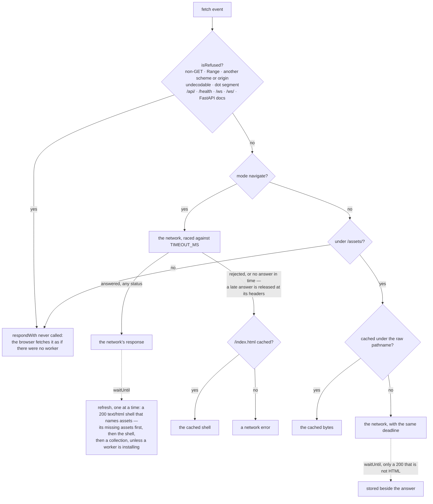
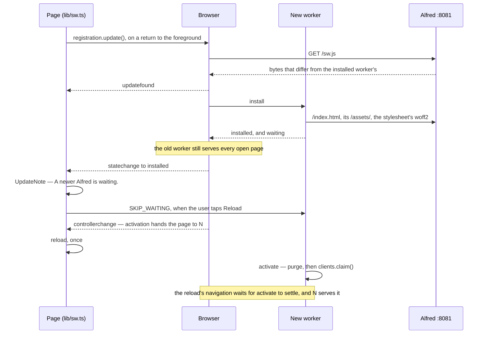
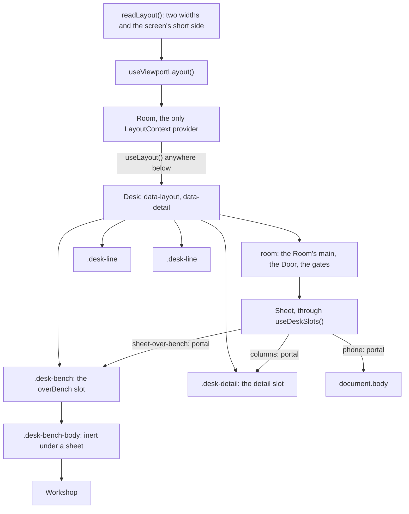

# Alfred Web Frontend

## Overview

The web frontend is the phone-first PWA client that replaced the Mission Control SPA
(icon rail, telemetry rail, data tables, shadcn component library — all removed in the
phase 1 rewrite). It is a single-page application built and served by the Alfred
channels process on port 8081.

It has **one screen** (the Room), **one interrupt** (the Door), and **four identity
gates** that rise over both, with two more that say why the identity read has not been
answered yet — and, under the Room, the **Workshop**, where the house's eight Redis
streams are read as they happen. There is no navigation: a notification tap deep-links
to the approval it names, the Workshop is a layer rather than a route (from 760 px, a
column beside the Room: "Desktop"), and everything else is one merged timeline. A
hand-written service worker keeps the app shell on the
device, so the app opens with no network at all, and never keeps anything the house said;
it also shows the house's pushes when the app is closed, counts them on the icon, and a
tap on one opens the approval it names ("Web Push").

Design source: `docs/design/2026-09-04-pwa-client-handoff/` (tokens, copy, and the
`Alfred.dc.html` prototype the presence field and the slide maths were ported from).
Spec: `docs/superpowers/specs/2026-09-04-mobile-first-pwa-client-design.md`.
Client-side working notes: `web/README.md`.

All six phases are built, phase 5 in two slices. Phase 4 is the icon set, the manifest pair,
the service worker and its kill switch, and the gates for a launch that has read nothing.
Phase 5's slice 1 is Web Push: the worker's `push` and `notificationclick` listeners, the
subscription the app keeps registered, System › Reach, and the `install` and `standalone`
gates it opens ("Web Push"). Its slice 2 asks in the Room and puts a number on the icon: on
an iPhone, the home-screen prompt row beside a waiting Door, the `standalone` gate opening
itself once on launch, and the allowed and declined Act rows; and, where the browser has
one, the icon badge. Phase 6 lays the same client out for a laptop: from 760 px the Workshop
stands beside the Room, from 1100 px a detail takes a third column, and a solo dims rather
than filters and the bench answers to the keyboard ("Desktop"). What Reach raises in the Room
stays on the iPhone, because the handoff draws no wording for anywhere else (R16, "Desktop").
What is still missing is in "What the six phases do not cover" at the end.

---

## Stack

| Concern | Tool | Version |
|---|---|---|
| Build | Vite | 8.x |
| Runtime | React | 19.x |
| Language | TypeScript | ~6.x |
| Styling | Tailwind CSS | v4.x (Vite plugin, `@theme inline`) |
| Data fetching | TanStack Query | 5.x |
| Routing | react-router-dom | 7.x |
| Testing | Vitest + Testing Library (jsdom) | Vitest 4.x, `@testing-library/react` 16.x, `jest-dom` 6.x |
| Lint | ESLint | 10.x |
| Fonts | DM Sans Variable (sans), Geist Mono (mono) |
| Service worker | Hand-written `public/sw.js` | — (no `vite-plugin-pwa`, no Workbox) |

No component library, no icon package, no markdown renderer, no toast library, no
command palette, no service-worker library. The presence field is a `<canvas>`, the
Door's fuse is a `conic-gradient`, and slide-to-confirm is four pointer handlers and a
keyboard path.

---

## Directory Map

```
web/
  index.html       # viewport-fit=cover, interactive-widget=resizes-content,
                   # one theme-color meta and one manifest link (applyTheme rewrites
                   # both), the apple-touch-icon link, Apple standalone metas
  public/          # Unhashed; copied into dist/ byte for byte ("The service worker")
    sw.js                # The service worker: precache, purge, route, SKIP_WAITING,
                         # and the push and notificationclick listeners ("Web Push")
    sw.kill.js           # The kill switch — nothing registers it until it is copied over sw.js
    manifest.json        # The manifest in the dark theme's colours
    manifest-light.json  # The same in the light theme's; applyTheme swaps the link
    icon.svg             # The mark, drawn as paths: the PNGs' source, and the favicon
    apple-touch-icon.png # 180x180, opaque — the iOS home-screen tile
    icon-192.png         # The manifest's small raster icon
    icon-512.png         # The manifest's large one, which is also its maskable
  src/
    lib/           # No React: transport, formatters, physics, pure reducers
      api.ts             # api/post/put, apiWithHeaders, ApiError{status,detail};
                         # 401→expired, 403→denied (not for the status read, whose
                         # route sends neither); timedOut() — whether a request
                         # failed on its deadline
      auth-events.ts     # authEvents.on/emit — the emitter api() announces gates on;
                         # AuthGate emits `signed-in` on it with every sign-in, and
                         # useActionRoute reads again on it ("The Door")
      auth.ts            # fetchAuthStatus (STATUS_DEADLINE_MS, the payload check),
                         # DEVICE_KEY, rememberDevice, deviceFootLine
      sw.ts              # installServiceWorker, onUpdateReady, applyUpdate, unregisterAll —
                         # the page's half of the service worker; unregisterAll takes a
                         # `stopped` check, so a later install stops a dev clean-up
      push.ts            # reachContext, permission, fetchPublicKey, syncSubscription,
                         # requestAndSubscribe, forgetPush, onOpenPath, and the three
                         # deadlines — every browser push API the app touches ("Web Push")
      badge.ts           # badgeSupported, clearBadge, onBadgeAdded — the page's half of the
                         # icon's count, under the worker's own names
      reach-local.ts     # What this browser alone knows about reaching it: the Act rows,
                         # the Doors `Not now` answered, and the gate's flag
      device.ts          # onIPhone, for the copy that names one
      webauthn.ts        # registerPasskey(), loginPasskey(), sessionChannel()
      ws.ts              # ReconnectingSocket — backoff, code-4001 gate, ping keepalive
      chat-socket.ts     # ChatSocket over /ws (channel "web_pwa", timezone, session_id)
      telemetry-socket.ts# TelemetrySocket over /ws/telemetry; subscriptions refcounted
      types.ts           # The shared type contract (hand-mirrors the bus/admin schemas)
      format.ts          # hhmm, hhmmss, dayMonth, dayLabel, mmss, usd, evs, shortId,
                         # humaniseTool, rawCall, notificationText
      theme.ts           # Theme, THEME_KEY, resolveInitialTheme, applyTheme, storedTheme
      viewport.ts        # installViewportVars
      lifecycle.ts       # onVisible(fn) — the one visibilitychange subscription
      audio.ts           # One unlocked AudioContext: installAudioUnlock, playWavBase64
      recorder.ts        # pickMimeType (mp4→aac→default), Recorder, blobToDataUrl
      presence-signal.ts # PresenceSignal — the ported signal() envelopes
      headline.ts        # greetingFor, pickHeadline — the whole priority table, pure
      history.ts         # TimelineItem, fetchRoomHistory, toTimelineItems,
                         # sessionWindow, withDividers, SESSION_IDLE_MS
      actions.ts         # actionReducer, fuseRemaining, tombstoneItems, the three fetches
      slide.ts           # CONFIRM_RATIO, slideKnob, hintOpacity
      streams.ts         # STREAMS, STREAM_INFO, isStreamName, streamLabel,
                         # ring/ringFill/ringText, idMs/compareIds, fetchStreamPage,
                         # rowKey, summarise, and the shared scalar/record/strings —
                         # the eight streams and one line for any event on any of them
      feed.ts            # feedReducer, mergeRows, olderTargets — eight paged lists,
                         # pause/hold, the horizon; MAX_PER_STREAM
      trace.ts           # fetchThread, buildThread, nodeMeta — the causal thread
      memory.ts          # EpisodicRow, toEpisodicRow (the three-shape adapter),
                         # episodicMeta, routineTrend/routineDetail, the four reads
      triggers.ts        # Trigger, triggerKind, triggerMeta, list/toggle/fire
      system.ts          # AuthSession, Credential, Integration, AttentionDomain,
                         # sessionMeta/credentialMeta/serviceNote/spendNote, the
                         # health cells, and every read and write the System bench makes
    shell/         # Providers, the layout, and the surfaces everything rises on
      QueryProvider.tsx      # QUERY_DEFAULTS: one retry, none for a 4xx or a deadline
      ErrorBoundary.tsx      # The Workshop's; a bench that throws costs the layer,
                             # or at width the column until `Start it over`
      ThemeProvider.tsx      # useTheme(); writes data-theme and the theme-color meta
      ThemeToggle.tsx        # 44x44 half-filled circle
      ConnectionProvider.tsx # Socket singletons; useConnection, useLastTrue, markTrue
      layout.ts              # readLayout, useViewportLayout, LayoutContext, useLayout:
                             # phone, sheet-over-bench or columns ("Desktop")
      Desk.tsx               # One tree at every layout: the Room, the bench, the detail,
                             # and the two slots a Sheet lands in (useDeskSlots)
      keys.ts                # isEditing: a key pressed in a field is text
      presence.ts            # usePresence, useModalFocus, useAsideFocus, riseStyle,
                             # prefersReducedMotion
      Layer.tsx              # Portal + rise in/out + focus trap + inert + level
                             # (workshop z-10 · layer z-30 · gate z-40)
      Sheet.tsx              # A detail in three modes: the phone's modal bottom sheet,
                             # a sheet over the bench, the third column
      UpdateNote.tsx         # "A newer Alfred is waiting." + Reload, in the Room's header
      useUpdateReady.ts      # Whether a changed sw.js is waiting (onUpdateReady)
      useOnline.ts           # navigator.onLine and its two events — explains, never gates
      usePush.ts             # usePush({ syncOnMount }) → { reach, asking, enable, retry };
                             # the one push query, ["push", "subscription"]
      PushKeeper.tsx         # PushKeeper (the launch and sign-in sync and the icon's clear,
                             # inside AuthGate) and NotificationOpen (routes the worker's
                             # OPEN_PATH, outside it)
    gates/         # Identity, over whatever is on screen; and the two on the way to notifications
      AuthGate.tsx       # Which gate, over what
      Gate.tsx           # kicker / title / body / children / footer, and the pointer
      GateField.tsx      # 220px dot field, drifting slowly
      StepList.tsx       # 48px rows, 22px ring; progress and toggle variants
      SetupGate.tsx      # First run: passkey → home-service credentials → attention set
      SignInGate.tsx     # Passkey sign-in
      ExpiredGate.tsx    # 401
      DeniedGate.tsx     # 403
      OfflineGate.tsx    # Nothing read, and the phone says it is offline
      UnansweredGate.tsx # Nothing read, the phone online, and the house did not answer
      InstallGate.tsx    # In a browser tab: add to the home screen, and the Share pointer
      StandaloneGate.tsx # In the installed app: Let me reach you
      ReachGates.tsx     # That pair at level "gate", hosted by System › Reach and by the Room
    room/          # The one screen
      Room.tsx           # Composes all of it
      PresenceField.tsx  # 393x190 canvas; the ported presence()
      Headline.tsx       # The page's one h1
      OfflineNote.tsx    # role="status", mounted always, filled only when not online
      DndRow.tsx         # Do-not-disturb + "{n} held ›"
      StatusLine.tsx     # The mono-12 status line: clock or last-true, cloud, reflex, rate
      Timeline.tsx       # The list and its scroll anchoring
      rows/              # Divider, YouBubble, AlfredRow, ActRow, Tombstone,
                         # TranscribingBubble, ThinkingRow, FirstDay, ReachRow
      Composer.tsx       # 50px field, send / hold slot, keyboard padding; ⌘K at width
      HoldToTalk.tsx     # Pointer hold, mic, caption, bars
      WorkshopHandle.tsx # The 44px handle under the composer; hidden with the keyboard
                         # up, and on the phone only
      useOverview.ts     # ["overview"], 30s poll, isFirstRun(), sessionIdleMs(), rateText()
      useRoomHistory.ts  # ["room-history"], read once, re-read on return
      useDetail.ts       # Which detail is open, the thread or Held back; never both
      useRoom.ts         # Live timeline state, the session window, send,
                         # unsent queue, no-reply timeout
      useReachPrompts.ts # What the Room raises about notifications on an iPhone: the prompt
                         # row, the gate that opens itself, the Act rows ("Web Push")
    door/          # The approval interrupt
      DoorProvider.tsx  # useDoor(); the reducer's three feeds and the 1s tick
      DoorBanner.tsx    # The ink banner above the composer
      DoorLayer.tsx     # The full inverted layer
      FuseRing.tsx      # 34px and 168px conic ring
      SlideToConfirm.tsx# Slide with travel
      useActionRoute.ts # /actions/:id
    workshop/      # The layer under the Room; from 760 px, the column beside it
      Workshop.tsx      # Layer level "workshop" (a named section at width): ‹ Room, the
                        # header's live region, the switcher, all four hooks, and the
                        # one mounted bench
      BenchSwitcher.tsx # The four-tab segmented control: a full ARIA tab set
      tabs.ts           # tabId and tabKeyDown — the two tab sets' shared behaviour
                        # (the switcher and Memory's sub-tabs; the chips are not tabs)
      ActivityBench.tsx # Stale banner, chips, ↑ older, the list and its scroll
                        # anchoring, the footer (at width, a footnote that names the keys)
      EventRow.tsx      # Monogram, line, meta; expanded payload and pills; dimmed at width
      StreamChips.tsx   # Eight chips with counts; tap to solo; compact at width
      useActivity.ts    # Head reads, the subscription, rehydrate on return, paging;
                        # dimSolo, where a solo moves nothing but the dimming
      useBenchKeys.ts   # J/K, Space and 1-8 on the Activity bench, at width
      MemoryBench.tsx   # Four sub-tabs: Episodic list + search footer, Semantic
                        # cards, Routines, Scratchpad
      RoutineRow.tsx    # One routine: trend, lifecycle rail, detail, sparkline
      useMemory.ts      # Sub-tab, browse/search, the four reads, the model pill
      TriggersBench.tsx # Kind chips, the list, both empty states, the footer note
      TriggerRow.tsx    # Kind, name, meta, the switch, payload, Fire now
      useTriggers.ts    # The list, the kind filter, the pending map, the 60 s re-read
      SystemBench.tsx   # Health, Quiet (and Held back), Maintenance
      ReachSection.tsx  # Reach: Push notifications, and which of ReachGates' two is up
      SystemSections.tsx# Sessions, Connected services, Devices & identity, Reflex
      IntegrationRow.tsx# One service: state, dot, and the credential form
      SystemFrame.tsx   # SystemSection and SystemRow — the shared card idiom
      Switch.tsx        # The Workshop's 52x32 switch, measured on both surrounds
      useSystem.ts      # The overview plus five reads, and every write on the bench
    sheets/
      HeldBackSheet.tsx # ["deferred"] + drain
      WhySheet.tsx      # ["trace", stream, id] — the causal thread as a column
    test/
      setup.ts      # jsdom stubs: matchMedia, ResizeObserver, visualViewport, PointerEvent
      fixtures.ts   # Shared fixtures: overview, streams, deferred, pending actions
      contrast.ts   # WCAG ratios over the palette, restated from index.css
      sw-harness.ts # A fake ServiceWorkerGlobalScope the shipped workers are run in
    index.css     # Tailwind import, fonts, tokens per [data-theme], @theme inline,
                  # the type scale, keyframes, safe areas, the fuse arc and its masks,
                  # the desk's grid and the Door's and gates' phone column
    main.tsx      # installViewportVars() → installAudioUnlock() → createRoot →
                  # installServiceWorker()
    App.tsx       # Providers and the three routes
```

Tests live beside their source (`lib/history.ts` → `lib/history.test.ts`). One test file
may cover a small family that ships together (`Layer.test.tsx` covers the phone's `Sheet`
as well, and `Headline.test.tsx` covers `OfflineNote` and `DndRow`). The files outside `src/` — the
two workers, the manifests, the icons and `index.html` — are tested from `src/test/`,
which has no `src`-side neighbour to put them beside.

---

## Design Tokens

Two themes — dark and light — defined as CSS custom properties under
`:root[data-theme="dark"]` and `:root[data-theme="light"]` in `web/src/index.css`, and
registered into Tailwind via `@theme inline`. Nothing in the client uses a Tailwind
palette colour.

| Token | Meaning |
|---|---|
| `--bg` | The room itself |
| `--surface` | Raised paper: notes, bubbles, sheets |
| `--field` | Input fill — a step *above* `--surface` in both themes. In dark it was the same colour as `--surface` (1.00:1) until phase 2, which made the chosen bench and a sheet's input invisible |
| `--detail` | The third column's ground. `#2A2723` in dark is the handoff's (§11), and it is the midpoint of dark `--bg` and `--surface`; §11 draws dark only, so light takes its own midpoint, `#F3EFE8` (R17, "Desktop") |
| `--line` | Hairlines |
| `--keyboard` | The composer's own ground — a design-system token; no component paints it yet |
| `--muted`, `--fg2`, `--fg` | The three text weights, quietest first. `--muted` is 3.46:1 on `--bg` in light theme — under AA, so it is for decoration, not for anything a reader must take on its own. `--fg2` is also what `input::placeholder` is set to: Tailwind's preflight would otherwise half-dissolve `--fg` into `--field` (3.84:1 dark, 3.22:1 light), and the Composer's `Offline · will send when connected` is the only thing that says a typed message will be queued |
| `--accent` | Alfred's warm signal — presence, focus, the fuse. A **fill**: what sits on it takes `--on-accent` |
| `--on-accent` | Text and icons on an accent fill — the theme's own dark colour either way (7.61:1 dark, 6.33:1 light). Never `--ink`, which is near-white in dark and reads 1.77:1 |
| `--accent-text` | The accent *as* text: `‹ Room`, `Why · causal thread`, a sheet's `Done`. Dark's accent is already 7.61:1 on `--bg`, so it is the same colour there; light's is 2.34:1, which is why the token exists |
| `--green` | Applied / healthy, as a **fill**: the Door's `Applied` dot on `--ink`, which is the only thing still using it |
| `--green-text` | Green *as* a word — Memory's `model: ok` pill (`MemoryBench.tsx`) and Connected services' `ok` verdict (`IntegrationRow.tsx`) — and also the dots: the health dot and the service dot, which are state indicators and owe 3:1 rather than a fill's nothing. System's `alive` is the dot and not the word; the word itself is `--fg`/`--fg2` with the rest of the cell. Raw `--green` is 2.29:1 on light `--bg` and 2.12:1 on a card; same reason `--accent-text` exists |
| `--ink`, `--paper`, `--paper-muted` | The Door's inverted surface and its text |
| `--ring`, `--scrim` | Focus ring, and the dim behind a layer |
| `--ring-text-l` | The lightness `ringText()` uses for a stream hue set as text — 0.75 on ink, 0.52 on paper |
| `--ring-count-opacity` | What a compact stream chip's count keeps of that text at width — 0.77 on ink, 0.99 on paper, the least that clears AA on all eight hues |
| `--ease-rise`, `--ease-settle`, `--ease-sink` | The three easing curves: rise in, settle, leave |
| `--app-height`, `--viewport-top` | The visible band's height and offset, written by `installViewportVars()` (below) |

`ThemeProvider` writes `data-theme` on `<html>` and rewrites the single
`<meta name="theme-color">` so Safari's chrome matches. The choice is stored under
`alfred.theme`; with nothing stored, the clock picks (dark at night).

The eight stream hues are **not** tokens: the hue is data (`h = 30 + 45·i` over `STREAMS`),
so it comes from `STREAM_INFO` through three functions in `lib/streams.ts` —
`ring(hue)` at L 0.62 for the Room's 8 px marks, which carry no text; `ringFill(hue)` at
L 0.52 for the fills under white text (monogram tiles, the soloed chip), because white on
`ring()` is 3.45:1; and `ringText(hue)`, the hue *as* text, whose lightness is the one
per-theme token above. `src/test/contrast.ts` restates the palette and holds the pairs a
test can check to 4.5:1; `contrast.test.ts` compares that restatement against `index.css`
verbatim, so a palette edit that leaves it behind fails rather than passing quietly.
Phase 3 added `line`, `muted`, `green`, `green-text`, `ink` and `paper` to it: a control
that shows state owes 3:1 for its **boundary** as well as its indicator (WCAG 1.4.11),
and a boundary painted in `--line` could not be measured at all until then.

### Type scale

Type comes from the `.t-*` classes in `index.css`, never an ad-hoc size:
`.t-gate`, `.t-headline`, `.t-title`, `.t-alfred`, `.t-you`, `.t-body`, `.t-row`,
`.t-label`, `.t-meta`, `.t-fuse`, `.t-status` — and `.t-monogram`, the Workshop's 9 px
stream monogram (`EventRow`, the Why sheet). `.t-meta-strong` is `.t-meta`'s type in a
colour that can be read (`--fg2` rather than `--muted`): the rule, decided once in
`index.css` rather than re-argued per call site, is that meta which is genuinely
decorative — a stamp beside the line it stamps, a count beside the thing counted — stays
on `.t-meta`, and anything a reader must take on its own to trust the screen takes
`.t-meta-strong`. The sizes outside the scale are written as
explicit arbitrary values: 15px (body copy in the gates, sheets, composer and Door),
16px (the gates' buttons, the Door's title and pill), 14px (an event row's line and the
bench's `All streams`), 13.5px (the held-back sheet's note and the Why sheet's intro),
13px (the offline, DND and banner notes, the Room's `why?`, the bench's stale banner, its
row pills and its four tabs), 11.5px (the raw call), 11px (the Door's mono labels),
10.5px (the bubbles' stamps) and 10px (the stream chips).

### The closed status vocabulary

System state is said in mono, lower case, and only in the words spec §10 closes:
`queued`, `applied`, `last true HH:MM`, `unknown since HH:MM`, `hot / cold`,
`candidate · active · dormant · archived`, `expired · not done`,
`takes effect within 60 s`. The Room and the Door use the first three and
`expired · not done` — `queued` and `applied` are the Door's phase pill, not the
Room's; the
Workshop's status line adds the handoff's `live · N ev/s`, `paused · N new` and
`last true HH:MM · not live`; the rest arrived with the phase-3 benches —
`hot / cold` and `candidate · active · dormant · archived` on Memory,
`takes effect within 60 s` on Triggers, `unknown since HH:MM` on System's health stamp.
Phase 4 adds no word: the unanswered gate's kicker says `unknown since --:--`, where
`--:--` is the stamp for a value never known, as the System bench writes one — a time
would claim the value was known at that moment. The one exception to mono-and-lower-case is
the Door's phase pill (`Confirmed · queued`, `Applied`, `Failed`, `Declined`, `Expired`, `Answered`), set in
the inverted layer's own type. Do not invent new words — the vocabulary is the contract
the spec's honesty rules (§5.2) are written against.

**`decaying`** is the ninth word, and it is here because the spec's list above never
enumerated it while the handoff's prototype uses it: `Alfred.dc.html:684` sets an episodic
row's meta to `17:58 today · significance 0.34 · recalled 0× · hot · decaying`. Since the
spec makes the handoff's copy final too, the word is the design's rather than an
invention, and it is written down here so the omission is not mistaken for a licence to
coin more.

> **`decaying`** — a **hot** episodic memory the house weighed lightly (significance below
> `DECAY_FLOOR`, 0.4) and has never reached for. It is the population the Librarian's decay
> pass migrates into cold storage; it is never said of a cold row, because decay is what
> puts a row there and nothing removes one afterwards. It marks a standing, not a schedule:
> the client cannot compute the pass's own pressure formula, which also weighs age and
> retrieval recency against a threshold no endpoint reports. That threshold is 0.2
> (`DEFAULT_DECAY_MIGRATION_THRESHOLD`, [#201](https://github.com/anirudhlath/alfred/issues/201)), and pressure tops out at
> `1 - 2 × significance`, so 0.4 is exactly the significance below which the pass can
> ever reach a row: `DECAY_FLOOR` and the server agree ([#258](https://github.com/anirudhlath/alfred/issues/258) §20).

It is drawn after the store rather than instead of the recall count, exactly as the
prototype draws it: the count is the evidence for the mark.

---

## The gates

`AuthGate` reads `GET /api/auth/status` (`["auth-status"]`) and decides what rises. The
first three rows are a launch that has read nothing yet; only the house's own answer
reaches setup and sign-in:

| Condition | Gate | Over |
|---|---|---|
| Nothing read, and the phone says it is offline | `OfflineGate` — `No way to the house.`, no button | Nothing yet |
| Nothing read, online, and a read asked while online has failed | `UnansweredGate` — `The house is not answering.` + `Try again` | Nothing yet |
| Nothing read, online, and no such read has failed yet | The presence field, no copy | Nothing yet |
| `registered: false` | `SetupGate` — passkey → home-service credentials → attention set | Nothing yet |
| `registered: true, authenticated: false` | `SignInGate` — passkey | Nothing yet |
| `authEvents` emitted `expired` (any HTTP 401 but the status read's and a passkey attempt's, or either socket closing with 4001 — see "Reconnect / backoff / 4001" below) | `ExpiredGate` | The last-known Room |
| `authEvents` emitted `denied` (any HTTP 403 but the status read's) | `DeniedGate` | Whatever is on screen |

**A read that has not landed is never read as an answer.** The first three rows key on
`data === undefined`, never on a request being in flight, and they say which of the
meanings the silence has — the rule phase 3 wrote for the benches ("The rules this
phase's reviews kept enforcing" below), one layer lower down:

- **`OfflineGate`** keys on `useOnline()`, which is `navigator.onLine` read through
  `useSyncExternalStore`, at any stage of the read: in flight, between its two tries, or
  failed. The flag explains a read and never gates one. The request still goes out, and
  if the phone is wrong about being offline the read lands and the gate gives way. It
  has no button. react-query's `onlineManager` starts online and changes only on the
  window's `online` and `offline` events — it never reads the flag — so a launch that
  begins offline is not paused: its read fails at once, and a retry while the phone has
  no connection could only fail the same way. When the `online` event fires, `AuthGate`
  asks again itself and shows the field while it does; a read sent with no network that
  is still in flight then is cancelled and asked again, not waited out to its deadline
  and blamed on the house. Seeding `onlineManager` from the flag would make the flag
  gate every request in the app, so it is deliberately not done.
- **`UnansweredGate`** is a phone with a network and no answer from the house: no route
  to it, no answer before the deadline, a proxy's 5xx or 4xx to the read, a captive
  portal's page, or the house failing to read its own store. Not a house stopped behind
  the proxy: the proxy's 502 answers the navigation first, so the app never boots to ask
  ([#406](https://github.com/anirudhlath/alfred/issues/406) §8). `fetchAuthStatus` (`lib/auth.ts`) gives
  the read a deadline of `STATUS_DEADLINE_MS`, 10 s — the service worker's navigation
  deadline — and rejects a 200 that is not the status payload, and `QUERY_DEFAULTS`
  never retries a read that ran out of time. The route answers 200 with both booleans
  or 500 and sends no 4xx of its own, so no failure of this read is the house saying who
  you are, and none of them reaches sign-in or setup (the table below maps every one).
  `Try again` is held (`aria-disabled` and `aria-busy`) while a read is in flight, and
  the gate stays up meanwhile instead of dropping to the field; `AuthGate` also asks
  again on each return to the foreground. Its kicker is
  `{hostname} · unknown since --:--`, the closed vocabulary's stamp for a value never
  known. On a house that hangs rather than refuses, it rises about 20 s after the tap:
  the worker's navigation deadline, then the read's.

**Every answer the status read can get.** `auth_status` (`core/identity/auth_routes.py`)
answers 200 with both booleans, or Starlette's plain-text 500 when its credential store
fails. Its router has no dependencies, no network gate guards it, and
`AuthCookieMiddleware` turns a failed session lookup into "not authenticated" rather than
an error — so no 4xx is ever the house's answer here. While nothing has been read, each
outcome shows:

| Outcome | Who can send it | Retried | Shows |
|---|---|---|---|
| 200 with `registered` and `authenticated`, both booleans | The house | — | `SetupGate`, `SignInGate` or the Room, from the answer |
| 200 without them (a captive portal's page, someone else's JSON, `null`), or 204 | Not the house | Once | `UnansweredGate` — `fetchAuthStatus` rejects it |
| 500 | The house, its credential store failing; or a proxy | Once | `UnansweredGate` |
| 502, 503, 504 | A proxy | Once | `UnansweredGate` |
| 403 | A proxy or a WAF (a Cloudflare challenge, say); never the house | No | `UnansweredGate` alone: `api()` does not announce this route's 403, so no `DeniedGate` |
| 401 | A proxy; never the house | No | `UnansweredGate` alone: `api()` does not announce this route's 401, so no `ExpiredGate` |
| Any other 4xx | Not the house | No | `UnansweredGate` |
| `TypeError` (refused, no DNS, no route) | The network | Once | `UnansweredGate` |
| The deadline, `STATUS_DEADLINE_MS` | The client | No | `UnansweredGate` |

While the phone says it is offline, every failure shows `OfflineGate` instead. Once the
house has answered, a failed read keeps that answer and the screen with it, and neither
its 401 nor its 403 raises anything. A session that really lapses still says so: the
next status read answers `authenticated: false`, which routes to `SignInGate`, and a 401
on any other request but a passkey attempt, or either socket closing with 4001, raises
`ExpiredGate` over the Room. Likewise `DeniedGate` rises for every 403 but the status
read's: a network-gated route's refusal is the house's own, over these gates as over the
Room. It also rises for a proxy's 403 on any other route, which it should not
([#406](https://github.com/anirudhlath/alfred/issues/406) §13). If the status route ever gains a
network gate, or sends a 401 of its own, that status becomes the house's answer, and
`api()`'s exemption (`isStatusRead`, `lib/api.ts`) has to be revisited.

**401 and 403 never redirect.** `api()` emits on `authEvents` (`lib/auth-events.ts`) and
the gate rises *over* whatever is on screen, so a lapsed session never blanks the state
the user was looking at (spec §5.2). A rejected passkey assertion is a 401 too, and is
excluded: `/api/auth/login/*` and `/api/auth/register/*` show the failure in the gate
that asked rather than raising a second one. The status read's 401 and 403 are excluded
too, for the reason above.

The session TTL is 8 hours, a hard cap from login with no sliding renewal, and the
Expired gate says so.

The copy region inside `Gate` scrolls: the shell is a fixed height (constraint §4.4), so
an inner `mt-auto` column keeps short copy bottom-aligned while setup's tall credential
step scrolls instead of clipping.

**A gate's buttons are never natively `disabled`.** A primary that is unavailable or busy
is held with `aria-disabled` and a press that does nothing, and keeps the focus: a native
`disabled` threw it to `<body>` the moment `Sign in with Face ID` or
`Create passkey with Face ID` was pressed (measured in Chromium, by pointer and by
keyboard). Unavailable and busy are painted alike, an `--fg2` label on a `--surface` fill
with an inset 1 px `--muted` edge, and a busy one adds `aria-busy`. The edge is there
because `--surface` is only 1.13:1 off `--bg` in dark and 1.08:1 in light;
`contrast.test.ts` measures all three pairs in both themes. A held secondary —
unavailable, or waiting on its request, which adds `aria-busy` — is `--fg2` on the page.
The handoff draws no unavailable or busy state for a gate's buttons, so this style is
invented, and the plan's deviation 13 puts it to the owner. When setup advances a step,
the focus moves to the new step's title, in a layout effect, so it is there in the first
frame the step paints; and the title is described by the step's foot
(`aria-describedby`) whenever the foot has text, so the move reads both.

---

## The Room

Everything on screen is one timeline.

- **Presence field** — a 393x190 `<canvas>` driven by `PresenceSignal`: the microphone
  while you hold the button, a thinking envelope while Alfred is working, and a still
  frame under `prefers-reduced-motion`.
- **Headline** — the page's one `<h1>`. `pickHeadline()` is a pure priority table:
  offline and reconnecting outrank everything (an unreachable house must not say
  "Good morning, sir."), then holding, then busy, then DND, then the first-day greeting.
- **Status line and offline note** — the vitals, and `last true HH:MM` whenever the
  socket is not online. The stamp moves on every chat frame, every socket open and every
  overview read as it lands in the cache (`ConnectionProvider`) — never on the reply to
  a read already cancelled and asked again. `Room` reads it at render time, beside the
  overview (`useLastTrue`, not the context), and an overview read's stamp is written in
  the same step as the overview itself, so no frame can draw one without the other. The
  note's `role="status"` region stays mounted and empty while online: VoiceOver can miss
  a live region inserted with its text already in it.
- **Timeline** — `useRoomHistory` reads four stream pages once
  (`user_requests`, `user_responses`, `reflex_observations` with an `action`, and
  `notifications` without a `pending_action_id`) and `toTimelineItems` merges them by
  timestamp. `sessionWindow` then keeps **the current session** — the turns since the
  last silence of the session idle timeout (satellite turns included; they land on the
  same two streams) — plus the house's own rows for the day, or from the session's start
  if that came earlier. That window is conversational continuity across every channel,
  not a claim about what Alfred still has in context: which server session a turn belongs
  to is `chat-socket.ts`'s business ("Sessions" below), and that id can turn over inside
  one window. `useRoom` merges
  the result with the live rows (what you sent, what Alfred said, what he did while you
  watched) and the Door's tombstones, neither of which is ever windowed. On an iPhone this
  device adds two more ("Web Push"): its Act rows join the history and are windowed with
  it, and the prompt row sits beside the tombstones, for as long as its Door. After a break
  the Room opens on the day's house rows alone — on nothing at all when there are none;
  older turns are the Activity bench's — open the Workshop. Row text comes from `notificationText`
  ("WebSocket Protocols" below).
- **Composer and hold-to-talk** — text queues under `alfred.unsent` while the house is
  unreachable and retries in order on the next socket open; holding records through
  `MediaRecorder` with a one-second floor. A message still being typed is kept for the
  tab under `alfred.draft` (`sessionStorage`), so a reload — the update note's `Reload`
  above all — does not take it; it goes when it is sent or emptied. A lapsed session and
  `Sign out on this device` leave it, as they leave `alfred.unsent`, by design: the house
  has one principal, and the draft shows only after a passkey sign-in.
- **Held-back sheet** — the DND row's `{n} held ›` opens `["deferred"]` and can drain it.

Nothing in the Room polls except the overview (30 s). The telemetry socket starts at `$`
and replays nothing, so `ConnectionProvider` invalidates `["overview"]`,
`["room-history"]`, `["pending-actions"]` and `["deferred"]` on `visibilitychange` —
that is what makes a suspended PWA correct on return (constraint §4.10).

---

## The Door

A critical action needing approval: a System 2 run that parked its critical calls, or an
action the router intercepted ([`autonomy.md`](autonomy.md#confirmation-flow-for-critical-actions)).
It is tracked by `actionReducer` over
`TrackedAction[]`, fed from three independent places so it survives a cold launch, a
notification tap and a suspended app:

1. `GET /api/actions/pending` (`["pending-actions"]`) — the cold-launch read.
2. A `/ws` `notification` frame carrying `metadata.pending_action_id`.
3. The `home_action_results` telemetry stream.

Phases: `pending` → `queued` → `applied` or `failed`, plus `declined`, `expired` and
`answered`.

**A 200 from `POST /api/actions/{request_id}/confirm` means queued, never applied** —
the endpoint hands the approval on and returns before anything runs. `applied` comes
only from `home_action_results`, and so does `failed`: the same report with
`status: "error"` (the owner said yes, the lock said it could not; the footer then offers
to ask again). One approval can cover several calls, each publishing its own result under
the same id; a `failed` item stays `failed` when a later call succeeds. A 404 on confirm or
deny means someone or something else answered first: the phase becomes `answered`.

**Declining.** The layer has a **Don't** button next to the slide (`POST
/api/actions/{request_id}/deny`). A 200 sets `declined`, which outranks what the phone merely
inferred (`expired` from a fast clock, `answered` from a racing 404). A declined run is told
so by the house and says so in the Room. A late `home_action_results` entry after a decline
still wins — `applied` or `failed` replaces `declined` — because if the lock reported, the
decline was wrong about what happened, and the Door shows what the lock did.

**Closing itself.** `applied` and `declined` leave the Door up for two seconds
(`SETTLED_CLOSE_MS`), enough to read the pill, and then it closes. `failed` stays, because
it has to be read, and so does `queued`, because the report may yet be a failure. `Back to
the room` closes any of them sooner. A Door that closed itself comes back if what it said
stops being true: a later call of the same approval failing, or a result arriving after a
decline. If another Door is up, it waits for that one to close.

**An ask is not critical.** A Reflex ask (`source` is `reflex-engine`) opens the same Door,
reading `ASK · a91f` and labelled `Approval`, with the question it put as its heading
(`title` on the pending payload). The banner and the tombstone go by that question too.

**A failed answer is not a lost one.** A confirm or deny that fails with anything other than
404 (a 503, no network) leaves the item `pending` so the owner can retry while the fuse
still runs; the failure is logged to the console (`door: could not answer {id}`), where
Safari's inspector can see it.

Confirmation is a slide with travel (`CONFIRM_RATIO = 0.85`), never a tap; iOS gives the
client no haptics, so the resistance is the confirmation. An approval that lapses leaves
a struck-through tombstone in the thread. `/actions/:id` renders the same Room with the
Door open over it — `useActionRoute` reads the action once and tells the Door when the
deep link finds one already gone. A 401 is no answer: the path stays under the Expired
gate, and the read is asked again after the sign-in (`authEvents`' `signed-in`, which
`AuthGate` emits with every sign-in), or by the Room the sign-in gate mounts afresh.

---

## The Workshop

A `Layer` at level `workshop` (z-10): under the sheets (z-20), the Door (z-30) and the
gates (z-40), over the Room. It is mounted in `Room.tsx` as `Desk`'s `bench`, opened by
the handle under the composer, and closed by `‹ Room` or Escape. Its header line is the
socket's word first (`last true HH:MM · not live` while the telemetry socket is down),
then the feed's (`paused · N new`), then the overview's rate (`live · N ev/s`) — and
since phase 3 the state word is the app's one bench-independent live region
("The Workshop's four benches", below). All four benches are built: Activity, Memory,
Triggers and System. This section is the phone's; from 760 px the same panel is a column
beside the Room, with no handle and nothing to close ("Desktop").

An `ErrorBoundary` sits inside the layer and around the panel, not around the app: a
bench that throws costs the reader the Workshop and not the Room under it, and closing
the layer unmounts the boundary so the next open starts clean. Its fallback is a
`role="alert"` — the only one in the client, because this happened under the reader's
hands rather than arriving behind them — saying `This bench stopped working.` and
offering `Room`. A column that never closes offers `Start it over` instead (R18, "Desktop").

`BenchSwitcher` is a full ARIA tab set rather than four buttons wearing `role="tab"`:
every tab carries an id and `aria-controls` for the one `role="tabpanel"` the Workshop
renders, only the chosen tab is in the tab order (roving `tabIndex`), and ←/→ move the
selection with the focus and wrap around the four.

**Activity** is `useActivity` over `feedReducer` (`lib/feed.ts`). Opening the bench
reads each stream's head page (`GET /api/admin/streams/{name}?count=50`) and subscribes
to all eight; `entry` frames are inserted at the top, or held while paused (`paused · N
new`, released on resume). Everything is keyed and ordered by the Redis id — `idMs`
is the millisecond half — never by `event.timestamp`. Each stream keeps its newest
`MAX_PER_STREAM` (400) entries, or as many as `↑ older` has already fetched, whichever is
deeper: the depth the user paged to is a floor the cap never rolls back. Past it the
oldest fall off the bottom and the cursor moves up to match, so nothing becomes
unreachable. Older mode is exempt from the cap by design, so a paged stream grows without
a ceiling — the virtualization ticket carries the cost
([#257](https://github.com/anirudhlath/alfred/issues/257) §1).

The hook's `loaded` says the head read *settled*, however it settled; `streamLoaded` says
it per stream. Both are needed to say what an empty list means without inventing
anything: nothing loaded yet, `0 entries · nothing has been written` for a stream that
answered, and `could not be read` for one that did not. "Nothing has been written" about
a stream the bench never read would be a claim about the server it has no evidence for
(spec §5.2).

**The horizon.** The list is a merge of up to eight independently paged streams. A
stream that can still page (`next_before` set) is only known back to its oldest loaded
entry, so rows from any stream older than the *shallowest* such stream are withheld —
otherwise one stream's past would sit next to another's silence and read as a quiet
spell. `↑ older` fetches the streams sitting at the horizon, and the button's label is
that cursor. Solo-ing a chip narrows the merge (and the horizon) to one stream; at width it
dims the other seven and narrows nothing ("Desktop").

**Rehydrate on return** (§4.10): the telemetry socket starts at `$` and replays nothing,
so `useActivity` re-reads every head page on `visibilitychange`. The reducer merges an
overlapping page in place and starts a stream over when the page does not reach the
entries it already had — a gap it cannot see across is not papered over. Not while
paused, though: a page is not a live frame and the reducer would merge it straight in,
sliding rows into a list the handoff promises will not move until Resume. Resume does
that re-read instead.

**Holding the reader's place.** Live rows land on top of the list, which would push
whatever is being read down the screen; WebKit has never shipped `overflow-anchor`, so
`ActivityBench` measures the growth in a `useLayoutEffect` and gives it back to
`scrollTop` — keyed on which row is newest, so an `↑ older` page or an opening payload
(the reader's own doing) moves nothing, and skipped at `scrollTop === 0`, where watching
rows arrive is the point. A second layout effect resets the scroll to the top when the
solo changes: a different stream is a different list. At width it is the same list, so the
effect stands aside.

**Causality.** A reflex act row in the Room (`why?`), or an RX or AL row in Activity
(`Why · causal thread`), opens `WhySheet` with a `StreamRef`. The two streams the bench
offers it on are `WHY_STREAMS` in `ActivityBench.tsx`: both have a cause the server holds
— an observation's `trigger_event`, and a reply's `actions_taken` naming the tool an
action ran. The reply is spec §5.1's own conversation turn ("correlate one conversation
turn with the system activity it caused"); the Room's Alfred bubbles do not offer it yet
([#257](https://github.com/anirudhlath/alfred/issues/257) §11). Notifications and triggers are left out
because they have no such id, and a pill that always produced a dashed-only column would
be noise. `lib/trace.ts` reads one
page of 100 from every stream up to ten minutes after the observation
(`fetchThreadCandidates`), then `buildThread` joins from the observation outward on the
ids events actually carry — `event_id` (an observation's `trigger_event` is the
originating event's full dump, which is how a fired trigger reaches the observation it
caused), `request_id`, `session_id`, a reply's `actions_taken` naming an action's tool,
and an action's `entity_id` against a state change within a minute — transitively
through anything admitted. `trigger_id` is deliberately **not** a join: it names the
rule rather than the firing, so two firings of one recurring trigger inside the window
would join, and the walk would carry on from the second firing to its own observation,
action and result, drawing solid connectors across two unrelated episodes. Up to six
unjoined entries within five seconds of a joined one are added as `adjacent in time
only`, drawn with a dashed connector.

A thread of one means one thing only: nothing the anchor's ids reach was inside the
read. It is not the ordinary case for a passive observation — every bus event carries an
`event_id` (`bus/schemas/events.py`) and `trigger_event` is the originating event's full
dump (`core/reflex/runner.py`), so an observation with no action still normally joins the
`home_state` row that caused it. A lone anchor is that row having aged past its stream's
hundred entries, or an anchor whose schema carries no id anything else in the window
shares. The sheet says so rather than promising solid and dashed links and then showing
neither: `Nothing else in the eight streams is joined to this row.` The footnote states what was searched (`searched 8 streams · 100 entries each ·
±10 min`, or `searched 7 of 8 streams (1 could not be read) · …` when a stream's read
failed — the reason is said, not left to be inferred from the count) and appends
` · N stream(s) could not be read back far enough` for every stream whose page both
filled and stopped inside the window — a stream busy enough to fill its hundred entries
inside the window hides the anchor's whole past behind them (`home_state` need only
produce 0.17 entries a second), and a one-node thread must not read as "nothing else was
involved". The query's `staleTime` is the join window itself: the
window has closed behind a thread by the time that much has passed, so re-asking the
same row does not re-read eight streams. The sheet never says "not caused by" — the
client cannot prove that. A server-side correlation id is the follow-up (spec §7,
[#257](https://github.com/anirudhlath/alfred/issues/257)).

---

## The Workshop's four benches

Phase 3 put Memory, Triggers and System beside Activity. The four share one shape, and
it is written down here because the shape — not the screens — is what a fifth bench
would have to keep.

**A bench is a pure view over one hook.** `ActivityBench({ activity, onWhy })`,
`MemoryBench({ memory })`, `TriggersBench({ triggers })`, `SystemBench({ system })`. A
bench fetches nothing, owns no query and imports no `api`; everything that talks to the
server lives in `lib/memory.ts`, `lib/triggers.ts` and `lib/system.ts` — types, fetches,
and the pure formatters that turn what the server sent into what a row can say — with
one hook over each. That is what makes a bench testable by handing it an object: a bench
test builds no `QueryClient` and no providers at all, and the hook's exported state
interface (`Memory`, `Triggers`, `System`) is the whole contract between the two halves.
One section breaks the rule, on purpose: System's Reach (`ReachSection.tsx`) reads
`usePush()` for itself, because its state is the push sync's, which `PushKeeper` keeps
whether or not the bench is showing, and threading it through `useSystem` would only hand
it back. `SystemBench.test.tsx` mocks that one hook ("Web Push").

**The hooks are called in `WorkshopPanel`, above the bench that gets swapped out.** All
four, side by side, each gated on whether its own bench is showing. Only one bench is
mounted at a time — a `switch` with a `never` arm, not four panels with three hidden —
so the reads stop when the reader leaves and the state does not. Surviving a trip to
another tab: Memory's sub-tab, its query and the rows a search already answered with,
Triggers' kind filter and open row, every queued note, a credential's save note, the
drain stamp. Deliberately *not* surviving, because it belongs to the surface it was
typed into rather than to the house: a half-typed credential (`IntegrationRow.tsx`), the
Quiet card's record of which expiry chip you last pressed and the `applied` note it draws
from it (`asked` in `SystemBench.tsx`), an unfolded semantic card (`MemoryBench.tsx`), and
the pairing code, which `useSystem` clears the moment the bench stops showing — a six-digit secret left standing on a screen nobody is watching is
the thing that decision exists to prevent. The list's scroll position goes with them,
which is a cost rather than a choice ([#258](https://github.com/anirudhlath/alfred/issues/258) §15).

**The `enabled` gate.** `useMemory(enabled)`, `useTriggers(enabled)` and
`useSystem(enabled, onHeld)` each take `bench === "…"` from the panel and hand it to
every `useQuery` they own, so a bench nobody is looking at does not scan a Redis
keyspace, glob a directory, or probe every connected service in turn. `useActivity` takes the
same gate over its *reads* only — the eight head pages, the visibility re-read and
`mergeRows` — while its socket stays subscribed and its frames keep landing, because the
header speaks for the feed on all four benches and a count that stopped counting would
be a lie told quietly. `useOverview(enabled)` gained the flag for the opposite case: a
*disabled* observer never fetches but still re-renders when whoever is polling gets an
answer, which is how Memory's scratchpad card reads the Librarian's schedule
(`useOverview(false)`) off the poll the Room is already running.

**The episodic adapter.** `GET /api/admin/memory/episodic` answers in three shapes for
what the design draws as one row, and `toEpisodicRow` in `lib/memory.ts` is the one
place that knows it. Nothing above that file branches on a *shape* again — `MemoryBench`
reads `row.store` once (`MemoryBench.tsx:126`), for the muted cold line and the store dot,
and never to decide what a row says:

| | browse · hot (Redis hash) | browse · cold (SQLite row) | search (`EpisodicResult`) |
|---|---|---|---|
| identity | **absent** — the key is discarded | `id` | `id` |
| the sentence | `content` | `summary` | `summary` |
| time | epoch seconds **as a string** | epoch seconds as a REAL | an **ISO 8601 string** |
| entities | `"lamp,kitchen"` | `"[\"lamp\",\"kitchen\"]"` | `["lamp","kitchen"]` |
| significance | a string float | JSON text `{"overall": …}` | an object `{"overall": …}` |
| recall | `retrieval_count` as a string, `last_retrieved` `0.0` for never | **absent** | `retrieval_count` — real for a hot row, hardcoded for a cold one; `last_retrieved` never set at all |
| score | absent | absent | `score` |

Two consequences the rows say out loud rather than paper over. A hot browse row gets the
key `hot:<index>`, because it carries no id at all and the list is replaced whole on
every read — correct there and nowhere else. And **a cold row prints no recall clause at
all**, in either shape: the columns are not in the cold schema, so a browse omits them,
and a cold search row carries a `retrieval_count` the store hardcodes and `recall()`
increments — always exactly 1, whatever the row's history. So `recalled` is `null` for
every cold row and the meta line drops the clause, the way it drops a significance the
server did not send. Absent, not zero: `never recalled` would be a claim about the house
drawn from a missing column. What the server would have to change is
[#258](https://github.com/anirudhlath/alfred/issues/258) §16. The same evidence moved `decaying` onto
**hot** rows, where both the handoff and the Librarian's decay pass put it (the
vocabulary entry above says what it means). Numeric parsing runs before `Date.parse`, or
an epoch string silently becomes the year 1758.

**Queued is not applied**, and it is the house style for every fire-and-forget control.
A trigger's enable/disable and `Fire now` (`core/channels/admin_api.py:655`, `:674`),
`Send them now` (`:627`) and `Run consolidation now` (`:633`) all answer
`{"status":"queued"}` — the route publishes an internal action and returns, so none of
them is evidence that anything happened. So the row **does not move**: the switch keeps
reporting the stored state
(`aria-checked` is the last read's value, never the requested one), the control's own
label becomes the status word (`Fire now` → `Fire again`), and an `--accent-text` mono
note under the meta line says when this client queued it —
`queued 21:15 · enabling · takes effect within 60 s`. A fire's note names the evidence
the reader would have to go and find: `queued 21:14 · look for trigger.fired on the
events stream to know it ran`. The exceptions are the direct writes the server confirms
and answers with the new state — DND set/clear, ending a session, and `Save & test`,
which is a `PUT` followed by a separate status probe, hence the two words in its note
(`saved · testing`). Even those move on the *re-read* rather than on the tap: the visible
beat between the two is the point. Accent is never success: it marks a decision waiting
on the world, and as text it is always `--accent-text` (`TriggerRow.tsx:258-262`) — raw
`--accent` is a fill. Green is the mirror image: `--green` fills exactly one thing in the
client, the Door's `Applied` dot (`DoorLayer.tsx:43`), and every green *word* and *dot* on
the Workshop is `--green-text`. There is no red.

### The rules this phase's reviews kept enforcing

Five findings came back often enough across the review rounds to be house style now.
The first two govern **anything a reader must read to trust the screen** — a state word, a
value, a label, a control — and not decoration that already carries a text equivalent.
Two of the five have live counterexamples in the tree, all of them older than the rules
but the Door's `Don't`, which master's deferred approvals added after them
([#391](https://github.com/anirudhlath/alfred/pull/391)); each is named under its own rule
rather than left for the next reviewer to find.

- **Dim by token, never by `opacity`.** A spent one-shot, an offline health grid and an
  ended session all recede by swapping to `--fg2`/`--muted`, not by an alpha. A
  composited opacity takes the handoff's `.55` under AA (a meta line lands at 2.71:1 in
  light) and — the reason it is a rule — it is invisible to `src/test/contrast.ts`,
  which is the file that exists to stop exactly that. **There is no "outside the rule"
  for a graphic.** This paragraph used to exempt the routine sparkline's older bars
  (`opacity: 0.7`) on the grounds that the `role="img"` label carried the number the bars
  drew — but the label is what a screen reader gets, and a low-vision sighted reader gets
  the bars. At `0.7` over `--accent` they composited to 1.67:1 on `--bg` in light. They
  dim by token now (`--muted`, with `--accent-text` for the newest), and both pairs are
  measured in `src/test/contrast.test.ts` like every other one. Five dims are left, and
  none is measured: the Door's offline track (`SlideToConfirm.tsx:149`, `0.5`) and its
  offline `Don't` (`DoorLayer.tsx:207`, `0.5`, next rule), a tombstone
  (`Tombstone.tsx:13`, `.8`), an unsent bubble (`YouBubble.tsx:15`, `.6`) and
  `All streams` (next rule, `.4`). The last three are the handoff's own values, so
  dimming them by token is a deviation the owner signs off; all five are filed in
  [#406](https://github.com/anirudhlath/alfred/issues/406) §15.
- **`aria-disabled` plus a no-op handler, never `disabled`.** A control that disables
  itself under the finger that just pressed it throws focus to `<body>` mid-action, and
  where the control is described by the note the press produced — a switch and its
  `queued …` line — a real `disabled` leaves a screen reader with nothing at all about
  the request it just sent. The handler checks the flag itself and returns. The gates'
  buttons and the held-back sheet's drain button keep it since phase 4's final fix wave,
  the drain held while its request is in flight and once it reads `Queued`: a held one is
  `aria-disabled`, keeps the focus of the finger or key that pressed it, and dims by token
  ("The gates" has the style), and a gate's button held on its request adds `aria-busy`.
  Three controls still break it. Activity's `All streams` button breaks both rules at
  once — a real `disabled` carrying `opacity: 0.4` (`ActivityBench.tsx:245-251`),
  phase-2 code phase 3 did not reopen, filed rather than fixed
  ([#258](https://github.com/anirudhlath/alfred/issues/258) §21). The composer's
  `Hold to talk` is a real `disabled` while the house is unreachable
  (`HoldToTalk.tsx:117`), phase-1 code. So is the Door's `Don't`, which carries
  `opacity: 0.5` as well (`DoorLayer.tsx:202-210`) and came with master's deferred
  approvals. Both are filed rather than fixed
  ([#406](https://github.com/anirudhlath/alfred/issues/406) §17).
- **Never say the house is empty before the server has answered.** An empty list has
  three possible meanings and they are different news: the read was refused
  (`Routines could not be read.`), the read has not landed
  (`Routines has not been read yet.`), or the store really is empty
  (`No routines learned yet.`). Refusal outranks the unlanded read, since an errored
  query is both at once. Every bench carries a permanently-mounted `role="status"`
  region labelled `Read errors` for the refusals — mounted empty, because VoiceOver can
  miss a region inserted with its text already in it. The unlanded read is the half that
  is easy to get wrong: it has to be keyed on `dataUpdatedAt`, never on `isFetching`,
  because react-query's default `networkMode: "online"` **pauses** a read with no network
  rather than failing it — a paused query is not fetching, holds no data and raises no
  error, so a bench reached for the first time on a phone with no signal looks exactly like
  one that asked and was told the house is empty. That pause needs react-query to have
  heard the window's `offline` event, which it does when a signed-in phone loses its
  signal — the only way a bench meets one, since nothing past the gates is reachable before
  the house has answered. A launch that begins offline fires no such event and pauses
  nothing, and that case is the gates' ("The gates" above). All three benches carry the
  same `read` flag for it (`useMemory.ts:270-275`, `useSystem.ts:944-970`,
  `useTriggers.ts:359`), and a bench that has not read says **nothing** rather than
  guessing which of the three it is.
  Connected services has a fourth: a read that half answered. `GET /api/integrations`
  lists the adapters even when the server cannot read the tool registry, and marks that
  answer with `X-Tool-Registry: unavailable` rather than changing the array's shape
  (`docs/secrets.md`). `fetchIntegrationListing` reads the header, the section prints
  `REGISTRY_DOWN_NOTE` over the adapters it does have, and the health grid's home card
  says `home assistant · registry unavailable` where it would otherwise have claimed
  `not registered` about a service the server never looked for.
- **Never let a client-set mark outlive its evidence.** A `Pending` stands for
  `REREAD_MS` (60 s) and then until the read that window asks for lands, after which the
  list itself is the evidence. It comes down in the render that draws that read and not
  when the read is sent: dropped at the window, it left the row on the state the tap
  meant to change, with nothing under it, for a round trip. `useSystem` prunes
  its `ended` and `saves` marks against the records still in the last read, so a mark
  cannot keep answering for a session or an integration the house has forgotten; a
  health dot goes out with the rest of the grid once the reads stop landing, even though
  react-query still holds the `alive` that lit it.
- **Every new colour pair is measured in `src/test/contrast.ts` against the surround it
  really sits on.** Phase 3 added `--green-text` (raw `--green` is 2.29:1 on light
  `--bg`, and green became a *word* here rather than a dot) and added `line` and `muted`
  to `TOKENS`, without which a control's **boundary** could not be measured at all. A
  state-bearing control owes 3:1 for both its indicator and its boundary (WCAG 1.4.11),
  and a pair measured on `--bg` says nothing about the same control inside a card — the
  Workshop's `Switch` is measured on both, because System puts one in a `Section`.

There is one live region for the whole layer that survives a change of bench: the state
word in the Workshop's header (`role="status"`), which is why Activity's stale-feed
banner kept its sentence and lost both its region role and its accessible name — it is a
bare `<div data-testid="feed-banner">` now (`ActivityBench.tsx:135-148`), and `Feed status`
appears nowhere in `web/src`. Two regions saying the same thing is worse than one. Only the state word is inside it. The rate and the held count are a
*sibling* span, not an `aria-hidden` child: `role="status"` implies
`aria-atomic="true"`, so any mutation inside re-presents the whole sentence, and a
reader who heard `live` every time the rate ticked would have traded one noise for
another. Whether iOS diffs the accessibility tree or the DOM is not something jsdom can
answer, so it is a line on the device checklist.

---

## Routes

| Path | Element | Notes |
|---|---|---|
| `/` | `Room` | The one screen |
| `/actions/:id` | `Room` | Same screen; `useActionRoute` opens the Door over it (spec §6.3) |
| `*` | `<Navigate to="/" replace>` | There is nowhere else |

Provider order in `App.tsx` is load-bearing:
`QueryProvider → ThemeProvider → ConnectionProvider → BrowserRouter → (NotificationOpen,
AuthGate → DoorProvider → (PushKeeper, Routes))`. `DoorProvider` sits inside `AuthGate` so
nothing reads `/api/actions/pending` before there is a session to read it with, and
`PushKeeper` for the same reason: its registration needs a session. `NotificationOpen`
needs only the router, so a tapped notification's path is heard whichever gate is up
("Web Push").

### Client state keys

| Kind | Keys |
|---|---|
| TanStack Query | `["auth-status"]`, `["overview"]`, `["integrations"]`, `["attention"]`, `["room-history"]`, `["deferred"]`, `["pending-actions"]`, `["trace", stream, id]` (the Why sheet — `staleTime` of the join window, not the app's 10 s), `["push", "subscription"]` (the Web Push sync, `usePush.ts` — `staleTime: Infinity`; what runs it is listed in [`web-push.md`](web-push.md#from-the-pwa)), `["push", "public-key"]` (whether the house has a Web Push key, `useReachPrompts.ts`), `["reach", "acts"]` (the Act rows, read once and disabled, "Web Push"); and the benches' own: `["memory", "episodic", "browse"]`, `["memory", "episodic", "search", query]`, `["memory", "semantic" \| "routines" \| "scratchpad"]`, `["triggers"]`, `["system", "sessions" \| "credentials" \| "integrations" \| "attention"]`, `["system", "integration-status", name]`. Each bench's keys sit under one prefix, which is how `REHYDRATE_KEYS` (`ConnectionProvider.tsx`) reaches all of them with `["memory"]`, `["triggers"]` and `["system"]` |
| `localStorage` | `alfred.theme`, `alfred.device`, `alfred.unsent`, `alfred.session`, `alfred.session-at`, and Reach's `alfred.reach.acts`, `alfred.reach.answeredDoors` and `alfred.reach.gateAnswered` ("Web Push") — every key is `alfred.<noun>`, `alfred.session-at` the one compound noun, except Reach's three, which are `alfred.reach.<noun>` |
| `sessionStorage` | `alfred.draft` — the composer's half-typed message, kept for the tab: it survives a reload, the update note's `Reload` included, and is removed when it is sent or emptied. Storage that refuses costs the draft and never the message. A queued message is `alfred.unsent`'s, in `localStorage`, because it must outlive the tab and a draft need not. Like `alfred.unsent` and `alfred.session`, it survives a lapsed session and `Sign out on this device`, by design: the house has one principal, and the draft shows only after a passkey sign-in |
| Cache Storage | `alfred-shell-<VERSION>`, the service worker's: `/index.html`, the hashed `/assets/*` it names, the `.woff2` fonts its stylesheet names, and `/__shell-manifest`, the worker's record of the precache. Nothing the house said is ever in it ("The service worker") |
| IndexedDB | `alfred-badge`, the icon's count: one number, which the worker adds to and the page puts back to zero ("Web Push") |

---

## WebSocket Protocols

### Chat (`/ws`)

Used by `ChatSocket` (`lib/chat-socket.ts`).

#### Client → Server

```json
{"type": "text",  "content": "<message>", "channel": "web_pwa", "timezone": "<IANA>", "session_id": "<id>"}
{"type": "audio", "content": "<base64-audio-data-url>", "channel": "web_pwa", "timezone": "<IANA>", "session_id": "<id>"}
{"type": "ping"}
```

`session_id` rides the connection's first text or audio frame — `payload()` in
`chat-socket.ts` is shared by both — and only when the client holds an id the server does
not already have. **Sessions** below has the rules.

`ping` is a keepalive (Cloudflare drops proxied sockets idle ~100s); the server answers
`{"type": "pong"}` and does nothing else — in particular a ping does not count as the
first message, so `session_id` restore still works after any number of them. The pong is
answered on the same serial receive loop as chat turns, so it can lag a full
conscious-engine turn (`publish_and_wait` timeout 60s) — pong latency is not a liveness
signal. `ReconnectingSocket` sends these on a 30s interval and tracks `lastMessageAt`, so
unlike the outgoing SPA this client does keep an idle socket open through a proxy.

The audio data URL is whatever `pickMimeType()` negotiated — `audio/mp4`, then
`audio/aac`, then the browser default. Safari has no WebM and throws from the
`MediaRecorder` constructor if you ask for it.

A frame that is malformed JSON, valid JSON but not an object (`[]`, `"str"`, `1`), or
binary rather than text, is refused with
`{"type": "error", "text": "Expected a JSON object", "session_id": "<id>"}` and the
connection stays open.

#### Sessions

The server assigns an id per connection and pushes it in a `session` frame before the
client has said anything (`core/channels/web_server.py`); a client holding no id of its
own adopts that one. `alfred.session` holds the id, and `alfred.session-at` an ISO stamp
that only a send writes; `adopt` and `forget` are the id's only writers, and `forget`
takes the stamp with it, so an id adopted but never sent on carries no stamp at all.

The first message of a connection decides which session the turn belongs to. A stored id
whose stamp has been idle for the timeout or longer is let go, stamp and all, and this
connection's assigned id takes its place; a missing or unreadable stamp counts as idle,
so a phone from before the stamp existed gets one fresh session. What survives is sent as
`session_id` only if the server does not already have it — when the two agree the frame
says nothing, because the server named that id itself. Only a send the socket actually
took commits anything: one it refused spends neither the connection's one chance to carry
`session_id` nor a record of activity the server never saw. After that first frame,
`session_id` is omitted until the next open.

The timeout is the server's own rather than a client constant:
`Overview.session.idle_minutes` → `sessionIdleMs()` (`room/useOverview.ts`) →
`chat.setIdleMs()` in a `Room` effect, with `SESSION_IDLE_MS` (30 min, `lib/history.ts`)
standing in until the overview answers. It is the same boundary the Room windows its
timeline on, so the thread and the id turn over together — and the stand-in is a real
state, not a formality: on a cold launch nothing has asked `/api/admin/overview` yet, so
both the window and the socket sit at thirty minutes, and a house configured below that
renders the thread once and shrinks it one round trip later.

The server locks the id after the first message (`session_locked`), so a session that
idles out mid-connection cannot rotate until the socket next reopens — which on iOS it
does, every time the app is backgrounded long enough.

#### Server → Client (`ChatServerMessage`)

```ts
| { type: "session";       session_id: string }
| { type: "transcription"; text: string; session_id: string }
| { type: "response";      text: string; audio?: string; session_id: string;
                            actions_taken?: string[]; mood?: Mood; followup?: boolean }
| { type: "notification";  title: string; body: string; urgency: Urgency;
                            notification_id: string; audio?: string;
                            metadata?: Record<string, unknown> }
| { type: "error";         text: string; session_id?: string }
| { type: "pong" }
```

- `response.actions_taken` — tool names the Conscious Engine executed; the Alfred row's
  meta reads them.
- `response.mood` — affective tone label. An `error` frame has neither, and says
  `error · HH:MM` rather than inventing a mood.
- `response.audio` — base64 WAV data URL, played through the one unlocked `AudioContext`.
- `response.followup` — true for a reply nobody asked this socket for: the answer to a run
  the owner approved or declined from the Door, or a late answer to a request that already got
  the "taking a little longer" fallback. Every frame the server's follow-up worker sends has it
  ([`notifications.md`](notifications.md#follow-ups-late-answers-and-door-resumes)). The Room
  treats it as unsolicited: an ordinary `response` clears the in-flight rows (thinking, the
  countdown) because it answers the turn they stand for, a follow-up does not, and
  `liftRepliesAboveTransients` seats it above whatever is still in flight.
- `notification.metadata.pending_action_id`, when present, routes the frame to the Door
  instead of the thread. The frame carries no `source`, so a live act row reads
  `HH:MM · live · {urgency}`; the same notification re-read from the stream later shows
  its real source. The row's text is the body, else the title — a title is often a bare
  label such as "Routine Suggestion" — from `notificationText` (`lib/format.ts`), which
  the live row, the history row and the held-back sheet all share so a live row and its
  history copy still pair on the read-back.
- `pong` is swallowed in `ChatSocket` and never reaches listeners.

#### Reconnect / backoff / 4001

`ReconnectingSocket` (`lib/ws.ts`) handles reconnection automatically:

- Initial connect: emits `"connecting"` status.
- On successful open: resets attempt counter, emits `"online"`.
- On close with code **4001**: emits `"unauthorized"` and stops — no retry.
  `ConnectionProvider` turns `"unauthorized"` from either socket into an `expired` event
  on `authEvents`: the same news as an HTTP 401, and the same gate (`ExpiredGate`, "The
  gates" above). The socket is reopened by `ConnectionProvider`'s `reconnect()` — on
  mount, after a successful sign-in, on every return to the foreground and on the
  window's `online` event — never by a backoff timer.
- On other close: exponential backoff starting at 500ms, doubling per attempt, capped
  at 8 seconds. Emits `"reconnecting"` for the first two failures and `"offline"` from
  the third (`OFFLINE_AFTER_ATTEMPTS`), or at once while `navigator.onLine` is false —
  and keeps retrying either way; the next open makes it `"online"` again. The Room
  says `Reconnecting…` for the one and `Unreachable.` for the other.
- `connect()` cancels a retry still waiting out its backoff before it tries, so none of
  `reconnect()`'s callers starts a second retry chain, and none lets a stale retry reopen
  a socket the server has just closed with 4001. The `online` event leans on it: after a
  launch with no network, the offline gate and the sockets both answer that event, so
  the Room's `No connection to the house …` note clears as the chat socket opens — well
  under a second after `online` (0.16 to 0.58 s over two runs in Chromium), where it
  waited out up to 8 s of backoff before.
- **A reconnected socket is not back on its session until it sends a message.** The server
  gives each new socket a fresh session id and adopts the client's previous one only with its
  first message, so a follow-up that lands in that window reaches the app as a notification,
  not as a `response` frame (known limitation, see
  [`notifications.md`](notifications.md#follow-ups-late-answers-and-door-resumes)).
- `ChatSocket.onopen` clears `firstMessageSent` and the previous connection's assigned
  id, so a live stored id is offered again on the next connection. `ws.ts` calls
  `onopen()` **before** `onstatus("online")` on purpose: `useRoom` flushes the unsent
  queue on that status, and a flush that ran first would send the new connection's first
  message with the old connection's state behind it.

### Telemetry (`/ws/telemetry`)

Used by `TelemetrySocket` (`lib/telemetry-socket.ts`). Provides a live push of Redis
stream entries. The Door subscribes to one stream, `home_action_results`, for the app's
lifetime — it is what turns a queued approval into an applied one; the Workshop
subscribes to all eight while it is up and lets them go when it leaves.

#### Client → Server

```json
{"type": "subscribe", "streams": ["home_action_results"]}
{"type": "unsubscribe", "streams": ["home_action_results"]}
{"type": "ping"}
```

`TelemetrySocket` counts wanters per stream: `subscribe` goes out only when a count
leaves zero, `unsubscribe` only when one reaches it — so the Workshop closing never takes
the Door's stream with it. Both methods walk `new Set(streams)`, so a name repeated in one
call is one wanter and `subscribe(["events", "events"])` is released by a single
`unsubscribe`. Every `subscribe` owes exactly one `unsubscribe`; the Door never pays,
deliberately, and an over-counted stream costs frames nobody reads while one released
early goes quiet on a surface still watching it.

`ping` is the same keepalive as on `/ws`: answered with `{"type": "pong"}`, and it emits
no `subscribed` ack and leaves the subscription set untouched.

On reconnect, everything still wanted is re-sent automatically (`onopen` replays the
keys of the wanter map), with no consumer involvement. Subscriptions start at `$`:
nothing that happened while the app was suspended is replayed, which is why the query
keys above are invalidated on return — and why `useActivity` re-reads all eight head
pages on `visibilitychange`.

#### Server → Client (`TelemetryMessage`)

```ts
| { type: "subscribed"; streams: string[] }
| { type: "entry"; stream: string; id: string; event: Record<string, unknown> }
| { type: "status"; detail: string }
| { type: "error"; message: string }
| { type: "pong" }
```

- `subscribed` — full current subscription set, sent after every subscribe/unsubscribe.
- `entry` — one per new Redis stream entry; `event` is the deserialized payload
  (not a raw JSON string).
- `status` — transient pump error (`detail: "redis_error"`); connection stays alive, pump
  retries after 1s backoff.
- `error` — a frame the server could not read (`message: "invalid JSON"`). Note the field
  is `message` here and `text` on `/ws`.

`ConnectionProvider` puts `status` and `error` on the console (`console.warn`), the same
complaint at most once a minute (`WARN_EVERY_MS` — the pump repeats `redis_error` every
second for the whole of an outage). Nothing on screen shows them, still: the System
bench reports the *reads* that failed, and each bench's `Read errors` region says the
same about its own, but no surface carries the socket's own frames.

---

## Data Flow

```mermaid
graph TD
    subgraph Browser
        QC[QueryClient<br/>TanStack Query]
        Router[BrowserRouter<br/>react-router v7]

        subgraph ConnectionProvider
            ChatSock[ChatSocket<br/>/ws]
            TelSock[TelemetrySocket<br/>/ws/telemetry]
            Conn[useConnection · useLastTrue<br/>online · chatStatus · lastTrueAt]
        end

        AuthGate[AuthGate<br/>offline · unanswered · setup · sign-in · expired · denied]
        SwPage[lib/sw.ts<br/>register · update on foreground · SKIP_WAITING]
        Load["a launch or a reload<br/>the document and its assets"]

        subgraph Room
            Presence[PresenceField<br/>PresenceSignal]
            Head[Headline · StatusLine · OfflineNote · UpdateNote · DndRow]
            TL[Timeline<br/>useRoom + useRoomHistory]
            Comp[Composer · HoldToTalk]
            Sheet[HeldBackSheet]
            Why[WhySheet<br/>lib/trace.ts]
        end

        subgraph Workshop
            Bench[BenchSwitcher<br/>Activity · Memory · Triggers · System]
            Feed[useActivity<br/>feedReducer · mergeRows]
        end

        subgraph DoorProvider
            Reducer[actionReducer<br/>TrackedAction phases]
            Banner[DoorBanner]
            Layer["DoorLayer<br/>FuseRing · SlideToConfirm · Don't"]
        end
    end

    subgraph SWG["Service worker · web/public/sw.js"]
        SW[fetch · install · activate · message]
        ShellCache[("alfred-shell-#lt;VERSION#gt;<br/>index.html · /assets/* · woff2")]
    end

    subgraph "Alfred :8081"
        WS_CHAT["/ws chat"]
        WS_TEL["/ws/telemetry<br/>Door: home_action_results<br/>Workshop: all eight"]
        REST["/api/admin/* · /api/actions/* · /api/auth/*"]
        SPA["mount_spa<br/>index.html · /assets/* · /sw.js"]
    end

    ChatSock -->|WebSocket| WS_CHAT
    TelSock  -->|WebSocket| WS_TEL
    QC       -->|REST fetch, never answered by the worker| REST
    Load     -->|navigation · /assets/*| SW
    SW       -->|navigation network-first · /assets/* cache-first| SPA
    SW       --- ShellCache
    SwPage   -->|register · update · SKIP_WAITING| SW
    SwPage   -->|a changed sw.js is waiting| Head

    ChatSock --> Conn
    TelSock  --> Conn
    Conn --> Head
    Conn --> AuthGate

    ChatSock -->|response incl. followup · transcription · error| TL
    ChatSock -->|notification without pending_action_id| TL
    ChatSock -->|notification with pending_action_id| Reducer
    TelSock  -->|result: applied or failed| Reducer
    TelSock  -->|entry x8| Feed
    QC       -->|pending-actions| Reducer
    Feed --> Bench
    Feed -->|head + older pages| REST
    TL   -->|why? on a reflex row| Why
    Feed -->|Why · causal thread| Why
    Why  -->|8 stream pages| REST

    QC --> Head
    QC --> TL
    QC --> Sheet
    Reducer --> Banner
    Reducer --> Layer
    Reducer -->|tombstones| TL
    Comp -->|sendText · sendAudio| ChatSock
```



---

## iOS constraints

Spec §4 lists twelve. The automated half lives in `web/src`
(`index-html.test.ts` for the metas, `viewport.test.ts` and `Composer.test.tsx` for
`--app-height` / `--viewport-top`, `audio.test.ts` for the single unlocked context,
`recorder.test.ts` for codec negotiation, `lifecycle.test.ts` and
`ConnectionProvider.test.tsx` for rehydration, `Layer.test.tsx` and `DoorLayer.test.tsx`
for explicit dismissal, `PresenceField.test.tsx` for reduce-motion). Phase 4 added
`icons.test.ts` and `manifest.test.ts` for §4.2's icons and manifest, `sw.test.ts`,
`sw-kill.test.ts` and `lib/sw.test.ts` for the worker, and `useOnline.test.tsx`,
`OfflineGate.test.tsx`, `UnansweredGate.test.tsx` and `AuthGate.test.tsx` for a cold
launch that has read nothing (§4.10). The half that needs a real phone is
`docs/superpowers/qa/2026-09-07-pwa-phase1-ios-checklist.md`, with
`2026-09-10-pwa-phase2-ios-checklist.md` beside it for the Workshop and the Activity
bench, `2026-09-16-pwa-phase3-ios-checklist.md` for the other three — which carries the
questions jsdom cannot answer at all, such as whether VoiceOver re-announces an
`aria-atomic` region whose sibling text changed — and
`2026-09-16-pwa-phase4-ios-checklist.md` for the install, the offline launch, the update
and the kill switch, none of which jsdom can run at all. Phase 5's slice 1 added
`sw-push.test.ts` for the worker's two push listeners, `lib/push.test.ts`,
`usePush.test.tsx`, `PushKeeper.test.tsx` and `ReachSection.test.tsx` for the
subscription and Reach, and `InstallGate.test.tsx` and `StandaloneGate.test.tsx` for the
two gates; whether iOS takes the subscription and shows the pushes is
`2026-10-29-pwa-phase5-ios-checklist.md`'s. Slice 2 added `sw-badge.test.ts` and
`lib/badge.test.ts` for the icon's count, `useReachPrompts.test.tsx` and
`ReachGates.test.tsx` for the asking, and `lib/reach-local.test.ts` for what the device
keeps; whether a number lands on the tile, and everything that needs a fresh install, is
the same checklist's.

Three of them bite hardest:

- **`100vh` is wrong in Safari, and so is the window.** `installViewportVars()` writes
  `--app-height` and `--viewport-top`, the band of screen that is actually visible:
  `visualViewport`'s height and offset while a field that raises a keyboard has focus,
  and `innerHeight` from the top otherwise. `#root` and every `.viewport-fill` layer
  are fixed boxes at exactly those coordinates, `height` and not `min-height`, with
  `overflow: hidden`, so the shell *is* the viewport and nothing scrolls but the regions
  that opt in: the Timeline, the Sheet body, the gate's copy region. A root that can grow
  scrolls the document instead, carrying the header and composer off-screen and leaving
  the Timeline's follow-the-bottom anchor nothing to scroll; `body` is `position: fixed`
  so iOS cannot scroll the document to reveal a focused field either.

  **Never derive a keyboard inset from `innerHeight - visualViewport.height`.** Phase 2
  did, and the phone reported the composer clipped off the *top* of the screen: the two
  readings settle at different moments, and one frame of disagreement leaves most of a
  keyboard as padding on a column that is already keyboard-free, overflowing a shell
  shorter than itself. Measured in standalone mode on a real iPhone at the time, neither
  reading moved when the keyboard opened — iOS slid the webview itself, invisibly to JS.
  iOS 27 on an iPhone 18 Pro Max does move one: the visual viewport reads 479 at offset
  415 with the keyboard up, against a `clientHeight` of 894.
  What the composer still owes is the home indicator, and that is a question about its
  own field's focus, which is what `Composer.tsx` asks.

  **Believe `visualViewport.height` only under a focused field.** On an iPhone 18 Pro Max
  (iOS 27, from the Home Screen), with no keyboard and nothing focused, it fell to 547
  against an `innerHeight` of 894 as the app went to the background. It came back reading
  547 with no event, and corrected only at the next touch. The Room and the Door both
  came up 547 tall over a dark band, which clipped the Door's `Don't` and `Back to the
  room`. Re-reading on resume cannot help, because the reading itself is what is wrong.
  iOS gave no reason for it, and the rule does not need one.
- **No translucent status bar.** `index.html` sets no `apple-mobile-web-app-status-bar-style`.
  With `black-translucent`, iOS 27 on an iPhone 18 Pro Max (956 pt, from the Home Screen)
  drew the app from the top of the screen, under the status bar
  (`env(safe-area-inset-top)` 62), but laid it out 894 pt tall: `innerHeight`,
  `visualViewport.height`, `clientHeight`, `100dvh` and `100svh` all read 894, while
  `100lvh` and `100vh` read 956. Every screen ended 62 pt short over an empty strip, and
  sizing the shell to `100lvh` does not reach it: the shell was laid out to 956 and
  iOS painted nothing of it below 894, which cut the bottom of each screen off instead.
  Without the style the app starts below an opaque bar coloured by `theme-color`, and
  the layout reaches the bottom of the screen. iOS reads the style only when the app is
  added to the Home Screen, so an older install keeps the strip until it is re-added.
  The headers are unaffected by which side of the bar the app starts on: the Workshop
  pads by `env(safe-area-inset-top)`, and the Room's literal was set against an app
  that started below the bar.
- **Audio needs a gesture.** `installAudioUnlock()` runs in `main.tsx`, before the first
  tap. iOS will not retroactively allow a sound requested before a gesture resumed a
  context, so a fresh `new Audio()` is silently dropped.

---

## Dev Workflow

```bash
cd web
npm install           # first time
npm run dev           # Vite dev server, HMR, proxies /api + /health + /ws* → localhost:8081
npm run lint          # ESLint
npm test              # Vitest (jsdom)
npm run build         # tsc -b && vite build → web/dist/
npm run preview       # serve web/dist/ locally
npm run design-sync   # regenerate the claude.ai/design system → design-system/out/ (docs/design-system.md)
```

The type check lives in `build` (`tsc -b`), not in `lint`. CI runs `lint`, `test` and
`build`, in that order, then serves the built `dist/` to
`tests/core/channels/test_spa_ci.py`.

The Vite proxy routes all `/api/*`, `/health` (backend healthcheck), and `/ws*` requests
to `http://localhost:8081` (or `ws://localhost:8081` for WebSocket upgrades) during
development. No CORS configuration is required — all traffic appears to come from the
same origin.

Alfred must be running (`uv run python -m runner`) before `npm run dev` is useful.

---

## Build / Serve / Container

### Production build

```bash
cd web && npm run build   # outputs to web/dist/
```

### Serving (Python side)

`core/channels/web_server.py` calls `mount_spa(app, _SPA_DIST)` at startup if
`web/dist/` exists. The `mount_spa` function (`core/channels/spa.py`):

1. Mounts `web/dist/assets/` at `/assets` via FastAPI `StaticFiles`.
2. Adds a catch-all `GET /{full_path:path}` handler that:
   - Returns the file at `web/dist/{full_path}` if it exists and is within `dist/`
     (path containment check: `candidate.is_relative_to(dist.resolve())`).
   - Falls back to `web/dist/index.html` for all other paths — which is what makes
     `/actions/{id}` load from a cold notification tap.
   - **Except** `api/*`, `ws*` and `health` (`_NON_SPA_PREFIXES` / `_NON_SPA_PATHS`),
     which raise a real 404. A REST or WebSocket client hitting a renamed endpoint —
     the iOS AlfredKit client, say — must get a 404, not 200 and a page of HTML.

`/sw.js` is one of the real files the catch-all returns, copied into `dist/` from
`web/public/`. The fallback is also why it must never be deleted: without the file,
`/sw.js` answers `index.html` with a 200, the browser refuses the update on its MIME type,
and every phone keeps the worker it has ("The kill switch" below).

If `web/dist/` is absent (dev mode), `mount_spa` is a no-op — the dev Vite server handles
the SPA.

### Container (Containerfile)

The `Containerfile` has a dedicated build stage:

```dockerfile
FROM node:22-slim AS webbuild
WORKDIR /web
COPY alfred/web/package.json alfred/web/package-lock.json ./
RUN npm ci
COPY alfred/web/ ./
RUN npm run build

# In the main stage:
COPY --from=webbuild /web/dist /app/web/dist
```

(The build context is the directory *above* the checkout — hence `alfred/web/`.)

The `webbuild` stage produces `web/dist/`; the main stage copies only the compiled
output. Node.js is not present in the production image.

Hashed asset filenames (e.g. `/assets/index-Bx3kYp9z.js`) are generated by Vite for
cache busting. `SpaCacheMiddleware` (`core/channels/spa.py`) turns that into a
three-tier `Cache-Control` policy over everything outside `/api/`, which is left
untouched:

| Response | Header | Why |
| --- | --- | --- |
| `/assets/*`, status < 400, not `text/html` | `public, max-age=31536000, immutable` | Content-hashed, so the bytes behind a URL never change. Errors are excluded — a pinned 404 has no URL to bust it — and so is `text/html`, which falls to the next row: it is `mount_spa`'s fallback answering for a file that is not there, as it does for every `/assets/*` path when the build has no `assets/` directory to mount (phase 4's final fix wave, ruling R31). |
| `text/html` | `no-cache, no-store, must-revalidate` | `index.html` and every SPA-fallback route: never stored, so a deploy is picked up on the next load. |
| everything else | `no-cache, must-revalidate` | Unhashed `web/public/` files (`/icon.svg`, `/apple-touch-icon.png`, `/icon-192.png`, `/icon-512.png`, `/manifest.json`, `/manifest-light.json`, `/sw.js`, `/sw.kill.js`): revalidated on every load. |

Tier 3 does not save bandwidth today. `mount_spa`'s fallback serves those files through a
bare `FileResponse`, which ignores `If-None-Match`/`If-Modified-Since` — only
`StaticFiles.get_response` honours conditional requests — so a revalidation returns 200
with the full body, not a 304. `no-cache, must-revalidate` is still the correct header:
it is what a caching proxy in front of Alfred needs, and the 304 arrives for free if the
fallback ever grows conditional handling. The file that pays for it most is `/sw.js`: the
service worker's update check fetches it on every return to the foreground, whole each
time ("How an update arrives" below).

---

## The service worker

Phase 4's offline story is the **app shell** — the app opening at all, with no network —
and never the data. `web/public/sw.js` keeps one copy of the shell on the phone, and
`web/src/lib/sw.ts` is the page's half. This section is the architecture.
`web/README.md`, "The service worker", walks the file mechanism by mechanism with the
measurements behind each one, and the plan
(`docs/superpowers/plans/2026-09-16-pwa-phase4-install-and-offline.md`, decisions 2 to 11)
has the reasoning.

### Why it is hand-written

Not `vite-plugin-pwa`, and not Workbox (spec §7 named the plugin; the plan's deviation 1
records the change):

- **Vite's `index.html` already is the precache manifest.** The build writes the hashed
  entry chunk and stylesheet into it, and install reads them back out. There is nothing
  to generate.
- **The policy has to be readable in review.** A versioned cache, an explicit purge and a
  kill switch are things a reviewer should read in the shipped bytes, not infer from a
  plugin's configuration.
- **Every behaviour is pinned by a test.** The shipped file runs inside a fake
  `ServiceWorkerGlobalScope` and is driven event by event ("How it is tested" below). A
  generated worker can only be tested by testing Workbox.
- **The load-bearing requirement is a negative one.** "This worker never answers
  `/api/*`" is one assertion against a hand-written file, and an argument against a
  plugin's route table.

The cost is the plugin's conveniences: no automatic precache on rebuild, no runtime-caching
recipes and no background sync. None of them is wanted here, because nothing the house
says is ever cached (next).

### The one rule

**It caches the app shell and nothing else.** `/api/*`, `/health`, `/ws`, `/ws/*` and
FastAPI's own `/docs`, `/docs/oauth2-redirect`, `/redoc` and `/openapi.json` are never
passed to `respondWith()`. That is stronger than network-only: the worker never sees those
responses, so no branch can store one even by accident, and no later edit to a caching
branch can reach them. The reason is the client's whole design — it never states a server
fact it has not just read — and **a cached API response is the client stating a server
fact it has not just read, with a longer half-life**: a stale `alive`, a stale
`dnd: false`, a stale trigger state, served with no stamp and no way for the reader to
know. There is no query-cache persistence for the same reason (plan decision 4).

`isRefused` decides it once, for every request, before either branch runs: a hand-typed
API URL arrives as a navigation, and a navigation branch that ran first would cache the
answer as the app's shell. The path list is `NEVER` and `NEVER_UNDER` at the top of the
routing code, applied to the path decoded the way uvicorn decodes it. Anything that is not
a `GET`, carries a `Range`, has another scheme or origin, will not decode, or has a dot
segment is refused too. `src/test/sw-server-routes.test.ts` reads both lists out of
`sw.js` and holds them against what the server declares: FastAPI's four docs routes,
which `create_app` leaves at their defaults, and the paths `mount_spa` keeps out of its
fallback (`_NON_SPA_PREFIXES`, `_NON_SPA_PATHS`). It also checks six paths the server
answers with the app itself — `/`, `/workshop` and four near-misses of the refused ones
(`/apifoo`, `/healthz`, `/docsx`, `/docs/foo`) — and fails if any is refused. Moving a
docs route, or changing either of `mount_spa`'s lists, fails it.

### The six events

| Event | What it does |
|---|---|
| `install` | Fetches `/index.html` past the HTTP cache (`cache: "reload"`) — the one fetch in the worker that asks past it, since `/index.html` is the one URL a deploy rewrites under the same name — and refuses it unless it is a 200 `text/html` that names at least one `/assets/` URL. Fetches each asset it names, the entry chunk and the stylesheet, through the HTTP cache: a hashed URL's bytes cannot change, and `SpaCacheMiddleware` marks an `/assets/` answer `immutable` only below 400 and never when it is `text/html`, so a missing file — a `no-cache` 404, or the app's own page where no `/assets` mount exists — is nothing the HTTP cache can pin. Any failure fails the install. Reads the stylesheet for its `.woff2` URLs and fetches those the same way, skipping a font that fails rather than failing the install. Writes the assets, then the fonts, then the shell, then the record of what it cached at `/__shell-manifest` — the record last, because it is the install's claim to have finished. Measured in Chromium, a first install makes one fetch past the HTTP cache, 1 728 bytes, where asking past it for everything made 11 and 628 111, and it no longer downloads again the entry chunk and stylesheet the page has just loaded. **Never calls `skipWaiting()`.** |
| `activate` | Deletes every other cache on the origin. Then collects its own: deletes every entry that none of the record, the shell now in the cache and the shell this worker last served from it names, itself or through its stylesheet, and then calls `clients.claim()`. A navigation's refresh runs the same collection once it has published a shell. |
| `fetch` | `isRefused` first. A navigation is network-first, and an `/assets/` URL is cache-first. Everything else (the manifests, the icons) is left to the network untouched. |
| `message` | `{ type: "SKIP_WAITING" }` calls `skipWaiting()`. Nothing else is acted on. |
| `push` | Shows a notification from the payload, inside `waitUntil`, whatever the payload holds: one it cannot read is shown as `Alfred`, because iOS revokes a subscription whose pushes are not shown. Its `data.path` is built here from the payload's `action_id`. Then, on a `waitUntil` branch of its own with a deadline, and where the browser has `setAppBadge`, adds one to the icon's count in IndexedDB, sets the badge and posts every open window `{ type: "BADGE_ADDED" }`; a failure there costs the number that push and never the notification. Reads no cache and fetches nothing ("Web Push"). |
| `notificationclick` | Closes the notification, builds its path again, and either focuses the first window on the origin and posts it `{ type: "OPEN_PATH", path }`, or, with none open, opens a window at the path. Reads no cache and fetches nothing. |

Three things about `activate` and its collection are not obvious from the code:

- **`caches` is scoped to the origin, not to the worker.** "Every other cache" means every
  cache that any code on this hostname owns. So the purge assumes the origin is Alfred's
  alone, since a second app or worker scope behind the same hostname would lose its caches
  on every activate. Nor is a cache safe inside `alfred-shell-<VERSION>`: a collection
  keeps only what the record or a shell it keeps names, that shell's stylesheet's fonts
  included (next), and one runs after most online navigations. What that asked of phase 5
  is [#406](https://github.com/anirudhlath/alfred/issues/406) §1, and slice 1 meets it by
  storing nothing: the `push` and `notificationclick` listeners read and write no cache
  (plan decision 4), so neither a purge nor a collection has anything of theirs to take.
  Slice 2's count is in IndexedDB rather than a cache, so the same holds for it.
- **A record it cannot trust means keep everything.** A record that is absent, is not a
  list, or will not read is treated the same way, because deleting on a record you cannot
  read is guessing, and what it guesses with is the only offline copy of the app. The
  keep-set is the record **and** what the cached shell names **and** the fonts that
  shell's stylesheet names. The second because a navigation's refresh publishes a newer
  deploy's chunks and shell that no record names; the third because a deploy that changes
  a font's hash publishes a stylesheet naming fonts only the page fetches. The collection
  reads each stylesheet the shell names back out of the cache with install's own
  extraction: one that will not read means keep everything, as a shell that will not read
  does, cached or last served, and one that is not in the cache names nothing. Each delete
  is caught on its own, so one storage failure costs neither the deletes behind it nor the
  claim.
- **A collection runs after every refresh too, and leaves two deploys, or three.** An
  ordinary deploy changes no byte of `sw.js`, so it installs and activates nothing; with
  activate the only collection, the cache grew by an entry chunk and a stylesheet on every
  deploy (measured in Chromium: 14, 16, 18 and 20 keys over four). `refresh()` therefore
  runs `collect()` once it has published a shell. Refreshes run one at a time, a failed
  one not stopping the queue, though one that never settles — a cache write or read that
  never resolves — holds it until the browser stops the worker. Each collection leaves the
  record's deploy and the cached shell's, one when they agree: 14 keys after each of the
  same four deploys. It also keeps what the shell this worker last served from the cache
  names, with its stylesheet's fonts, because a launch served one deploy's cached shell
  while a refresh publishes the next would otherwise lose that shell's chunk in the moment
  before the page asks for it. That is a third deploy at most, and only while the worker
  runs: it remembers one such shell, and none once it is stopped and started again. A
  refresh collects nothing while a worker is installing, since that install's files are
  named by nothing until its record lands; the install writes its deploy beside what is
  there, so on an ordinary update, whose refresh publishes the deploy being installed, the
  deploy that refresh replaced stays for a while too — three deploys, where nothing was
  served from the cache — and so does each further deploy a refresh publishes before the
  install ends. The next collection takes the extra. The race with an install is narrowed,
  not closed: the refresh looks at the registration first, and every collection snapshots
  the cache's keys before it reads the record.



**Deadlines are per wait.** A request has `TIMEOUT_MS` (10 s) to answer, and each piece of
its body 10 s to follow the last, so a stall is noticed 10 s after the last byte while a
slow link that keeps delivering is waited for. Over that, each body has `CEILING_MS`
(120 s) from its headers to its last byte, because a limit on silence never ends a body
that is never silent. Every network body the worker stores or reads goes through `whole()`
first, since `Cache.put` reads its body to the end before it writes, and a body the worker
turns down is released (cancelled unread) rather than left holding its connection.

A navigation's own fetch cannot be aborted, because an init would demote its
`mode: "navigate"`, so the deadline only races it. When the cached shell wins, the fetch
that lost is left in flight until its headers arrive and is then released unread.
Measured in Chromium with no DevTools on the worker, a navigation answered at 12 s held
its connection 28 s past its headers before that release, and none at all after it. A
request still waiting for its headers is left for the browser to end.

A navigation answered with an error is still answered: a 502 or a 500 is passed through
to the page, and the cached shell is served only when the fetch rejects or does not answer
inside the deadline (plan decision 8). A cache failure is never read as a network failure.
Every cache operation is outside the `try` that decides "offline", so a worker whose
storage is full serves what a browser with no worker would.

### The two things a 200 does not mean

- **A 200 is not the file that was asked for.** `mount_spa`'s fallback answers any unknown
  path with `index.html` and a 200, so the worker decides on status **and** content type.
  It stores under `/assets/` only a 200 that is not `text/html` (`isAsset`): `/assets` is
  a `StaticFiles` mount today and answers a removed hash with a JSON 404, but a page of
  HTML stored under a `.js` URL is how a PWA bricks itself, so the guard does not rely on
  the mount. It accepts a shell only as a 200 `text/html` (`isShell`). The status half
  stops an error page becoming the app's offline face — nginx's `proxy_cache_use_stale`
  answers 502 with the app's own HTML — and the content-type half stops a 200 that is not
  HTML.
- **A 200 `text/html` is not proof that the page is the app.** Install and the
  navigation's refresh both refuse a page that names no hashed `/assets/` URL. A reverse
  proxy's default page, the dev server's own `index.html` and a captive portal's page are
  all 200 `text/html`, and any of them would otherwise be kept as the shell and stay. Over
  https a portal cannot intercept at all; this is the check that catches one that can.

### How the cache is versioned

`VERSION` is the one constant at the top of `sw.js`, and the cache is
`alfred-shell-<VERSION>`. Bump it when the **policy** changes in a way the old cache must
not survive, and not on a deploy: asset URLs are content-hashed, and each collection,
after every refresh that publishes a shell and at activate (the record plus what the
cached shell and the last shell served from the cache name, their stylesheets' fonts
included), is what clears an old build out of the current cache. The tests read `VERSION`
from `sw.js` rather than restating it. The kill switch's tests name `alfred-shell-v1`
literally, because the switch deletes every cache, whatever its name.

A bump is a byte change to `sw.js`, and so is any edit at all, a comment included. Every
one of them installs a new worker on every phone at its next update check (next).

### How an update arrives

Two different things arrive, and only one of them is an "update" to the worker:

- **An ordinary deploy** changes `index.html` and the hashed assets, and leaves `sw.js`
  byte for byte the same. No worker installs, nothing waits, and no note appears. An open
  app takes the deploy at its next navigation, because navigations are network-first, and
  that navigation's refresh updates the offline copy in the background, assets first and
  shell last, and then collects what none of the record, the new shell and the last shell
  served from the cache names (above). A refresh that fails part way leaves the old shell
  whole.
- **A changed `sw.js`** installs a new worker at the next update check. The browser runs
  one at every navigation, and `lib/sw.ts` runs one on every return to the foreground
  (`registration.update()` from `onVisible`), because an installed PWA is brought back
  rather than relaunched and could otherwise stay on one worker for weeks. The new worker
  precaches and then waits, because a worker that swapped itself in would do it under a
  running conversation. The Room offers it, and one tap takes it.



The page's half, `lib/sw.ts`, is called once from `main.tsx` (`installServiceWorker()`),
after the app is handed to React:

- **In a production build** it registers `/sw.js` at the root. **In dev** it unregisters
  every worker and deletes every cache instead, because a worker left behind by
  `npm run preview` outlives the preview server and would serve `npm run dev` a stale
  shell on the same origin.
- **A `register()` that rejects** is reported by `main.tsx` with
  `console.error("service worker setup failed", error)`. That is what a deploy without
  `/sw.js` looks like (`mount_spa` answers it with `index.html`), and on a phone with no
  worker yet it is the only sign. A phone that already has a worker hears it from the
  foreground check instead, which logs
  `console.warn("service worker update check failed", error)` while `navigator.onLine` is
  true and stays quiet offline. So an online phone that cannot reach the house — a
  tailnet that is down, a house restarting — logs one warning per foreground. That is
  expected, not a fault.
- **`onUpdateReady()`** announces a worker that reaches `installed` behind an existing
  controller. `useUpdateReady` subscribes to it, and `UpdateNote` shows
  `A newer Alfred is waiting. Nothing is lost; I pick up where we left off.` with a
  `Reload` text button. `applyUpdate()` posts `SKIP_WAITING`. "Nothing is lost" covers an
  unsent draft too: the Composer keeps it in `sessionStorage` (`alfred.draft`), so the
  reload puts it back in the field ("Client state keys" says what else it outlives).
- **It reloads once when a new worker takes over**, and never when the first worker claims
  a page that had none, which `activate`'s `clients.claim()` does on every first visit.
  That page came from the network moments ago and has nothing newer to reload into.

A reload does not take a waiting worker: the old page stays until the new one's response
arrives, so the two overlap and the old worker never runs out of pages. The tap is the
only way in, short of closing every page the old worker controls. The note sits in the
Room's header only (`Room.tsx:124-125`, under `OfflineNote`), and every check downloads all
of `sw.js` — 75 479 bytes at `1d166e3` — because `mount_spa` never answers a revalidation
with a 304 and the check has no minimum interval. Both are filed
([#406](https://github.com/anirudhlath/alfred/issues/406) §2 and §3).

### The kill switch

`web/public/sw.kill.js` ships in every build, and nothing registers it. Copied over
`sw.js`, it is the one remote way to empty an installed phone. A bad precache on an
installed iOS PWA is otherwise very hard to clear: there is no address bar, no developer
tools and no reliable "clear site data" for a home-screen app.

What it does: `install` calls `skipWaiting()`, the opposite of `sw.js` on purpose, since
the case it exists for is an app nobody can drive. `activate` first lists the pages it
controls, with a default `matchAll()` — which are the pages the old worker controlled.
It then deletes every cache, each delete caught on its own, then awaits its own
unregistration, and only then reloads each listed page once. It never claims and has no
fetch handler. It reloads only those pages because while these bytes are at `/sw.js`,
every page load registers a fresh copy; a copy that reloaded the load it was registered
from would never stop. The file's header has the measurements.

**Firing it:**

1. `cp web/public/sw.kill.js web/public/sw.js`, and commit that alone. A real copy — not a
   redirect, a symlink or an import.
2. Open a pull request and let `ci-ok` pass it. While `sw.js` is `sw.kill.js` byte for
   byte, and only then, every test that reads the worker's bytes stands down: each file
   that does, `src/test/sw.test.ts`, `sw-server-routes.test.ts`, `sw-push.test.ts` and
   `sw-badge.test.ts`, runs one passing test that says the switch is fired (a warning on
   the run in GitHub Actions). CI keeps that true before anyone needs it: every run of the
   web job also runs the whole suite on a fired copy of the tree, `sw.kill.js` copied over
   `sw.js`, so a test that would fail the firing commit fails the pull request that adds it.
   Beside it, a test that runs in either tree (`sw.test.ts:81`) fails if any file under
   `src/` loads `public/sw.js` without its own `const FIRED =` and `.skipIf(FIRED)`. That
   one checks per file, not per block; a block in one of those files that stops standing
   down is the fired run's to catch. `src/lib/auth.test.ts` no longer reads `sw.js`: its
   check that the worker's `TIMEOUT_MS` equals the page's `STATUS_DEADLINE_MS` is in
   `sw.test.ts`'s `navigations` block (`sw.test.ts:2299`). Measured on a fired tree at
   `b416875`: 0 failed, 2 085 passed and 305 skipped, and one warning from each of those
   files. The warnings come from the job's ordinary test step; the fired copy runs with
   `--reporter=default`, so on a tree that is not fired it posts none, and a run carrying
   them is a fired tree.
3. Merge it; merging deploys it. Every installed copy takes it at its next update check —
   a navigation, or a return to the foreground.
4. Afterwards, **revert the firing commit** (a pull request of its own), and ship the fix.
   Phones register the restored worker at their next launch.

On the fired tree, `sw-server-routes.test.ts`'s checks of `core/channels/spa.py` and
`web_server.py` stand down with the worker's tests. A server-route change merged while the
switch is deployed is therefore not checked against the worker's list until the revert,
and fails first on the revert pull request.

**Deleting `sw.js` does not work, and must never be tried.** `mount_spa` answers any
unknown path with `index.html` and a 200, so the browser's update check fetches a page of
HTML, refuses it on its MIME type, and leaves the old worker installed and still serving its
cache.

**What it leaves behind.** Every page loaded while the switch is deployed, the pages it
reloaded included, ends up holding a registration that no longer exists: each copy of the
switch unregisters itself, the copy that page registered too. While the phone is online,
each of that page's returns to the foreground logs one `InvalidStateError` as
`service worker update check failed` — one per open page, for as long as the page lives,
and after the revert too, until it is relaunched. Nothing is visible on screen. Those
pages take the restored worker only at their next launch (filed:
[#406](https://github.com/anirudhlath/alfred/issues/406) §12). It leaves the icon's count
as well, since caches are the only store it touches: `alfred-badge`, and any number on the
icon, stay until the page next clears them ("Web Push").

**The last resort**, for a phone that is bricked and has no network to take the switch
over: delete the home-screen icon and add it again. Nothing the house holds is lost — the
conversation is on the server and the passkey is the phone's — though the new install may
have to sign in again.

### How it is tested

`src/test/sw-harness.ts` builds a fake `ServiceWorkerGlobalScope` and evaluates the shipped
bytes of `public/sw.js` and `public/sw.kill.js` in it with
`new Function("self", ...SEALED, source)`. Twelve globals are reached only through `self.`,
which is the fake scope: `fetch`, `caches`, `clients`, `registration`, `location`,
`setTimeout`, `clearTimeout`, `AbortController`, `addEventListener`, `skipWaiting`,
`indexedDB` and `navigator`. Those twelve, `SEALED`, are passed as parameters too, each
sealed behind a `Proxy` that throws, so a bare `caches` or `fetch` fails the test instead
of reaching jsdom or Node. The language's own globals, and `URL` and `Response`, are
reached bare: none of them reaches outside the worker, and the tests run the real ones.
The rule is enforced in source as well: `no-restricted-globals` in `web/eslint.config.js`
rejects a bare use of any of the twelve at lint time, which `globals.serviceworker` would
otherwise allow.

Two facts about the environment shape the harness. Requests are plain objects, because
undici's `Request` refuses `mode: "navigate"`. And `Response` is Node's global, since jsdom
implements no fetch.

Time is the harness's own clock, so a test says when things happen. `hang(pathname)`
never answers. `late(pathname, ms)` answers, or fails, `ms` after it is asked: the request
a worker has stopped waiting for, and what the worker does when the answer turns up after
all. `holdPut(key)` holds a `Cache.put` after its body is read and before it lands, which
is how a test stops an install part way through its writes and watches what a refresh
does to the same cache meanwhile. `holdRead(key)` holds the body of the next match for a
key, and `refuseRead(key)` fails it as it is read — each once, so one reader's copy of an
entry can be held or failed while another reader of the same key goes on.

A push's count has three more. `indexedDB` hands the worker a store: `fake-indexeddb` for
real transactions, or one that throws, errors or hangs. `appBadge` says whether
`setAppBadge()` sets, rejects or hangs, and is absent by default, as on a browser without
one; `badges` records every number it was handed. `clockHeld` holds the clock until
`releaseClock()`, because `fake-indexeddb` takes real macrotasks and this clock would fire
a 5-second deadline before a healthy store had answered.

| File | Covers |
|---|---|
| `src/test/sw.test.ts` | The worker, event by event |
| `src/test/sw-push.test.ts` | The `push` and `notificationclick` listeners: what is shown for every payload shape, the deep link, focus before post, an uncontrolled window, a new window when none is open, and rule 1 unchanged |
| `src/test/sw-badge.test.ts` | A push's count: one per push and two at once as two, every push shown when the store throws, errors or hangs or `setAppBadge` is absent, the windows told once `setAppBadge` has answered, even with a refusal, and that the worker and `lib/badge.ts` agree on the database |
| `src/test/sw-kill.test.ts` | The kill switch, in the same fake scope |
| `src/test/sw-harness.test.ts` | The fake scope itself: `ExtendableEvent`, `Cache.put`, `Clients.matchAll`, which worker controls each open page, the clock, and the late answers, held puts and held or failed reads (`late`, `holdPut`, `holdRead`, `refuseRead`) |
| `src/test/sw-server-routes.test.ts` | `NEVER` and `NEVER_UNDER` against the routes `create_app` and `mount_spa` declare |
| `src/lib/sw.test.ts` | The page's half, against a fake `navigator.serviceWorker` |
| `src/test/manifest.test.ts`, `src/test/icons.test.ts`, `src/test/index-html.test.ts` | The manifest pair, the icon pixels, the links and metas |

Two things are not tested here. Nothing checks that the built `dist/sw.js` exists and is
served as JavaScript ([#406](https://github.com/anirudhlath/alfred/issues/406) §10). And none of it is
WebKit: what Safari does with any of it is the phase-4 device checklist's
(`docs/superpowers/qa/2026-09-16-pwa-phase4-ios-checklist.md`), and for pushes the
phase-5 one's (`docs/superpowers/qa/2026-10-29-pwa-phase5-ios-checklist.md`).

### The manifest pair

`public/manifest.json` and `public/manifest-light.json` are identical — `id: "/"`, `name`
and `short_name` `Alfred`, `display: standalone`, `orientation: portrait`, the three icons
— except for `theme_color` and `background_color`. Those are `#25221F` in the first and
`#F6F3EE` in the second. `applyTheme` swaps the `<link rel="manifest">` alongside the
`theme-color` meta it already rewrites, and `manifest.test.ts` keeps the two files a
faithful copy of each other.

Read that narrowly, because it is not known to fix anything on a phone:

- **A manifest is consumed at install time**, so on iOS the most the swap can do is align
  one install with the theme in force at that moment; Chromium re-reads it at its update
  check (the last bullet).
- **On iOS it may be inert.** WebKit fetches at most one manifest per document load and
  has no observer for a later `href` change, and the swap runs after parsing, so the
  manifest iOS reads may always be the dark one `index.html` ships. And iOS takes its
  launch screen from `apple-touch-startup-image`, which this app does not ship (plan
  decision 11), not from the manifest at all. Nobody has yet looked at what it shows
  instead ([#406](https://github.com/anirudhlath/alfred/issues/406) §6).
- **Chromium observes the link, and that is where the value and the cost both are.**
  Chrome's WebAPK update check fingerprints both colours, so crossing 07:00 or 19:00
  presents a manifest that disagrees with the installed app, which may schedule a silent
  reinstall about once a day. That is reasoned from Chrome's documented fingerprint, not
  measured.

### The icons

Four checked-in files, generated once from one drawing. No build step, no CI step, and the
container's `webbuild` stage is unchanged:

| File | Size | Used by |
|---|---|---|
| `public/icon.svg` | any | The source of the three PNGs, the favicon, and the manifests' `any` vector icon |
| `public/apple-touch-icon.png` | 180x180 | iOS's home-screen tile. iOS ignores SVG there, and ignores the manifests' icons outright |
| `public/icon-192.png` | 192x192 | The manifests, `any` |
| `public/icon-512.png` | 512x512 | The manifests, `any maskable` |

- **The mark is geometry, not `<text>`** — the handoff's `A` (`Alfred.dc.html:530`) drawn
  as two stroked paths. A `<text>` icon renders in whatever font the rasteriser has, and
  `@fontsource-variable/dm-sans` ships `woff2` only, which neither `rsvg-convert` nor
  `resvg` can load.
- **It is full-bleed, with no radius.** iOS applies its own mask and composites
  transparency as black, so a rounded square puts black slivers in the tile's corners. The
  PNGs carry no alpha channel at all (spec §4.2).
- **One 512 PNG is both `any` and `maskable`.** The furthest inked pixel of the drawing is
  170.5 px from the centre of the 512 canvas, inside the maskable safe circle's 204.8 px
  radius, so the same art is safe under a mask and correct without one.

The regeneration commands are in `web/README.md`, "Regenerating the icons".
`src/test/icons.test.ts` decodes the committed PNGs and checks their pixels, so an icon
regenerated from a different drawing fails rather than ships.

---

## Web Push

Phase 5. In slice 1 the house pushes every important and urgent notification to each
installed copy of the app, and a tap on one opens the approval it names. In slice 2 an
iPhone is asked at the moments that matter, and the icon counts what arrived ("Slice 2"
below). The house's half
(VAPID, the adapter, the registration routes, the payload contract with `sw.js`) is
[`web-push.md`](web-push.md). So is the client's flow as the owner meets it: what System ›
Reach says in each state and what it offers, Enable and the gates it opens, when the sync
runs, and the deadline on every wait, all in ["From the PWA"](web-push.md#from-the-pwa)
there. This section does not restate any of that. It is the client's architecture around
it.

| Piece | File | What it owns |
|---|---|---|
| The browser's push APIs | `src/lib/push.ts` | Every call to `PushManager` and `Notification`, and the worker's messages: `reachContext()`, `permission()`, `fetchPublicKey()`, `syncSubscription()`, `requestAndSubscribe()`, `forgetPush()`, `onOpenPath()`, and the deadlines `READY_TIMEOUT_MS`, `REQUEST_TIMEOUT_MS` and `FORGET_TIMEOUT_MS` |
| The sync and the Reach state | `src/shell/usePush.ts` | `usePush(options?)`, which returns `{ reach, asking, enable, retry }` over one query, `["push", "subscription"]` (`PUSH_QUERY_KEY`) |
| Keeping it registered, a tap, and the icon's clear | `src/shell/PushKeeper.tsx` | `PushKeeper`, inside `AuthGate`, and `NotificationOpen`, outside it (`App.tsx`) |
| Reach | `src/workshop/ReachSection.tsx` | The System bench's `Push notifications` row, and which of the two gates it has up |
| The gates | `src/gates/ReachGates.tsx`, `src/gates/InstallGate.tsx`, `src/gates/StandaloneGate.tsx` | `ReachGates` mounts the pair, for Reach and for the Room. Both drawn on `Gate`. The install gate's `Share` pointer is `Gate`'s `pointer` prop |
| What the Room raises | `src/room/useReachPrompts.ts`, `src/room/rows/ReachRow.tsx` | `useReachPrompts(pending, now)`, `useReachActRows()` and `useHouseKey(wanted)`: the prompt row, the gate that opens itself, the Act rows |
| What this device keeps | `src/lib/reach-local.ts`, `src/lib/device.ts` | The Act rows, the Doors `Not now` answered and the gate's flag, in `localStorage`; `onIPhone()` |
| The icon's number, the page's half | `src/lib/badge.ts` | `badgeSupported()`, `clearBadge()`, `onBadgeAdded()` |
| Sign-out | `src/workshop/useSystem.ts` | `Sign out on this device` forgets the subscription first |
| The worker | `public/sw.js` | `push` and `notificationclick` ("The six events" above) |

**One query, one owner.** The sync is a react-query query rather than an effect so that a
sign-in through the Expired gate, which leaves the Room mounted and calls
`invalidateQueries()`, reaches it like every other key (plan ruling R7). It is enabled only
in a production build of the installed app, with the push APIs present and the permission
granted, and `staleTime: Infinity` with `refetchOnWindowFocus: false` keeps it to once a
launch: the house's row does not lapse, and a register on every app switch would only
rewrite it. `PushKeeper` owns it. Mounted inside `AuthGate`, it syncs when it mounts at
launch, and each sign-in's `invalidateQueries()` runs the sync again, whether the sign-in
gate's sign-in mounted it or the Expired gate's left it mounted. `ReachSection` and
`ReachGates`, in Reach and in the Room, watch the same query through
`usePush({ syncOnMount: false })`: every caller but `PushKeeper` passes the option. The
System bench remounts on every visit and react-query marks a failed query
invalidated, so with the defaults every opening of System would quietly subscribe and
register again. With the option, opening System never re-runs a failed sync: Reach shows
`failed` and `Try again`. What does run the sync is listed once, in
[`web-push.md`](web-push.md#from-the-pwa), "From the PWA". A query nothing has fetched yet
still loads on Reach's mount, as react-query always loads one; `PushKeeper`, mounted beside
it, has normally done that already.

**Enable asks first.** `enable()` calls `requestAndSubscribe()` before any await, state or
effect, because iOS shows the permission prompt only from inside the tap. The key read and
`pushManager.subscribe()` follow the answer, and so run outside the tap: whether iOS
accepts a `subscribe()` that late is unmeasured, and the phase-5 checklist records it.
While `asking`, the hook that asked keeps its own observer disabled, so the asking hook
starts no second registration when a render reads the new permission mid-tap: the tap
registers for itself. `asking` belongs to that hook instance alone, so any other `usePush`
observer (`PushKeeper`'s, `ReachSection`'s or the Room's `ReachGates`) can still start a
sync if a render of it reads the new permission mid-tap. That costs one extra `POST`, which
registers the same subscription under the same field and rewrites the same row. And if that
sync fails after Enable's has landed, Reach reads `failed` with `Try again` until it is
tapped. The tap's own success is written into the query as `on` and a 404 key read as
`unconfigured`; any other failure invalidates the query, so the sync gets one try of its
own once the tap is done.

**A permission taken away.** `usePush` re-reads the permission on every render and on each
return to the foreground (`onVisible`), which is how a change made in Settings arrives.
Whenever it is not `granted`, `usePush` discards the answer of any sync in flight and then
invalidates the query without fetching, the two calls in that order and in one go. The sync
itself ignores the cancel, so its `POST` may still land; only its answer is dropped. The
browser deactivates the subscription with the permission, and without the cancel that answer
could land after the mark, clear it, and leave `on` standing for a subscription that is gone.
Given back, the permission enables the query, which is stale, so it syncs again.

**Sign-out forgets first.** `Sign out on this device` awaits `forgetPush()` before
`logoutSession()`, because the `DELETE` of the house's row needs the session the logout
ends (plan ruling R8). It waits first for a sync under way, by the two rules
[`web-push.md`](web-push.md#from-the-pwa) states. `forgetPush()` reads the registration with `getRegistration()`, never
`ready`, which never settles without a worker. It gives the `DELETE` `FORGET_TIMEOUT_MS`
(5 s), unsubscribes whatever the `DELETE` answered, and never rejects, so the logout always
follows. A failed `DELETE` alone leaves a row whose endpoint the browser has just dropped:
it stays until the push service refuses a push to it with 404 or 410, which prunes it, or
until the cap evicts it. A failed unsubscribe alone, after the `DELETE` landed, leaves a
subscription the house no longer pushes to.

**The gap: both fail.** When the `DELETE` and the `unsubscribe()` both fail, the browser
keeps its subscription and the house keeps its row. So does a failure to read the
registration or the subscription, which skips both. Pushes then keep arriving on this
device, text and all, while it is signed out. That lasts until the next sign-in's sync
registers the same subscription again, by which time the device is the owner's once more,
or until the push service drops the subscription, or the cap evicts the row. `forgetPush`
accepts the gap rather than hold sign-out on a retry, and its comment says so. Nothing on
the phone shows it. `GET /api/admin/devices` still lists the row, and
[`web-push.md`](web-push.md), "Operations", says how to remove one by hand.

**A tap.** The worker builds every path it opens from the payload's `action_id`, and builds
a tapped notification's path again, so a tap opens `/` or `/actions/<id>` and nothing else.
With a window open, it focuses the window and posts it `{ type: "OPEN_PATH", path }`.
`onOpenPath()` passes on only `/` and a path the router's own `ACTION_PATH` matches, and
`NotificationOpen` navigates there. It is mounted in `App.tsx` inside the router and outside
`AuthGate`, so the path is heard whichever gate is up, and `useActionRoute` opens the Door
once there is a session. With no window open, the worker opens one at the path, so a cold
launch lands on the approval's route. Neither case has been seen on an iPhone yet: the
phase-5 checklist taps one of each.

**What the worker keeps.** One number, in IndexedDB ("Slice 2" below). Neither listener
reads or writes a cache, which meets the condition
[#406](https://github.com/anirudhlath/alfred/issues/406) §1 set on phase 5 ("The six events"
above).

**The two gates.** Both take only props, both are drawn on `Gate`, and `ReachGates` mounts
them at `level="gate"`, so they rise over the Workshop or the Room as `AuthGate`'s rise over
the Room. `ReachSection` and the Room each host a `ReachGates` and hold which gate is up;
asking iOS, and closing when that ends, are `ReachGates`'s. The install gate's `Not now`
only closes it. The standalone gate's `Not yet` closes it and ends its opening by itself on
this device, as `Let me reach you` does.

- **`InstallGate`** (`reaching you · 3 of 6 · in Safari`) has no primary, because Safari
  keeps the gesture to itself. It has the three steps, `Not now`, and `Gate`'s `pointer`:
  a `Share` label over a chevron, pinned at `calc(4px + env(safe-area-inset-bottom, 0px))`
  from the bottom edge and nudging down towards Safari's toolbar. The pointer is hidden from
  assistive tech, since the steps say the same in words, and it holds still under reduced
  motion. The handoff stops the gate 115 px above the bottom for its mock Safari toolbar. A
  real page's viewport already ends at Safari's chrome, so the gate runs full height (plan
  ruling R9, deviation D6). Where the pointer lands on a real phone is for the phase-5
  checklist to record.
- **`StandaloneGate`** (`reaching you · 5 of 6 · opened from the home screen`) has all six
  steps, the first four done. The first carries this host, the second the time the current
  session began (once the sessions read lands, and only through Reach: the Room reads no
  sessions, so opened there the step shows no time), and the fourth `now` (deviation D5). Its
  primary, `Let me reach you`, is `enable()`, held while `asking` and through the gate's
  leave, and the gate closes when the asking ends, leaving Reach's row and the Room's Act row
  to say what came of it.

**Slice 2: asking in the Room, and the number on the icon.** Slice 1 said nothing to someone
in a Safari tab, left the iOS prompt behind Workshop › System › Reach, and left no trace of a
missed push. Slice 2 closes those three, all in `web/`: no new route, no new setting, and
`build_payload()` and the payload contract stay as they are. Its spec is
[`2026-11-04-pwa-phase5-slice2-reach-design.md`](superpowers/specs/2026-11-04-pwa-phase5-slice2-reach-design.md),
and that spec's "Deviations from the handoff" table holds D8 to D12, plus D13 to D15 for the
Door, from the first ask tried on the phone. Otherwise the handoff's copy is verbatim.

The prompt row, the gate that opens itself and the Act rows appear only on an iPhone
(`onIPhone()`), because their copy names Safari, iOS and this iPhone. An iPad reports a Mac,
so it reads false. Every other device keeps Reach, as it did. D9 left their wording for phase
6, and phase 6 answers by leaving them here: the handoff draws no desktop wording, so they
stay iPhone only at every width (R16, "Desktop").

**The prompt row** (`ReachRow`, `Alfred.dc.html:75-77` and `:751`) shows in a browser tab
while a Door waits that `Not now` has not answered and the house has a Web Push key. The key
is read only once the other two hold (`useHouseKey`). While that read is pending, or if it
failed, there is no row. A failed read is not retried at once: the phone coming back online
or a sign-in reads it anew, as does the next launch, and a later Door does only once no such
Door was left waiting. The row is derived from those facts, so it leaves with the last such
Door, several Doors give one row, and a reload brings it back while one still waits. It
takes the first such Door's time for its place in the thread and its meta line (D10), and
`useRoom` never windows it, because it stands as long as its Door does. `Show me how` opens
the install gate, with the row left behind it. `Not now` answers every Door waiting at that
moment, so the row stays gone, across a reload too, until a Door arrives that was not
waiting when it was tapped. It writes no line into the Room: the handoff's line
(`Alfred.dc.html:835`) promises never to raise it again, which would be false (D11, the
owner's ruling).

**The gate that opens itself.** In the installed app, with the permission still `default`,
neither button tapped, a key on the house and nothing modal already up, the `standalone`
gate opens once on launch, as the key read answers. The Room hosts it; Reach's own opening
of it is unchanged. The permission and the flag are read again at that moment, because a
slow read leaves time to answer through Reach. So is whether anything is up
(`anySurfaceUp()`, from `shell/presence.ts`): a Door, the Workshop, a sheet, Reach's own
gate, the Expired gate or the Denied gate, one in its leave included. That check runs in a
passive effect, so it counts what the same commit raised under the Room: a child's effects
run first, and a surface joins the stack in its own. An Expired or Denied gate raised in
that very commit sits above the Room and is not counted, which is accepted. If something is
up this launch skips the gate, since over a Door `Not yet` would be the only quick way back,
and over Reach's own gate there would be two to answer (D12). A failed key read skips this
launch too, and the next reads anew. A tap on either button ends the opening on this device, even if iOS's
dialog is then dismissed, and Reach keeps `Enable`. `enable()` still comes first in the tap,
ahead of the flag, since anything ahead of it can end the gesture. A launch with neither tap
writes nothing, so the next one shows it again. It never opens for `granted` or `denied`, so
an iPhone already set up sees nothing new.

**The Act rows** (`reachActRow`, `Alfred.dc.html:752`, hue 255, the notification stream's)
are written by `enable()` when the iOS dialog answers, from either route to it. Allowed and
registered writes `Notifications on for this iPhone`, with the meta
`<hh:mm> · notifications · iOS allowed · important and urgent only`. Declined writes
`Notifications stay off on this iPhone`, with
`<hh:mm> · iOS declined · Settings › Alfred › Notifications to change · not asked again`. A
dismissed dialog writes nothing. Nor does a grant the house did not take, or a house with no
key: `on` would be false there, and Reach already says where things stand. They behave like
history rows: `useRoom` passes them through `sessionWindow`, so they show at their time and
go once the window has moved past them, and, not being turns, they never hold it open. Any
row, the prompt row included, takes the timeline's `FirstDay` row away. The headline's
first-day greeting stays, since `isFirstRun` reads the house's streams and not the rows.

**Where device state lives.** `src/lib/reach-local.ts`, in this browser's `localStorage`. It
is never sent to the house, so other devices do not see it.

| Key | Holds |
|---|---|
| `alfred.reach.acts` | The Act rows: a JSON list of `{ at, outcome }`, with `outcome` `on` or `off` |
| `alfred.reach.answeredDoors` | The `request_id`s `Not now` last answered: a JSON list, replaced on each tap, so it cannot grow |
| `alfred.reach.gateAnswered` | `1` once either of the gate's buttons has been tapped |

Corrupt or unavailable storage loses them and never the app. On a store that refuses writes,
a row stays in its query entry, `["reach", "acts"]`, until the cache lets that go; the entry
is disabled so that a sign-in's `invalidateQueries()` cannot re-read the row away. A `Not now`
or a gate tap the store refused holds only while this Room is mounted. Nothing holds a tap
during a slow key read either, so on such a store `Not yet` or a dismissed dialog through
Reach then still opens the gate once, unless something is up when the key answers. Section 4
of the spec accepts that loss.

**The badge.** The owner's rulings: every push adds one, urgent and important alike, and
INFORMATIONAL is never pushed, so it never counts. Opening the app sets it to zero, for now
([#424](https://github.com/anirudhlath/alfred/issues/424)). A notification that lapses while
the app is closed stays counted until the app is opened, because a closed PWA cannot lower
the number silently. It counts pushes, and nothing says it counts approvals.

The worker adds. It dies between pushes and `setAppBadge` has no getter, so the count needs a
store, and rule 1 keeps the caches for the shell, so that store is IndexedDB:

| Database | Version | Object store | Key | Value |
|---|---|---|---|---|
| `alfred-badge` | 1 | `count` | `pushes`, out of line | Pushes since the last clear. Anything but a positive integer reads as none |

The increment is one read-write transaction, so two pushes at once both count. `push` hands
`waitUntil` the notification first, and `countPush` is a branch of its own beside it, with
every failure swallowed and a time limit (`BADGE_TIMEOUT_MS`, 5 s), so a broken or hung store
can neither stop the notification nor hold the event open. That matters because iOS revokes
a subscription that receives pushes it does not show. A browser with no `setAppBadge` counts
nothing and makes no database. Once `setAppBadge` has answered, even with a refusal, the
worker posts every open window `{ type: "BADGE_ADDED" }`, the way `OPEN_PATH` travels.

The page clears, and that is how a push on screen ends up not counted. **The worker never
reads `visibilityState`:** that reading is unverified from an iOS worker, and if it were
wrong, pushes to a backgrounded app would never count. So the worker always adds, and a page
that is running and on screen answers `BADGE_ADDED` by clearing. A suspended page runs
nothing, so its count stands. The worst case is a number that shows for a moment, or sits
until the next return to the foreground. The notification is shown either way.

`PushKeeper` calls `clearBadge()` on its mount, on each return to the foreground (`onVisible`)
and on `BADGE_ADDED` while visible, only in the `capable` context. Opening means the app on
screen inside `AuthGate`, so a person at the sign-in gate on launch has not opened it yet. A
session that lapsed in the background is the exception: `PushKeeper` stays mounted under the
Expired gate, so the number clears just before that gate rises, and what counts as seen is
[#424](https://github.com/anirudhlath/alfred/issues/424)'s to define. `forgetPush()` clears it
first on sign-out, since a number left there would never move again. `clearBadge()` zeroes
the count and clears the icon, each whatever becomes of the other; it never rejects and has
no time limit, so every caller leaves it unawaited. Notifications already in Notification
Center are left alone: opening clears the number, not the shade.

`lib/badge.ts` repeats the database's names and its upgrade, since `sw.js` is hand-written and
not bundled, and `src/test/sw-badge.test.ts` pins that the two agree. Slice 2 changed `sw.js`'s
bytes, so every phone sees `A newer Alfred is waiting` once, and pushes count from the moment
the new worker is active.

**Reach's `on` line** ends ` · badge = notifications since you last opened`, only where
`setAppBadge` exists (`badgeSupported()`); elsewhere it stays as slice 1 shipped it. The
handoff's clause, `badge = waiting approvals + unread urgent`, which slice 1's plan meant to
restore here (its deviation D7), would be false under the ruling on what counts (D8).

| File | Covers |
|---|---|
| `src/test/sw-push.test.ts`, `src/test/sw-badge.test.ts` | The worker's two listeners, and a push's count ("How it is tested" above) |
| `src/lib/badge.test.ts` | `clearBadge` clearing the icon and zeroing the count each without the other, its never rejecting, and `onBadgeAdded`'s filter |
| `src/lib/reach-local.test.ts` | The Act rows' copy, what survives a reload, corrupt storage read as empty, and a store that throws |
| `src/lib/push.test.ts` | The context and permission reads, the key read's 404, the sync and its resubscribe after a key change, both deadlines, the prompt asked first, `forgetPush`'s order and its never rejecting, its two rules for a sync under way and the bound on its wait, `onOpenPath`'s filter, and the badge's clear not holding `forgetPush` |
| `src/shell/usePush.test.tsx` | Every Reach state, Enable's one registration, the sign-in and re-grant syncs, the revoke during a sync, `syncOnMount`, and each outcome's Act row or none |
| `src/shell/PushKeeper.test.tsx` | The launch sync, the badge's clear on mount, on return and on the worker's message only while visible, and `NotificationOpen` routing an `OPEN_PATH` |
| `src/workshop/ReachSection.test.tsx` | The row in each state, the `on` line's badge clause, both gates opening and closing through `ReachGates`, the notes, and `Try again` |
| `src/workshop/ReachSection.hook.test.tsx` | The card over the real `usePush`: opening on a failed sync without syncing, `Try again` syncing, Enable registering once, and Reach's route to the Act rows |
| `src/gates/ReachGates.test.tsx` | `enable()` first in the tap, the close when the asking ends, a tap during the leave, either button ending the self-opening, and a throwing store |
| `src/gates/InstallGate.test.tsx`, `src/gates/StandaloneGate.test.tsx`, `src/gates/Gate.test.tsx` | The gates' copy and steps, and the pointer |
| `src/room/useReachPrompts.test.tsx` | The self-opening gate and the prompt row, each condition, across reloads and new Doors, and the launch skipped with a real `Layer` or `Sheet` up |
| `src/shell/Layer.test.tsx` | `anySurfaceUp()` from a surface's rise to the end of its leave |
| `src/room/Timeline.test.tsx`, `src/room/useRoom.test.tsx` | The row verbatim and its buttons; the Act rows windowed and the row not |
| `src/App.test.tsx` | A first launch raising the gate with a decline written into the Room, the key answering over Reach's own gate and over an open Door, a Door tapped open as the key settles with its notify still out, and a tab's offer on and off an iPhone |
| `src/workshop/useSystem.test.tsx` | Sign-out forgets the subscription before it logs out |

---

## Desktop

Phase 6 lays the same client out for a laptop (`Alfred Desktop.dc.html`, handoff §5 and §11).
There is no second app and no second tree: the Room, the Workshop and the sheets are the
phone's components, and what changes is where they sit and which keys they answer. Below
760 px every behaviour is as it was, and every pixel but one, the last row of the deviations
table below. The R numbers name the rulings in the plan,
[`2026-11-06-pwa-phase6-desktop.md`](superpowers/plans/2026-11-06-pwa-phase6-desktop.md),
because the handoff draws one composition, the Workshop open with a thread beside it, and
leaves the rest open.

**The prompt row, the gate that opens itself and the Act rows stay iPhone only (R16).** D9
left their wording for desktop and Android browsers to this phase, and this phase answers by
leaving them where they are: the handoff draws no desktop wording, and their copy names
Safari, iOS and this iPhone. Every other browser keeps System › Reach, as it did.

### Three layouts

| Layout | When | The Workshop | A detail |
|---|---|---|---|
| `phone` | Under 760 px, or a screen whose short side is under 500 px | A layer under the Room's handle | A modal sheet over everything |
| `sheet-over-bench` | From 760 px | The second column, all that the Room's 420 px leaves | A sheet over the bench alone, with the Room live beside it |
| `columns` | From 1100 px | The second column | A third column, there only while a detail is open (R2) |

`readLayout()` (`shell/layout.ts`) reads the two widths with `matchMedia`, and the short side
from `screen.width` and `screen.height`, not from the viewport (R4). A phone on its side is
852 px wide and under 450 px tall, so it stays the phone. A viewport height would flip a
landscape tablet to the phone when `interactive-widget=resizes-content` shrinks it for the
keyboard, which unmounts the focused field, which closes the keyboard, which flips it back.

`useViewportLayout()` is `useSyncExternalStore` over both queries and `resize`, so a foldable
re-reads its screen. Only `Room` calls it and only `Room` provides `LayoutContext`. `useLayout()`
reads that context, defaulting to `phone`, so a story in a wide frame and every test stay the
phone unless they ask not to (R5); the Door, the sheets and the benches are all inside the Room.



`Desk` renders that one tree at every layout, and `.desk` in `index.css` decides what shows.
Below 760 px the lines, the bench and the detail are `display: none`, and the Room is the only
thing in a column that lays out as it always has. So crossing a breakpoint mid-sentence costs
nothing: the Room's DOM node survives, and the draft, the scroll position and the socket with
it. The phone's Workshop still sits in that hidden bench, because `Layer` portals out of it.
The Workshop does not survive the crossing at 760 px, where a `section` takes over from a
`Layer` and remounts the panel. That is accepted: the Room's is the node that has to survive.

The grid is §11's, `420px 1px minmax(380px,1fr) 1px minmax(360px,520px)`, except that the
bench's minimum is `min(380px, calc(100vw - 782px))`: §11's minimums sum to 1162 px and its
breakpoint is 1100 px, so from 1100 to 1161 px the bench gives up the difference and the page
does not scroll sideways (R3). With no detail open, and at every width under 1100 px, the grid
is `420px 1px minmax(0,1fr)`.

### A detail, in three modes

`Sheet` is one component per mode, so each has its own hooks. Crossing a breakpoint with a
detail open remounts it in the new mode, which is neither an open nor a close (`Handoff` in
`presence.ts`). The opener stays the row pressed, so a close after any number of crossings gives
focus back to it. Focus moves in only where it has to: into the phone's modal, which makes
everything behind it inert; or for a reader who was inside the panel that went, or on `<body>`,
which is where that panel's removal leaves them. A reader in the composer mid-sentence stays
there. The column is `tabIndex={-1}` for the one crossing that moves focus into it, from the
sheet over the bench; an open never focuses it.

`Sheet` reads its slot with `useDeskSlots()`, so it has to be a child of `Desk`. Slots are
state, set from ref callbacks, which is why a width renders the modal for the one commit before
`Desk` has handed them out.
The slot opens on the Room's state alone, `heldOpen || why` as `Desk`'s `detailOpen`
(`web/src/room/Room.tsx`): a `Sheet` opened anywhere else inside the `Desk` would render its column
into a hidden slot, so a new detail opens through `useDetail`, or `Desk` learns to register it.

| Mode | When | What it is | Focus on open | Going |
|---|---|---|---|---|
| `ModalSheet` | `phone`, or a width with no slot yet | On `<body>`, `aria-modal`, everything behind it inert | Moves in and stays | 380 ms leave |
| `SheetOverBench` | `sheet-over-bench` | A dialog in the `overBench` slot, not modal; `Desk` makes only `.desk-bench-body` inert | Moves in | 380 ms leave |
| `DetailColumn` | `columns` | An `<aside>` in the `detail` slot: eyebrow, `esc closes`, title, intro | Stays where it was, so J and K keep working | At once: the column is a change of the grid |

Focus goes back to the opener on a close only if it was still inside, so only from `<body>`
once the panel has gone: a reader who has moved on during a leave, into the composer or a new
sheet, stays there. A column re-pointed by another row's `why?` takes that row as its opener
(R10), and an opener that has died gets nothing. Every press that points a detail starts its
body at the top, the thread already open included, since pressing it asks to see it. So the
reset follows `useDetail`'s count of presses, not the row: the Room's Act row hands over the
same ref every time, and while its thread is open its `why?` takes no pointer, so that press
comes from the keyboard. A close is not a press, so a sheet leaves from where it was.

`useDetail` holds one detail at a time (R6): nothing is modal at width, so `why?` can be
pressed with Held back open, and both would land in one column. The Room passes the open
thread's key to `Timeline` at width, and that Act row reads `{meta} · thread open →`. It keeps
its `why?` as the same DOM node, because removing it would throw a keyboard reader's focus to
`<body>` the moment they pressed it (R23). While the thread is open the button takes no pointer,
is faded unless `focus-visible`, and sits out of the flow in the same spot, so the row's words
get its column.

The column keeps the title `Why Alfred did that`, since the mock's
`Why Alfred spoke about the door` is sample data and nothing generates such a sentence (R8).
`Causal thread` is the thread's eyebrow; Held back has none, since no other is drawn (R9).

### The bench at width

From 760 px the Workshop is always in the middle column, with no handle and no `‹ Room`, and
`open` means nothing (R1). It is a `section` named Workshop, always there and always reading.
Leaving the phone clears `workshopOpen`, so a trip through the desk does not raise the phone's
Workshop again on the way back.

A bench that throws says `This bench stopped working.` and `Nothing on the Room is affected.`,
with a button `Start it over` (R18, and the one string the handoff does not have), because
opening the Workshop again means nothing in a column that never closes. The button remounts
the panel under a new `key` and gives focus to its chosen tab. The fallback stays
`role="alert"`, and takes focus itself only from `<body>`, so a reader typing in the Room keeps
their place.

On the Activity bench, `useActivity(enabled, dimSolo)` runs with `dimSolo` on. A solo dims the
other streams to `.35` and removes nothing (handoff §5), so the list, its scroll, the cursor,
`↑ older` and the open row all stay as they were, and an empty list means all eight are empty.
The chips keep their hue while another is soloed, since the phone's fading exists for its
stacked 44 px chip (R19), and they go on top in one row with `All` and `Pause`. Real counts run
to 400 where the mock has single digits, so the row wraps: a narrow chip drops its count under
its monogram, and `All` and `Pause` drop to a second line under 352 px (R20). Under the list,
the keyboard sentence always shows, since it is the only way to discover the shortcuts, and
`Soloed {mono}: …` shows only while soloed. The third column's design note links to prototype
files and does not ship (R13).

The Door and the gates still cover all three columns, with their contents held to a centred
480 px (`.phone-column`, R15), because nothing there is redesigned and a slide 1200 px long is
unusable.

`orientation: portrait` stays in the manifests: a desktop ignores it, and removing it changes
phones, so an Android tablet stays portrait for now (R22).

### The keys

All of them are at width only. The phone's Escape goes where it always went.

| Key | What it does | Where it stands aside |
|---|---|---|
| `J`, `K` | Move real focus onto the next or previous row's own button, past dimmed rows, by document position, with no wrap; from outside the list, onto the first row (R11) | The bench's guards, below |
| `Enter` | Presses that button, which opens the payload. Native, so it needs no code | Nowhere: it is the browser's |
| `Space` | Pauses or resumes from a row, or from anywhere else inside the Workshop's `tabpanel`: the chips' strip, the list, or the bench's blank space, which a press focuses. A held key toggles once, and its keyup is claimed, because Firefox clicks a focused button on keyup whatever became of its keydown (R12) | The bench's guards; on any other `button`, `a`, `[role="tab"]` or `[role="switch"]`, where it stays that control's (WCAG 2.1.1); and everywhere outside the `tabpanel`, `<body>` included, where it scrolls. That narrows R12's "from nothing": a reader whose focus is on `<body>` is scrolling what they last clicked, the Room or the thread as often as the feed |
| `1`–`8` | Solos that stream in `STREAMS` order; the same digit clears it. A held key does not flicker | The bench's guards |
| `⌘K`, `Ctrl+K` | Focuses the composer, from anywhere. The hint reads `⌘K` on every OS and only with no draft (R14) | With Shift or Alt held, since `⌘⇧K` is a browser's console; and when the field is inside `[inert]` |
| `Escape` in the composer | Blurs it, or J would type a j with no way back but Tab, and stops there so a detail stays open. A second press, from outside the field, closes the detail (R14) | During a composition |
| `Escape` elsewhere | Closes the open detail, wherever focus is | During a composition, and when the panel is inside `[inert]` |

The bench's guards (`useBenchKeys`) are that none of these acts when the list is gone or inside
`[inert]`, during a composition, with Ctrl, Meta or Alt held, or when `isEditing()` finds the key
in an `input`, `textarea`, `select` or `[contenteditable]`, where it is just text. `[inert]` is
what keeps a shortcut from acting through a surface: a Door or a gate makes `#root` inert around
the list, and a sheet over the bench makes the bench's body inert. The hook is scoped to Activity
by being unmounted with it on the other three benches.

### Deviations from the handoff

The rulings above aside, these are the differences from `Alfred Desktop.dc.html` that a design
reader would otherwise take for mistakes. They are not a full diff of the mock against the code.
The mock's sample rows are data rather than copy: a row says what `summarise` makes of its event.
The mock writes colours as literals where the code uses tokens, so "muted" below is its `#9a9186`,
which is `--muted` in dark. The stream ring is the exception: a hue there is data, which
`lib/streams.ts` computes from `STREAM_INFO` rather than naming as a token, and the white on a tile
is a literal too. The rows below quote the ring's lightness.

These were decided for the desk:

| The mock draws | What ships | Why |
|---|---|---|
| The column labels `Workshop` and `Causal thread` in muted (`:46`, `:94`) | `t-label` with its colour overridden to `--fg2` | `--muted` is 3.46:1 on `--bg` and 3.34:1 on `--detail` in light, under AA at 11 px. The type is the mock's exactly, so only the colour moves (R24) |
| A compact chip's count at `.7`, and `.8` on the soloed chip (`:53-64`) | `.77` in dark and `.99` in light (`--ring-count-opacity`), and `.91` on the soloed chip (`RING_COUNT_ON_OPACITY`) | The count is the chip's only data. `.7` is 2.77:1 in light and `.8` is 3.85:1, at their worst hues, so each stops where AA does on all eight |
| The bench's annotation in muted (`:88`) | `t-meta-strong` | It is the only place on the desk that names the keys (R13) |
| An open thread's meta in muted (`:32`) | `t-meta-strong` | It is the only thing saying so, and `--muted` is 3.20:1 on `--surface` in light |
| An open row with no `why?` (`:32`) | The same button, with no pointer, faded unless `focus-visible`, and out of the flow in the spot it held (`absolute top-0 right-1.5`) | R23: removing the node a keyboard reader just pressed would throw their focus to `<body>`. Out of the flow because a faded button keeping its column cost the meta 58 px: a row could wrap, and grow by a line, the moment its thread opened. The cost: while it is focused, its label (x 356–388 at 420, where the words run to 392) sits over the end of a first line longer than about 308 px, accepted so that a row stops growing a line every time its thread opens |
| `↑ older` 36 px tall, in muted (`:67`) | 44 px and `--fg2`, the phone's button unchanged | An iPad reaches this layout by touch, and `--muted` at 11 px is under AA in light |
| The compact chip with a `gap` of 4 px (`:53-64`) | `gap-x-1` | The mock only ever draws the count beside the monogram. A row gap stacked in the 33 px inside a chip would clip the count that drops under it (R20) |
| No stale banner and no error line, since it shows a healthy bench | Both held to `max-w-[520px]` | On a wide column nothing else would line them up with the chips and the list's content |
| Only the Activity bench (`:53-88`) | Memory, Triggers and System at its edges, a 24 px gutter and 520 px of content, drawn by each bench from `web/src/workshop/edges.ts`. A block takes `DESK_EDGE`, a margin and a cap. A scroller stays the column's full width and takes `DESK_SCROLL_EDGE`, whose padding holds its content to the same place, so its bar is at the column's edge and the wheel turns it from anywhere in the column. Activity's list takes it too, for the mock's 568 with 24 px either side. The Memory search's and the Triggers footer's hairlines are the content's 520, as the rows' are | They sit under the switcher, which is at 24 px and at most 520 px (`:45`, `:47`). With the phone's gutter and no cap they started 8 px to its left and ran past its end, about 1350 px wide at 1800. A cap on the `tabpanel` lined them up but left every scroller's bar mid-column and the wheel dead to its right |
| `All` plain, at full strength (`:53-64`) | With no solo, `aria-disabled`, `opacity-40` and `focus-visible:opacity-100` | A press then does nothing. `disabled` would throw focus to `<body>` under the press that cleared the solo, on the surface built for the keyboard. So focus can rest there, and `opacity` dims the focus ring too, so it comes back to full on focus |
| No focus ring on a row (`:68`) | `2px solid var(--accent-text)`, offset `-2px`, on a row's `focus-visible`, at width only | J and K leave real focus there (R11), and the UA's ring vanishes on `--surface`. Inset, because the list clips what crosses its edge |
| `esc closes` as a muted label (`:94`) | A real button in `t-meta-strong`, whose `after` box makes 44 px of its 16.5 px line | An iPad in landscape reaches 1100 px with no Escape key (R7), and a button's name has to be readable: `--muted` is 3.34:1 on `--detail` in light (R21) |
| No Door or gate at width; they cover all three columns (§11) | Their contents in a `.phone-column`, at most 480 px, at every width | R15 reasons that no phone held upright is wider than 480 px, so phones do not change. That does not cover **a phone on its side**, which R4 keeps `phone` and CSS cannot tell from a window that wide, or **any window 481–759 px wide**: both get a slide narrower than they had. This is the one thing below 760 px that moved |

These came with the components. §11 calls the Room "identical to phone", and the bench and the
thread are the phone's own, so where the phone already differed from the mock the desk does too.
None was decided for a laptop.

| The mock draws | What ships | Why |
|---|---|---|
| No theme toggle in the header (`:24-26`) | `ThemeToggle` beside the headline (`Room.tsx`) | The handoff asks for it top-right of the Room header, and the phone's mock draws it (`Alfred.dc.html:40`) |
| The composer's text at 15 px (`:38`) | 16 px | iOS zooms the page in on any field it focuses below 16, which shrinks the viewport the shell is sized from, so the phone left the handoff's 15 (`Composer.tsx`). The class has no width branch |
| The composer's field on `#2f2b27` (`:38`) | `--field`, `#3A3631` in dark | At `#2F2B27` a field was `--surface`'s colour, 1.00:1, and invisible on a sheet and as the switcher's selection. It is a step above now, 1.17:1 (`index.css`) |
| The composer's placeholder in `#9a9186` (`:38`) | `--fg2` | It is 7.99:1 on `--field` in dark, where `#9a9186` is 3.86:1, and a placeholder has to be read: the composer's `Offline · will send when connected` is the only thing promising a typed message is queued (`index.css`) |
| Alfred's line at most 340 px wide (`:35`) | 330 px | §1's `max 330`. §11 does not mention 340; only the mock draws it |
| Your bubble at most 300 px wide (`:34`) | 280 px | §1's `max 280`. §11 does not mention 300 either |
| `live · 2.1 ev/s` in muted (`:46`) | `t-meta-strong` | A reader has to take the Workshop's state on its own to trust the screen (`index.css`, `.t-meta-strong`), and `--muted` is 3.46:1 on `--bg` in light |
| The three unchosen tabs in muted (`:49-51`) | `--fg2` | `--muted` is 3.20:1 on `--surface` in light, under AA at 13 px (`BenchSwitcher.tsx`) |
| Every chip's border, and an unsoloed chip's label, at L 0.62 (`:54-61`) | `ringText`: `--ring-text-l`, 0.75 in dark and 0.52 in light, the soloed chip's border included (`StreamChips.tsx`) | The label is 10 px text on the page. L 0.62 is 4.10:1 on `--bg` in dark at its worst hue, and 0.75 is 6.76:1 (`index.css`, `lib/streams.ts`). The border takes the same colour on every chip, so in dark the soloed chip is two-toned, a 0.75 border round a 0.52 fill, where the mock's `:58` draws both at 0.62; in light both are 0.52. Nothing records a reason for the soloed chip's border |
| Monogram tiles and the soloed chip's fill at L 0.62 (`:58`, `:68-85`, `:99-103`) | `ringFill`, L 0.52 | White on L 0.62 is 3.45:1 at its worst hue, at 9-10 px, and 5.11:1 on L 0.52 (`lib/streams.ts`). Only the Room's 8 px marks, which carry no text, stay at `ring()`'s 0.62 |
| A bench monogram level with its row's padding (`:68`) | `mt-px` (`EventRow.tsx`) | The phone's mock puts it 1 px down (`Alfred.dc.html:210`) |
| An open row with only its payload (`:70-80`) | The payload, then `Why · causal thread` and `Only {mono}` | The mock's bench draws no way to open a thread or solo from a row; these are the phone's buttons (`Alfred.dc.html:217-218`) |
| A thread's first node at the column's 18 px of padding (`:98`) | 24 px | The list keeps the 6 px of `padding-top` in the phone's mock (`Alfred.dc.html:173`), which the desktop mock drops |
| A thread node's two lines 3 px apart (`:99-103`) | 2 px | Phase 2 built `gap-0.5` against both mocks, and nothing records why |
| A thread node's meta in muted (`:99-103`) | `t-meta-strong` | It is the whole evidence for the link drawn beside it (`WhySheet.tsx`), and `--muted` is 3.34:1 on `--detail` in light |
| No padding under a thread's last node (`:103`) | `pb-3.5` under every node, the last included (`WhySheet.tsx`) | The phone's mock has one template for all of them, with 14 px under it (`Alfred.dc.html:177`) |
| Nothing under the thread (`:99-103`) | `searched 8 streams · 100 entries each · ±10 min` | It states what was searched, and says so when a stream could not be read |

Two wraps are not deviations. The Room's status line wraps at 420 px as the mock's does
(`… 2.1 / ev/s`). `thread open →` stays on the meta's line wherever the meta fits the row's 344 px
at 420, as `home.light_turn_on`'s 337 px does, and wraps only past that, as the mock's would. Both
are from Chromium at 1280 and 1100 px.

### How it is tested

jsdom has no layout, so none of these can say that four-digit counts fit eight chips at 1100 px
with a thread open, or that the columns are the widths the grid asks for. They pin the attributes,
the classes and the behaviour, and the grid's own text.

| File | Covers |
|---|---|
| `src/shell/layout.test.tsx` | Both breakpoints and the short side, a tablet's keyboard not flipping it, a foldable both ways, no `matchMedia`, and `useLayout`'s default of `phone` |
| `src/shell/Desk.test.tsx` | The Room's DOM node across every layout, `data-detail`, the bench body's `inert` only over the bench, and both slots |
| `src/shell/Sheet.test.tsx` | The three modes: where each lands, what closes it and what does not, focus on open and on close, a re-pointed column, the body's scroll, and focus across a breakpoint |
| `src/room/useDetail.test.tsx` | One detail at a time, a thread re-pointed, every press counted and no close, and the callbacks' identity |
| `src/workshop/useBenchKeys.test.tsx` | J and K, Space, 1 to 8, and when each stays silent |
| `src/room/Composer.test.tsx` | `⌘K` and `Ctrl+K`, the hint, Escape's two presses beside a detail, and the phone answering none of it |
| `src/workshop/ActivityBench.test.tsx`, `src/workshop/StreamChips.test.tsx`, `src/workshop/EventRow.test.tsx`, `src/workshop/useActivity.test.tsx` | The bench at width: the chips on top, a solo that dims, an open row through a solo, the footnote, the gutters, and the compact chip |
| `src/workshop/Workshop.test.tsx` | The named column, its label, `Start it over` where focus lands after it, and a `tabpanel` with no edges of its own around every bench's scroller |
| `src/workshop/MemoryBench.test.tsx`, `src/workshop/TriggersBench.test.tsx`, `src/workshop/SystemBench.test.tsx` | Each bench's edges at width: its blocks under the switcher, every scroller the column's width with its content held in, the hairlines over the content, and the phone's own gutters |
| `src/room/Timeline.test.tsx` | The Act row whose thread is open, and the gutter of each layout |
| `src/sheets/WhySheet.test.tsx`, `src/sheets/HeldBackSheet.test.tsx` | Each detail's words in a column, and focus back on the row that last opened the thread |
| `src/door/DoorLayer.test.tsx`, `src/gates/Gate.test.tsx` | The contents inside `.phone-column` and the ground outside it |
| `src/test/contrast.test.ts` | `--detail` carrying what is written on it, the row's ring, a compact chip's count on both halves of its rule, and the phone column's width |
| `src/test/desk-css.test.ts` | The grid `index.css` draws, read as text: the phone hiding all but the Room, the third column's tracks, the 782 px the bench gives up parsed from them, and the bench left at each breakpoint in `layout.ts` |
| `src/App.test.tsx` | The desk end to end: the handle gone, a draft through every breakpoint, the phone's Workshop not raised after a trip through it, the third column, one detail at a time, focus back on the row last pressed, and the open thread's own row sending it to its top |

---

## What the six phases do not cover

- **Anything iOS does with the manifests or the launch screen** is unmeasured: the
  phase-4 device checklist is the only thing that settles it, and it is unrun.
- **Anything iOS does with Web Push** is unmeasured as well: whether a `subscribe()` after
  the tap is accepted, how the pushes and the taps behave, where the install gate's pointer
  lands, and whether a number reaches the icon. The iOS prompt can now be raised from the
  Room's gate as well as Reach's, and that road needs a fresh install. The phase-5 device
  checklist (`docs/superpowers/qa/2026-10-29-pwa-phase5-ios-checklist.md`) settles it, and it
  is unrun.
- **Three things slice 2 left out.** A `pushsubscriptionchange` handler
  ([#427](https://github.com/anirudhlath/alfred/issues/427)): reports say iOS doesn't fire
  it, a rotation can't be forced to test it, and the launch sync already re-registers on
  every open. Seen and unseen per notification
  ([#424](https://github.com/anirudhlath/alfred/issues/424)): zero on open is a known
  simplification. Alfred taking back a suggestion whose reason has gone
  ([#425](https://github.com/anirudhlath/alfred/issues/425)).
- **Trigger editing, service restart and log download** — the three things the old SPA
  could do that no endpoint supports. Only the first is said out loud in the client: the
  Triggers footer reads `Nothing here edits a trigger — ask Alfred to change or remove
  one.` (`TriggersBench.tsx:190`). Restart and log download are absent without comment,
  because System has no ops section for a sentence to sit in. [#258](https://github.com/anirudhlath/alfred/issues/258)
  §7 and §10 name the routes each would need.
- **Telemetry `status`/`error` frames** (`redis_error`, `invalid JSON`) still reach only
  the console, rate-limited by `WARN_EVERY_MS`. The System bench reports the *reads* that
  failed, not the socket's own frames.
- **The prompt row, the gate and the Act rows on a desktop or Android browser.** They stay
  iPhone only, because the handoff draws no wording for anywhere else and theirs names Safari,
  iOS and this iPhone (R16, "Desktop"). Those browsers turn notifications on from System › Reach.

Open follow-ups: [#256](https://github.com/anirudhlath/alfred/issues/256),
[#257](https://github.com/anirudhlath/alfred/issues/257),
[#258](https://github.com/anirudhlath/alfred/issues/258),
[#406](https://github.com/anirudhlath/alfred/issues/406),
[#424](https://github.com/anirudhlath/alfred/issues/424),
[#425](https://github.com/anirudhlath/alfred/issues/425) and
[#427](https://github.com/anirudhlath/alfred/issues/427).
