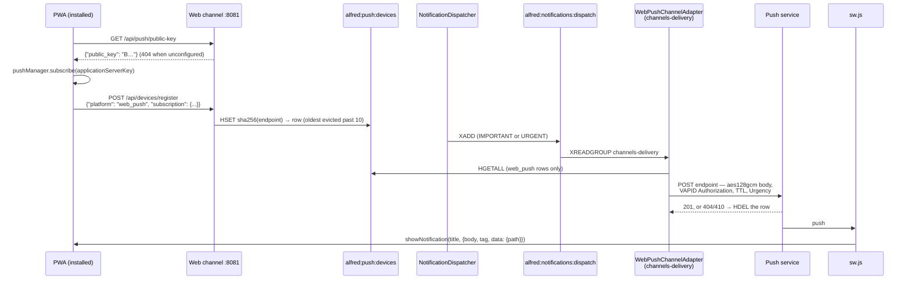

# Web Push

## Overview

Web Push lets Alfred reach the installed PWA when the app is closed: every IMPORTANT and
URGENT notification is encrypted for each subscribed browser and pushed through that
browser's push service (Apple's, Google's, Mozilla's, Microsoft's), which wakes the PWA's
service worker to show it. It sits beside APNs, which keeps serving the native iOS app;
both are channel adapters behind the one dispatcher
([spec §6](superpowers/specs/2026-09-04-mobile-first-pwa-client-design.md)).

The payload is **encrypted end to end** (RFC 8291 `aes128gcm`): the push service relays
ciphertext it cannot read, so Apple's relay never sees a notification's text.

| Piece | Where | What it does |
|---|---|---|
| Device vocabulary | `core/notifications/devices.py` | `WebPushSubscription` (the endpoint allowlist and key checks), `endpoint_field()`, `decode_device()`, `is_web_push()`, `push_host()`, `MAX_WEB_PUSH_SUBSCRIPTIONS` |
| VAPID key | `core/notifications/vapid.py` | `vapid_subject()`, `ensure_vapid_keys()`, `VapidKeys.authorization()` (RFC 8292) |
| Adapter | `core/notifications/adapters/webpush.py` | `WebPushChannelAdapter`: payload, encryption, headers, delivery, pruning |
| Routes | `core/channels/web_server.py` | `POST`/`DELETE /api/devices/register`, `GET /api/push/public-key`, `_init_webpush_adapter()` |
| Admin read | `core/channels/admin_api.py` | `GET /api/admin/devices`, with Web Push rows redacted |
| Worker | `web/public/sw.js` | the `push` and `notificationclick` listeners |
| Client | `web/src/lib/push.ts` | subscribing, launch re-validation, sign-out ([`web-frontend.md`](web-frontend.md)) |

## Architecture



Delivery runs in the channels process, in its `channels-delivery` consumer group of
`alfred:notifications:dispatch` ([`notifications.md`](notifications.md)), beside the
WebSocket, APNs and satellite adapters.

## Startup and the VAPID key

`_init_webpush_adapter(app, pool)` runs in the web channel's lifespan, beside APNs, in its
own `try/except`:

1. **The subject (R4).** `vapid_subject()` reads `WEBPUSH_VAPID_SUBJECT` once per start and
   hands it to the adapter. It is RFC 8292's `sub`, a contact for the push service's
   operator: a `mailto:` or `https:` URI (`mailto:you@example.com`,
   `https://alfred.example.com`). Apple refuses a token without one, and the repo is public,
   so no default ships. Unset, there is no adapter and the public-key route answers 404:
   INFO `Web Push not configured (WEBPUSH_VAPID_SUBJECT unset), skipping adapter`. A value
   with another scheme warns once, naming the variable but never echoing the value, and
   counts as unset.
2. **The key (R5).** `ensure_vapid_keys()` reads the P-256 private key from the keyring
   (`("webpush", "vapid_private_key")`), or on the first start with a subject generates one
   and stores it (INFO `Generated a VAPID key`). The read, the generation and the write run
   under the one keyring lock every process shares (`aget_or_create_secret`), so two first
   callers cannot each store a key. A keyring read that fails **propagates and generates
   nothing**: a new key over one we merely could not read would orphan every subscription.
3. **Registration.** The adapter is built with the pool, the keys and the subject,
   registered as `ChannelRegistry.set_instance("webpush", …)`, and the key's public half
   (87 characters of unpadded base64url) is set on `app.state.vapid_public_key`. INFO
   `Web Push adapter registered`.

Any failure in these steps logs WARNING `Web Push adapter init failed (<type>): …` and
costs Web Push alone: the rest of the channel starts, and the public-key route answers 404.
At shutdown `teardown()` closes the adapter's HTTP client, as it closes APNs'.

**A rotated key heals itself.** Every subscription is bound to the public key it subscribed
with. If the keyring is lost or the key is regenerated, the push services refuse the new
token for every stored subscription (RFC 8292 suggests a 403), the adapter logs a WARNING
per push and keeps the rows (only 404 and 410 prune). At each phone's next launch, the
PWA's re-validation (`syncSubscription()` in `web/src/lib/push.ts`) sees that its
subscription's key differs from the house's, `DELETE`s its old row, unsubscribes and
subscribes again. A phone that never relaunches keeps its dead row until the cap evicts it.
Back up the data dir, which holds the keyring, as for every other credential
([`secrets.md`](secrets.md)).

## Registration

| Method | Path | Gate | Answers |
|---|---|---|---|
| `POST` | `/api/devices/register` | session | `{"status": "ok"}`; 422 for a body that does not validate |
| `DELETE` | `/api/devices/register` | session | `{"status": "ok"}` whether or not the row existed; 422 unless exactly one of `device_token` and `endpoint` |
| `GET` | `/api/push/public-key` | none | `{"public_key": "B…"}`, or 404 `{"detail": "Web Push not configured"}` |

`POST` takes a body discriminated on `platform`:

```json
{"platform": "web_push",
 "subscription": {"endpoint": "https://web.push.apple.com/…", "expirationTime": null,
                  "keys": {"p256dh": "B…", "auth": "…"}}}
```

`subscription` is the browser's `PushSubscription.toJSON()` as it stands; `expirationTime`
is ignored. The APNs body keeps its shape, `{"device_token", "platform": "ios" | "ipados" |
"macos", "identity"}`. Any other `platform` is a 422.

`DELETE` takes `{"endpoint": "…"}` for a Web Push subscription or `{"device_token": "…"}`
for APNs. The endpoint there is not checked against the allowlist: it only names the field
to delete.

**The gate is the session alone** (spec §6.2, the owner's decision of 2026-10-29): both
device routes take `require_authenticated` and not `require_trusted_network`, so a phone
away from home can enable notifications right after it installs the app. The route is
shared, so the APNs payload moved with it. The accepted trade: a stolen session cookie can
register a stranger's endpoint and receive the text of important and urgent notifications.
The allowlist and the cap below bound what it buys, and the row outlives the session, so
the owner looks for unknown rows in `GET /api/admin/devices` (see Operations).

The public key needs no session: it is a public key, and the client fetches it before it
subscribes (spec §6.1).

### The row

One field per subscription in the hash `alfred:push:devices` (`DEVICE_TOKENS_KEY`), beside
the APNs tokens. The field is the SHA-256 hex of the endpoint (`endpoint_field()`), so a
browser that registers again replaces its own row. The value is JSON:

| Field | Value |
|---|---|
| `platform` | `"web_push"` |
| `endpoint` | the push service URL, as validated |
| `keys` | `{"p256dh", "auth"}`, base64url without padding |
| `identity` | `"sir"`: only a signed-in session reaches the route, as with the WebSocket handler |
| `registered_at` | ISO 8601 in UTC, set on every registration |
| `user_agent` | the request's `User-Agent`, cut to 200 characters (`_MAX_USER_AGENT_LEN`) |

### The allowlist (R2)

The endpoint is a URL the house later POSTs to, so it must be on a known push service.
Without the check, any session could make the house send requests to any address on its
LAN. `WebPushSubscription` accepts an endpoint only when it is:

- at most 2048 characters (`MAX_ENDPOINT_LEN`) of visible ASCII;
- `https`, on port 443 or none, with no userinfo;
- on a DNS-name host equal to one of `PUSH_SERVICE_HOSTS` or under it on a label boundary:
  `push.apple.com`, `fcm.googleapis.com`, `push.services.mozilla.com`, `notify.windows.com`
  (`web.push.apple.com` passes, `notpush.apple.com` does not).

`p256dh` must decode to an uncompressed P-256 point and `auth` to 16 bytes; `=` padding is
accepted and stripped. Anything else is a 422. A browser whose push service is not on the
list cannot register until its host is added to `PUSH_SERVICE_HOSTS`.

### The cap (R3)

At most 10 Web Push rows (`MAX_WEB_PUSH_SUBSCRIPTIONS`). Registering a new endpoint while 10
are stored deletes the oldest by `registered_at` first (INFO `Evicted the oldest web push
subscription (<field prefix>…)`), so a reinstalled phone is never locked out behind its own
dead rows, and a stolen cookie cannot buy an unbounded fan-out. Re-registering an endpoint
already stored evicts nothing, and APNs rows never count. The read and the writes are not
one transaction: two registrations at once can leave 11 rows, and the next new one evicts
back down to 10.

### Validation errors

FastAPI's default 422 body echoes the rejected `input` back to the caller who sent it,
which returns the caller's own values to the caller. The app installs no
`RequestValidationError` handler, and none may log `exc.errors()`: those carry the
endpoint and keys.

## Delivery

`WebPushChannelAdapter` (`name = "webpush"`) takes IMPORTANT and URGENT. INFORMATIONAL never
pushes: a push for every informational event would train the owner to ignore the channel.

| Urgency | `Urgency` header | `TTL` |
|---|---|---|
| IMPORTANT | `normal` | `86400` (a day) |
| URGENT | `high` | `3600` (an hour) |

For each notification the adapter reads the hash, keeps the `web_push` rows (the APNs
adapter, in turn, skips them), builds the payload once, and for each subscription in
parallel:

1. encrypts the payload to its `p256dh` and `auth` with `http_ece` (`aes128gcm`), a fresh
   ephemeral P-256 key and a 16-byte random salt per push;
2. POSTs it to the endpoint over an HTTP/2 `httpx` client (10 s timeout) with
   `Authorization: vapid t=<ES256 JWT>, k=<public key>`, `Content-Encoding: aes128gcm`,
   `Content-Type: application/octet-stream`, `TTL` and `Urgency`. The JWT's `aud` is the
   endpoint's origin, so each push service gets a token for itself; `exp` is 12 hours
   ahead (RFC 8292 caps it at 24) and `sub` is the subject.

| Push service answers | The adapter |
|---|---|
| 2xx | INFO `Web push notification sent (<prefix>…, <host>, urgency=…)` |
| 404 or 410 | **prunes**: `HDEL`s the row, INFO `Pruned stale web push subscription <prefix>… (<host>)` |
| anything else | keeps the row, WARNING with the status and at most 200 characters of the response |
| an exception | keeps the row, ERROR with the exception's type only (httpx's messages can quote the URL) |

Browsers rotate and drop endpoints, and a 404 or 410 is permanent, so those two alone prune
(spec §6.1). One failed send never stops another.

### The payload contract with `sw.js`

The plaintext is compact JSON, built by `build_payload()`:

| Field | Value |
|---|---|
| `title` | the notification's title |
| `body` | the notification's body |
| `urgency` | `"important"` or `"urgent"` |
| `id` | the `notification_id` |
| `action_id` | `metadata["pending_action_id"]` when it is a string, else `null` |

It is at most 3072 bytes (`MAX_PAYLOAD_BYTES`): push services refuse an encrypted body over
4096, and `aes128gcm` adds 103. Over it, the body is cut to the longest prefix that fits,
ending in `…`, then the title the same way. The ids are never cut.

The worker (`web/public/sw.js`) reads it on `push` and shows `title` (or `Alfred`) with
`body` (or nothing), tagged by `id` when it is a string. A push it cannot read still shows
`Alfred`: iOS revokes a subscription that receives pushes it does not show. The worker
builds the tap's link itself: `/actions/<action_id>` when `action_id` matches
`^[A-Za-z0-9_-]{1,128}$`, else `/`. The server never names a URL the worker opens. On
`notificationclick` it closes the notification, focuses an open window on its origin and
posts it `{type: "OPEN_PATH", path}`, or opens one at `path` when none is open; a `path`
it would not have built becomes `/`.

A change to a field changes both sides in one branch: `build_payload()` and the worker's
`push` listener. Any byte change to `sw.js` installs a new worker on every phone
([`web-frontend.md`](web-frontend.md), "The service worker").

## Credentials

An endpoint, a `p256dh` or an `auth` value is a credential: anyone holding all three can
push to the browser. None is logged, and no route returns one.

- A log line names the field's first 12 characters and the push host:
  `Registered web push subscription (3f2a9c41b7d0…, host=web.push.apple.com)`.
- `GET /api/admin/devices` shows a Web Push row as `{"device_token": <field[:12]>,
  "platform", "identity", "registered_at", "user_agent", "push_host"}` and nothing else
  ([`admin-api.md`](admin-api.md), "Devices").
- `WebPushSubscription` sets `hide_input_in_errors`, so a `ValidationError`'s message never
  quotes them.

## Operations

**Turning it on.** Set `WEBPUSH_VAPID_SUBJECT` in the deploy `.env`
(`~/code/alfred-deploy/.env` on the CD host) and restart or redeploy:

```bash
WEBPUSH_VAPID_SUBJECT=mailto:you@example.com
```

The first start logs `Generated a VAPID key`, then `Web Push adapter registered`, and
`https://alfred.example.com/api/push/public-key` answers with the key. The PWA's System ›
Reach card then offers `Enable` in the installed app.

**Looking at what is registered.** `GET /api/admin/devices` lists every row with its
`push_host` and the first 12 characters of its field.

**Removing a row you do not recognise.** The admin read gives only the field's prefix, and
the `DELETE` route wants the endpoint, so remove it in Redis:

```bash
docker exec <alfred-container> redis-cli HSCAN alfred:push:devices 0 MATCH '<prefix>*'
docker exec <alfred-container> redis-cli HDEL alfred:push:devices <the full field>
```

| Symptom | Read |
|---|---|
| `/api/push/public-key` is 404 and Reach says Web Push is not set up | `WEBPUSH_VAPID_SUBJECT` is unset or has another scheme (look for `Web Push not configured` or the warning naming the variable), or startup failed (`Web Push adapter init failed`) |
| Registration answers 422 | the endpoint's host is not on `PUSH_SERVICE_HOSTS`, or the keys are malformed |
| Every push logs `Web push delivery failed … 403` | the key changed under live subscriptions: each phone heals at its next launch |
| `Pruned stale web push subscription` | the browser dropped the subscription; the PWA registers a new one at its next launch |
| An INFORMATIONAL notification never arrives | by design: it stays in the app and on Signal |

## Redis keys

| Key | Type | Purpose |
|---|---|---|
| `alfred:push:devices` | Hash | Every push device: APNs tokens by token, Web Push subscriptions by the SHA-256 hex of the endpoint |
